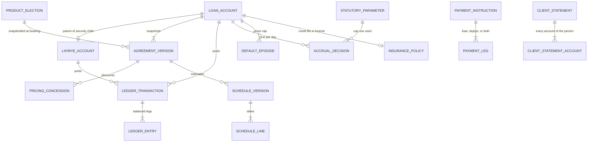

# Account, balance and transaction model

Day-1 ledger for a post-origination, white-label loan management service. Identity, organisations, memberships, product enrolment, roles and mandates stay in Enigma. This service stores Enigma identifiers and the financial facts of each agreement.

This document is the implementation design for the ledger and the account. It defines tables and invariants. It does not implement the calculation engine or servicing workflows.

Locked business decisions are **L1–L9** (decision log 1.2.3 and 1.2.4 are L2). They are fixed in the schema. Statutory caps remain versioned data. Items that still need a business or legal answer before coding the engine are listed in section 10 and are not given a silent default.

Money is integer cents (ZAR). Sub-cent interest is integer micro-cents (1 cent = 1,000,000 micro-cents). No floating point.

Figures cited from the regulations are the text in GN 1080, *Government Gazette* 39379, 6 November 2015, unless a later gazette is loaded into `statutory_parameter`. Checked 27 October 2026 (Africa/Johannesburg).

---

## 1. Locked decisions

### L1. Value date is the system recognition date

`value_date` is the Africa/Johannesburg civil date of `recognised_at`, the timestamp at which the LMS commits the event. Allocation, accrual and reversals all use that date. A caller cannot supply a different value date.

A reversal is a new transaction recognised on its own date. Its legs match the original amounts with the directions swapped, and `reversal_of` points at the original. The original row stays. History for an earlier value date is not rewritten. A correcting accrual is a new transaction recognised today, with `reason = interest_correction`.

Same-day order is recognition order (`recognised_at`, then `id`). The daily interest accrual is the last posting of that value date. A payment recognised today is allocated against interest already recognised on earlier value dates. Today's interest is recognised after that payment and is available to payments recognised on later dates.

A settlement transaction is the exception required by section 125(2)(b): on the settlement's recognition date the engine accrues that day's interest first, then allocates the settlement payment.

### L2. Initiation fee (decisions 1.2.3 and 1.2.4)

`initiation_treatment` is `capitalised` or `separate_fee`.

| Treatment | Decision | Ledger effect | Section 126 tier |
| --- | --- | --- | --- |
| `capitalised` | 1.2.3 | The fee is debited to `principal` on the disbursement value date. `capitalised_initiation_cents` stores the amount for disclosure and the cap test. The `initiation_fee` component stays zero. | Part of the principal debt. Allocated third. |
| `separate_fee` | 1.2.4 | Debit `initiation_fee`, credit income, on the disbursement value date. The amount is due on that date. | A due fee. Allocated second, with the other section 101(1) fees. |

The fee amount, whichever treatment is chosen, must be within regulation 42 Table B and regulation 43(3) (15% of the principal debt). A replacement agreement and a supplemental advance still carry a zero initiation fee (section 101(2), regulation 43(2) and 43(4)).

Capitalising the fee on a short-term or unsecured agreement is stored by the schema and blocked at activation until the legal gate in section 10 is loaded. Section 102(1)(a) allows inclusion in the principal debt for an instalment agreement, a mortgage, a secured loan or a lease, where the consumer was offered the chance to pay the fee separately and declined. That offer-and-decline is stored on the agreement when treatment is `capitalised`.

### L3. Zero rates, zero fees and campaigns

A campaign is a discount off the contractual rate or fee. The charged value is `max(0, contractual − discount)`. A result of 0% or R0 is a normal value for the whole term or for any date range inside the term.

The contractual rate is still capped by regulation 42 Table A. The discount cannot take the charged rate below zero, and it cannot be used to book a contractual rate above the cap. Fee campaigns work the same way against the contractual fee, which itself must sit at or under regulation 44 or Table B.

The annuity formula is not used when the charged rate is zero. The instalment principal is the outstanding principal divided by the number of instalments. Daily interest multiplies by the charged rate, so a zero rate yields a zero amount and posts no interest entry. A zero fee posts no fee entry. No code path divides by the rate.

### L4. Laybye linked to a loan

A security lay-by is a child of exactly one parent loan. The parent is a `loan_account`. The child is a `laybye_account` with `purpose = loan_security` and `parent_loan_account_id` set. One open security lay-by per parent.

The lay-by balance is a liability, `consumer_funds_held`. It is the consumer's property (CPA section 62(1)(a) and section 65). It is not a receivable and it is not negative principal.

**Interest base.** Daily interest is calculated on the net principal:

```
net_principal_cents = max(0, loan.principal_cents − linked.consumer_funds_held_cents)
```

`principal_cents` includes a capitalised initiation fee. It excludes interest and non-capitalised fees. Unpaid interest is not part of the base, so daily accrual does not compound. When the hold exceeds principal, the base is zero and the day's interest is zero.

The section 103(5) ceiling stays the unpaid principal of the loan, the gross principal, snapshotted when default opens. The hold reduces the interest that accrues. It does not reduce that ceiling until the hold is applied as a payment.

**One service fee.** The parent carries the only service fee for the pair. The child accepts no `service_fee` debit. At most one service-fee levy is posted for the pair in a calendar month. Weekly or other instalment frequencies do not create extra service fees. Section 101(1)(c) allows a monthly or an annual service fee on a credit transaction; the pair still has a single schedule for that fee, on the parent.

**Payments across both.** A payment instruction may name legs to the parent, the child, or both. An unnamed receipt is applied entirely to the parent loan. A lay-by increase is an explicit leg. Section 7 states the order.

**Consolidate or settle.** The client operation `consolidate_settle` is available when `consumer_funds_held >= settlement_value` of the parent. It applies the settlement value to the loan through the section 126 order, refunds any surplus hold to the client, and closes both accounts. Below that threshold the operation is rejected. Ordinary legs still work below the threshold.

**Credit life and funeral.** One policy row on the parent. Premiums that are a cost of credit post once, to the parent's `credit_insurance` component, and never on the child.

| Preset | Proceeds | Linked lay-by | Loan after the event |
| --- | --- | --- | --- |
| `credit_life_settles_loan` | Posted to the parent as a payment, section 126 order, capped at the settlement value. Any proceeds above that settlement value are refunded to the estate. | After the proceeds, the hold is applied to any remaining settlement balance, in section 126 order. What remains of the hold is refunded to the estate. | Settled if proceeds plus hold cover the settlement value. Any shortfall stays owing by the estate. |
| `funeral_to_beneficiary` | Paid to `beneficiary_person_id`. If none is stored, paid to the estate. Nothing is posted to the loan. | Unchanged. It remains the parent's security. | Unchanged by the funeral benefit. The estate may later use `consolidate_settle` when the hold covers the settlement value. |

Death is recognised on the value date of the death instruction. Interest accrues through that date before proceeds are allocated. New disbursements on the parent are rejected once death is recognised.

### L5. Day count

The credit provider chooses `actual_actual` or `thirty_360` on the product. The agreement snapshots the choice. New products default to `actual_actual`.

`actual_actual` uses the Actual/Actual ISDA day count for an annual rate: one calendar day's interest is `net_principal × annual_rate / days_in_the_calendar_year of that day` (365 or 366). A monthly short-term rate uses `net_principal × monthly_rate / days_in_that_calendar_month`.

`thirty_360` uses the US NASD 30/360 day count. For dates `d1` then `d2`:

```
if d1.day == 31: d1.day = 30
if d2.day == 31 and d1.day == 30: d2.day = 30
days = 360*(y2−y1) + 30*(m2−m1) + (d2−d1)
```

The weight of calendar day T is `us360(disbursement_date, T) − us360(disbursement_date, T−1)`. Annual interest for that day is `net_principal × annual_rate × weight / 360`. Monthly short-term interest is `net_principal × monthly_rate × weight / 30`. A negative weight fails the accrual. European 30E/360 is not a third option.

*Loan Company v NCR* [2025] ZASCA 40 still applies to both conventions. The sum of day-weights charged from disbursement through the earlier of settlement and contractual end is at most the number of calendar days in that span. A weight that would pass the cap is clipped. A 29-day agreement cannot be charged 30 days of a monthly rate.

The day-count convention sizes interest. It does not move instalment due dates. Due dates follow L9.

### L6. Accrual frequency

Accrual is daily on every active loan, including days on which the charged rate is zero (that day posts nothing). There is one interest `accrual_decision` per loan per value date. The decision records the net principal used, the charged rate, the day weight, the micro-cent amount, and the cents posted.

Whole cents are released from the accumulated micro-cents. The fraction stays in `accrual_remainder`. Over the life of the loan, posted interest cents converted back to micro-cents, plus the remainder, equal the sum of the daily computed micro-cents.

The interest component increases on the value date of the accrual. The next day's base does not include that interest component. Regulation 40's "at most once a month" rule is about adding interest into the deferred amount. This model does not do that. The base stays net principal.

### L7. Statements

A statement is one document per client: the pair `(credit_provider_organisation_id, consumer_person_id)`. It lists every loan and every lay-by of that client that was open at any moment in the period, including a child under its parent, with a client total. There is no per-loan statement table.

### L8. Decision engine and late disbursement

`schedule_origin` is `platform_engine` or `external_engine`. A tenant setting `accept_external_schedules` defaults to false, which forces the platform engine. When the setting is true, an external engine may supply the schedule lines and the quoted terms. The LMS still owns daily accrual, balances, allocation and the section 103(5) counter. An external schedule is rejected when it fails the schedule invariants in section 8.

`quote_date` and the disbursement `value_date` are both stored. When disbursement is recognised on the quote date, the quoted schedule is the first active schedule. When disbursement is recognised later, the agreement's `disbursement_adjustment` chooses one of:

| Policy | Behaviour |
| --- | --- |
| `recalculate_instalment` | Contractual end date stays the quoted end date. Due dates are the quoted due dates that fall after the disbursement value date. If none remain, one instalment falls on the contractual end date. Instalment amounts are recomputed from the actual principal, the charged rate, the day count, and that remaining term. A zero charged rate divides principal by the number of remaining instalments. |
| `keep_instalment` | The quoted instalment amounts and the contractual end date stay. Interest starts on the disbursement value date, so the interest actually accrued is lower. If payments then clear the balance before the last instalment, the account settles early through the ordinary settlement path. |

At the contractual end date, under `keep_instalment` only: if the account is not in default and `0 < customer_owes <= residual_write_off_cap_cents`, the LMS posts a `residual_write_off`. If the account is in default, no write-off is posted and the balance stays collectable. If the residual exceeds the cap, no write-off is posted. If the cap is null, no write-off is posted. The cap amount is still an open business number (section 10). The transaction kind and the rule are fixed.

No interest is accrued on a value date before the disbursement value date.

### L9. Payment frequencies

`payment_frequency` is one of `weekly`, `fortnightly`, `monthly`, `quarterly`, `bi_annual`, `annual`.

The anchor is `first_due_on`. Due date *k* (from zero) is the anchor plus *k* periods, clamped, not chained from the previous clamped date.

| Frequency | Step |
| --- | --- |
| `weekly` | 7 calendar days |
| `fortnightly` | 14 calendar days |
| `monthly` | 1 calendar month |
| `quarterly` | 3 calendar months |
| `bi_annual` | 6 calendar months |
| `annual` | 12 calendar months |

Month steps keep the anchor's day of month. When that day does not exist in the target month, the due date is the last day of that month. An anchor of 31 January yields 28 February in a non-leap year, then 31 March, then 30 April.

---

## 2. Statutory rules the locks do not switch off

These stay hard checks. Parameter rows carry the citation and the effective dates. A missing row for the value date fails the post.

Section 101(1) is the closed list of what a consumer can owe: principal, initiation fee, service fee, interest, credit insurance, default administration, collection costs. Section 100 forbids anything else and forbids amounts above the permitted maximum. A campaign may reduce a charge to zero. It may not add a charge the section does not list.

Section 126(3) allocation on a loan leg, in order:

1. Due or unpaid interest.
2. Due or unpaid fees and charges. Within this tier, the oldest due date is satisfied first. On the same due date the order is section 101(1)(b), then (c), then (e), then (f), then (g): initiation (when it is a separate fee), service fee, credit insurance, default administration, collection costs.
3. Principal, which includes a capitalised initiation fee.

A non-capitalised initiation fee is due from the disbursement value date, so it sits in tier 2 from that date. A capitalised initiation fee sits in tier 3.

Section 125 settlement value is unpaid principal, plus unpaid interest and other fees payable up to the settlement date, plus an early-termination charge only when the agreement is large. The lay-by hold is not subtracted inside that figure. `consolidate_settle` compares the hold with this figure and then pays it.

Section 103(5), as construed in *National Credit Regulator v Nedbank* [2011] ZASCA 35: section 101(1)(b) to (g) amounts that accrue while the consumer is in default may not, in aggregate, exceed the unpaid principal at the time default occurred. The counter is gross. A payment does not reduce it. Suppressed amounts are an `accrual_decision` with a reason and never a receivable. The episode boundaries (what falls inside the opening day, which charge takes the last rand of room, when a cured default opens a new ceiling) are still open in section 10. The columns for the ceiling and the counter exist so the engine can be coded once those three answers are signed. Until they are signed, the duplum clip is not activated; accruals post in full and each decision is stamped `duplum_policy = unsigned`. That is a deliberate fail-visible state, not a guess at the clip.

Section 103(1): interest in default uses the same charged rate as the principal. There is no penalty rate.

Regulation 46 and regulation 47: default administration is the registered-letter tariff plus necessary delivery cost, and only for a letter. Collection costs are the external cost actually incurred, limited to the applicable court or debt-collector tariff. Both reference an external document id.

Juristic consumers stay out of Day-1 booking (section 4 and section 6). `consumer_person_id` is required.

A zero-cost BNPL or a CPA lay-by that is not security for a loan has a `laybye_account` with a null parent and no loan. CPA regulation 34 caps a cancellation penalty at 1% of the price, and section 62(5) bars the penalty on death, hospitalisation, or missing disclosure. Incidental credit under section 5 stays off unless `incidental_charges_enabled` is set on the product. That flag ships false.

---

## 3. What is owed

For a loan:

```
customer_owes
  = principal
  + interest
  + initiation_fee          -- zero when L2 treatment is capitalised
  + service_fee
  + credit_insurance
  + default_admin
  + collection_cost
  − unapplied_credit

net_principal = max(0, principal − linked_laybye.consumer_funds_held)

settlement_value
  = principal
  + interest recognised through the settlement value date
  + fees payable through that date
  + early_termination_charge    -- only if agreement_size = large

arrears = max(0, fallen_due(value_date) − satisfied(value_date))
```

`fallen_due` sums schedule portions and fee levies whose due date is on or before the value date, excluding suppressed amounts. `satisfied` sums allocations with `value_date` on or before that date. Arrears are this comparison. They are not a component and they are not a row in the ledger.

`unapplied_credit` is a liability on the loan. It exists only when every receivable component is zero and a payment remainder is left. It is refundable.

The linked lay-by's `consumer_funds_held` is outside `customer_owes`. A client-level amount owed, used on the statement, is the sum of `customer_owes` across the client's loans. Holds are shown beside that sum and are not deducted from it. The statement also shows net principal per linked pair, because that is the interest base.

---

## 4. Entity relationship



Enigma ids on the financial rows are `credit_provider_organisation_id`, `consumer_person_id`, `product_enrolment_id`, `mandate_ref`, and optionally `beneficiary_person_id`. The LMS does not store a person or organisation table. Row-level security on every financial table is:

```sql
using (credit_provider_organisation_id = current_setting('app.organisation_id')::uuid)
```

Child foreign keys include the organisation id, so a row cannot point at another tenant's account.

---

## 5. Table designs

Aurora PostgreSQL. Append-only, enforced by trigger: `agreement_version`, `pricing_concession`, `schedule_version`, `schedule_line`, `ledger_transaction`, `ledger_entry`, `accrual_decision`, `default_episode`, `default_episode_event`, `settlement_quote`, `insurance_policy`, `payment_instruction`, `payment_leg`. Status flags that must change are projected from an append-only event row; the mutable column is a cache of the latest event.

`value_date` on every financial fact:

```sql
value_date date not null,
recognised_at timestamptz not null,
constraint value_date_is_recognition
  check (value_date = (recognised_at at time zone 'Africa/Johannesburg')::date)
```

### 5.1 `product_election`

The credit provider's choices for a product. Copied onto `agreement_version` at booking. Later edits do not change booked agreements.

| Column | Type | Notes |
| --- | --- | --- |
| `credit_provider_organisation_id` | uuid | Enigma organisation |
| `product_code` | text | |
| `effective_from` | date | Part of the primary key. A later row does not change booked agreements |
| `agreement_kind` | text | `short_term`, `short_term_secured`, `unsecured_personal`, `layby_cpa`, `bnpl_zero` |
| `day_count` | text | `actual_actual` (default for new products) or `thirty_360` |
| `rate_basis` | text | `annual` or `monthly`. Short-term and incidental are `monthly` |
| `nominal_interest_ppm` | bigint | Contractual rate before any campaign. 5% = 50000. Zero allowed |
| `initiation_treatment` | text | `capitalised` or `separate_fee` |
| `initiation_fee_cents` | bigint | Contractual fee before any campaign. Zero allowed |
| `service_fee_cents` | bigint | Contractual monthly or annual fee. Zero allowed. Levied on the parent only |
| `service_fee_period` | text | `monthly` or `annual` |
| `payment_frequency` | text | L9 enum |
| `disbursement_adjustment` | text | `recalculate_instalment` or `keep_instalment` |
| `accept_external_schedules` | boolean | Default false |
| `residual_write_off_cap_cents` | bigint null | Null disables the L8 write-off |
| `incidental_charges_enabled` | boolean | Default false |

Primary key `(credit_provider_organisation_id, product_code, effective_from)`.

### 5.2 `statutory_parameter`

Unchanged in role. One row per rule per effective interval: interest cap, initiation cap, service-fee cap, default-admin tariff, collection tariff, short-term amount and term thresholds, agreement-size threshold, lay-by penalty cap, and `initiation_capitalisation_permitted` per `agreement_kind`. `formula jsonb`, `citation text not null`, `effective_from`, `effective_to`. Insert fails when `citation` is blank.

### 5.3 `reference_rate_observation`

`rate_code` (`SARB_REPO`), `effective_from`, `ppm`, `source`. An RR-plus accrual on a value date with no row fails.

### 5.4 `loan_account`

| Column | Type | Notes |
| --- | --- | --- |
| `id` | uuid | |
| `credit_provider_organisation_id` | uuid | Immutable |
| `consumer_person_id` | uuid | Enigma person. Required |
| `product_code` | text | |
| `currency` | char(3) | Check `ZAR` |
| `status` | text | Cache of the latest `account_event`: `pending`, `active`, `settled`, `written_off`, `cancelled` |
| `opened_on` | date | Disbursement value date |

No balance columns. Primary key `(credit_provider_organisation_id, id)`.

### 5.5 `laybye_account`

| Column | Type | Notes |
| --- | --- | --- |
| `id` | uuid | |
| `credit_provider_organisation_id` | uuid | Same as the parent when linked |
| `consumer_person_id` | uuid | Same person as the parent when linked |
| `parent_loan_account_id` | uuid null | Required when `purpose = loan_security`. Null for a standalone CPA lay-by or zero-cost BNPL |
| `purpose` | text | `loan_security`, `cpa_layby`, `bnpl_price` |
| `price_cents` | bigint null | CPA or BNPL price. Null for a pure cash security |
| `penalty_disclosed_cents` | bigint null | Must be ≤ 1% of `price_cents` when set |
| `anticipated_completion_on` | date null | CPA section 62 |
| `closed_on` | date null | |

```sql
create unique index one_open_security_laybye
  on laybye_account (credit_provider_organisation_id, parent_loan_account_id)
  where purpose = 'loan_security' and closed_on is null;
```

A check constraint rejects `purpose = loan_security` when `parent_loan_account_id` is null, and rejects a parent whose organisation id differs.

### 5.6 `agreement_version`

Immutable snapshot. Version 1 is booking. A later version is a section 116/117 change, a supplemental advance, or a late-disbursement adjustment. Partial unique index: one row per loan with `state = active`.

Columns: `loan_account_id`, `version int`, `state`, `agreement_kind`, `agreement_size`, `replaces_loan_account_id`, `product_enrolment_id`, `quotation_ref`, `quote_date`, `day_count`, `rate_basis`, `nominal_interest_ppm`, `initiation_treatment`, `initiation_fee_cents`, `capitalised_initiation_cents`, `initiation_offer_declined boolean`, `service_fee_cents`, `service_fee_period`, `payment_frequency`, `first_due_on`, `contractual_end`, `schedule_origin`, `disbursement_adjustment`, `signed_on`, `s117_deliver_by`, `reason`.

`accrual_frequency` is not a column. The table comment and a check on `accrual_decision` fix it as daily.

### 5.7 `pricing_concession`

A campaign. Append-only.

| Column | Type | Notes |
| --- | --- | --- |
| `loan_account_id` | uuid | The parent. A concession is never attached to the child |
| `kind` | text | `interest`, `service_fee`, `initiation_fee` |
| `valid_from` | date | Inclusive |
| `valid_to` | date | Exclusive. The range may be the whole term or a portion |
| `discount_ppm` | bigint null | For `interest`. Charged ppm = `max(0, nominal_interest_ppm − discount_ppm)` |
| `discount_cents` | bigint null | For a fee. Charged cents = `max(0, contractual_cents − discount_cents)` |
| `campaign_code` | text | |

An exclusion constraint rejects two concessions of the same kind on the same loan with overlapping `[valid_from, valid_to)`.

### 5.8 `schedule_version` and `schedule_line`

| `schedule_version` column | Notes |
| --- | --- |
| `origin` | `platform_engine` or `external_engine` |
| `adjustment` | `none`, `recalculate_instalment`, `keep_instalment` |
| `quote_date` | |
| `disbursement_value_date` | |
| `frequency` | L9 enum |
| `day_count` | Copied from the agreement |
| `regular_instalment_cents` | Level instalment. Null when the external schedule is not level |
| `principal_assumption_cents` | The principal the lines amortise |

`schedule_line`: `sequence`, `due_on`, `principal_cents`, `interest_cents`, `service_fee_cents`. Interest on the line is an estimate. Creating the line posts nothing. The sum of `principal_cents` equals `principal_assumption_cents`. Every `due_on` is on or before `contractual_end` and is produced by the L9 step rule from `first_due_on`, except a single balloon created by `recalculate_instalment` when no quoted date remains.

### 5.9 `ledger_transaction` and `ledger_entry`

```sql
ledger_transaction (
  id uuid,
  credit_provider_organisation_id uuid,
  loan_account_id uuid null,
  laybye_account_id uuid null,
  kind text,
  value_date date,
  recognised_at timestamptz,
  idempotency_key text,
  correlation_id uuid,
  reversal_of uuid null,
  mandate_ref uuid null,
  external_ref text null,
  reason text null,
  primary key (credit_provider_organisation_id, id),
  unique (credit_provider_organisation_id, idempotency_key)
)

ledger_entry (
  id uuid,
  transaction_id uuid,
  credit_provider_organisation_id uuid,
  account_kind text,             -- loan | laybye | clearing | income | expense
  account_id uuid,
  component text,
  direction text,                -- debit | credit
  amount_cents bigint,           -- check (amount_cents > 0)
  primary key (credit_provider_organisation_id, id)
)
```

`kind` is one of: `disbursement`, `initiation_fee`, `interest_debit`, `service_fee_debit`, `insurance_debit`, `default_admin_debit`, `collection_cost_debit`, `payment`, `laybye_receipt`, `laybye_refund`, `consolidate_settle`, `insurance_proceeds`, `funeral_payout`, `settlement`, `residual_write_off`, `write_off`, `cpa_penalty`, `reversal`, `interest_correction`.

A transaction balances: debit cents equal credit cents. At least one of `loan_account_id` and `laybye_account_id` is set. A `service_fee_debit` with a lay-by id and a null loan id is rejected. A `service_fee_debit` whose loan has a linked lay-by is still posted on the loan.

Component codes on a loan receivable: `principal`, `interest`, `initiation_fee`, `service_fee`, `credit_insurance`, `default_admin`, `collection_cost`. Liability codes: `unapplied_credit`, `consumer_funds_held`. Plus `clearing`, `income`, `write_off_expense`.

### 5.10 `accrual_decision` and `accrual_remainder`

One interest decision per `(loan_account_id, value_date)`.

| Column | Notes |
| --- | --- |
| `net_principal_cents` | The L4 base used for this day |
| `gross_principal_cents` | Stored so the duplum ceiling can be audited beside the base |
| `charged_ppm` | After the campaign. Zero is valid |
| `day_weight_ppm` | Actual/actual weight, or the 30/360 weight, scaled so the formula stays in integers |
| `computed_micro` | Exact daily amount, zero when the charged rate is zero |
| `posted_cents` | Whole cents released today |
| `duplum_policy` | `unsigned`, `posted`, or `suppressed` |
| `ledger_transaction_id` | Null when `posted_cents = 0` |

`accrual_remainder` is one mutable row per loan: `residual_micro bigint`. It is the only mutable financial amount, and it is a cache of the unposted fraction. Deleting and replaying decisions rebuilds it.

### 5.11 `default_episode`

Inserted when arrears move from zero to positive. `opened_on`, `principal_ceiling_cents` (gross unpaid principal, including capitalised initiation, not reduced by the lay-by), `gross_counter_cents` as a rebuildable cache. Closing inserts `default_episode_event (kind = closed)`. The counter cache is unused for clipping while `duplum_policy = unsigned`.

### 5.12 `payment_instruction` and `payment_leg`

The instruction is the inbound fact. Legs are the split across accounts. Both are append-only; posting status is an event.

```sql
payment_instruction (
  id uuid,
  credit_provider_organisation_id uuid,
  consumer_person_id uuid,
  amount_cents bigint,
  currency char(3),
  value_date date,
  recognised_at timestamptz,
  rail_event_id text,
  unique (credit_provider_organisation_id, rail, rail_event_id)
)

payment_leg (
  instruction_id uuid,
  loan_account_id uuid null,
  laybye_account_id uuid null,
  amount_cents bigint,
  check ((loan_account_id is null) <> (laybye_account_id is null))
)
```

The sum of leg amounts equals the instruction amount. Zero legs means the whole amount is one implicit leg to the client's open parent loan. If the client has more than one open loan and no legs, the instruction is rejected rather than split by a guess.

### 5.13 `settlement_quote`

Append-only. `loan_account_id`, `settlement_date`, principal, interest, each fee component, `early_termination_cents`, `total_cents`, `linked_hold_cents`, `consolidate_available boolean` (`linked_hold_cents >= total_cents`). The quote does not post. A later payment allocates against the ledger as it stands at recognition.

### 5.14 `insurance_policy`

| Column | Notes |
| --- | --- |
| `loan_account_id` | The parent. Unique while open |
| `cover_kind` | `credit_life` or `funeral` |
| `proceeds_preset` | `credit_life_settles_loan` or `funeral_to_beneficiary`. Must match `cover_kind` |
| `counts_as_credit_cost` | When true, premiums debit `credit_insurance` on the parent |
| `beneficiary_person_id` | Enigma person. Required for a funeral preset before the policy can activate |
| `premium_cents` | Zero allowed |
| `premium_frequency` | L9 enum |

### 5.15 `client_statement` and `client_statement_account`

| Header | One row per `(credit_provider_organisation_id, consumer_person_id, period_from, period_to)` |
| --- | --- |
| Line | `loan_account_id` or `laybye_account_id`, opening and closing component totals, interest accrued in the period, payments in the period |

The header carries `client_owes_closing_cents`, the sum of loan `customer_owes`, and `client_holds_closing_cents`, the sum of lay-by liabilities. Building a statement is a read of the ledger. This design does not define delivery.

### 5.16 `balance_snapshot`

Cache. Primary key `(organisation_id, account_kind, account_id, value_date, component)`. A snapshot is stale, and must not be read, when a transaction for that account exists with `value_date <= snapshot.value_date` and `recognised_at > snapshot.built_at`. The source of truth is the sum of entries with `value_date` on or before the date.

---

## 6. How a payment allocates when a lay-by is linked

Recognition order on the value date:

1. Explicit lay-by legs post `laybye_receipt`. Debit clearing, credit `consumer_funds_held`. The loan receivables do not move. Net principal for the end-of-day accrual falls by the receipt.
2. Loan legs, and any implicit parent leg, post `payment` on the loan. Section 126 order, using amounts already recognised before this transaction. Capitalised initiation is inside principal. A separate initiation fee is a fee.
3. After the last cash event of the date, one interest accrual runs on the closing net principal and the charged rate for that date.

`consolidate_settle` is not a cash instruction. It is available only when the hold is at least the settlement value. One `correlation_id` covers three balanced transactions: a section 126 payment on the loan funded by a debit to `consumer_funds_held` for the settlement value, a `laybye_refund` of any surplus hold, and the close events. The loan payment inside it follows the same section 126 order.

Credit-life proceeds are a loan payment with `kind = insurance_proceeds`, same section 126 order, capped at the settlement value recognised that day (accrual for that day runs first, as for settlement). The lay-by is then applied to whatever settlement balance remains. Surplus hold and surplus proceeds are refunded to the estate. A funeral payout debits clearing and credits a beneficiary-payable clearing account. It has no loan leg and no lay-by leg.

### Worked allocation

Parent disbursed 1 March. Cash principal R1,000.00. Initiation fee R150.00, treatment `separate_fee`, due 1 March. R150.00 is the regulation 43(3) cap of 15% of that principal; Table B on R1,000.00 is R165.00, so the 15% cap is the one that binds. Child lay-by funded R400.00 on 1 March. Charged rate 5% per month, `actual_actual`, March has 31 days. No campaign. Net principal on 1–14 March is R600.00. A full month of interest on R600.00 at 5% is R30.00. Each day is `R30.00 / 31`.

After 14 days the posted interest is R13.54. The remaining fraction of a cent stays in `accrual_remainder` and is not yet a receivable.

On 15 March a R500.00 instruction is recognised with two legs: R200.00 to the lay-by, R300.00 to the loan.

| Step | Account | Effect |
| --- | ---: | --- |
| Lay-by leg R200.00 | Child | `consumer_funds_held` R400.00 → R600.00 |
| Loan leg, interest | Parent | R13.54 clears the posted interest |
| Loan leg, fees | Parent | R150.00 clears the initiation fee |
| Loan leg, principal | Parent | R136.46 reduces principal to R863.54 |
| End-of-day accrual | Parent | Base is `max(0, 863.54 − 600.00) = R263.54`. The day's interest is `263.54 × 0.05 / 31` |

The service fee, if the contractual fee is R60.00, is levied once on the parent at month-end. The child has no service-fee transaction. A campaign with `discount_ppm = 50000` on this term sets the charged rate to 0. The daily computed amount is 0, no interest row is posted, and four weekly instalments on a R1,000.00 principal are R250.00 each.

### Consolidate

At a later date the parent owes principal R200.00, interest R10.00 and a service fee R60.00. Settlement value R270.00. The child holds R300.00. `consolidate_settle` posts:

| Leg | Amount | Section 126 tier |
| --- | ---: | --- |
| Interest | R10.00 | First |
| Service fee | R60.00 | Second |
| Principal | R200.00 | Third |
| Lay-by refund | R30.00 | Surplus hold, returned to the client |

Both balances are zero. The loan is `settled`. The lay-by `closed_on` is that value date.

If the hold were R200.00, the operation would be rejected. The client could still pay the loan by a loan leg, or increase the hold by a lay-by leg.

### Credit life and funeral on these balances

Settlement value R270.00, hold R100.00, credit-life proceeds R150.00.

1. Proceeds allocate interest R10.00, service fee R60.00, principal R80.00. Principal left R120.00.
2. The hold of R100.00 then allocates to that principal. Principal left R20.00. Hold left R0.00.
3. The estate owes the remaining R20.00. No funeral-style payment to a beneficiary occurs.

The same balances with a funeral preset and a R10,000.00 benefit: the beneficiary is paid R10,000.00, the loan stays at R270.00, and the hold stays at R100.00.

---

## 7. Other posting rules the tables have to support

**Booking.** Resolve organisation, person, enrolment and mandate in Enigma. Snapshot `product_election` into `agreement_version` 1. Reject a null L5, L8 or L9 choice. Reject a contractual rate or fee above the parameter. Allow zero. Post `disbursement` for the cash principal. If treatment is `capitalised` and the legal gate permits it, the principal debit includes `capitalised_initiation_cents`. If treatment is `separate_fee` and the charged fee is above zero, post `initiation_fee`. Open the child lay-by when the product kind is `short_term_secured`.

**Schedule.** Platform origin builds lines from the frequency rule, the day count and the charged rate, including the zero-rate division by instalment count. External origin inserts the supplied lines and then runs the same invariants. Late disbursement applies L8 before the schedule becomes active. A prepayment or a campaign change inserts a new `schedule_version` for the remaining estimates. Past lines and posted entries stay.

**Top-up.** A supplemental advance is a new agreement version and a `disbursement` on the same loan. Initiation fee amount is zero. A replacement is a new loan whose disbursement funds a section 126 payment of the old loan, initiation fee zero. Neither moves interest or fees into principal. A top-up that would take a short-term agreement outside the R8,000 or six-month parameter fails the transaction.

**Restructure.** A new agreement version and a new schedule. No ledger movement unless cash moves. No fee kind exists for it.

**Residual write-off.** Only the L8 `keep_instalment` path, only on the contractual end value date, only when the account is not in default, only within the cap.

**Backdated rail files.** The value date is the recognition date of the file, including when the rail's own timestamp was the previous civil day. Section 126(3) speaks of the date of receipt. L1 is the locked operational rule. Counsel's acceptance of that gap is recorded in section 10; the schema does not carry a second date.

---

## 8. Invariants

A posting transaction that would break one of these rolls back. A nightly rebuild reports any breach it finds.

**Scope and identity**

1. Every financial row has `credit_provider_organisation_id`, and every child foreign key includes it.
2. `value_date` equals the Africa/Johannesburg civil date of `recognised_at`.
3. A loan has `consumer_person_id` and no juristic consumer.
4. `currency = ZAR`.
5. A `loan_security` lay-by has a parent loan in the same organisation, for the same person, and it is the only open security lay-by of that parent.

**Closed list and campaigns**

6. Loan receivable components are only the seven section 101 codes.
7. Charged interest ppm equals `max(0, nominal_interest_ppm − discount_ppm)` and is ≤ the Table A parameter. Charged fees equal `max(0, contractual − discount)` and are ≤ the fee parameter.
8. A zero charged rate and a zero charged fee insert no ledger entry with that component.
9. No formula divides by the charged rate.
10. `initiation_treatment = capitalised` implies the `initiation_fee` balance is zero and `capitalised_initiation_cents` is included in the principal balance. `separate_fee` implies `capitalised_initiation_cents = 0` and the fee, when non-zero, is an `initiation_fee` balance due from the disbursement value date.
11. A replacement or a supplemental advance has no initiation amount.
12. Short-term and unsecured agreements cannot become active with `initiation_treatment = capitalised` unless `initiation_capitalisation_permitted` is true for that kind and value date.

**Net interest and the single fee**

13. Each interest `accrual_decision.net_principal_cents` equals `max(0, gross principal − linked consumer_funds_held)` as at the recognition instant before that accrual, and the accrual is the last financial fact of its value date other than a settlement or insurance-proceeds transaction, which accrues first.
14. There is at most one interest `accrual_decision` per loan per value date, and none on a lay-by.
15. The interest base of a day does not include the interest component.
16. No `service_fee` entry is posted on a lay-by. A parent and its linked child together have at most one `service_fee_debit` in a calendar month.
17. Credit-insurance premiums post on the parent only.

**Lay-by and allocation**

18. `consumer_funds_held >= 0`. Each loan receivable component is `>= 0`. `unapplied_credit >= 0`, and it is positive only when every receivable component is zero.
19. A loan payment's cents to principal are zero whenever due interest or due fees remain unpaid after that payment.
20. A separate initiation fee is allocated in the fee tier. A capitalised initiation fee is allocated in the principal tier.
21. An instruction with no legs posts to one open parent loan of that client. Zero or several open parent loans reject the instruction.
22. `consolidate_settle` is inserted only when `consumer_funds_held >= settlement_value` immediately before it, and the loan leg of that correlation equals the settlement value and obeys invariant 19.
23. A funeral payout has no loan entry and no lay-by entry. A credit-life proceeds entry is a loan payment capped at the settlement value, followed by a lay-by application to any remainder and a refund of what is left to the estate.

**Day count, frequency, disbursement**

24. `day_count` is `actual_actual` or `thirty_360`.
25. The sum of day-weights from disbursement through the earlier of settlement and contractual end is ≤ the number of calendar days in that span.
26. No interest `accrual_decision` has a value date before the disbursement value date.
27. `payment_frequency` is one of the six L9 values, and each schedule due date matches the anchor-plus-period rule.
28. Schedule principal portions sum to the schedule's principal assumption.
29. `accept_external_schedules = false` rejects `schedule_origin = external_engine`.
30. A `residual_write_off` exists only for `keep_instalment`, only on the contractual end value date, only when no default episode is open, and only for an amount ≤ `residual_write_off_cap_cents`. A null cap means the write-off is absent.

**Duplum columns, while the policy remains unsigned**

31. `principal_ceiling_cents` on an episode equals the gross unpaid principal when the episode opened, and no later hold or payment updates that stored ceiling.
32. While every decision on the loan has `duplum_policy = unsigned`, the clip does not change `posted_cents`. A future signed policy may set `suppressed` only by inserting new decisions, not by updating old ones.

**Ledger mechanics**

33. Debit cents equal credit cents on every transaction.
34. Updating or deleting an append-only row fails.
35. A reversal's component amounts equal the original, directions swapped, `reversal_of` set, and its own `value_date` is its own recognition date.
36. `(organisation, idempotency_key)` is unique.
37. A client statement header is unique on organisation, person and period. Its lines cover every loan and lay-by of that person open during the period. No statement table is keyed by a single loan.

---

## 9. What changed from the unsigned draft

| Earlier item | Now |
| --- | --- |
| Value date was the rail receipt date, with backdated replay | L1. Recognition date. No replay of an earlier value date |
| Initiation fee kept out of principal for short-term and unsecured | L2. Treatment is an election. Activation of `capitalised` on those kinds waits on the legal gate |
| Interest base was unpaid principal, hold ignored until applied | L4. Daily interest uses net principal. The duplum ceiling still uses gross principal |
| Hold application was a general section 124 debit | Living client applies the hold only through `consolidate_settle` once the hold covers the settlement value. Credit life applies it on death as defined in L4 |
| Day count was "30 or actual" as a regulation quote | L5. Provider chooses `actual_actual` (default) or `thirty_360` |
| Accrual could be folded on the debit date | L6. Daily |
| Statements were left to a later design | L7. One statement per client |
| Schedules were platform-built only | L8. Platform engine forced until the tenant accepts external schedules. Two late-disbursement policies |
| Frequencies were unspecified | L9. Six frequencies |

---

## 10. Open points before coding the engine

The tables in section 5 can be migrated with these unresolved. The behaviour each one controls must stay disabled until the answer is loaded. None of them reopen L1–L9.

| # | Question | What stays disabled |
| --- | --- | --- |
| O1 | May `short_term` and `unsecured_personal` use `initiation_treatment = capitalised`? Section 102(1)(a) lists instalment agreements, mortgages, secured loans and leases. `short_term_secured` may fall inside "secured loan" if counsel classifies it that way. | `initiation_capitalisation_permitted` stays false for a kind, and activation with `capitalised` fails for that kind |
| O2 | What is `residual_write_off_cap_cents`? | The write-off transaction is never posted. `keep_instalment` still keeps the instalment and still settles early when payments clear the balance |
| O3 | Is a funeral premium a section 101(1)(e) credit-insurance cost, or a policy outside the credit agreement? | `counts_as_credit_cost` stays false, so no funeral premium is debited to the loan. The payout preset itself is defined |
| O4 | Does the credit-life lay-by application on death need a section 124 authorisation signed in life, or is the L4 preset enough? | Death processing can be switched on only after this answer. The transaction shapes are already defined |
| O5 | Section 103(5) episode edges. Which charges on the opening day count toward the gross counter? Which component takes the last rand of room? When a cured default opens a new ceiling? *Nedbank* decides the gross counter and that a payment does not refill it. It does not decide these three edges | `duplum_policy` stays `unsigned` and the clip does not run |
| O6 | On a settlement before the service-fee levy date, is that month's service fee inside the section 125 total? Regulation 41(2) levies a monthly fee at month-end. Regulation 44(4) pro-rates the opening month and does not mention the closing month | Settlement quotes for a date before the levy date are not issued |
| O7 | The pro-rata fraction for a service fee in the month the agreement is concluded (regulation 44(4) requires pro rata and does not define the numerator) | A monthly service fee posts only when the conclusion value date is the first of the month, or when the fee is zero |
| O8 | Counsel acceptance that a rail file recognised on the next civil day is credited on the recognition date (L1), which can differ from the date of receipt in section 126(3) | No schema change. This is a compliance acceptance, not a second date field |
| O9 | Whether holding the linked lay-by cash is deposit-taking under the Banks Act. The ledger already records a liability either way | `short_term_secured` and any other product that holds cash stay inactive |

---

## 11. Out of scope for this design

The calculation engine, statement delivery, section 129 notices, origination, debt-review workflow, and Enigma itself are out of scope. The ledger stores `quotation_ref`, `product_enrolment_id`, `mandate_ref`, `s117_deliver_by`, and external letter and cost ids so those workflows can post into these tables later.

The model does not post a charge outside section 101, does not keep an arrears component, does not apply the common-law in-duplum rule, does not move arrears into principal on a restructure or a top-up, and does not hard-code a cap.
