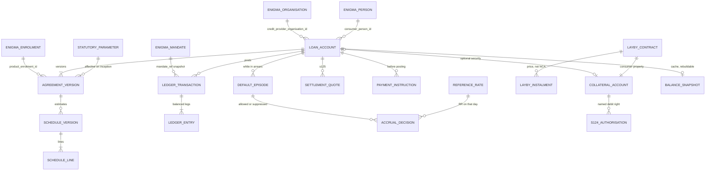

# Account, balance and transaction model

Day-1 ledger for a post-origination, white-label loan management service. Identity, organisations, memberships, product enrolment, roles and mandates stay in Enigma. This service stores Enigma identifiers and the financial facts of each agreement.

This is an engineering model constrained by the National Credit Act 34 of 2005 (NCA) and, for zero-cost lay-bys, the Consumer Protection Act 68 of 2008 (CPA). It is not a legal opinion. Where the Act does not choose, the choice is numbered (`D1`, `D2`, …), given options and a worked example, and left unset on the agreement until credit-law sign-off. An account cannot be activated while a required choice is unset.

Figures cited from the regulations are the text published in the amendments this design was checked against (principally GN 1080, *Government Gazette* 39379, 6 November 2015). They are rows in `statutory_parameter`, not constants in code. A later gazette supersedes them without a schema change. Checked 26 October 2026 (Africa/Johannesburg). The August 2025 draft regulations found while checking were about credit-information originators and were withdrawn; they are not a fee amendment.

Money is integer cents (ZAR). Sub-cent interest is integer micro-cents (1 cent = 1,000,000 micro-cents). No floating point.

---

## 1. Decisions the schema is built around

1. **Seven receivable components, not four buckets.** Section 101(1) is a closed list. The consumer balance is principal, interest, initiation fee, service fee, credit insurance, default administration, and collection costs. "Fees" is a view over the five fee components. "Arrears" is not a component.

2. **Arrears is a comparison, not a stock of money.** Moving a rand into an arrears bucket would count it twice. Arrears is `amounts that have fallen due` minus `amounts already satisfied`, as at a value date. Default, for the section 103(5) cap, is the continuous period in which that difference is positive.

3. **The ledger is append-only and double-entry.** A mistake is a reversing transaction plus a new transaction. Value date (civil date of receipt in Africa/Johannesburg) is not the same fact as `posted_at`. Section 126(3) credits a payment as of the date of receipt.

4. **A hold is a liability to the consumer, never a reduction of principal.** Cash held under a lay-by or as security remains the consumer's property (CPA s62(1)(a) and s65). It reduces the loan only when it is applied as a payment, and that payment runs through the section 126 waterfall. Section 124 sets the conditions for that debit.

5. **Caps, thresholds and tariffs are versioned data with a citation.** The posting service refuses to accrue, quote or activate if the parameter row for that date is missing. It does not fall back to a number compiled into the service.

6. **A schedule is an estimate of future dues. The ledger is what is owed.** Prepayments, rate changes and the in-duplum cap make the original schedule wrong. Past schedule rows are kept. A new schedule version is written. Already-posted entries are not rewritten.

7. **Top-ups and restructures never edit history and never capitalise arrears into principal.** No section found authorises turning unpaid interest or fees into principal. Doing so would raise the section 103(5) ceiling and charge the principal rate on costs of credit. A restructure fee, top-up fee or other charge outside section 101(1) cannot be posted.

---

## 2. Statutory anchors

These are the rules the engine enforces. They are not configurable.

### Cost of credit — s101(1)

A credit agreement may require only:

| Code | Section | Component |
| --- | --- | --- |
| `principal` | 101(1)(a) | The amount deferred, plus any section 102 item that was lawfully included |
| `initiation_fee` | 101(1)(b) | Only if the application results in a credit agreement. Capped. See below |
| `service_fee` | 101(1)(c) | Monthly or annual on a credit transaction. A facility may also be transactional. Capped |
| `interest` | 101(1)(d) | Disclosed as a percentage, calculated in the prescribed manner, at or under the prescribed maximum |
| `credit_insurance` | 101(1)(e) | Only as allowed by section 106. Day-1 products may leave this at zero |
| `default_admin` | 101(1)(f) | Only after default, only for a letter necessarily written under Chapter 6 Part C, and only up to the prescribed maximum |
| `collection_cost` | 101(1)(g) | Only to the extent of Part C of Chapter 6, and only up to the prescribed maximum |

Section 100 prohibits any other fee, any fee above the permitted amount, and interest above the permitted amount. The database `CHECK` on `ledger_entry.component` is this list plus the non-receivable accounts in section 6 (clearing, consumer funds held, unapplied credit, income, write-off). There is no `other_fee` and no `restructure_fee`.

### Initiation fee

- Regulation 42 Table B (as amended by GN 1080) is the rand formula per sub-sector. For short-term credit transactions and for unsecured credit transactions the published formula is R165 plus 10% of the amount of the agreement above R1,000, never above R1,050. "Amount of the agreement" is the amount deferred (reg 42(2)(a)).
- Regulation 43(3): the initiation fee may never exceed 15% of the principal debt.
- Regulation 43(4): charge it only when a new credit agreement is established, not on a transactional basis.
- Regulation 43(2), read with section 101(2): no initiation fee on an agreement that replaces an earlier agreement with the same consumer, in whole or in part.
- Section 102(1)(a) allows the initiation fee to be included in the principal debt only for an instalment agreement, mortgage, secured loan or lease, and only if the consumer was offered the option to pay it separately and declined. Short-term and unsecured personal loans are not in that list. See D7.

The cap actually applied is the minimum of the Table B result and 15% of principal. Both tests are stored on the accrual decision.

### Interest

- Regulation 42 Table A (GN 1080): short-term transactions, 5% per month on the first loan and 3% per month on subsequent loans within a calendar year; unsecured credit transactions, repurchase rate (RR) + 21% per year; incidental credit, 2% per month. Short-term and incidental rates are disclosed as a monthly rate.
- Regulation 40: daily rand amount. Non-short-term: `deferred amount for the day × annual rate / days in the year`. Short-term: `deferred amount for the day × monthly rate / days in the month`. Days in the year may be 365 or the actual year. Days in the month may be 30 or the actual month. The agreement must say which. Interest is added at most once a month, not before the end of the day it applies to (s103(3)), and not on a day earlier than the repayment due date if it is added before month-end (reg 40(1)(a)). The final month may be added on the final day (reg 40(1)(c)).
- *Loan Company (Pty) Ltd v National Credit Regulator* [2025] ZASCA 40: the 30-day election may not be used to charge more days of interest than the agreement's duration. A 29-day agreement cannot be charged as 30 days. The period charged for must not exceed the duration of the credit agreement.
- Section 103(1): interest on an amount in default may not exceed the highest rate applicable to any part of the principal. There is no separate penalty rate.
- Section 103(4): a variable rate is allowed only as a fixed relationship to a reference rate, and that reference rate must be the one the credit provider uses for similar agreements it is currently issuing. Section 104(3) requires notice within 30 business days after a reference-rate change takes effect. The notice is a record the service must emit; this model does not send it.
- Regulation 40(4): a provider's method may differ from the prescribed method only within 0.1% over a year. Read here as a tolerance on the method for the rate and base the agreement actually uses, not as a duty to charge the statutory maximum. See D10.

Regulation 39 defines "deferred amount" for that calculation. It includes section 101(1)(b) to (g) amounts once they may be levied, and it is reduced by payments as they are made. That is a wider base than principal, and it compounds after a charge is levied. See D10.

### Section 103(5) — the statutory cap, which is not the common-law in duplum rule

> The amounts contemplated in section 101(1)(b) to (g) that accrue during the time that a consumer is in default may not, in aggregate, exceed the unpaid balance of the principal debt under that credit agreement as at the time that the default occurs.

*National Credit Regulator v Nedbank* [2011] ZASCA 35 upheld the declarator, in substance:

- The amounts in section 101(1)(b) to (g) that accrue while the consumer is in default may not, in aggregate, exceed the unpaid principal at the time default occurred.
- Once that total equals the unpaid principal, no further such charges may be levied.
- A payment during the continuing default does not free the provider to charge further interest (or other section 101(1)(b)–(g) amounts) while the default persists.

Paragraphs 48 and 49: those amounts "accrue whether they are paid or not". A payment cannot revive a charge that was not allowed to accrue. The common-law rule, under which paying interest lets interest run again up to the capital, does not apply. The opening words of section 103(5) ("Despite any provision of the common law…") are the reason. The engine therefore keeps a **gross accrual counter** per default episode. Payments reduce what the consumer owes. They do not reduce the counter.

The ceiling is the unpaid **principal** at the time default occurs. It is not the total balance, and it is not reduced by a hold that has not been applied.

The judgment's order is "while such default persists". It does not work an example of a default that is later cured. See D6. Paragraph 48's closing sentence ("simply reduces the outstanding principal debt") is not implemented as a second allocation rule. See D11.

### Payments — s126

1. The consumer may prepay any amount at any time, without notice or penalty (s126(1)).
2. The credit provider must accept a payment when it is tendered, including before it is due (s126(2)). A lapsed product enrolment must not be a reason to reject a payment.
3. Credit the payment as of the date of receipt, in this order (s126(3)):
   - first, any due or unpaid interest;
   - second, any due or unpaid fees or charges;
   - third, the principal debt.

"Due or unpaid" is in the Act for interest and for fees. It is not in the Act for a further order among fees, or for instalment-by-instalment allocation. See D1 and D2. Future interest that has not accrued is not "due or unpaid", so a prepayment is not used to collect it.

### Settlement — s125

The consumer or a guarantor may settle at any time, with or without notice. The settlement value is:

- the unpaid balance of the principal debt at that time, plus
- the unpaid interest and other fees and charges payable up to the settlement date, plus
- an early termination charge **only if the agreement is a large agreement** (s125(2)(c)).

A large agreement is a mortgage, or another credit transaction (other than a pawn or a credit guarantee) whose principal is at or above the higher threshold set under section 7(1)(b). Day-1 short-term and unsecured personal loans are not large unless that threshold says they are. The threshold is a parameter. Until it is loaded, the engine treats the early-termination charge as unavailable and refuses to post one, rather than guessing.

Section 125(2)(b) includes interest up to the settlement date even when the contractual debit date is later. That is a settlement rule. It is not, by itself, the rule for a partial prepayment. See D1 and D3.

### Service fee, default administration, collection

- Regulation 44: maximum monthly service fee R60 (wording substituted by GN 1080). An annual fee is at most 12 times the monthly limit, and a shorter period is pro rata by months. Transaction-based fees, where they are allowed, cannot take the total over the monthly or annual limit. Regulation 44(4): pro rata when the agreement is **concluded** during the calendar month. The regulation does not give the fraction. See D15. It does not say the fee is pro rata because the agreement **ended** during the month. See D3.
- Regulation 41(2): a monthly service fee may be levied at the end of the month to which it relates.
- Regulation 46: default administration charges are for each letter necessarily written under Chapter 6 Part C, and may not exceed the registered-letter cost in an undefended action under the Magistrates' Courts Act, 1944, plus reasonable and necessary delivery expenses. The tariff is a parameter. The model does not invent a rand amount, and it does not post a periodic "default fee" that is not a letter.
- Regulation 47: collection costs may not exceed the costs the credit provider incurred, limited by Chapter 6 Part C and by the Supreme Court Act, Magistrates' Courts Act, Attorneys Act or Debt Collectors Act tariff that applies. The posted amount must reference the external cost. There is no flat collection fee.

### Short-term classification — regulation 39(2)

A short-term credit transaction is a credit transaction where:

- the deferred amount at inception does not exceed R8,000, and
- the whole amount is repayable within 6 months, and
- money was disbursed to the consumer to use at the consumer's sole discretion,

and it includes pawn transactions, but it excludes a transaction that is conditional on the credit provider paying the deferred amount to a related person, or to someone other than the consumer, unless the consumer introduced that condition.

A loan paid to a merchant fails regulation 39(2)(d). It is not priced off the short-term row. See the product table below.

Regulation 39(3): an unsecured credit transaction is one not supported by any pledge or other right in property or suretyship or other personal security, other than credit life insurance. A cash pledge therefore takes the loan out of the "unsecured" row. See D9.

### Zero-cost lay-by and BNPL

An instalment agreement under section 1 exists only if interest, fees or other charges are payable. A credit facility under section 8(3) requires a charge, fee or interest. The NCR's Circular 05 of 2026, as published, states that BNPL agreements are not credit agreements at inception, and that a default charge levied later may make the agreement incidental credit. Counsel should confirm the circular's final text before incidental credit is switched on. The schema follows that position.

Incidental credit (s5):

- Only the provisions listed in section 5(1) apply. Chapter 5 Part C applies subject to section 5(3).
- The agreement is deemed made 20 business days after the supplier first charges a late fee or interest, or after a predetermined higher price becomes applicable, unless the consumer has paid the settlement value in full before that date (s5(2)).
- The only recoverable charges are those in section 101(1)(d), (f) and (g): interest, default administration, and collection costs (s5(3)). No initiation fee. No service fee. Interest at most 2% per month (Table A).

CPA section 62 lay-by, where the supplier holds the goods until the price is paid:

- Each amount paid remains the consumer's property until delivery (s62(1)(a)), and the goods remain at the supplier's risk (s62(1)(b)).
- On cancellation, or if payment is not completed within 60 business days after the anticipated completion date, the supplier may charge a termination penalty and must refund the rest (s62(4)).
- No penalty if the failure was death or hospitalisation, or if the penalty was not disclosed before the agreement (s62(5)).
- CPA regulation 34: the penalty must be reasonable and may not exceed 1% of the full purchase price.

That penalty is a CPA amount. It is tagged `cpa_s62`. It is not an NCA cost of credit and it does not enter the section 103(5) counter.

### Debiting the hold — s124

It is lawful to debit an asset or amount held for the consumer only if the authorisation names the asset, names the obligation, states the amount (or the way it is calculated), and states the date, and if notice is given before the first charge. If section 124 conflicts with the National Payment System Act, that Act prevails. The ledger does not infer an authorisation from the mere existence of a hold.

### Changes — s116 and s117

A change to the agreement document after signature or delivery is void unless it reduces the consumer's liabilities, or the consumer initials it, or it is in writing and signed by the parties, or an oral change is recorded and then reduced to writing (s116). If the parties agree to change the terms, the credit provider must deliver a document of the amended agreement, complying with section 93, within 20 business days (s117(1)). The service stores the amendment and the delivery deadline. It does not itself perform delivery.

### Juristic consumers — s4 and s6

Chapter 5 Part C (the cost-of-credit rules above) does not apply where the consumer is a juristic person (s6). Above the section 4 asset-value or turnover threshold, the Act does not apply at all. Day-1 activation rejects `consumer_organisation_id`. See D12.

---

## 3. Open choices

Each choice is a column on `agreement_version` or on `statutory_parameter`. Activation fails if it is null. The recommendation is the value to sign off, not a silent default.

### D1. When is interest "due or unpaid" for a partial prepayment?

Regulation 40(1)(a) does not allow interest to be added to the deferred amount before the repayment due date (except the final-day rule in the final month). Section 103(3) forbids debiting interest before the end of the day it applies to. Section 126(3) allocates first to interest that is due or unpaid.

| | Reading | Effect on a mid-cycle payment |
| --- | --- | --- |
| A. Recommended | Interest is allocated under s126 only once it may be debited. Before the debit date, a prepayment reduces principal. | Consumer gets the full principal reduction. Matches reg 40 and s103(3). |
| B | Interest accrued up to the receipt date, but not yet debitable, is already "unpaid". | Part of the prepayment is consumed by interest. Less principal reduction. |

Settlement is not this choice. Section 125(2)(b) includes unpaid interest up to the settlement date regardless of D1.

Worked example A in section 10 uses both readings on the same loan. The difference on an R80 prepayment is R0.75 of interest. The difference scales with the prepayment and the number of days left.

### D2. Order inside "fees or charges"

Section 126(3)(b) does not rank initiation, service, insurance, default administration and collection against each other.

Recommended, and the only order the engine will implement once selected: among fees that are already due or unpaid, satisfy the oldest due date first; on the same due date, follow section 101(1) listing order (b), then (c), then (e), then (f), then (g). Interest is one component, so it has no sub-order. This is a tie-break, not a claim that the Act wrote it.

### D3. Monthly service fee on a settlement date before the levy date

Regulation 41(2) levies the monthly service fee at month-end. Regulation 44(4) pro-rates the **opening** month, not the closing month. Section 125(2)(b) includes fees payable up to the settlement date.

| | Reading | R60 monthly fee, settlement on day 15 of a 30-day month |
| --- | --- | --- |
| A | Full month is payable if the agreement existed in that month | Include R60 |
| B | Pro rata by analogy with reg 44(4) | Include R30 |
| C. Recommended | Not payable until the reg 41(2) levy date, so it is outside s125(2)(b) | Include R0 |

The settlement quote stores which reading produced it. Example C in section 10 shows all three totals.

### D4. Do the charges that fall due on the default date count toward the cap?

The missed instalment is what puts the consumer in default. Those charges have accrued as at the time default occurs. They remain payable. Recommended: they are **not** added to the section 103(5) counter. The counter starts with later accruals. The ceiling is the unpaid principal at that time.

The alternative (include that day's interest and service fee in the counter) reaches the cap sooner. It is the more restrictive reading and is not adopted unless signed off as D4 = `included`.

### D5. Which charge is suppressed when several would exceed the remaining room?

The cap is an aggregate. The Act does not say whether the last rand of room is interest or a service fee.

Recommended: on a given value date, post candidates in section 101(1) order (b), (c), (d), (e), (f), (g), each up to the remaining room, and suppress the rest. Suppressed amounts are recorded on `accrual_decision` and are never receivables. They do not become payable when the default is later cured (*Nedbank*, para 49: no enforceable right arises).

### D6. When does "the default" end, and when does a new ceiling start?

Recommended: one open episode while arrears are continuously positive. A partial payment, including a payment that clears all unpaid interest, does not close it and does not reduce the counter. The episode closes on the value date arrears return to zero. The next time arrears become positive, a new episode snapshots principal again.

Alternative, rejected unless counsel requires it: each missed instalment is its own cap. That is difficult to reconcile with "the time that the default occurs" as a state of being in default, and it would let the provider stack several ceilings.

The 2011 judgment does not contain a cured-and-redefaulted example. D6 needs an explicit sign-off.

### D7. Is a deferred initiation fee principal?

Recommended for Day-1 short-term and unsecured personal loans: no. It is the `initiation_fee` component. Section 102(1)(a) is the statutory door into principal, and those two products are not listed.

`initiation_included_in_principal` may be set true only when `agreement_kind` is `secured_loan`, `instalment`, `mortgage` or `lease`, and the offer-and-decline is stored. If it is true, that portion is principal for interest, for section 125(2)(a), and for the section 103(5) ceiling, and it is not also an `initiation_fee` receivable.

Once an initiation fee is levied and remains unpaid, regulation 39 includes it in the deferred amount used by the prescribed interest formula, even where it is not principal. See D10.

### D8. "First" and "subsequent" short-term loan

Table A says "5% per month on the first loan and 3% per month on subsequent loans within a calendar year." It does not say with whom, or whether a replacement counts.

Recommended test, snapshotted at inception: same `consumer_person_id`, same `credit_provider_organisation_id`, any earlier short-term agreement whose inception date falls in the same calendar year. The rate cap is fixed at inception; a loan that runs into January does not reprice. A replacement is still "subsequent" for the 3% cap, and it still draws an initiation fee of zero under regulation 43(2).

A concurrent second loan that does not replace the first may carry an initiation fee (reg 43(4) is satisfied: it is a new agreement), subject to Table B and the 15% test.

### D9. Short-term loan secured by a cash lay-by

If regulation 39(2) is met (disbursed to the consumer, at most R8,000, at most 6 months), the loan matches the short-term row and does not match the unsecured row, because a pledge fails regulation 39(3). Recommended: apply the short-term cap (5% or 3%), not RR+21%, and not the "other credit agreements" row (RR+17%). Classification is stored as `short_term_secured`. If counsel disagrees, the parameter row for that kind changes. The account is not silently dual-capped.

Separate question, not decided here: whether holding that cash is deposit-taking under the Banks Act. The ledger treats it as consumer property (a liability) either way. The product must not be activated on that legal point until it is signed off. CPA section 65 duties (do not treat the money as the supplier's own; care; liability for loss) are operational duties outside the posting rules, except that the balance can never be recognised as fee or interest income.

### D10. Interest base

| | Base | Result |
| --- | --- | --- |
| Recommended for Day-1 | Unpaid principal only | At or below the regulation 39 benchmark. Simple to explain. Does not compound fees into interest. |
| Prescribed benchmark | Regulation 39 deferred amount, which includes section 101(1)(b)–(g) amounts once they may be levied | Higher. Compounds after levy. This is the shadow calculator. |

Regulation 40(4) is applied as a method check: for the base and rate the agreement names, the amount debited over a year must be within 0.1% of the prescribed daily method on that same base and rate. Charging less than the statutory maximum is allowed. Section 105 and Table A are maxima. The shadow run on the regulation 39 base is stored so a reviewer can see the gap. A debit above the agreement's own benchmark by more than the tolerance is rejected.

"Deferred amount for the day" is either the average for the day or the balance at a time of day named in the agreement (reg 40(2)(c)(i)). Recommended same-day order, which must be written into the agreement: accrue that day's interest on the opening balance, then apply payments. This is D10's `same_day_order`, not a code default.

### D11. Section 126 during default

*Nedbank* para 48 says section 126(3) "takes the matter no further" on the question of accrual, and then says a payment that does not end the default "simply reduces the outstanding principal debt."

The engine follows the first statement. Allocation during default stays interest, then fees, then principal. The sentence about principal is treated as a description of the duplum consequence (the payment does not revive charges), not as a waterfall that skips unpaid interest. If counsel reads it as a literal allocation rule, that would contradict section 126(3) and needs a specific opinion before any code path implements it.

### D12. Juristic consumers

Day-1 `loan_account` and `layby_contract` require `consumer_person_id` and reject `consumer_organisation_id`. Applying Chapter 5 Part C to a juristic person would contradict section 6. Not applying any cap, without a section 4 threshold snapshot from Enigma, would be a guess. Both wait.

### D13. A top-up that leaves the short-term box

If a supplemental advance or an extension would make the deferred amount exceed R8,000, or would push the final due date beyond six months, or would pay the advance to someone other than the consumer, the operation fails. The service does not reclassify the agreement onto the unsecured row in place. A new agreement of the correct kind is a separate booking.

### D14. Choices that must be written on the agreement

Activation requires non-null: `interest_base`, `prepayment_interest` (D1), `settlement_service_fee` (D3), `duplum_boundary` (D4), `duplum_suppression_order` (D5), `default_episode_policy` (D6), `initiation_in_principal` (D7), `day_count_month`, `day_count_year` when the rate is annual, `same_day_order`, `deferred_amount_time_of_day`. The short-term subsequent-loan test (D8) lives on the parameter set, not per agreement, because it is a reading of Table A.

### D15. Pro rata fraction in the month of conclusion

Regulation 44(4) requires pro rata and does not define the numerator. Recommended, pending sign-off: days from and including the conclusion date, divided by the number of days in that calendar month, rounded to the nearest cent, half away from zero. Until D15 is signed off, a monthly service fee posts in full only when the conclusion date is the first of the month. Any other conclusion date fails the fee posting rather than inventing a fraction.

### D16. The 20-business-day incidental clock

Recommended Day-1 product flag: `incidental_charges_enabled = false`. Zero-cost BNPL and CPA lay-bys post no late fee, so the clock never starts.

If the flag is later enabled: the first late charge is recorded as a pending incidental event, not as an NCA receivable. The agreement is deemed made 20 business days later unless the commercial balance has been paid in full. Only then is an NCA loan account opened, and only section 101(1)(d), (f) and (g) can be posted to it. Business days come from an NCA calendar (the Act excludes Sundays and public holidays). The holiday list is data. If a public holiday is missing for a date in the window, the clock does not complete.

What happens to a late fee if the consumer pays in full during the 20 days is not answered by section 5(2), which says only that no incidental agreement is deemed. Recommended: post no fee in that case. See the options in the product section of the sign-off list.

### D17. Date of receipt

Section 126(3) does not name a time zone. Recommended: `value_date` is the civil date in Africa/Johannesburg of the timestamp the payment rail reports as received. A receipt at 00:30 UTC on a Tuesday is still Monday in Johannesburg and is credited to Monday.

---

## 4. What is owed, and what is only derived

```
customer_owes
  = principal
  + interest
  + initiation_fee
  + service_fee
  + credit_insurance
  + default_admin
  + collection_cost
  - unapplied_credit

arrears            = max(0, fallen_due(value_date) - satisfied(value_date))
settlement_value   = principal
                   + interest and fees payable up to the settlement date
                   + early_termination_charge   only if agreement_size = large
funds_held         = collateral liability        not part of customer_owes
duplum_room        = ceiling - gross_counter     not a balance the consumer owes
```

`unapplied_credit` is a liability. It exists only when every receivable component is zero and a payment (or a CPA refund that has not been paid out) remains. It is never netted into a report as negative principal.

`fallen_due` is the sum of schedule-line amounts and fee levies whose due date is on or before the value date, excluding amounts that were suppressed and therefore never fell due. `satisfied` is the sum of payment allocations with `value_date` on or before that date. Because section 126 pays all due interest before any fee, and all due fees before principal, the account can show unpaid principal from an older instalment while newer interest is fully satisfied. That is what the section says. Ageing for collections uses the date arrears most recently became positive (the episode open date), not a reconstructed per-instalment story that pretends principal was paid first.

Holds do not reduce `customer_owes`, `arrears`, the duplum ceiling, or the settlement value. A quote may show a second figure, "settlement if the section 124 authorisation is applied", and must label it as such.

---

## 5. Entity relationship

Enigma owns the dashed entities. The LMS stores the identifier only.



A CPA lay-by or a zero-cost BNPL that has not become incidental credit has a `layby_contract` and a `collateral_account` (or a commercial price balance on the lay-by itself) and **no** `loan_account`. An NCA loan that happens to be secured by cash has both, linked, with separate balances.

---

## 6. Multi-tenant scope

Every financial row carries `credit_provider_organisation_id`, the Enigma organisation id of the credit provider. It is part of the primary key of every account, and part of the foreign key of every child, so a row cannot point at another tenant's account.

PostgreSQL row-level security, on every financial table:

```sql
USING (credit_provider_organisation_id = current_setting('app.organisation_id')::uuid)
```

The application sets that parameter from the resolved Enigma mandate at the start of the transaction and cannot override it per statement. A missing setting returns zero rows. There is no superuser path in the application role.

Day-1 forbids a hold in organisation A securing a loan in organisation B. The link column and the loan's organisation id are the same value, enforced by a composite foreign key. A marketplace where the merchant and the lender differ needs an explicit inter-organisation instruction later, not a shared balance.

White-label branding is not a ledger table. Statement rendering asks Enigma for the consumer's name at read time. The ledger remains correct while Enigma is unavailable. Posting that needs a fresh mandate or a fresh enrolment fails closed when Enigma is unavailable.

What is snapshotted at write time, because later changes in Enigma must not rewrite a posted fact:

| Fact | Source | Used for |
| --- | --- | --- |
| `credit_provider_organisation_id` | Enigma organisation | Tenant scope, for the life of the account |
| `consumer_person_id` | Enigma person | The consumer. Immutable on the account |
| `product_enrolment_id` | Enigma enrolment | Proof the product was enrolled at booking or at the advance |
| `mandate_ref` | Enigma membership and mandate | Who was allowed to post this transaction. Null only for system posts of contractual accrual and for inbound payments |
| `quotation_ref` | Origination | Ties the booked terms to the section 92 quotation. Not revalidated on later accruals |

Revoking an enrolment stops new bookings and stops supplemental advances. It does not stop contractual accrual, and it does not stop payment acceptance (s126(2)).

The LMS does not contain person, organisation, membership or role tables. A `tenant_projection` cache (legal name, registration number, statement preferences) is optional, rebuildable, and never joined into a posting decision.

---

## 7. Key tables

Types are Aurora PostgreSQL. `bigint` money columns are cents, except `*_micro`, which are micro-cents. All financial tables include `credit_provider_organisation_id uuid not null`. Child foreign keys are composite on `(credit_provider_organisation_id, parent_id)`.

Append-only, by trigger (no `UPDATE`, no `DELETE`): `agreement_version`, `schedule_version`, `schedule_line`, `ledger_transaction`, `ledger_entry`, `accrual_decision`, `default_episode` (close is an insert of the close facts into `default_episode_event`, not an update), `settlement_quote`, `s124_authorisation`, `layby_contract` versions. Operational tables (`payment_instruction`, `balance_snapshot`) may update status.

### 7.1 `statutory_parameter`

One row per rule per effective interval. The poster selects the row whose `[effective_from, effective_to)` contains the value date.

| Column | Notes |
| --- | --- |
| `parameter_key` | `interest_cap`, `initiation_cap`, `service_fee_cap`, `default_admin_cap`, `collection_tariff`, `short_term_amount_cap`, `short_term_term_cap`, `agreement_size_threshold`, `layby_penalty_cap`, `subsequent_loan_rule` |
| `agreement_kind` | Which product the row applies to. Null if it applies to all |
| `formula` | `jsonb`. For example `{ "type": "repo_plus", "margin_ppm": 210000 }` or `{ "type": "monthly_first_subsequent", "first_ppm": 50000, "subsequent_ppm": 30000 }` or `{ "type": "fixed_plus_percent", "fixed_cents": 16500, "threshold_cents": 100000, "percent_ppm": 100000, "max_cents": 105000, "also_max_percent_of_principal_ppm": 150000 }` |
| `citation` | Required. Gazette or Act section. Insert fails if blank |
| `effective_from`, `effective_to` | `date`. `effective_to` null means open |

Parts per million: 5% per month is `50000`. 21 percentage points is `210000`. Comparison and multiplication stay in integers.

### 7.2 `reference_rate_observation`

`rate_code` (`SARB_REPO`), `effective_from`, `ppm`, `source`. Accrual of an RR-plus agreement looks up the rate in force on that value date. A missing observation fails the accrual. It does not reuse yesterday.

### 7.3 `loan_account`

| Column | Notes |
| --- | --- |
| `id` | uuid |
| `credit_provider_organisation_id` | Enigma. Immutable |
| `consumer_person_id` | Enigma. Exactly one of this and the rejected juristic column |
| `status` | `pending`, `active`, `settled`, `written_off`, `cancelled`. Status changes are themselves ledger-adjacent events in `account_event` (append-only), not silent updates. The column is a cache of the latest event |
| `currency` | `ZAR` check |
| `opened_on` | date |

No balance columns. Balances are the sum of entries.

### 7.4 `agreement_version`

Immutable terms snapshot. Version 1 is booking. A later version is a section 116/117 change, a supplemental advance, or a debt-review schedule hook. Only one version has `state = active` per account; superseding inserts a new row and an `agreement_event`, and the "one active" rule is a partial unique index.

Holds the classification and every D-choice in section 3: `agreement_kind`, `nca_applies`, `agreement_size`, `replaces_loan_account_id`, rate formula (`margin_ppm` or `monthly_ppm`, plus `rate_cap_parameter_id`), `interest_base`, day-count, `same_day_order`, fee policy, `initiation_included_in_principal`, `incidental_deemed_on`, `quotation_ref`, `product_enrolment_id`, `signed_on`, `s117_deliver_by`.

`agreement_kind` for Day-1:

| Kind | NCA at inception | Interest | Initiation | Service fee |
| --- | --- | --- | --- | --- |
| `short_term` | Yes, reg 39(2) | Table A row 5 | Table B and 15%, zero if replacement | Reg 44, monthly or annual |
| `short_term_secured` | Yes, if D9 is signed off | Same as short-term | Same. Section 102 inclusion only if D7 conditions hold | Same |
| `unsecured_personal` | Yes, reg 39(3) | RR + margin, margin ≤ 21 percentage points | Table B and 15%, zero if replacement | Reg 44 |
| `layby_cpa` | No | None | None | None. CPA penalty only on cancel |
| `bnpl_zero` | No, until D16 | None until incidental | None | None. Section 5(3) forbids it even after deeming |
| `incidental` | From `incidental_deemed_on` | ≤ 2% per month | Forbidden | Forbidden |

### 7.5 `schedule_version` and `schedule_line`

A version is an estimate produced from one agreement version and one principal assumption. Lines: `due_on`, `principal_cents`, `interest_cents`, `service_fee_cents`, `is_estimate = true` for interest. Sum of `principal_cents` across the active version equals the principal assumption of that version. Interest on the line is not posted by creating the schedule. The accrual job posts interest, then a difference against the estimate is carried by regenerating the **remaining** lines as a new version.

Superseded lines stay. They are how a statement explains "this is what the contract showed on the day it was signed."

### 7.6 `ledger_transaction` and `ledger_entry`

```sql
ledger_transaction (
  id uuid,
  credit_provider_organisation_id uuid,
  loan_account_id uuid null,          -- null if the batch is lay-by only
  collateral_account_id uuid null,
  kind text,                          -- see below
  value_date date,                    -- Africa/Johannesburg civil date
  posted_at timestamptz,
  idempotency_key text,               -- unique with organisation id
  correlation_id uuid,                -- ties hold-release to loan-payment
  reversal_of uuid null,
  mandate_ref uuid null,
  external_ref text null,             -- rail receipt, letter id, invoice id
  primary key (credit_provider_organisation_id, id)
)

ledger_entry (
  id uuid,
  transaction_id uuid,
  credit_provider_organisation_id uuid,
  account_code text,                  -- receivable component, liability, income, clearing, expense
  component text null,                -- the s101 code when account_code is a receivable
  direction text,                     -- debit | credit
  amount_cents bigint,                -- positive
  primary key (credit_provider_organisation_id, id)
)
```

A transaction is balanced: debit cents equal credit cents. The trigger rejects an unbalanced insert. Components on consumer receivables are only the section 101 codes. `amount_cents > 0`.

`kind` is one of: `disbursement`, `initiation_fee`, `interest_debit`, `service_fee_debit`, `insurance_debit`, `default_admin_debit`, `collection_cost_debit`, `payment`, `hold_place`, `hold_release`, `hold_apply`, `settlement`, `write_off`, `refund`, `cpa_penalty`, `reversal`.

`idempotency_key` is unique per organisation. A retried payment rail event returns the original transaction.

### 7.7 `accrual_decision`

One row per attempted accrual per component per value date, whether posted or suppressed.

| Column | Notes |
| --- | --- |
| `episode_id` | Null if the account is not in default |
| `counts_toward_duplum` | False for charges that D4 treats as pre-default, and false whenever no episode is open |
| `computed_micro` | Exact daily accumulation |
| `allowed_cents` | What was posted. Zero if suppressed |
| `suppressed_cents` | What section 103(5), a cap, or the day-count rule refused |
| `reason` | `posted`, `duplum_cap`, `above_statutory_cap`, `beyond_agreement_duration`, `not_yet_payable`, `incidental_forbidden` |
| `parameter_id` | The cap row used |
| `ledger_transaction_id` | Null when nothing was posted |

Suppressed cents never appear in `ledger_entry`.

### 7.8 `accrual_remainder`

One mutable row per account per component: `residual_micro bigint`. It exists so rounding does not drift. Invariant: over the life of the account, posted interest cents, converted to micro-cents, plus the residual, equal the sum of `computed_micro` of decisions that were allowed to post. Rounding is half away from zero, applied on the contractual debit date, not every day. The residual carries into the next period.

### 7.9 `default_episode` and `default_episode_event`

`default_episode` is inserted when arrears become positive and no episode is open. Columns: `opened_on`, `principal_ceiling_cents` (unpaid principal at that time), `policy` (the D6 value snapshotted). Closing inserts `default_episode_event (kind = closed, value_date)` . The gross counter is `sum(allowed_cents + suppressed_cents)` of decisions in the episode with `counts_toward_duplum`. Room is `principal_ceiling_cents - counter`, never negative.

### 7.10 `payment_instruction`

Outside the immutable ledger. Created when a rail event arrives. Status `received → posted | rejected`. Posting writes the `payment` transaction. Unique on `(organisation, rail, rail_event_id)`. Rejection reasons are explicit (`unbalanced`, `unknown_account`, `currency`). "Enrolment revoked" is not a rejection reason.

### 7.11 `settlement_quote`

Append-only. `settlement_date`, the D3 policy used, principal, interest, each fee, early-termination charge (always 0 unless `agreement_size = large` and a prescribed charge parameter exists), `total_cents`, and optional `total_if_hold_applied_cents`. A quote does not post. Paying the quoted total on that value date posts a `settlement` payment. If the ledger moved between quote and payment, the payment is allocated on the ledger as it stands (s126); the quote is not an override. If the payment is short of the amount required to bring every receivable to zero, the account is not marked settled.

### 7.12 `collateral_account`, `s124_authorisation`, `layby_contract`

`collateral_account.kind`: `cash_security` or `layby_proceeds`. Balance is a liability, derived from entries with component `consumer_funds_held`.

`s124_authorisation`: the named asset (this collateral account), the named obligation (this loan, and which obligations: a specific instalment or the settlement value), the amount or formula, the earliest value date, `notice_given_on`, `mandate_ref`. An `hold_apply` transaction fails without a matching authorisation whose date and amount cover it.

`layby_contract`: `price_cents`, `anticipated_completion_on`, `penalty_disclosed_cents` (must be ≤ 1% of `price_cents` or the insert fails), `goods_held` boolean, `consumer_person_id`, organisation id. Instalments are `layby_instalment`. Receipts credit `consumer_funds_held`. Cancellation posts `cpa_penalty` up to the disclosed amount and only if disclosure is on file and the reason is not `death` or `hospitalisation`, then a `refund` of the remainder. Delivery of the goods when the price is fully paid posts a delivery event and clears the liability against the price; that journal is a sale completion, not interest and not a fee.

`bnpl_zero` uses the same price-and-receipts shape when goods are held. When goods are delivered immediately and the price is deferred at zero cost, the rows are still a `layby_contract` with `goods_held = false` and `regime = deferred_price`, so the money is not forced through section 126 until an incidental loan account exists. Receipts reduce the remaining price directly. There is no interest to allocate.

### 7.13 `balance_snapshot` and `arrears_snapshot`

Caches. Unique on `(account, value_date)`. A snapshot is stale, and must not be read, if any entry for that account has `value_date <= snapshot.value_date` and `posted_at > snapshot.built_at`. Rebuild is the sum of entries. The cache is not a source of truth and is not append-only.

---

## 8. How the operations post

The account row is locked (`FOR UPDATE`) for the duration of a posting transaction. Serializable isolation is an acceptable alternative. The idempotency unique key is the backstop.

### Booking

1. Resolve organisation, person, enrolment and mandate in Enigma. Any failure aborts.
2. Classify. If the requested kind is `short_term` or `short_term_secured`, reject unless the deferred amount at inception is ≤ the parameter (R8,000 in the 2015 text), the last schedule date is within six months, and the disbursement payee is the consumer. Do not reclassify downward.
3. Load parameters for the inception date. Missing parameter aborts.
4. If `replaces_loan_account_id` is set, initiation fee must be 0 (reg 43(2)). Otherwise compute Table B and 15% and reject a fee above either.
5. Reject a service fee above regulation 44, a rate above Table A, a transaction-based service fee on a non-facility, and any D-choice that is null.
6. Insert `loan_account`, `agreement_version` 1, `schedule_version` 1.
7. Post `disbursement`: debit `principal`, credit clearing. If the initiation fee is paid in cash: debit clearing, credit income, and do not create an initiation receivable. If it is deferred and D7 says it is not principal: debit `initiation_fee`, credit income. If D7 includes it in principal: the principal debit is the sum, and there is no separate initiation receivable.

A quote or a section 92 pre-agreement statement does not create an account.

### Accrual and the schedule

The schedule generator builds equal or stated instalments from the agreement. Principal portions sum to the scheduled principal. Interest portions use the same formula as the ledger, on the assumption that contractual payments arrive on their due dates and that no cap suppresses them. They are estimates.

Each value date, for each active agreement:

1. If the date is after the contractual end, still consider default interest (s103(1)), but never charge more days than the duration for the **contractual** period (*Loan Company*). Post-maturity accrual is a separate counter of days and is allowed only while an episode is open and room remains.
2. Compute the day's interest in micro-cents on the D10 base, using that day's RR if the formula needs it, and the day-count on the agreement.
3. On a fee levy date, compute the fee against the parameter, including D15.
4. If an episode is open, clip the day's section 101(1)(b)–(g) candidates to the remaining gross room, in D5 order. Write an `accrual_decision` for every candidate, including full suppressions.
5. On the contractual debit date, fold the micro-cent remainder to cents and post one `interest_debit` for the period (reg 40: at most once a month).
6. If posted interest or a prepayment makes the remaining estimate wrong, insert a new `schedule_version` for the unpaid future lines. Do not alter posted entries or past lines.

### Payments

1. Insert `payment_instruction`.
2. `value_date` from D17.
3. If `value_date` is before the latest accrual already posted, post reversing transactions for accruals after that date, post the payment, then re-accrue forward. Reversals reference the original ids. Nothing is updated.
4. Same-day order as written on the agreement (recommended: accrue on the opening balance, then allocate).
5. Allocate in section 126 order, with the D2 tie-break inside fees. Each allocation is a credit to that receivable and a debit to clearing, one balanced transaction.
6. Any remainder after every receivable is zero credits `unapplied_credit`.
7. Recompute arrears. If it has gone from zero to positive, insert `default_episode` and snapshot principal. If it has gone from positive to zero, insert the close event. The payment does not change `principal_ceiling_cents` or the gross counter of an episode that remains open.

### Settlement

Build a `settlement_quote` with interest up to the settlement date (s125(2)(b)), fees according to D3, and early-termination charge only for a large agreement. Accepting payment posts a normal `payment` with `kind = settlement`. Status becomes `settled` only when every receivable is zero. Excess is `unapplied_credit` and is refundable; it is not income.

### Top-up

Two operations, chosen explicitly by the caller. There is no in-place edit.

**Supplemental advance** on the same account. Requires a fresh Enigma enrolment check and a mandate. Inserts a new `agreement_version` (s116/s117 flags and the 20-business-day delivery deadline). Posts a `disbursement` for the new principal only. Initiation fee is 0 (reg 43(4): not a new agreement). Regenerates the schedule. Runs the D13 tests and aborts the whole transaction if the agreement would leave its kind. Does not capitalise unpaid interest or fees.

**Replacement.** New `loan_account` with `replaces_loan_account_id` set. Initiation fee 0 (reg 43(2)). One correlation id covers: disbursement on the new account, and a section 125/126 payment on the old account funded from that disbursement. The part that is new cash leaves via clearing. The old account settles, or, if the payment is short, stays open with its own ledger. The rolled principal on the new account is principal, not a fee. Rate cap is re-evaluated (D8).

### Restructure

A new `agreement_version` and a new `schedule_version`. No ledger entries unless cash actually moves. No fee kind exists for it. A change that increases the rate or a fee is re-checked against Table A, regulation 44 and section 104 (no unilateral increase). A change that only reduces the consumer's liabilities is recorded as such (s116(a)).

Debt review under section 86 is not a Day-1 process. The hook is `agreement_version.reason = debt_review_order` plus `external_order_ref`. The effect is still a new schedule over the existing component balances. It is not a transfer into principal.

### Holds

Place: `hold_place` debits clearing (cash in) and credits `consumer_funds_held`. The loan is unchanged.

Apply: allowed only with a covering `s124_authorisation` and only on or after its date. Two transactions, one `correlation_id`. The hold release debits the liability. The loan side is an ordinary `payment` of the same cents, allocated under section 126. A partial application is allowed if the authorisation's amount covers it. The duplum ceiling is unchanged by the mere holding of the cash. If the payment brings arrears to zero, the episode closes because the default ended, not because a hold existed.

Refund of unused hold: debit liability, credit clearing. Never debit income.

CPA cancellation: penalty journal tagged `cpa_s62`, capped, then refund. No section 103(5) involvement, because there is no NCA agreement.

---

## 9. Invariants

These are the tests the posting transaction and a nightly rebuild both enforce. A failure is an incident, not a warning.

**Identity and scope**

1. Every financial row has a non-null `credit_provider_organisation_id`, and every child foreign key includes it.
2. A `loan_account` has `consumer_person_id` and not a juristic consumer (D12), until a signed juristic policy exists.
3. No collateral account is linked to a loan of a different organisation.
4. `currency = ZAR`.

**The closed list**

5. The sum of entry amounts on consumer receivables, by component, uses only the seven section 101 codes.
6. No transaction kind posts a component outside that list, except `consumer_funds_held`, `unapplied_credit`, clearing, income and write-off expense.
7. A `short_term` or `unsecured_personal` agreement has `initiation_included_in_principal = false`.
8. An agreement with `replaces_loan_account_id` set, and any supplemental advance, has no `initiation_fee` debit.
9. An `incidental` or `bnpl_zero` or `layby_cpa` account has no initiation-fee and no service-fee debit. `layby_cpa` and `bnpl_zero` have no interest debit unless and until an `incidental` loan exists.
10. `default_admin` entries reference a letter id and are ≤ the parameter tariff on that date. `collection_cost` entries reference an external cost and are ≤ that cost and ≤ the applicable tariff parameter.
11. A posted interest, initiation or service-fee amount is ≤ the parameter result for that agreement kind and value date, and interest days charged in the contractual period are ≤ the agreement's duration.

**Balances**

12. Each receivable component balance is ≥ 0. `unapplied_credit` ≥ 0. `consumer_funds_held` ≥ 0.
13. If `unapplied_credit > 0`, every receivable component is 0.
14. `customer_owes` does not include `consumer_funds_held` or suppressed amounts.
15. The balance served to a reader equals the sum of entries up to that value date. A stale snapshot is not served.
16. For every transaction, debit cents equal credit cents.
17. Posted interest micro-cents plus the residual equal the sum of allowed `computed_micro`.

**Section 126 and section 125**

18. For every payment, the cents allocated to principal are zero unless the cents allocated to due or unpaid interest and to due or unpaid fees in that same payment equal those dues. In words: principal is last.
19. A payment's `value_date` is the receipt date, and the allocation is reproducible by replaying entries in `(value_date, posted_at, id)` order.
20. An early-termination charge entry exists only when `agreement_size = large` and a prescribed-charge parameter exists.

**Section 103(5)**

21. For an open or closed episode, the gross counter (allowed plus suppressed section 101(1)(b)–(g) amounts with `counts_toward_duplum`) is ≤ `principal_ceiling_cents`.
22. The ceiling equals the unpaid principal snapshotted when the episode opened, and no later payment updates it.
23. A suppressed decision has no `ledger_entry`.
24. While an episode is open, a payment does not decrease the counter.
25. At most one episode is open per account.

**Schedule, top-up, restructure**

26. Active schedule principal portions sum to the principal assumption of that schedule version.
27. A schedule insert does not insert ledger entries.
28. A restructure or supplemental-advance transaction does not move cents from `interest` or any fee component into `principal`.
29. A short-term agreement's deferred amount at inception is ≤ the parameter, and its last contractual due date is within six months of inception. A later version that would break either is not insertable (D13).

**Holds**

30. A `hold_apply` correlation posts equal cents of liability release and of loan payment, and the loan payment's allocation satisfies invariant 18.
31. A `hold_apply` without a covering section 124 authorisation cannot be inserted.
32. A CPA penalty is ≤ the disclosed penalty and ≤ 1% of the lay-by price, and is absent when the reason is death or hospitalisation or when no disclosure is stored.

**Immutability**

33. Updating or deleting a row in an append-only table fails.
34. A reversal's amounts equal the original, with directions swapped, and `reversal_of` set. The original remains.
35. `(organisation, idempotency_key)` is unique.

**Activation**

36. No agreement version can become active with a null D-choice from D14, a null parameter reference for its kind and inception date, or a missing day-count.

---

## 10. Worked examples

All of these use the published parameters above so the arithmetic can be checked. They are illustrations of the engine, not a statement that a particular tenant's product charges the maximum. Rates are at the cap only to make the cap visible. Cents are exact. Where a regulation is silent, the example is labelled with the D-number it assumes.

Shared loan for examples A and C:

- Booked 1 March, single instalment due 30 March. The interest period is 1 March through 30 March inclusive: 30 days. The agreement elects the 30-day denominator. Duration and denominator are equal, so the 30-day election does not charge a day the agreement did not last (*Loan Company*).
- Principal disbursed to the consumer: R2,000.00.
- First short-term loan of the year: 5% per month.
- Interest base D10 = principal only. Same-day order = accrue on the opening balance, then pay.
- Initiation fee paid in cash at booking, so it is not a receivable. Table B: R165 + 10% × (R2,000 − R1,000) = R265. Fifteen percent of R2,000 is R300. The fee charged is R265, which is inside both caps. It does not appear in the balances below.
- Service fee R60, levied at month-end (reg 41(2)). Conclusion date is the 1st, so D15 does not reduce it.
- Daily interest on R2,000: `200_000 cents × 50_000 ppm / (1_000_000 × 30) = 333.333… cents`, which is R3.333…, and 30 days is exactly R100.00.

### Example A — prepayment of R80 on day 15 (D1)

Interest for 15 days on R2,000 is exactly R50.00. It is not yet debitable if D1 = A, because the repayment due date has not arrived (reg 40(1)(a)). The service fee is not yet levied. The R80 therefore reduces principal to R1,920.00.

Remaining 15 days on R1,920: `192_000 × 50_000 / (1_000_000 × 30) × 15 = 4_800 cents = R48.00`.

| | No prepayment | D1 = A (recommended) | D1 = B (interest taken first) |
| --- | ---: | ---: | ---: |
| Allocated to interest on day 15 | — | R0.00 | R50.00 |
| Allocated to principal on day 15 | — | R80.00 | R30.00 |
| Interest debited on day 30 | R100.00 | R98.00 | R99.25 |
| Service fee on day 30 | R60.00 | R60.00 | R60.00 |
| Principal remaining at day 30 | R2,000.00 | R1,920.00 | R1,970.00 |
| Total the consumer pays | R2,160.00 | R2,158.00 | R2,159.25 |

D1 = B saves R0.75 of interest instead of R2.00, because R50 of the prepayment never reduced principal. The engine implements A once it is signed. The R2.00 saving is `80 × 0.05 × 15/30`.

On day 30 the consumer pays the amount due. Section 126 on that payment, under D1 = A: interest R98.00 first, service fee R60.00 second, principal R1,920.00 third.

### Example B — section 103(5) counter is not reduced by payment

A different loan, so the numbers are round. Unpaid principal when default occurs: R1,000.00. That is the ceiling. It does not move.

Charges that fell due on the default date and were not paid: interest R50.00 and service fee R60.00. Under D4 they remain payable and are **outside** the counter. Counter opens at R0.00.

While default continues, each month the contract would debit interest R50.00 and a service fee R60.00. (This example uses the monthly debit, not a 31-day rebuild, so the cap arithmetic is the point.)

| Default month | Attempted | Posted | Suppressed | Gross counter |
| --- | ---: | ---: | ---: | ---: |
| 1 to 9 | R110.00 | R110.00 | R0.00 | R990.00 after month 9 |
| 10 | R110.00 | R10.00 service fee | R50.00 fee and R50.00 interest | R1,000.00 |
| 11 | R110.00 | R0.00 | R110.00 | R1,000.00 |

D5 gives the R10.00 of room to the service fee, because section 101(1)(c) ranks before (d). The suppressed R50.00 and R50.00 are rows in `accrual_decision` only.

The consumer then pays R500.00, still in default.

Unpaid interest is the pre-default R50.00 plus nine months of R50.00, which is R500.00. The payment satisfies interest and stops. Fees and principal are untouched. After the payment:

| Component | Owed |
| --- | ---: |
| Interest | R0.00 |
| Service fee (R60.00 pre-default + R540.00 + R10.00) | R610.00 |
| Principal | R1,000.00 |
| Gross counter | R1,000.00, unchanged |
| Further accrual | Fully suppressed while the episode stays open |

Under the common-law in duplum rule, unpaid interest of zero would let interest run again up to the capital. Section 103(5), as construed in *Nedbank* paras 48–49, does not. The next month's decision is `reason = duplum_cap` and posts nothing.

The consumer is up to date only when the remaining R1,610.00 is paid. That payment closes the episode (D6). The suppressed charges never fall due. A later new default snapshots whatever principal is then unpaid and starts a new counter at zero.

A hold of R300.00 sitting unapplied throughout this example does not change the R1,000.00 ceiling.

### Example C — settlement on day 15 (s125, D3)

Same loan as example A, no prepayment, settlement date = day 15. Interest up to that date is R50.00 and is included because section 125(2)(b) says so, even though D1 would not allocate a mere prepayment to it. Principal unpaid is R2,000.00. The agreement is not large, so the early-termination charge is R0.00. Initiation was paid in cash and is not outstanding.

| D3 reading | Service fee in the quote | Settlement total |
| --- | ---: | ---: |
| A. Full month | R60.00 | R2,110.00 |
| B. Pro rata 15/30 | R30.00 | R2,080.00 |
| C. Not yet payable (recommended) | R0.00 | R2,050.00 |

The quote row stores the reading. Paying R2,050.00 under reading C brings every receivable to zero and settles the account. Paying it under reading A would leave the service fee unpaid, so the account would not be marked settled.

### Example D — section 124 application of a R300 hold

Loan, already in default, with D4 pre-default charges unpaid:

| | Before | The R300 payment | After |
| --- | ---: | ---: | ---: |
| Interest | R40.00 | R40.00 | R0.00 |
| Service fee | R60.00 | R60.00 | R0.00 |
| Principal | R1,000.00 | R200.00 | R800.00 |
| `consumer_funds_held` | R300.00 | R300.00 released | R0.00 |

The release and the payment share a `correlation_id`. The loan side is invariant 18: interest, then fees, then principal. If those were the only overdue amounts, arrears are now zero and the episode closes. The ceiling was R1,000.00 the whole time the cash was merely held; it is not retrospectively R700.00. Future interest, if the account is not settled, runs on R800.00 of principal.

Without a section 124 authorisation that names this hold, this loan, this amount and a date that has arrived, the apply transaction is rejected. The R300.00 stays a liability.

### Example E — top-up that replaces, and one that does not

Old account: principal R800.00, no unpaid interest or fees, not in default, short-term, booked in March.

**Replacement** for an additional R1,000.00 paid to the consumer. New account principal R1,800.00. Correlation: disburse R1,800.00, of which R800.00 is the section 126 payment that settles the old account and R1,000.00 leaves to the consumer. Initiation fee on the new account: R0.00 (s101(2), reg 43(2)). It is a subsequent short-term loan in the same calendar year, so the cap is 3% per month if D8 is signed, not 5%. Deferred amount R1,800.00 is within R8,000, and the new final due date must still fall inside six months or the booking is rejected (D13).

**Concurrent loan** of R1,000.00, old account left open. The new account may carry an initiation fee. Table B on R1,000.00 is R165.00 (nothing above the R1,000 threshold). Fifteen percent of R1,000.00 is R150.00. The fee is capped at R150.00, not R165.00. The rate cap is 3% per month under the same D8 test.

**Supplemental advance** of R1,000.00 on the old account, old balance R800.00. Same account, new agreement version, disbursement R1,000.00, principal becomes R1,800.00, initiation fee R0.00 (reg 43(4)). Schedule version 2 replaces future estimates. Unpaid interest, if there had been any, stays in the interest component.

None of the three moves interest or fees into principal.

### Example F — section 126 fee tie-break (D2)

Due and unpaid on the receipt date: interest R15.00, service fee R60.00 due 31 March, default-administration letter R20.00 due 2 April. The R20.00 is a stand-in for "whatever the registered-letter tariff parameter says"; the ranking is the point, not the tariff.

Payment R30.00 on 5 April:

- Interest takes R15.00.
- Fees take the remaining R15.00. The March service fee is older than the April letter, so the R15.00 reduces the service fee to R45.00. The letter stays at R20.00.
- Principal takes nothing.

---

## 11. What this model will not do on Day 1

- It will not post a charge that section 101 does not list.
- It will not keep a parallel "arrears balance" that money is moved into.
- It will not apply common-law in duplum on top of, or instead of, section 103(5).
- It will not capitalise arrears on a restructure, a top-up, or a debt-review hook.
- It will not net a hold against principal.
- It will not hard-code a cap, a tariff, or the R8,000 / six-month box.
- It will not charge a 30-day interest period on a shorter agreement.
- It will not open an NCA account for a zero-cost lay-by or BNPL unless incidental credit is explicitly enabled and the section 5(2) date has arrived.
- It will not book a juristic consumer.
- It will not implement debt-review workflow, statement delivery, section 129 notices, or origination. It stores the identifiers and the dates those processes have to honour (`s117_deliver_by`, letter ids, `quotation_ref`).

---

## 12. Sign-off before activation

An agreement kind stays disabled until the named items are signed and the parameter rows are loaded from the gazette then in force.

| Kind | Must be signed | Parameters that must be loaded |
| --- | --- | --- |
| `short_term` | D1, D2, D3, D4, D5, D6, D7, D8, D10, D11, D14, D15, D17 | Table A row 5, Table B, reg 43, reg 44, reg 46, reg 47, reg 39(2) thresholds, s7 size thresholds |
| `unsecured_personal` | Same, except D8 | Table A row 3, RR observations, plus the same fee parameters |
| `short_term_secured` | All of the short-term list, plus D9, plus the Banks Act / CPA s65 custody opinion | Same as short-term |
| `layby_cpa` | D17, CPA reg 34 | 1% penalty cap |
| `bnpl_zero` | D16, D17, confirmation of NCR Circular 05 of 2026 | None until incidental credit is enabled. If enabled: Table A row 7, business-day calendar, reg 46, reg 47 |
