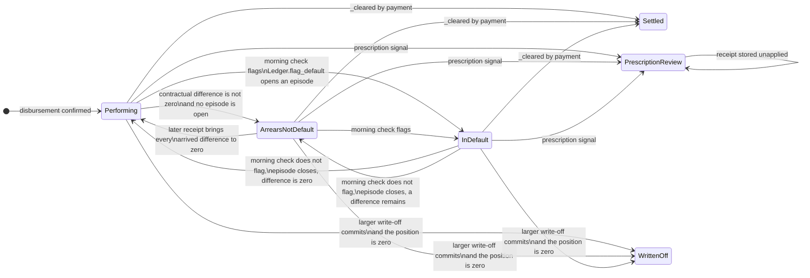
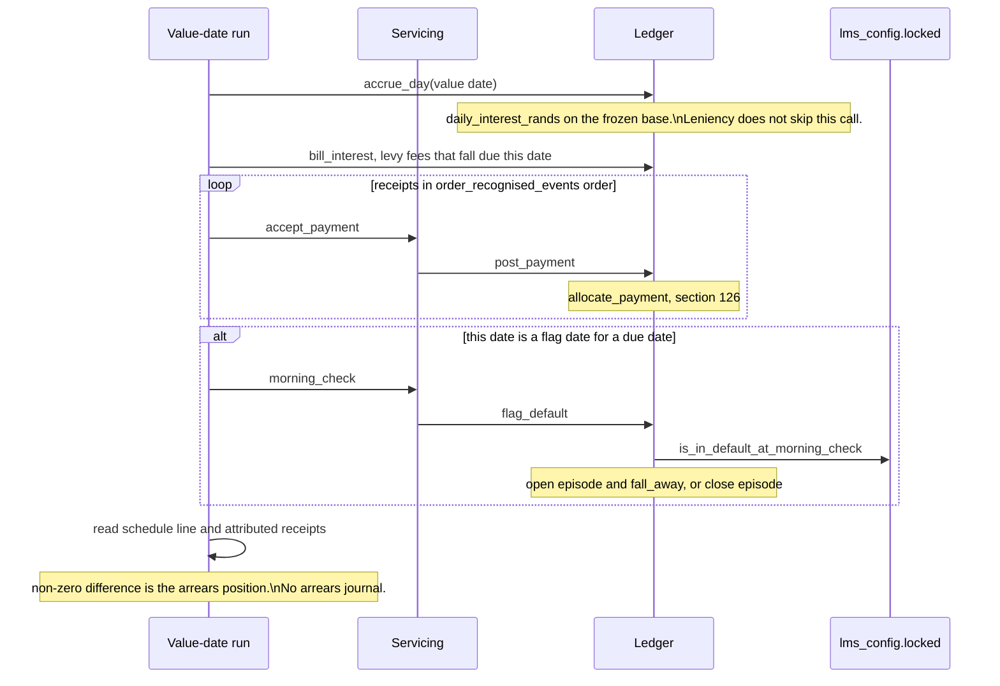
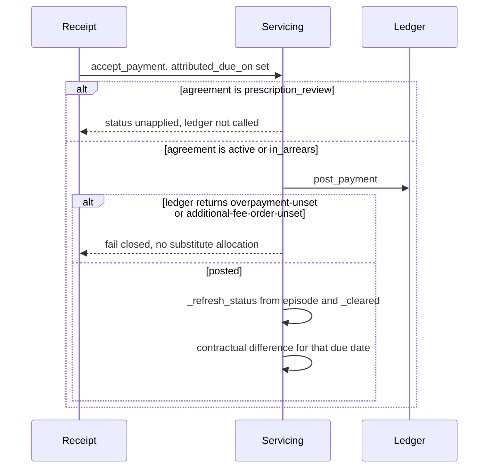
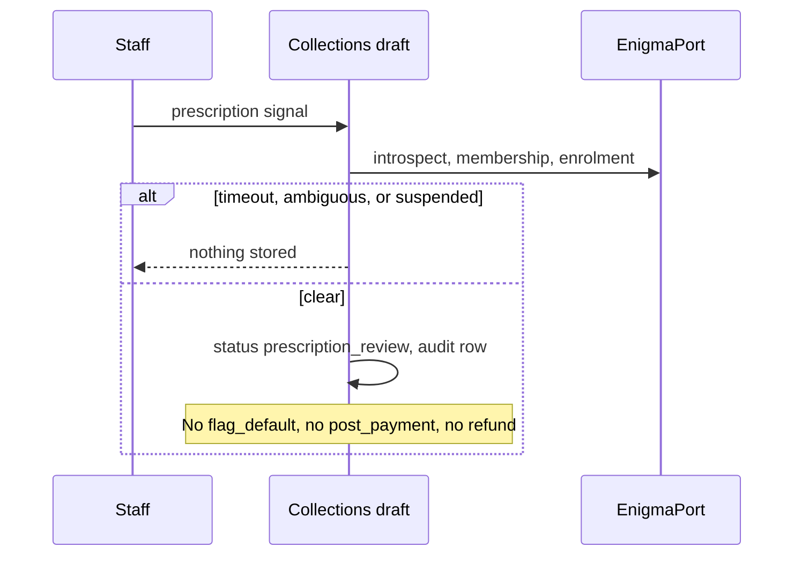
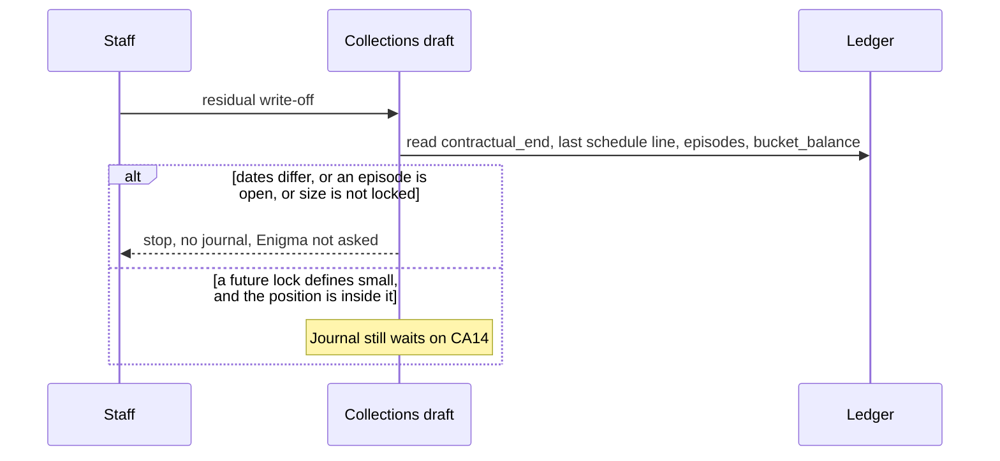
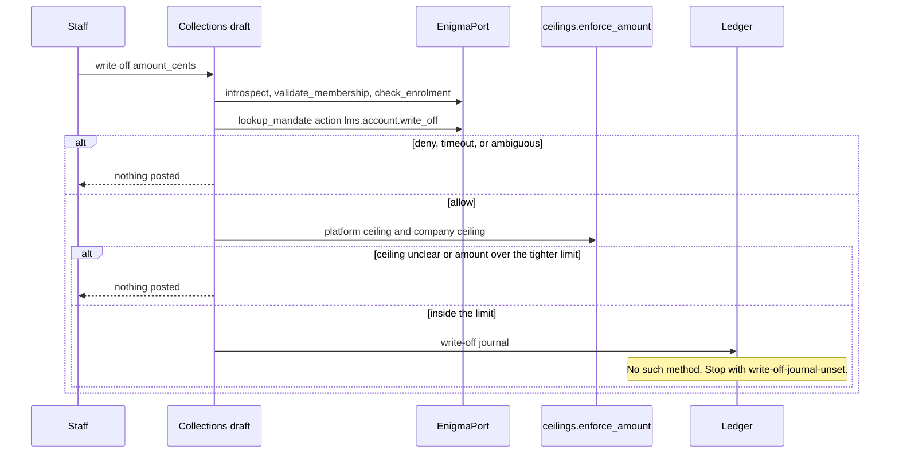

# Collections and arrears — Layer 1 draft

**Status: Layer 1 draft. Design only. This file is not production code and it is not a locked decision.**

`docs/LOCKED_DECISIONS.md` on `main` (last updated 2026-10-28) is the source of truth. This draft calls the Layer 0 interfaces. It does not re-implement their formulas, journals, or elections.

Layer 0 was read from these branches. They are not merged to `main`. Where a branch copy of the locked file differs from `main`, `main` wins. That difference is conflict CA17.

| Layer | Branch read | Surface this draft calls |
| --- | --- | --- |
| Calculation engine | `cursor/day1-calc-engine-928f`, as included on `cursor/servicing-orchestration-9c3c` | `lms.calc` |
| Configuration | `cursor/lms-owned-config-1a86`, as included on the servicing branch | `lms_config` |
| Ledger | `cursor/ledger-account-model-7aa6`, as included on the servicing branch | `lms.ledger` |
| Servicing orchestration | `cursor/servicing-orchestration-9c3c` | `lms.servicing` |
| Enigma port | `cursor/enigma-interface-d0c7` | `lms.enigma` |

The servicing branch copy of the locked file is behind `main`. It still says memo accruals are not allocatable, and it does not contain the current section 8 sentences on the contractual instalment, arrears, and the residual write-off, or the section 1 order that capitalises the day's due amounts before allocating that day's receipts. The interfaces below were built against that older copy.

## 1. What this layer owns

Collections and arrears is an orchestration layer. It decides when to run the existing morning check, when a contractual difference is an arrears position, when a prescription signal stops allocation, and when a write-off may be asked for. Amounts, allocation order, interest, the in-duplum ceiling, and the value date stay in Layer 0.

Four flows are in scope:

1. Default, using the one locked test for in duplum and for collections reporting.
2. Arrears, when a receipt is not the contractual instalment.
3. Prescription under section 126B, as a review hold.
4. Write-off of a small residual, and of a larger outstanding amount.

Section 129 notices, section 130 enforcement, and handover to an external debt collector are outside this draft. The locked file does not describe them. See CA22.

## 2. Locked rules this draft applies

Citations only. The text of the rule stays in the locked file.

| Topic | Lock | What this draft does with it |
| --- | --- | --- |
| Value date | §1 | Recognition date, Johannesburg calendar date, treated as 00:00. Same-day receipts keep recognition sequence. On a flag date the receipt is visible to the morning check. The day's due amounts are capitalised before that day's receipts are allocated. |
| Campaign discount | §3 | The discount stays through leniency. It falls away on the flag date. It does not return on cure. This draft does not add a penalty rate. |
| Day count | §5 | Daily accrual. The method is the one frozen at booking. Leniency does not switch it. |
| Default | §6 | One test. Calendar-day leniency, per the snapshot on the agreement. Unset leniency or threshold fails closed. No example day-count and no example percent is introduced here. |
| In duplum | §7 | A flagged default opens one episode. The ceiling is fixed at opening. A payment does not reset that episode. A cure closes it. The next default opens a new episode. The clip stays off. |
| Allocation and arrears | §8 | Section 126 order stays in the ledger. An inexact contractual instalment leaves a difference. The client continues until the position is cleared, or until a write-off is committed. |
| Instalment | §13 | The contractual instalment the client accepted is binding. The preference is that it stays the same during the term. |
| Residual | §8 and §13 | A small residual after the last instalment may be written off. The write-off is not required when the account is already in default. "Small" has no amount. |
| Mandates | §15 | Enigma owns the mandate. Timeout, an ambiguous status, or a clear suspended enrolment fails closed. Nothing is posted. |
| Identity | §16 | The agreement keeps the frozen name, ID number, and service address. This layer does not read them back from Enigma to change a balance. |
| Tariffs | §18 | A default-administration or collection-cost levy fails closed until a tariff row exists. |
| Elections | §19 | Unset elections fail closed. An existing agreement uses the snapshot taken at booking. |

Leniency is a count of calendar days, including weekends and public holidays (§6). The flag date is that count added to the contractual due date. The configuration function that does this is `is_in_default_at_morning_check`. This draft does not call the business-day helpers in `lms_config.calendar` to shorten the window. Those helpers implement section 2(5) of the Act for business-day intervals. Leniency is not one of those intervals.

## 3. Default

### 3.1 One definition

The default test is `lms_config.locked.is_in_default_at_morning_check`. `is_in_default` is the same test once the received cents are already summed. `is_full_payment` treats a receipt that lands exactly on the threshold as full. A zero instalment is already full. Collections reporting reads the episode that this test opens or closes. There is no second days-past-due rule and no collections-only flag date.

The threshold instalment is assembled the way servicing already assembles it before `Ledger.flag_default`: the original principal slice for that due date, plus levied charges that share that due date, including the monthly service fee, a non-capitalised initiation fee, and credit life. Unbilled interest is absent because it is not yet a charge (§6). The public entry is `Servicing.morning_check`. This draft does not add a second sum.

`leniency_days` and `full_payment_threshold_percent` are read from `LoanAccount.snapshot`, copied at booking. This draft does not call `resolve_customer_settings` again for an open agreement. A missing snapshot value fails closed inside the configuration function. No substitute is stored.

§6 says leniency is per customer. The snapshot is the organisation value with a product override. That remains open. See CA18.

### 3.2 Leniency does not pause interest

Every civil day from disbursement through the contractual end, including each day of the leniency window and the flag date, is an accrual day. The call is `Ledger.accrue_day`. That method does not take a leniency argument and does not reduce the base because a default flag is absent. The rate and the day-count weight come from the frozen snapshot and from `daily_interest_rands` inside the ledger. This layer does not call `daily_interest_rands` itself.

The campaign discount remains in force during the window because `Ledger.flag_default` posts the `fall_away` effect only when the morning check flags default. A later cure closes the episode and leaves `discount_fallen_away` set. The following accrual uses `campaign_rate` with the discount already fallen away, so the rate is the base rate. This layer does not call `campaign_rate` to remove the discount early, and it does not put the discount back.

Which of the base rate and the net campaign rate is the "contractual interest rate" in the penalty sentence of §3 is still open (servicing gap G3). This draft does not pick one. The ledger's current `campaign_rate` returns the base rate after fall-away. Collections leaves that function as it is.

### 3.3 Flag date

"Morning" is the name of the existing check. §6 and §1 say a receipt recognised on the flag date has value date 00:00 that day and is visible to the check. They do not set a clock time. This draft does not add one (servicing gap G8).

On the flag date the orchestrator runs, in this order:

1. `Ledger.accrue_day` for that Johannesburg value date. Interest for the flag date is still calculated.
2. `Ledger.bill_interest`, and any fee that becomes due that day (`Ledger.levy_service_fee` or `Ledger.levy_charge`). §1 and §8: capitalise the day's due amounts before allocating the day's receipts. A fee that is not due on this date is not invented so that the check has something to count.
3. `Ledger.post_payment` for each receipt recognised that day, in `order_recognised_events` order (value date, then recognition sequence).
4. `Servicing.morning_check`, which calls `Ledger.flag_default`, which calls `is_in_default_at_morning_check`.

`flag_default` builds the receipt list from posted payments that carry `attributed_due_on`. A payment with no attributed due date fails closed (`due-date-attribution-unset`). This draft uses that same attribution. It does not invent a rule for which receipts count as "for that due date" beyond what the ledger already requires (servicing gap G6). A receipt recognised after the flag date is outside `receipts_visible_at_morning_check`. See CA23.

When the check flags and no episode is open, the ledger opens an episode. The ceiling is `duplum_base_cents` of unpaid principal, including pre-default capitalised initiation. The ledger posts `fall_away` in the same transaction. `default_occurred_on` for reporting is `Episode.started_on`, which the ledger sets to the check date. This draft does not store a second default date.

When the check does not flag and an episode is open, the ledger closes that episode. See CA5 before relying on that close. The clip is not turned on. `Ledger.clip_in_duplum` raises `in-duplum-clip-off` while `IN_DUPLUM_CLIP_POSTS` is false. `lms_config.duplum.post_month` is not called. The pure engine's `run` can still apply a Nedbank clip inside its own state. Servicing does not copy `run` balances onto the ledger. Collections follows the ledger.

### 3.4 What reporting uses

A collections or regulatory extract that says the account is in default reads an open `Episode` and the §6 inputs that produced it: due date, leniency days, threshold percent, threshold instalment, and the receipts visible at the check. An account inside the leniency window, or an account that met the threshold with a shortfall still outstanding, is not in default. The extract says so from the absence of an open episode, not from a parallel counter.

## 4. Arrears

### 4.1 The contractual instalment

The contractual instalment is the schedule line the client accepted (§13). On the servicing record that line is `AgreementRecord.schedule`: a due date and an amount in cents. On the ledger the current lines live on `ScheduleVersion`. Late disbursement keeps or replaces those lines according to the frozen `late_disbursement` election. This draft reads the lines the ledger already stored. It does not rebuild the instalment.

The §6 threshold bundle is the default test only. It excludes unbilled interest. The schedule line is not defined as that bundle. See CA3.

### 4.2 The difference

For a due date D:

- `contractual_cents` is the schedule line for D.
- `received_cents` is the sum of payment `amount_cents` attributed to D and recognised by the day being read, excluding a payment that `Ledger.reverse` has reversed.
- The difference is `contractual_cents - received_cents`.

The default test uses a narrower set. `receipts_visible_at_morning_check` keeps receipts for D whose value date is on or before the flag date. A receipt recognised after the flag date reduces this arrears difference and does not enter that function. The lock does not say a later receipt is ignored for a cure. The ledger does not add a second cure. This draft does not feed the later receipt back into `flag_default`. An open episode can therefore sit beside a contractual difference that has since gone to zero. See CA23.

A difference of zero is an exact contractual instalment (§8). The loan then runs on toward an earlier settlement, or toward the residual path in section 6 after the last instalment.

A non-zero difference is the arrears position for that due date (§8). This draft does not post it to a new bucket. The cents remain where `Ledger.post_payment` left them, in the existing debit-normal buckets (`principal`, `interest`, `initiation`, `service`, `credit_insurance`, `default_administration`, `collection_costs`, `additional_monthly`). See CA4.

The sign of the difference is not fully specified. An underpayment leaves unpaid due amounts in those buckets, and the client keeps paying them. An amount above what is due, after the frozen partial-prepayment choice has been applied, is rejected by the ledger today (`overpayment-unset`). §13 already chooses, for a partial prepayment, whether the term shortens or the instalment drops. This draft does not relabel that excess as arrears and does not add a refund. See CA2.

Allocation itself stays `allocate_payment` inside `Ledger.post_payment`: due interest, then the named fee buckets, then due principal. A short payment that would have to rank `additional_monthly` among the named fee buckets fails closed (`additional-fee-order-unset`). This draft does not supply that rank.

### 4.3 Rules that then apply

"Normal arrears, in-duplum and collections rules" (§8) means the rules that are already locked, applied together:

- The shortfall stays collectible. The client continues on the ordinary payment path (`Servicing.accept_payment` → `Ledger.post_payment`) until `Servicing._cleared` is true, or until a write-off in section 6 is committed.
- In duplum applies when, and only when, the §6 check flags default and the ledger holds an open episode. A difference during leniency, or a difference that is still at or above the threshold, does not open an episode and does not start the ceiling.
- Collections reporting uses that same episode. It also shows the contractual difference so that a shortfall which is not yet default is visible. The servicing status `in_arrears` is not that difference. See CA1.
- Interest continues daily, including during leniency (§6).
- A cure is the §6 check returning not-in-default, which closes the episode (§7). The discount stays off (§3). The contractual difference, if any remains, is still arrears.
- No ageing bucket, penalty fee, or second waterfall is added. Those would be new rules. See CA22.

`_cleared` is the existing settlement test: no remaining principal slice, no remaining charge, and a zero principal bucket. The status becomes `settled`. Unbilled accrual memos are not part of that test. See CA21.

### 4.4 Collection costs

A collections cost that is actually charged is posted only by `Ledger.levy_charge`. Buckets `default_administration` and `collection_costs` call `require_reference_for_posting` with the tariff required. An empty tariff table fails the levy (§18). A cost that is the further monthly fee uses bucket `additional_monthly` and is not capitalised into the schedule (§13, §18). This draft does not decide which real-world cost is which, and it does not capitalise either of them. The in-duplum clip stays off, so a levy during an open episode is posted in full even when it is above the ceiling. That is the current ledger behaviour under §7.

## 5. Prescription (section 126B)

### 5.1 What the statute says, and what is not locked

Section 126B of the National Credit Act 34 of 2005 was inserted by the National Credit Amendment Act 19 of 2014 and commenced on 13 March 2015. The Supreme Court of Appeal in *Kaknis v Absa Bank* [2016] ZASCA 206 set out the text. In short:

- Section 126B(1)(a): no person may sell a debt under a credit agreement to which the Act applies that has been extinguished by prescription under the Prescription Act 68 of 1969.
- Section 126B(1)(b): no person may continue the collection of, or re-activate, such a debt where the debt has been extinguished under the Prescription Act and the consumer raises the defence of prescription, or would reasonably have raised it had the consumer been aware of it, in response to a demand.

The locked file does not mention section 126B. This draft does not turn the Prescription Act into an LMS clock. It does not state a period, a start date, or an interruption, and it does not decide that limb (b)(ii) is either required or dispensable. See CA7. *Kaknis* also holds that section 126B is not retrospective. This draft does not apply the section to a debt extinguished before 13 March 2015. The date a particular agreement's debt was extinguished is itself inside CA7, so no agreement is classified by this draft.

### 5.2 Identification

Identification in this draft is the recording of a prescription signal, not a finding that the debt is extinguished.

The signal this draft accepts is an explicit review command from a staff actor, carrying that actor's Enigma session, naming the agreement and the demand the defence answers. The command writes an audit row (actor, organisation, agreement, the demand reference, the Enigma request id, the Johannesburg value date of recognition). It does not write a balance.

This draft does not accept a scheduled job that counts years from a due date. Until CA7 is locked, that job would be an invented prescription period.

Whether the review command itself needs a mandate, distinct from the write-off mandate, is open. See CA10.

### 5.3 Hold

On a valid signal the agreement moves to draft status `prescription_review`. The earlier servicing notes disagree on whether this is a status or a flag. See CA6. This draft uses a status because allocation has to stop for the whole agreement, and a flag on `active` would need a second rule inside the payment path.

While the status is `prescription_review`:

- The agreement is outside the allocatable set. Today that set is `active` and `in_arrears`.
- `Servicing.accept_payment` stores the receipt as `unapplied` and does not call `Ledger.post_payment`.
- `Servicing.apply_payment` is refused. The receipt stays unapplied. The value date remains the original recognition date (§1) for whatever later command a lock eventually allows.
- No refund is posted. Layer 0 has no refund method. This draft does not add one. "Stop automatic refund" is this refusal: the unapplied receipt is not returned by an automatic payment, and amounts already allocated are not reversed by this transition. See CA8.
- An open episode is left as it stands. Prescription is not a §6 cure, so this draft does not call `flag_default` to close it. See CA9.
- `Ledger.accrue_day`, fee levies, and `issue_statement` are unchanged by this draft. Whether those calls are "continuing the collection" under section 126B(1)(b) is CA9. Implementation of the hold waits on that lock. The design records the stop on allocation and on automatic refund, which is the behaviour the task fixes, and it records that accrual was not given a new pause rule.

There is no exit. A later lock has to name who may return the agreement to a payable status, who may write it off, and who may leave it in review. See CA10.

Section 126B(1)(a) forbids a sale of a debt extinguished by prescription. This draft has no sale command. A future sale has to refuse an agreement that is in `prescription_review` or that a locked test has found extinguished. See CA11.

The ledger still has no unallocated-suspense account. An unapplied receipt is held by servicing, as an unmatched receipt is held today. This draft does not add that account.

## 6. Write-off

Two paths. Neither path recalculates interest or allocation. The amount is a ledger position, or a staff-entered amount checked against that position. The ledger has no write-off method. Both paths stop before a journal until CA14 is locked. This draft does not post a write-off through `post_payment`, `reverse`, or a negative `levy_charge`.

### 6.1 Small residual after the last contractual instalment

§8 and §13 allow a small residual to be written off after the last instalment. The write-off is not required when the account is already in default. The task for this layer says the small residual may be written off only if the account is not already in default. "Not required" and "only if not in default" are not the same sentence. See CA13. This draft follows both where they agree, and stops where they do not.

The small path is considered only when all of the following hold:

1. The value date is after the last schedule due date and after `LoanAccount.contractual_end`. If those two dates differ, the command stops with `contractual-end-unset`. See CA15.
2. The account is not in default: no open episode. This draft does not run an automatic write-off while an episode is open. That satisfies "not required". A staff attempt to use the small path while an episode is open also stops (`residual-while-in-default`), which is the task's "only if". CA13 records that the locked file does not forbid that staff attempt.
3. The residual is the remaining ledger position: principal bucket, remaining slices, and remaining charges, read with `Ledger.bucket_balance` and the account rows. This draft does not recompute it with `payoff_cents` or `quote_settlement`. Those engine figures include unbilled interest and a section 125 settlement, which is a different event. A section 125 settlement inside its section 113 window stays `quote_settlement` and `execute_settlement`. The waiver inside that window is the engine's settlement rule. It is not this residual write-off.
4. The position is within the locked meaning of "small". No amount and no bucket are locked (servicing gap G16). The command stops with `residual-size-unset` and posts nothing. See CA12.

The small path does not call `lookup_mandate` or `enforce_amount` in this draft, because the task reserves the mandate and the operational ceiling for the larger path. The locked file does not say the small path is exempt. See CA13.

An exact contractual instalment that leaves a nil position does not use this path. `_cleared` sets `settled`.

### 6.2 Larger write-off

Any other write-off of an outstanding amount is the larger path. That includes a write-off while an episode is open, a write-off before the last instalment, and a residual that a future lock places outside "small".

The client otherwise continues paying (§8). A larger write-off is a staff command, not a scheduled job.

Sequence, and nothing is posted unless every step returns a clear allow:

1. `EnigmaPort.introspect` for the staff session. Audience is the LMS. Timeout or an unclear sign-in stops the command (§15, and the port's `authority_unavailable` / `authority_ambiguous`).
2. `validate_membership` for the actor in the agreement's organisation. Suspended, absent, or unclear stops the command.
3. `check_enrolment` for the agreement's product. A clear suspended enrolment stops the command (§15). Timeout and an ambiguous status stop it as well.
4. `lookup_mandate` with a `MandateQuery` whose action is the write-off action. The Enigma port sketch names that action `lms.account.write_off`. The locked file does not. This draft uses the sketch name so the call has a target, and CA16 records that the id is not locked. `deny` stops the command. An unclear decision stops the command. The borrower's `person_id` is the account owner, not the actor. `EnigmaStub.check` on the servicing branch takes the borrower. This command does not use that stub. See CA16.
5. `enforce_amount` with the platform ceiling and, when the company has set one, the company ceiling, for the same action. The effective limit is the platform amount, or the lower of the two. A missing platform ceiling, a non-ZAR currency, or a negative amount is ambiguous and stops the command. An amount equal to the limit is inside it. One cent over is `mandate_denied`. The worked example amounts in the Enigma design note are illustrations. This draft does not copy them and does not store a ceiling of its own.
6. The authority snapshot (mandate id and version, enrolment id and version, ceiling versions, Enigma request id) is written with the command. A later revocation does not rewrite it. The port already specifies that snapshot.
7. The ledger journal. There is no method to call. The command stops with `write-off-journal-unset`. See CA14.

A future journal that brings every bucket, slice, and charge to zero moves the agreement to a draft terminal `written_off`. That status is not `settled`. `settled` remains the payment-cleared terminal. A journal that leaves a remainder does not change status. The client continues paying the remainder. `written_off` is not a locked status. See CA14.

A write-off is not a §6 cure and is not a payment, so it does not close an episode and it does not reset an episode counter. Whether a full write-off should close the episode for reporting is open inside CA14. This draft leaves the episode row unchanged because closing it would look like a cure.

## 7. State machine

Statuses below the line are the ones servicing implements today. The two draft statuses are not implemented. Arrears-not-default is a derived position, not a new status: servicing leaves the agreement `active` when no episode is open.

| Name in this draft | Servicing status today | Ledger fact |
| --- | --- | --- |
| Performing | `active` | No open episode. Contractual difference is zero on every due date whose value date has arrived. |
| Arrears, not default | `active` | No open episode. At least one arrived due date has a non-zero contractual difference. Includes the whole leniency window. |
| In default | `in_arrears` | An `Episode` with `closed_on` empty. This is the §6 flag. Collections reporting and in duplum both read it. |
| Settled | `settled` | `_cleared` after payments. |
| Prescription review | not implemented | No balance journal. Receipts stay unapplied. |
| Written off | not implemented | No journal kind yet. Intended when a larger write-off clears the position. |

`pending_disbursement`, `disbursement_failed`, and `rescinded` are unchanged and are not allocatable. The morning check already refuses them.

Notes on the arrows:

- Leniency is not a state. The agreement stays Performing or Arrears-not-default, interest accrues, and the discount stays on, until the flag date. Leniency of zero is a legal snapshot value. The flag date is then the due date, and the difference and the morning check are both evaluated after that day's allocation.
- In default can still carry a non-zero contractual difference. The diagram's In-default state is the episode, not a claim that the difference has gone to zero.
- The In-default arrows are servicing status `in_arrears` plus an open episode. The label in the diagram is the business name, so it is not confused with the §8 difference.
- The cure arrows call the existing single-due-date `flag_default`. CA5: that call can close an episode while another due date is still short. This draft draws the cure §7 describes and does not add a second test to defend the diagram.
- `Settled` from In-default is the existing `_refresh_status` path when a payment clears the position. It is not a write-off.
- The small-residual path has no arrow. It stops until "small" is locked (CA12). It is not an automatic transition on the last due date.
- `PrescriptionReview` has no exit (CA10).
- `WrittenOff` and `Settled` are terminals in this draft. A receipt after either status is not allocated to the loan. A receipt after `Settled` already has nowhere to go inside the loan ledger (`overpayment-unset` once nothing is due). This draft does not add a surplus refund.

Implemented code sets `in_arrears` only from an open episode (`Servicing._refresh_status`). A §8 difference during leniency stays `active`. Reporting that treats status `in_arrears` as "any arrears" would mix §6 and §8. See CA1.

## 8. Sequences

Draft step names below are the orchestration this layer would add. They are not symbols in the tree. Each step only calls the Layer 0 operations in the sequence.

### 8.1 Value date, including a leniency day and the flag date

`quote_settlement` is not in this daily run. It runs when a settlement is requested. `clip_in_duplum` is not in this run.

Configuration reads on this path are the snapshot already on the account, plus `require_reference_for_posting` inside a levy that needs a cap or a tariff. `ENGINE_READ_STEPS` is not opened by this layer. `interest_cap_present` stays a caller-supplied boolean, as servicing already requires on a statement.

### 8.2 Inexact instalment

### 8.3 Prescription signal

### 8.4 Small residual

### 8.5 Larger write-off

### 8.6 Calls this layer leaves to Layer 0

| Concern | Call | Owner |
| --- | --- | --- |
| Flag date and threshold | `is_in_default_at_morning_check`, `is_full_payment`, `receipts_visible_at_morning_check` | Configuration, via `Ledger.flag_default` |
| Open or close episode, ceiling, discount fall-away | `Ledger.flag_default`, `duplum_base_cents` | Ledger and configuration |
| Daily interest during leniency | `Ledger.accrue_day` | Ledger, using `daily_interest_rands` and `interest_bearing_cents` |
| Debit interest and fees | `Ledger.bill_interest`, `Ledger.levy_service_fee`, `Ledger.levy_charge` | Ledger |
| Section 126 allocation | `Ledger.post_payment` → `allocate_payment` | Ledger and calculation engine |
| Reversal value date | `Ledger.reverse` | Ledger |
| Same-day order | `order_recognised_events` | Configuration |
| Johannesburg value date | `lms_config.calendar.value_date` | Configuration |
| Cleared position | `Servicing._refresh_status` / `_cleared`, `Ledger.bucket_balance` | Servicing and ledger |
| Settlement quote | `quote_settlement`, `execute_settlement` | Calculation engine, and only for a section 125 settlement |
| Write-off authority | `EnigmaPort.lookup_mandate`, `ceilings.enforce_amount` | Enigma port |
| Tariff or cap presence | `require_reference_for_posting` | Configuration, inside the ledger levy |

Left uncalled on purpose: `Ledger.clip_in_duplum`, `lms_config.duplum.post_month`, `lms_config.duplum.open_default`, `resolve_customer_settings` on an agreement that already has a snapshot, `campaign_rate` as a way to drop the discount before `fall_away`, and `run` as a source of posted balances.

## 9. Gaps that need a locked decision

None of these is given a value in this draft. Closing one means editing `docs/LOCKED_DECISIONS.md`. Existing servicing gap ids are reused where the question is the same.

| Id | Decision still required |
| --- | --- |
| CA1 | Servicing status `in_arrears` means "open in-duplum episode". §8 arrears is the contractual difference and can exist with no episode. The status name, and what collections reporting is allowed to call "in arrears", needs a lock before any rename. Until then, reporting reads the episode for §6 and the contractual difference for §8. |
| CA2 | §8 says an inexact instalment's difference becomes arrears. §13 gives a partial-prepayment choice when principal that is not yet due is paid. The ledger rejects a remainder above due amounts and that choice (`overpayment-unset`). The lock does not say an overpayment is arrears. |
| CA3 | The contractual instalment is the schedule line the client accepted (§13). The §6 threshold bundle excludes unbilled interest. They are not defined as the same cents. This draft uses the schedule line for the difference and the §6 bundle only for the morning check. A lock that they are one figure would change this draft. |
| CA4 | §8 does not name a bucket for the arrears difference. This draft leaves the cents in the buckets `post_payment` already uses. |
| CA5 | `Ledger.flag_default` closes the open episode when the single due date it was given is not short. The engine cure looks at every bundle whose flag date has arrived. §7 says a cure is the account brought out of default. The multi-date rule is not locked. This draft does not add a second cure. |
| CA23 | `is_in_default_at_morning_check` counts receipts for that due date only when their value date is on or before the flag date. A later receipt reduces the §8 difference in this draft and does not change that function. The lock does not say the later receipt is ignored when asking whether the account has been brought out of default. This draft does not add a cure. |
| CA6 | `prescription_review` is a side state in `docs/servicing/primary-flows.md` and a flag in `docs/servicing/implementation-design.md`. The locked file is silent. This draft uses a status so allocation stops. |
| CA7 | When a debt becomes prescribed. Section 126B points at extinction under the Prescription Act, and section 126B(1)(b) also requires the defence limb. The period, the start date, what interrupts it, and whether the defence limb must be true before this system stops collection are not in the locked file. This draft records a signal and does not run a clock. |
| CA8 | What "automatic refund" refers to. The section 126B text cited here does not order a refund of amounts already paid. This draft posts no refund and holds a new receipt unapplied. Which cents, if any, are refundable, and who may refund them, is open. |
| CA9 | Whether accrual, fee levies, statements, and an already-open episode continue during prescription review. This draft stops allocation and automatic refund only. Continuation of the other calls may itself be collection under section 126B(1)(b). |
| CA10 | How an agreement leaves `prescription_review`, and whether opening the review needs a mandate of its own. |
| CA11 | Section 126B(1)(a) forbids selling an extinguished debt. There is no sale command and no locked hook for one. |
| CA12 | Same question as servicing gap G16. "Small" has no amount and no sub-ledger. The residual command stops with `residual-size-unset`. |
| CA13 | §8 and §13 say a residual write-off is not required when the account is already in default. The task for this layer says the small residual may be written off only if the account is not in default, and that the mandate and the operational ceiling apply to the larger path. This draft runs no automatic residual write-off while an episode is open, refuses the small staff path in that case, and does not call Enigma on the small path. The locked file does not forbid the staff attempt and does not exempt the small path from a mandate. |
| CA14 | The ledger has no write-off journal. `settled` means the position was cleared by payment. A full write-off needs a journal kind and a terminal status. Whether that journal closes an open episode is part of the same gap. |
| CA15 | "After the last instalment" (§8) and "at contractual end" (§13). `contractual_end` and the last schedule line can differ after a late disbursement. This draft stops if they differ. |
| CA16 | The write-off action id `lms.account.write_off`, the platform and company ceiling rows, and the staff-session mandate are specified in the Enigma port design. Locked section 15 does not list those stores (Enigma design conflict C2). The servicing `EnigmaStub.check` takes the borrower, not the staff actor. This draft calls the port, not the stub, and does not treat the sketch action id as locked. |
| CA17 | The servicing branch copy of `docs/LOCKED_DECISIONS.md` is behind `main`. It is missing the current §1 capitalise-then-allocate sentence and the current §8 arrears and residual sentences, and it still says memo accruals are not allocatable. Layer 0 on that branch was built against the older text. Implementation of this draft waits until those interfaces are brought onto the current lock. |
| CA18 | Same question as servicing gap G5. §6 says leniency is per customer. The snapshot is organisation with a product override. This draft reads the snapshot. |
| G3 | After the discount falls away, the ledger charges the base rate. §3 says penalty interest may not exceed the contractual rate and does not say whether contractual means the base or the net campaign rate. |
| G6 | "Amount received for that due date" does not say which receipts qualify. This draft uses the attributed payment `amount_cents` the morning check already sums. The morning check then keeps only those whose value date is on or before the flag date. The arrears difference keeps every attributed receipt recognised by the day being read. A lock on which receipts qualify changes both. The flag-date cutoff is CA23. |
| CA21 | `_cleared` ignores unbilled accrual memos. An agreement can become `settled` while a memo balance remains. Whether that memo is the small residual is not locked. |
| CA22 | §8's "normal arrears rules" and "collections rules" are not listed beyond the difference, the shared default test, the episode, continued payment, and write-off. Section 129, section 130, external collectors, and ageing buckets are not in the locked file and are not designed here. |

## 10. Conflicts recorded, not resolved

1. **Locked file against the task's small-residual sentence.** "Not required if already in default" (§8, §13) is not the same as "only if the account is not already in default". CA13. This draft does not rewrite the lock.
2. **Locked file against section 126B.** The Act restricts collection of a prescribed debt. The locked file does not say when prescription is recognised or what happens to interest. CA7 and CA9. This draft does not choose a reading of the Act in order to fill the lock.
3. **Two servicing designs against each other.** Primary flows call `prescription_review` a state that pauses allocation. The implementation design calls prescription review a flag and sets `in_arrears` at the end of a due date with a bucket unpaid. The code sets `in_arrears` from an open episode only. The current lock supports the code's default test and separately defines the §8 difference. CA1 and CA6.
4. **Engine cure against ledger cure.** CA5 is the multi-date close. CA23 is a receipt that arrives after the flag date: it reduces the §8 difference and the current morning check does not see it. Collections calls the ledger and does not add a cure.
5. **In-duplum clip.** §7 leaves the clip off until three unnamed section 103(5) edges are confirmed. The ledger raises if asked to clip. The pure `run` path can still clip its own state. Collections follows the ledger and does not copy `run`.
6. **Branch copy of the locked file.** CA17. `main` wins.

## 11. Out of scope for this draft

Production code, migrations, and tests. A per-customer leniency store. A prescription clock. A refund payment. A write-off journal. An arrears bucket. An in-duplum clip. Section 129 and section 130. Selling a debt. Restructuring (§13), beyond reading the schedule version the ledger already stores. Lay-by cross-allocation (§4), which stays where the ledger already posts it. The section 104 notice on a repo-rate fall.
