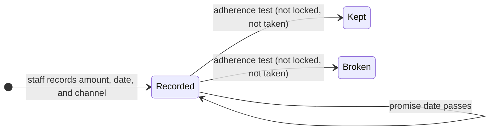
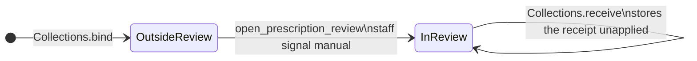
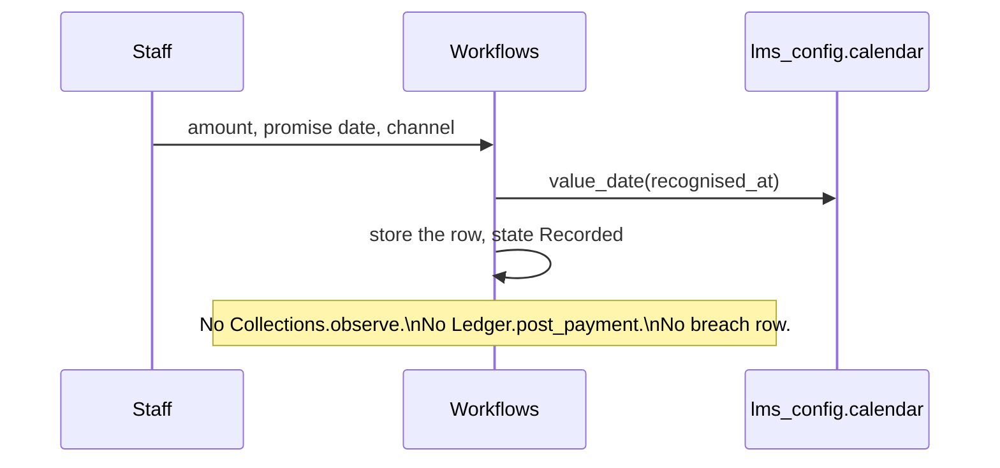
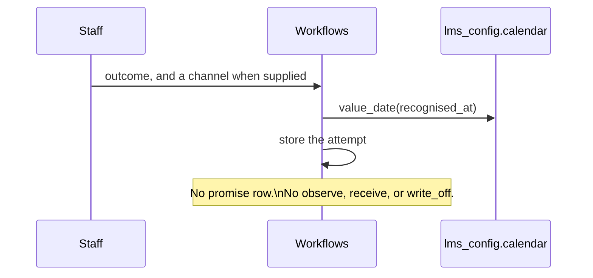
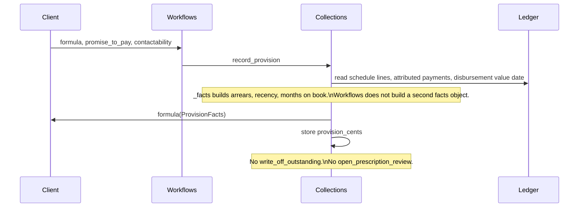
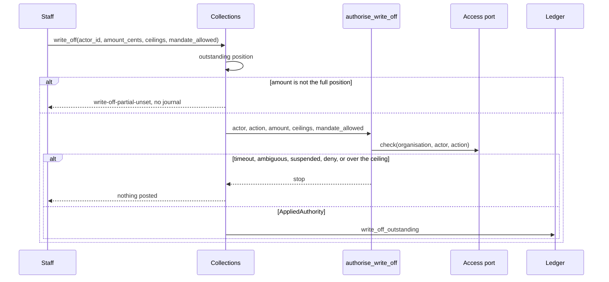
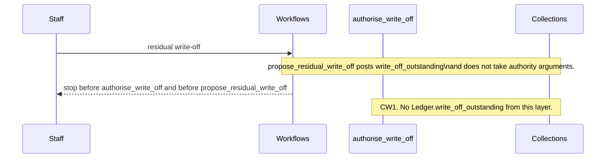
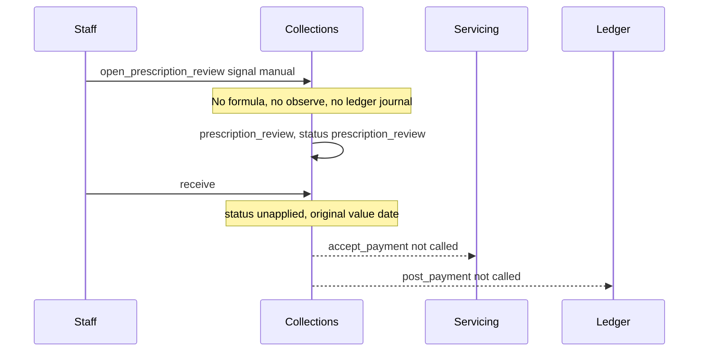
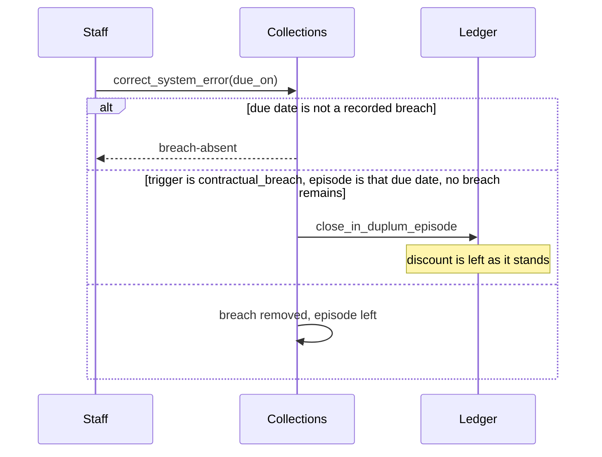

# Collections workflows — Layer 2 draft

**Status: Layer 2 draft. Design only. This file is not production code and it is not a locked decision.**

`docs/LOCKED_DECISIONS.md` on `main` (last updated 2026-10-28) is the source of truth. This draft calls the Layer 0 and Layer 1 interfaces. It does not re-implement their tests, journals, elections, or formulas.

The collections interfaces were read from `origin/cursor/layer1-gap-closures-ccde`. That branch’s copy of the locked file matches `main`. The interfaces are not on `main`. The older design note `docs/collections/layer1-draft.md` on `origin/cursor/collections-arrears-design-8d01` was written before the two-concept default, the residual threshold, and section 20. Where that note and the collections module disagree, the module and `main` are what this draft calls.

## 1. What this layer owns

Collections workflows sit on `lms.collections`. They record staff facts that the ledger does not store, and they invoke the collections commands that already exist. They do not decide arrears, open an in-duplum episode, allocate a receipt, or post a write-off journal of their own.

Four workflows are in scope:

1. Promise-to-pay. Staff record an amount, a promise date, and a channel. The rows are kept so a client formula can be given them. A promise date does not become a contractual due date.
2. Contactability. Staff record a contact attempt and an outcome. The rows are kept for the same client formula and for a later write-off decision. This layer does not score them.
3. Formula-based provisioning. The client supplies the formula. This layer stores the promise and contact rows and calls `Collections.record_provision`. Arrears, recency, and months on book stay inside that method.
4. Staff actions. A larger write-off calls `Collections.write_off`. A residual write-off is specified against `authorise_write_off` and `Collections.propose_residual_write_off`, and stops where that pair cannot be called (CW1). Prescription review is the existing staff signal. A system-error correction of a contractual breach calls `Collections.correct_system_error`.

Section 129 notices, section 130 enforcement, handover to an external collector, and a sale of the debt stay out of scope, as they were in the collections design.

## 2. Locked rules this draft applies

Citations only. The text of the rule stays in the locked file.

| Topic | Lock | What this draft does with it |
| --- | --- | --- |
| Value date | §1 | The recognition instant of a staff command is `lms_config.calendar.value_date`. The promise date is the calendar date the staff member entered. It is not shifted onto a business day. |
| Contractual breach | §6 | A breach is a due date `Collections.observe` has already recorded. This layer does not record one. The only removal path is `Collections.correct_system_error`. |
| Collections default | §6 | Cure is a payment of the arrears, through `Collections.observe` and the ledger episode methods that command already uses. A promise, a contact, a provision, and a broken promise do not call `observe`. |
| In-duplum trigger | §6, §7, §19 | The trigger is the value `Collections.bind` stored from `resolve_in_duplum_trigger`. This layer does not bind again and does not read the election a second time. |
| Discount | §3 | A system-error correction uses the collections method, which leaves the discount where it is. This layer does not call `Ledger.mark_discount_fallen_away` to put the discount back. |
| Residual threshold | §8, §19 | The threshold is the cents `Collections.bind` stored from `resolve_residual_threshold_cents`. This layer does not embed 5 000. |
| Provision and write-off | §8 | Manual or formula, per client. No platform formula. A formula result stays on the collections case. It is not a ledger journal. |
| Prescription | §20 | Manual or formula, per client. No platform clock. The staff path is the manual signal. Receipts in review go through `Collections.receive`. |
| Mandates | §15 | Enigma answers identity and access. Timeout, an ambiguous status, or a suspended enrolment fails closed. The operational ceiling is the LMS amount `authorise_write_off` already applies. |
| Identity | §16 | Frozen name, ID number, and service address are not read back to change a balance or a promise. |

## 3. Promise-to-pay

### 3.1 What staff record

One command stores one row:

| Field | Source |
| --- | --- |
| Agreement | The agreement id the staff member names. The case must already exist (`Collections.bind`). |
| Amount | Cents the staff member enters. A negative amount is refused and nothing is stored. |
| Promise date | The calendar date the staff member enters. |
| Channel | The channel text the staff member enters. Empty text is refused. No channel list is stored here. |
| Recognised at | The staff command’s recognition instant, kept as `value_date`. |
| Actor | The staff person id from the session. This row does not use the borrower’s id as the actor. |

The command does not call `Collections.observe`, `Collections.receive`, `Collections.correct_system_error`, `Ledger.post_payment`, `Ledger.flag_default`, or `Servicing.morning_check`. It does not set `attributed_due_on`. It does not change the agreement status.

A second command stores a second row. This draft has no withdrawal command and no rule that a new promise replaces an older one (CW2).

### 3.2 Adherence

Section 8 names promise-to-pay adherence as an input a client formula may use. It does not say which receipts count, whether the promise amount must be met in full, or how the promise date lines up with a receipt’s value date.

`Collections.record_provision` already requires a non-empty `promise_to_pay` string in formula mode and passes it through on `ProvisionFacts`. The collections module does not score that string. This draft does not replace the string with `kept`, `broken`, a ratio, or a token that means “no promise”. The client supplies the string when the formula is called. The rows in this section are the store the client can read. They are not copied onto `ProvisionFacts`, because that type has no row list (CW3).

Until an adherence test is locked, a promise stays `recorded` after the promise date. The date passing does not add the promise date to `Case.breaches` and does not open or close an episode.

### 3.3 State machine

`kept` and `broken` are drawn so the prohibition is visible. The arrows into them are not taken. The adherence test is CW4.



`Broken` has no arrow to a contractual breach, to a collections default, or to `correct_system_error`. A broken promise is not a system error, and a system error is not a way to clear a promise.

## 4. Contactability

### 4.1 What staff record

One command stores one attempt:

| Field | Source |
| --- | --- |
| Agreement | The agreement id. The case must already exist. |
| Outcome | The outcome text the staff member enters. Empty text is refused. No outcome list is stored here. |
| Channel | Stored when the staff member supplies one. The command does not require it. |
| Recognised at | `value_date` of the command. |
| Actor | The staff person id. |

The command does not create a promise row, even when the outcome text talks about a promise. A promise is the command in section 3.

The command does not call `observe`, `receive`, `write_off`, or `open_prescription_review`. It does not change the agreement status.

### 4.2 No platform measure

Section 8 and section 20 name contactability as a formula input. They do not define a rate, a boolean, or a count that this platform must produce.

`record_provision` and `open_prescription_review` already require a non-empty `contactability` string when a formula is used. This draft leaves that string to the client. An empty store is not turned into a placeholder. The existing methods then fail closed with `provision-factor-unset` or `prescription-factor-unset`.

The same rows are available to a staff member who is about to call `write_off` or `propose_residual_write_off`. They do not change the amount those methods post.

## 5. Formula-based provisioning

### 5.1 The call

Provisioning for this draft is `Collections.record_provision` in `formula` mode. The mode is the one `bind` stored. This layer does not change it and does not supply a formula.

The call is:

```text
Collections.record_provision(
    agreement_id,
    recognised_at=...,
    formula=<client callable>,
    promise_to_pay=<client string>,
    contactability=<client string>,
)
```

`amount_cents` is left unset on this path. The manual branch of the same method is unchanged and is not given a new command here.

When `provision_mode` is unset, the method raises `provision-mode-unset` and stores nothing. When the formula argument is missing, it raises `provision-formula-unset`. This draft does not catch those errors and substitute a figure, including zero.

### 5.2 Inputs the collections method already builds

`record_provision` builds `ProvisionFacts` in `_facts` and passes that object to the client callable. This layer does not build a second facts object.

| Fact | Where it is produced | This draft |
| --- | --- | --- |
| `arrears_cents` | Sum, over schedule lines already due, of the shortfall of the schedule cents against attributed receipts with value date on or before the check | Passed through. Not recomputed. |
| `recency_days` | Days from the latest payment value date, or from the disbursement value date when there is no payment | Passed through. The measure is not a locked sentence (CW5). |
| `months_on_book` | Calendar months from the disbursement value date to the check date, floored at zero | Passed through. The measure is not a locked sentence (CW5). |
| `promise_to_pay` | The client string | Not replaced with a score of the rows in section 3. |
| `contactability` | The client string | Not replaced with a score of the rows in section 4. |
| `as_of` | `value_date` of the command | Unchanged. |

The callable’s integer is stored on `Case.provision_cents` by the collections method. A negative result is refused there. The result does not call `Ledger.write_off_outstanding`, `Ledger.levy_charge`, or `Collections.open_prescription_review`.

A formula-based write-off, which section 8 also allows, is still the staff command in section 6. The stored provision is an input a person may read. It is not the amount `write_off` posts, and it does not satisfy the mandate check.

## 6. Staff actions

### 6.1 Larger write-off

The command is `Collections.write_off`. That method already:

1. Reads the outstanding position.
2. Refuses an amount other than that position (`write-off-partial-unset`).
3. Calls `authorise_write_off` with the staff `actor_id`, the action string, the platform ceiling, the company ceiling when one is passed, and `mandate_allowed`.
4. On a clear allow inside the ceiling, calls `Ledger.write_off_outstanding` and sets the case and the agreement to written off.

This draft does not call `Ledger.write_off_outstanding` itself and does not call `authorise_write_off` a second time around `write_off`.

`authorise_write_off` calls the access port first. A timeout stays `authority-unavailable`. An ambiguous status stays `authority-ambiguous`. A suspended enrolment stays `enrolment-suspended`. A denied mandate, or an amount over the tighter ceiling, stays `mandate-denied`. An amount equal to the limit is inside it. Nothing is posted on those stops.

The action string defaults to the port sketch `lms.account.write_off`. Section 15 does not name that id (CW6). This draft does not treat the sketch as a locked action. A machine allocation session is not this command. The collections implementation already refuses a write-off that has no mandate.

The residual gates (exact schedule, threshold, last instalment, matching contractual end) belong to `propose_residual_write_off`. A larger write-off is not sent through that method.

### 6.2 Residual write-off

Section 8 allows a small residual after the last instalment. The threshold is the client election, with R50 where `resolve_residual_threshold_cents` has already applied that sentence. The write-off is not automatic: this draft does not schedule `propose_residual_write_off`.

The task for this layer requires a mandate check and an operational ceiling for a residual write-off as well as for a larger one. Section 8 and section 15 do not exempt the residual path.

`propose_residual_write_off` posts `Ledger.write_off_outstanding` and does not take `actor_id`, a ceiling, or `mandate_allowed`. It also does not return the outstanding cents before it posts. `write_off` does take those authority arguments, and it skips the residual gates (`contractual-end-unset`, `residual-not-due`, `residual-episode-open`, `residual-not-exact`, `residual-above-threshold`).

This draft therefore has no call that both authorises the residual and posts it. The staff command stops before either method. It does not sum ledger buckets in order to call `authorise_write_off`, and it does not call `Ledger.write_off_outstanding`. CW1 is the lock that would give `propose_residual_write_off` the same authority arguments `write_off` already has. Until then the residual journal stays inside the collections method, and this layer does not invoke it.

The open-episode refusal inside `propose_residual_write_off` is that method’s gate. Current section 8 does not state it (CW7). This draft does not delete the gate and does not add another one.

### 6.3 Prescription review

The staff command is:

```text
Collections.open_prescription_review(
    agreement_id,
    recognised_at=...,
    signal="manual",
)
```

No formula is passed. The case must already have `prescription_mode` set. An unset mode raises `prescription-mode-unset`. This draft does not default the mode to manual or to formula.

The method sets `prescription_review` and the agreement status `prescription_review`. It does not post a balance journal, does not call `observe`, and does not refund a receipt already posted.

While the flag is set, a receipt is `Collections.receive`. That method stores the payment as `unapplied`, keeps the original value date, and does not call `Servicing.accept_payment` or `Ledger.post_payment`. This layer does not add a second hold and does not add a refund.

`Collections.observe` already returns the current view while the flag is set, so this command does not use `observe` to freeze breaches. Promise rows and contact rows may still be recorded. They do not clear the flag and they do not allocate.

There is no exit command (CW8).

Section 20 also allows a client formula. `open_prescription_review` opens the review when that formula returns true, and it then stores the signal `formula`, with no staff actor argument. The task for this layer says the review is a staff signal. This draft’s staff path does not pass a formula. It does not remove the formula parameter. Whether a formula may enter review without a staff actor is CW9.

### 6.4 System-error correction of a contractual breach

Section 6: once the due date has passed, a contractual breach cannot be rectified, except a system error, which is corrected as if the breach never occurred. A payment after the due date does not call this command. A promise does not call it.

The staff command is `Collections.correct_system_error(agreement_id, due_on, recognised_at=...)`.

That method:

- Raises `breach-absent` when `observe` has not recorded that due date. Nothing else is written.
- Removes that due date from `Case.breaches`.
- When the stored trigger is `contractual_breach`, the episode was opened for that due date, no breach remains, and an episode is open, calls `Ledger.close_in_duplum_episode`.
- Leaves the discount as it stands. The method’s own statement is that the discount is not put back.
- Does not call `observe`, `post_payment`, `write_off`, or `flag_default`.

A collections-default episode is not closed by this command. Cure of that episode remains a payment, through `observe`.

The method takes no actor and no action id. The task calls this a staff action. Section 15 does not name an action for it. This draft does not reuse `lms.account.write_off` and does not invent an action id (CW10). The workflow is invoked by a person. The method cannot tell that person from a job.

Two effects of “as if it never occurred” are already unresolved inside the collections method. This draft does not add a second correction (CW11):

- The discount stays off even though a system-error correction is not a cure. Section 3 says the discount does not return on a later cure.
- When another breach remains, the episode and its ceiling stay. The ceiling is not rebuilt from the breach that remains.

### 6.5 State machine for prescription review



Notes on the arrows:

- `InReview` has no exit (CW8).
- The formula parameter on `open_prescription_review` can also set the flag. That path is CW9. It is not a second arrow in this staff machine.
- A promise row, a contact row, a provision figure, and a broken promise do not enter `InReview`.
- `written_off`, set by `write_off` or by `propose_residual_write_off`, is the collections terminal. It is not an exit from this review drawn here. Whether those commands may run while the review flag is set is CW12. The methods do not read the flag. This draft does not add a gate.

## 7. Sequences

Names below are the collections, ledger, and configuration operations this workflow calls. Inner helpers stay inside the method that owns them.

### 7.1 Record a promise



### 7.2 Record a contact attempt



### 7.3 Formula provision



Configuration on this path is the snapshot and the case `bind` already resolved. `resolve_in_duplum_trigger` and `resolve_residual_threshold_cents` are not called again.

### 7.4 Larger write-off



### 7.5 Residual write-off



The collections method, when some later lock lets it accept the authority result, would then apply its own gates and call `Ledger.write_off_outstanding`. Those gates are not redrawn here as a second implementation.

### 7.6 Prescription signal, then a receipt



### 7.7 System-error correction



`observe`, `post_payment`, and `mark_discount_fallen_away` are not in this sequence.

### 7.8 Calls this layer leaves where they are

| Concern | Call | Who makes it |
| --- | --- | --- |
| Copy trigger and residual threshold | `Collections.bind` → `resolve_in_duplum_trigger`, `resolve_residual_threshold_cents` | Already done before these workflows. Not called again. |
| Record a breach or a collections default | `Collections.observe` → `is_full_payment`, `is_in_default`, `Ledger.open_in_duplum_episode`, `Ledger.close_in_duplum_episode`, `Ledger.mark_discount_fallen_away` | The existing value-date run. Not a promise, a contact, or a provision. |
| Promise and contact rows | Workflow store | This layer. No ledger method. |
| Formula provision | `Collections.record_provision` | This layer, with the client formula and the client strings. |
| Larger write-off | `Collections.write_off` → `authorise_write_off` → `Ledger.write_off_outstanding` | This layer calls `write_off` only. |
| Residual write-off | `authorise_write_off`, `Collections.propose_residual_write_off` | Not called, pending CW1. |
| Prescription hold | `Collections.open_prescription_review`, `Collections.receive` | This layer. |
| System-error correction | `Collections.correct_system_error` → `Ledger.close_in_duplum_episode` when that method already closes | This layer calls `correct_system_error` only. |
| Recognition date | `lms_config.calendar.value_date` | This layer, for the staff command’s own instant. |
| Servicing morning check | `Servicing.morning_check`, `Ledger.flag_default` | Not called. Collections does not use them. |
| In-duplum clip and settlement quote | `Ledger.clip_in_duplum`, `quote_settlement` | Not called. |

## 8. Gaps that need a locked decision

None of these is given a value in this draft. Closing one means editing `docs/LOCKED_DECISIONS.md`.

| Id | Decision still required |
| --- | --- |
| CW1 | A residual write-off must pass a mandate check and an operational ceiling. `Collections.write_off` does that and then posts the full outstanding position, skipping the residual gates. `Collections.propose_residual_write_off` applies the residual gates and posts `Ledger.write_off_outstanding` with no authority arguments and no outstanding figure returned first. Section 8 and section 15 do not exempt the residual path. This draft calls neither method and does not post the journal itself. |
| CW2 | Whether more than one promise may be open, and whether a promise can be withdrawn or replaced. This draft stores each successful command as its own row and has no withdrawal command. |
| CW3 | `ProvisionFacts.promise_to_pay` and `ProvisionFacts.contactability` are single strings. The promise rows and contact rows are not fields on that type. Passing the rows through would change the collections signature. This draft leaves the strings to the client. |
| CW4 | How promise-to-pay adherence is measured: which receipts, full amount or part, and the promise date against the receipt value date. Until that test exists, the promise stays `recorded`. A later `broken` state still must not call `observe` or insert a contractual breach. |
| CW5 | Section 8 names recency and months on book. `Collections._facts` already computes both. The lock does not define either measure. This draft does not replace the computation. |
| CW6 | The write-off action id. `write_off` defaults to the sketch `lms.account.write_off`. Section 15 does not name it. Same open point as the collections implementation note. |
| CW7 | `propose_residual_write_off` refuses an open in-duplum episode (`residual-episode-open`). Current section 8 does not state that gate. The collections implementation note already records the mismatch. This draft does not remove the gate. |
| CW8 | How an agreement leaves `prescription_review`. The collections method has no exit. This draft does not add one. |
| CW9 | Section 20 allows a formula to decide prescription. The task for this layer says the review is a staff signal. `open_prescription_review` opens the review when the client formula returns true and records the signal `formula`, with no staff actor. This draft’s staff path passes `signal="manual"` and no formula. It does not delete the formula parameter. |
| CW10 | System-error correction is a staff action. `correct_system_error` takes no actor and no action id. Section 15 does not name an action. This draft does not reuse the write-off action and does not coin one. |
| CW11 | “As if the breach never occurred” against two results the collections method already leaves in place: the discount stays off, and a remaining breach keeps the open episode and its ceiling. Section 3 says the discount does not return on a later cure. A system-error correction is not a cure. This draft does not add a second correction. |
| CW12 | Whether `write_off`, `propose_residual_write_off`, or `correct_system_error` may run while `prescription_review` is set. The methods do not read the flag. Section 20 and section 126B do not say whether those commands are continued collection. This draft does not add a gate. |
| CW13 | Section 19 says an unset election fails closed. Section 8 says the residual threshold defaults to R50. `resolve_residual_threshold_cents` returns 5 000 cents when both levels are null, and fails closed on the in-duplum trigger. This layer uses the case `bind` already stored and does not choose again. |

## 9. Conflicts recorded, not resolved

1. **Residual authority.** The task requires a mandate and an operational ceiling for a residual write-off. The collections residual method posts without them. CW1. This draft does not rewrite the method and does not post around it.
2. **Adherence as a score.** Section 8 lists promise-to-pay adherence as a formula input. The collections module stores it as a client string and does not score it. The promise state machine draws `kept` and `broken` and does not enter them. CW4.
3. **Prescription formula and the staff signal.** Section 20 and the collections method allow the formula to open review. The task says the review is a staff signal. CW9.
4. **System error and the discount.** Section 6 treats the corrected breach as never having occurred. The collections method, citing section 3, does not restore the discount. CW11.
5. **Residual default and fail closed.** CW13. The configuration resolver has already taken the R50 sentence for this election. This draft does not open that choice.
6. **Open episode and the residual path.** CW7. Current section 8 is silent. The method refuses. This draft leaves the refusal in the method it is not yet calling.
7. **Where the code lives.** The collections module this draft calls is on `origin/cursor/layer1-gap-closures-ccde`, not on `main`. An implementation of this draft has to build against that module. This file does not copy it onto `main`.

## 10. Out of scope for this draft

Production code, migrations, and tests. A platform provisioning formula. A platform contactability rate. An adherence score. A second arrears figure beside `ProvisionFacts.arrears_cents`. A write-off journal of this layer’s own. A partial write-off (`write-off-partial-unset` stays in `Collections.write_off`). An exit from prescription review. A prescription clock. A refund. Section 129 and section 130. Selling a debt. Calling `Servicing.morning_check` or `Ledger.flag_default`.
