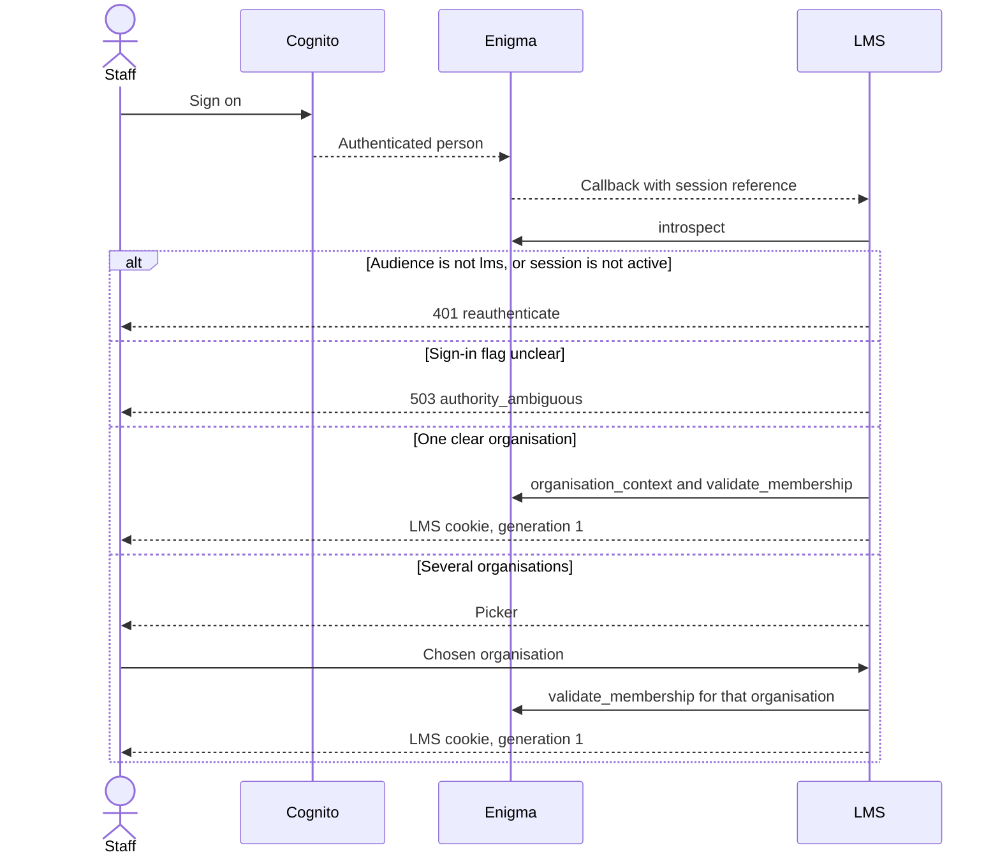
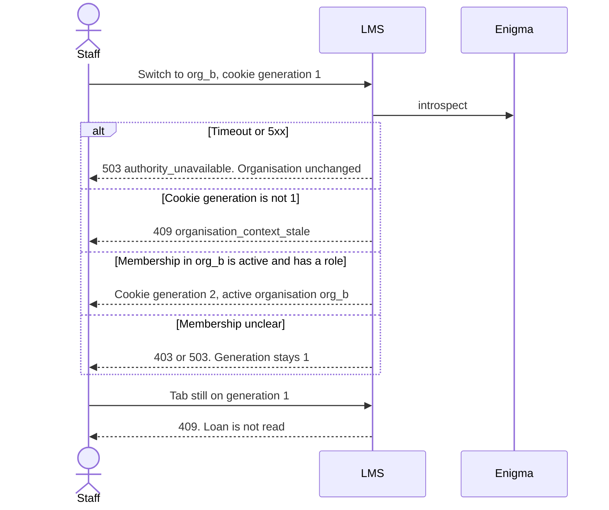
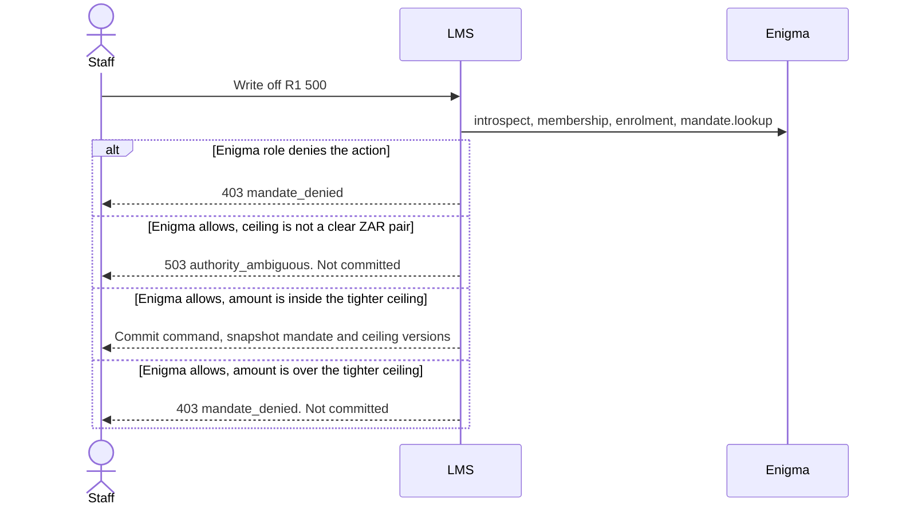

# LMS port on Enigma

Updated 27 October 2026 (Africa/Johannesburg).

This is the interface the post-origination LMS needs from Enigma, plus the LMS-side session handling that sits on it. Interest, fees, in duplum, payment allocation, and early settlement stay in the calculation engine. The ledger is out of scope.

The port operations are implemented as Python signatures in `src/lms/enigma/`. HTTP paths are still unbound: `eugene-ehlers/enigma` was not readable from this environment, and `UnboundEnigmaPort` raises if something tries to call a sketched URL.

## Locked decisions

Decisions taken 27 October 2026. The earlier option lists are closed.

### 1. Staff boarding follows the Academy pattern

Enigma owns the organisation and its staff list, including roles and mandates. An admin role amends that list in Enigma. Human sign-on is Cognito, fronted by Enigma. LMS trusts the membership and the role Enigma returns on `membership.validate` and the allow or deny from `mandate.lookup`.

LMS does not keep a staff table that can grant access. LMS does not amend the list. The next request after an admin change sees the new membership because every request asks Enigma again.

A person operates only in organisations where that answer is an active membership with at least one role. An active membership with an empty role list is ambiguous and stops the request.

### 2. Machines use an IAM role, exchanged by Enigma

Human path: Cognito authenticates the person, Enigma maps them to membership and roles.

Machine path: the job's AWS IAM role authenticates the process, Enigma maps the role ARN to a machine member, and the same five operations run with that machine session. The machine's allowed actions are a short list on the Enigma registration. Allocation is `lms.allocation.run`. A write-off call from that job is denied by `mandate.lookup`.

Comparison and the rejected alternatives are in [Machine identity](#machine-identity).

### 3. Suspended or unclear means stop

Servicing reads and money movement both stop unless sign-in, organisation status, membership, role, and enrolment are each a clear active answer, and `mandate.lookup` is a clear allow for the declared action.

`suspended`, `absent`, `closed`, a timeout, an HTTP 5xx, an unknown status, a missing role, or an enrolment answer for a different product all stop the request. Nothing in that set falls through to a cached role.

### 4. NCR number lives in LMS

Enigma does not hold the credit provider's NCR number. LMS stores it as a tenant regulatory attribute.

It is required later, on NCA compliance extracts and on communications for products that fall under the NCA. For the day-1 catalogue that means `lms.micro_short_term` and `lms.unsecured_personal`, unless the tenant is marked pure hosting. It is not required for pure hosting, `lms.bnpl_laybye`, or `lms.laybye_security`.

A blank number refuses the NCA communication or extract. It does not refuse booking. `ncr_number_required` in `src/lms/enigma/regulatory.py` is the gate.

### 5. Rand ceilings are adjustable data, evaluated by LMS

These are operational ceilings (for example a write-off ceiling). They are not the statutory NCA maxima. Those stay in the calculation engine.

- TSDG, the platform owner, adjusts solution-wide ceilings through an interface. The actor must hold Enigma role `lms.ceiling.platform.write` in the platform organisation.
- A company adjusts its own ceilings through an interface. The actor must hold Enigma role `lms.ceiling.company.write` in that company. The platform organisation cannot use the company screen to write a company's row.
- LMS stores the amounts. The next command reads the current rows. No deploy is required.
- The effective ceiling is the platform amount, or the lower of the platform and company amounts when the company has set one. A company figure above the platform ceiling does not raise the limit.
- A missing platform ceiling, a non-ZAR currency, or a negative amount is ambiguous and stops the command.
- An amount equal to the limit is inside the ceiling. One cent over is `mandate_denied`.

Role strings above are port names. The adapter maps them to Enigma's real role ids. See the remaining-details list.

Worked example. Platform write-off ceiling R10 000. Cape Credit sets R1 000. A clerk whose Enigma role allows `lms.account.write_off` submits R1 500 (`amount_cents` 150000). `mandate.lookup` returns allow. LMS then applies the ceiling and denies. R1 000.00 (`amount_cents` 100000) is allowed. If Cape Credit instead saves R50 000, the effective ceiling stays R10 000 until TSDG raises the platform row.

### 6. Identity freeze at booking

At booking LMS reads the live Enigma person and snapshots three fields onto the agreement: name, ID number, and service address. A later change in Enigma does not rewrite that agreement. A correction is a new LMS command with a new snapshot.

Communication preferences (email, mobile, preferred channel) are read from the live Enigma person at send time. They are not part of the frozen agreement.

A blank name, ID number, or service address refuses booking (`attributes_unavailable`). The booking command is not committed.

Worked example. Thandi is booked at 10:00 Africa/Johannesburg as "Thandi Nkosi", ID number `8001015009087`, service address "12 Loop Street, Cape Town". She later changes her name and address in Enigma. The concluded agreement still shows Loop Street. A statement email uses the email address on the live record.

## Fixed LMS rules

1. Enigma is the registry for persons, organisations, staff memberships, roles, mandates, and product enrolment. Cognito is the human authenticator behind Enigma.
2. The browser receives an LMS cookie (`HttpOnly`, `Secure`, `SameSite`). The Enigma session reference stays on the server. Production storage encrypts it at rest. The in-memory store in the sketch does not.
3. A session whose audience is not `lms` does not open an LMS session. The I-DIP audience `product-idip` is the case already seen in a sibling product.
4. Every request introspects the session. The route declares an action and, except for an organisation switch, a product code. A missing action or product is ambiguous.
5. Events clear caches. An event never grants a permission.
6. Timeout, HTTP 5xx, and an unrecognised payload become `authority_unavailable` or `authority_ambiguous`. The command is not committed.
7. After the caller may act in the active organisation, an account in another organisation is answered the same way as a missing account.
8. Timestamps from Enigma are absolute instants. LMS displays them in Africa/Johannesburg.

## Who owns which fact

| Fact | Authority | What LMS keeps |
| --- | --- | --- |
| Person identifier | Enigma | Opaque `person_id` on the account and the audit row |
| Name, ID number, service address | Enigma at booking | Frozen `AgreementIdentity`. Not updated from later Enigma reads |
| Email, mobile, channel preference | Enigma, live | Nothing on the agreement. Read again when sending |
| Organisation identifier | Enigma | Tenant key on every LMS row |
| Legal name, trading name | Enigma | Header projection |
| NCR number | LMS | Tenant regulatory attribute. Blank blocks NCA communications and extracts only |
| Staff list, roles, mandates | Enigma | Mandate id and version on the command snapshot. No staff table |
| Operational rand ceilings | LMS values, Enigma role gate | Platform row and per-company row, with versions on the snapshot |
| Product enrolment | Enigma | Menu cache only. Account routes call `enrolment.check` |
| Session | Enigma, after Cognito | LMS session id, session reference, person id, active organisation, generation |
| Loans, balances, allocation, settlement maths | LMS | Servicing record |

### Authority snapshot

Written in the same transaction as a regulated command that commits.

| Field | Meaning |
| --- | --- |
| `command_id` | LMS command |
| `person_id` | Actor, or the machine id Enigma returned |
| `organisation_id` | Active tenant |
| `session_ref_hash` | Hash of the Enigma session reference |
| `action` | For example `lms.account.write_off` |
| `product_code` | Enrolment code |
| `mandate_id`, `mandate_version` | From a clear allow |
| `enrolment_id`, `enrolment_version` | From a clear active enrolment |
| `platform_ceiling_version`, `company_ceiling_version` | Present when an amount was checked. Company version is empty when the company has not tightened the platform ceiling |
| `enigma_request_id` | Correlation id |
| `decided_at` | Instant of the decision |

A later revocation leaves the snapshot in place. Retention follows the audit record. The retention period is still a compliance decision and is not set here.

### Session row

| Field | Meaning |
| --- | --- |
| `lms_session_id` | Cookie name |
| `session_ref` | Enigma reference. Server only |
| `person_id` | Actor |
| `active_organisation_id` | Tenant currently selected |
| `organisation_generation` | Increments when the active organisation changes. A mismatch is HTTP 409 |

Switching to the organisation that is already active does not increment the generation, so other tabs stay valid.

## Port operations

Python: `EnigmaClient` in `src/lms/enigma/client.py`. The five methods are the port. They are not yet Enigma URLs.

Every call takes a `request_id`. Decisions carry `enigma_request_id`.

### `introspect(session_ref, *, request_id) -> SessionView`

`session.introspect`. LMS proceeds only when `audience == "lms"`, `status == "active"`, `sign_in_clear` is true, and `person_id` is present. Expired or revoked, or a foreign audience, is `reauthenticate` (401). Any other shape is `authority_ambiguous` (503).

`bound_organisation_id`, when set, must match the organisation LMS is about to use. A mismatch is ambiguous. LMS calls `session.bind_organisation` only if Enigma's real introspect includes that field. The method is not in the five.

### `organisation_context(session_ref, organisation_id, *, request_id) -> OrganisationContext`

Proceeds only for `status == "active"` on that organisation id. `suspended` and `closed` are `organisation_unavailable` (403). Anything else is ambiguous.

### `validate_membership(session_ref, person_id, organisation_id, *, request_id) -> Membership`

Proceeds only for `status == "active"` and a non-empty `roles` tuple. `suspended` and `absent` are `not_a_member` (403). An active membership with no role is ambiguous. LMS authorises from this answer and from `lookup_mandate`. It does not map a local role table.

### `lookup_mandate(query, *, request_id) -> MandateDecision`

`query` carries session, person, organisation, action, and product code. `allow` with a mandate id and version is the only yes, and only for that action. `deny` is `mandate_denied` (403). Any other payload is ambiguous.

Rand ceilings are not decided here. After a clear allow, LMS calls `enforce_amount` when the command has an amount.

Day-1 actions:

| Action | Who |
| --- | --- |
| `lms.account.read` | Staff |
| `lms.account.statement.read` | Staff |
| `lms.account.open` | Staff, at booking |
| `lms.payment.capture` | Staff |
| `lms.allocation.run` | Machine member |
| `lms.settlement.quote` | Staff. Arithmetic is LMS |
| `lms.settlement.accept` | Staff |
| `lms.account.write_off` | Staff, then the rand ceiling |
| `lms.account.restructure` | Staff |
| `lms.party.attributes.read` | Staff, to freeze or to read live preferences |
| `lms.export.borrower_data` | Staff |
| `lms.ceiling.platform.write` | TSDG role, platform organisation only |
| `lms.ceiling.company.write` | Company role, that company only |

### `check_enrolment(session_ref, organisation_id, product_code, *, request_id) -> Enrolment`

Proceeds only for `status == "active"` on the requested product code, with an enrolment id. `suspended` and `absent` are `enrolment_denied` (403), including on reads. A different product code in the answer is ambiguous.

Proposed codes, still to be confirmed against Enigma's catalogue:

| Code | Day-1 product | NCR number on communications |
| --- | --- | --- |
| `lms.micro_short_term` | Micro / short-term | Required when the tenant is not pure hosting |
| `lms.unsecured_personal` | Unsecured personal | Required when the tenant is not pure hosting |
| `lms.bnpl_laybye` | BNPL / laybye, zero cost | Not required |
| `lms.laybye_security` | Laybye as zero-interest security or deposit | Not required |

Enrolment and role are both required. A director role does not enrol the organisation.

## Identity freeze

`freeze_at_booking` in `src/lms/enigma/identity_freeze.py` reads `PersonDirectory.read_live_identity` and returns an `AgreementIdentity` with `person_id`, `name`, `id_number`, `service_address`, `frozen_at`, and `source_request_id`.

`communication_preferences` reads the same live person and returns email, mobile, and preferred channel. Callers must not write those fields onto the agreement.

Timeout and HTTP 5xx on the read are `authority_unavailable`. Booking waits.

## Session middleware

`src/lms/enigma/middleware.py`.

`establish_session` runs after the Cognito/Enigma callback. It introspects, checks organisation and membership, and stores generation `1`.

`handle_request` on every later call:

1. Load the LMS session. A missing cookie is 401.
2. `introspect`. Timeout or 5xx is 503 `authority_unavailable`. Unclear sign-in is 503 `authority_ambiguous`.
3. Compare the cookie generation to the server session. A mismatch is 409 `organisation_context_stale`, with the current organisation id and generation, and the loan is not read.
4. Organisation switch, when asked: `organisation_context` and `validate_membership` for the target. On success the generation increments and the cookie must be replaced. A stale tab cannot switch.
5. Otherwise require a product code, an active organisation, an active membership with a role, an active enrolment, and a mandate allow. An amount then goes through `enforce_amount`.

The edge returns `HttpResult`. Enigma response bodies stay in the server log beside `enigma_request_id`.

## Machine identity

Allocation and other non-human jobs have no staff cookie. Four patterns:

| Pattern | Authentication | How the mandate is limited | Credential on the job | Verdict |
| --- | --- | --- | --- | --- |
| Enigma + AWS IAM | The task role presigns `sts:GetCallerIdentity`. Enigma verifies it with AWS and returns a machine session | Enigma machine member lists the actions. LMS then calls the same `lookup_mandate` and `check_enrolment` | No long-lived access key. The role is the identity | Recommended. Same shape as Enigma + Cognito for humans |
| Cognito client credentials | App client id and secret. Enigma maps the client to a machine member | Same Enigma action list | Long-lived secret | Simpler only while Enigma cannot verify IAM. Interim: secret in Secrets Manager, rotation, private subnet. Not the target |
| Network location or mTLS only | Being inside the VPC, or holding a client certificate | No per-action mandate | Certificate | Rejected for allocation. Any process on that network could call write-off |
| Copied staff session | A person's Enigma session stored for the job | Whatever that person can do, including after they leave | The session | Rejected |

### Recommended registration

The machine list lives in Enigma and is amended by the same admin role that amends the staff list. LMS does not store a second copy. `MachineRegistration` in `src/lms/enigma/models.py` is the record Enigma holds.

1. Create an IAM role, for example `lms-allocation-cape-credit`, trusted only by the ECS task or Lambda service. No human principal. No access keys.
2. An Enigma admin adds a machine member: display name, `organisation_id`, IAM role ARN, AWS account, and allowed actions. For the nightly allocation job the list is `{lms.allocation.run}`.
3. The job runs as that task role. It presigns `GetCallerIdentity` and passes the proof to LMS.
4. LMS calls `MachineIdentityPort.exchange`. Enigma checks the signature, the role ARN, and the machine member, and returns a session reference.
5. LMS runs `introspect`, `organisation_context`, `validate_membership`, `check_enrolment`, and `lookup_mandate` for `lms.allocation.run`. Unclear answers fail closed and the batch posts nothing.
6. Removing the machine member, or deleting the IAM role, stops the next run. A bug that asks for `lms.account.write_off` is denied at mandate lookup.

`UnboundMachineIdentity` raises `wire_unbound` until Enigma exposes the exchange. The presigned URL is the proof. LMS does not mint keys and does not verify AWS itself.

Worked example. At 02:00 Africa/Johannesburg the Cape Credit allocation job exchanges its task role. Enigma returns a machine session whose only action is `lms.allocation.run`. The job allocates. A remainder that the job tries to write off is `mandate_denied`. If the exchange times out, the run is `authority_unavailable` and posts nothing.

## Sequences

### Login

### Organisation switch

Worked example. Johan is a member of North Bridge (`org_a`) and Harbour (`org_b`). He switches to Harbour at 11:00 Africa/Johannesburg. Generation becomes 2. A North Bridge tab still presenting generation 1 receives 409. After the browser retries with generation 2, a North Bridge loan id is answered as not found.

### Write-off

## Errors

The adapter maps Enigma's codes onto these. `HttpResult.error` is the code.

| Code | HTTP | When |
| --- | --- | --- |
| `reauthenticate` | 401 | Missing session, expired, revoked, or audience other than `lms` |
| `not_a_member` | 403 | Membership `absent` or `suspended` |
| `organisation_unavailable` | 403 | Organisation `suspended`, `closed`, or a different id |
| `enrolment_denied` | 403 | Enrolment `absent` or `suspended`, on reads and on mutations |
| `mandate_denied` | 403 | Lookup `deny`, or amount over the effective ceiling, or a ceiling edit without the role |
| `organisation_context_stale` | 409 | Cookie generation does not match. Body includes the current organisation and generation |
| `attributes_unavailable` | 409 | Booking is missing name, ID number, or service address, or a send has no live channel |
| `authority_unavailable` | 503 | Timeout, HTTP 5xx, or connection failure. Command not committed |
| `authority_ambiguous` | 503 | Unclear sign-in, empty role, unknown status, missing platform ceiling, or a payload the client does not recognise |
| `wire_unbound` | 503 | The placeholder adapter was called |

`introspect`, `organisation_context`, `validate_membership`, `lookup_mandate`, and `check_enrolment` are safe to retry with the same `request_id`.

Cache rules: session, membership, mandate, and enrolment authorise only inside the request that fetched them. A menu may show a stale action. The command calls lookup again. A negative cache is not used.

## LMS modules

| Module | Responsibility |
| --- | --- |
| `src/lms/enigma/client.py` | Five operations and fail-closed mapping |
| `src/lms/enigma/errors.py` | Error types and HTTP statuses |
| `src/lms/enigma/models.py` | Port value types, including the Enigma-held `MachineRegistration` |
| `src/lms/enigma/port.py` | `EnigmaPort`, `PersonDirectory`, `MachineIdentityPort`, `UnboundEnigmaPort` |
| `src/lms/enigma/middleware.py` | Establish session, switch, generation 409, per-request introspect |
| `src/lms/enigma/identity_freeze.py` | Booking snapshot and live communication preferences |
| `src/lms/enigma/ceilings.py` | Role gate for edits, tighter-of platform and company |
| `src/lms/enigma/machine.py` | Unbound IAM exchange |
| `src/lms/enigma/regulatory.py` | Whether an NCR number is required for a communication |
| `tests/test_enigma_session.py` | Session, freeze, ceiling, and NCR behaviour |

`python3 -m pytest tests/test_enigma_session.py` covers the middleware and the locked rules. There is no UI in this change.

## Remaining Enigma API details

These are the only items still needed from `STATUS.md`, the architecture docs, `consumer_contract.py`, the identity registry, mandates, and sessions. The six decisions above are not waiting on them.

1. HTTP paths, how LMS authenticates as a consumer, and the error-code map.
2. Cognito callback shape. LMS expects a session reference. Confirm whether the callback is that reference or an authorization code to exchange, and the claim that carries audience `lms`.
3. Real role ids for staff admin, `lms.ceiling.platform.write`, and `lms.ceiling.company.write`.
4. IAM exchange. The request Enigma will accept (presigned `GetCallerIdentity` or another SigV4 call), the checks on account and role ARN, and the machine session reference it returns.
5. Live person field names for name, ID number, service address, email, mobile, and preferred channel.
6. Whether `session.introspect` returns `bound_organisation_id`. If it does, switch must call Enigma's bind operation and LMS must not keep a local organisation the session is not bound to.
7. Catalogue strings for the four product codes.
8. Event signature, delivery, and the tombstone event if a person can be closed. A tombstone clears display projections and does not delete frozen agreement identity or authority snapshots.
9. Sandbox versus production audience, so a sandbox session cannot introspect into a production organisation.
10. How the admin staff-list screen is reached. LMS does not implement the amendment. Confirm whether the UI deep-links into Enigma or calls an Enigma API.

## Out of scope

The calculation engine and the ledger. Statutory interest, fees, in duplum, allocation order, and early-settlement formulae are not in this port. Operational ceilings are authorization limits only.

LMS does not register persons, does not register organisations, and does not edit the staff list or machine list.
