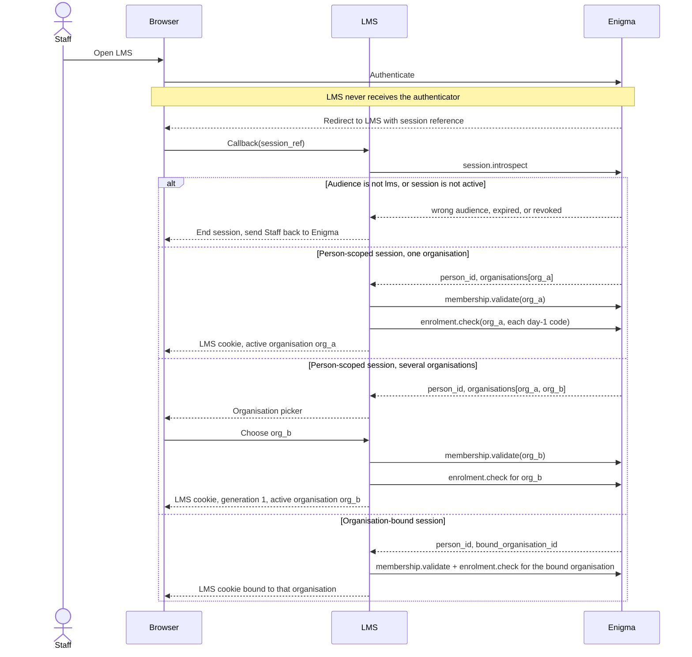
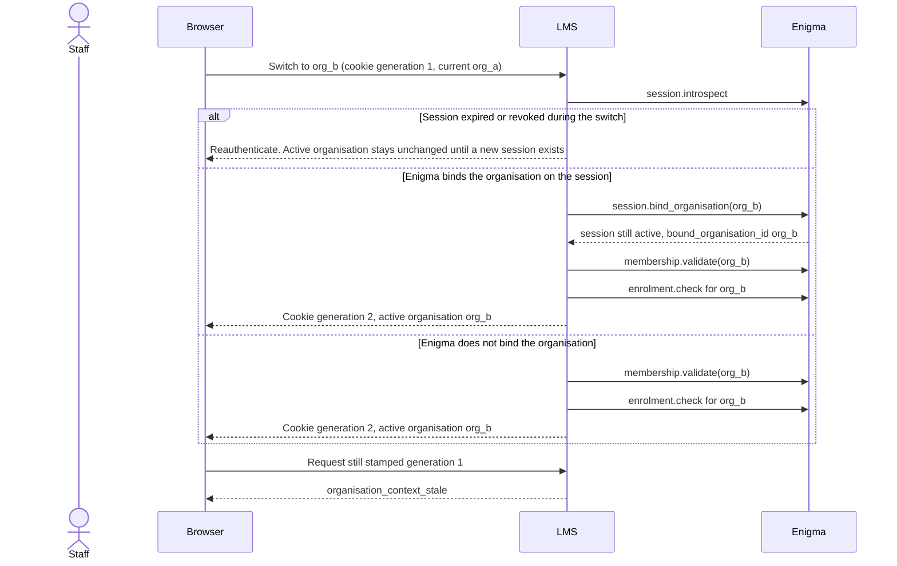
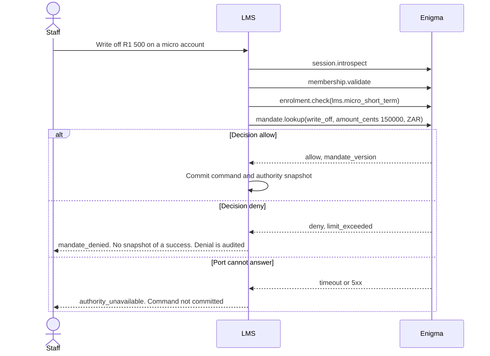

# LMS port on Enigma

Date: 26 October 2026 (Africa/Johannesburg).

This is the interface the post-origination LMS needs from Enigma. It covers organisation context, membership, session validation, role and mandate lookup, and product enrolment. It does not specify interest, fees, in duplum, payment allocation, or early settlement. Those stay in the LMS calculation engine.

The contract has two layers. The LMS port is the exact set of operations LMS code will call. The wire binding (HTTP paths, JSON names, event names, error codes) is unbound until `eugene-ehlers/enigma` is readable. Sketches in the wire section are proposals for Enigma to accept or replace. Do not generate a client from them.

## Source status

`eugene-ehlers/enigma` was not readable from this environment. The GitHub installation used by this run can see `eugene-ehlers/LMS` only. A request for `eugene-ehlers/enigma` came back as not found, which is also what GitHub returns for a private repository the caller cannot see. The account's public repositories do not contain `STATUS.md`, `consumer_contract.py`, an identity registry, mandates, or sessions.

Sibling-consumer evidence, which is not Enigma's contract: an I-DIP review dated 23 October 2026 (Africa/Johannesburg) says that product keeps only an Enigma session reference, turns Enigma on with `IDIP_ENIGMA_ENABLED` and `IDIP_OWNED_PASSPORT_AUTH`, and uses rails named `product-idip`, `org-tsdg`, and `idip-production`. Those rail names belong to that product. LMS must not copy them until Enigma's architecture docs confirm the rail scheme.

Fill the "Enigma actual" column in the reconciliation checklist from these files, in this order:

1. `STATUS.md` — what is already implemented.
2. Architecture docs — sessions, sync calls, events, rails.
3. `consumer_contract.py` — operations, authentication of a consumer, errors.
4. Identity registry — person identifier stability, attributes, search, deletion.
5. Mandates — decision versus data, limits, versions, machine actors.
6. Sessions — opaque reference versus token, organisation binding, expiry, revocation.

## Fixed LMS rules

These are LMS behaviour. They hold whichever wire Enigma exposes.

1. Enigma is the registry for persons, organisations, memberships, product enrolment, roles, and mandates. LMS calls the port. LMS has no local table that can say yes to those questions.
2. Enigma collects the authenticator. LMS receives a session reference and keeps it on the server. The browser receives an LMS cookie (`HttpOnly`, `Secure`, `SameSite`).
3. A session whose audience is another product (the I-DIP rail is the example already in use) does not authorize LMS. The adapter rejects it before any LMS data is read.
4. Every regulated mutation asks Enigma for a decision on that action, then writes an authority snapshot. A menu built from an earlier lookup is a display hint.
5. An event clears a cache. An event is never the grant of a permission.
6. When the port cannot return a decision (timeout, 5xx, unauthenticated response, unknown payload), the mutation is refused. The caller sees `authority_unavailable`. There is no local role to fall back to.
7. After the caller is allowed to act in the active organisation, an account that belongs to another organisation is answered the same way as an account that does not exist.
8. Timestamps from Enigma are absolute instants. LMS displays them in Africa/Johannesburg and stores them as instants. The call budget is configuration. When the budget is spent, the result is a refusal, not an implicit allow.

A regulated mutation is any LMS command that opens or changes an account, captures or allocates money, quotes or accepts a settlement, writes off, restructures, exports borrower data, or reads identity attributes beyond a display name. Reads of an account the caller already may see still require a live session and a live membership. They reuse the mandate decision only inside that same request.

## Who owns which fact

| Fact | Authority | What LMS keeps |
| --- | --- | --- |
| Person identifier | Enigma | The opaque `person_id` on the account and on the audit row |
| Legal name, identity number, contact, address | Enigma | A frozen attribute bag on the credit agreement, and only the fields counsel confirms the agreement must show. Later changes in Enigma leave the bag as concluded |
| Display name for the staff UI | Enigma | A projection with `fetched_at`. Rebuilt any time. Never used as the agreement name |
| Organisation identifier | Enigma | The opaque `organisation_id` on every LMS row. It is the tenant key |
| Legal name, trading name, registration | Enigma, if Enigma holds them | Projection for the header. Frozen legal name on the agreement |
| NCR registration number of the credit provider | Unbound. See open question 4 | Frozen on the agreement once the source of the number is chosen |
| Membership, role, mandate | Enigma | The mandate id, version, and Enigma request id on the authority snapshot for that command. No role table |
| Product enrolment | Enigma | Nothing authoritative. A positive cache may drive the product menu and must be ignored by account-opening |
| Session | Enigma | LMS session row: LMS session id, Enigma session reference, `person_id`, active `organisation_id`, organisation generation, expiry |
| Loans, balances, statements, allocation, settlement maths | LMS | The servicing record |
| Which of the four day-1 products an organisation may service | Enigma enrolment. Proposed codes below, unbound | LMS configuration (statement template, fee set, product parameters) is inert unless enrolment for that code is active |

LMS does not keep passwords, password hashes, MFA secrets, a membership table, or a searchable index of identity numbers. If a servicing search by identity number is required, that search is an Enigma call. See open question 6.

### Authority snapshot

Written in the same transaction as the regulated command.

| Field | Meaning |
| --- | --- |
| `command_id` | LMS id of the command |
| `person_id` | Actor |
| `organisation_id` | Active tenant |
| `session_ref_hash` | Hash of the Enigma session reference. The raw reference is a bearer secret and stays in the session store |
| `action` | Port action name, for example `lms.account.write_off` |
| `product_code` | Enrolment code of the account |
| `mandate_id` | From the decision |
| `mandate_version` | From the decision |
| `enrolment_id` | From the enrolment check |
| `enrolment_version` | From the enrolment check |
| `enigma_request_id` | Correlation id returned by Enigma |
| `decided_at` | Instant of the decision |

A later revocation leaves the snapshot in place. Unwinding the command is an LMS decision and is outside this contract. Retention of the snapshot follows the LMS audit record. The retention period is open question 11.

### Session row

| Field | Meaning |
| --- | --- |
| `lms_session_id` | What the cookie names |
| `session_ref` | Enigma reference. Encrypted at rest. Server only |
| `person_id` | Actor |
| `active_organisation_id` | Tenant currently selected |
| `organisation_generation` | Increments on every organisation switch. A request that still carries the previous generation gets `organisation_context_stale` |
| `expires_at` | The earlier of the LMS idle limit and the Enigma session expiry |

## Port operations

LMS calls these. Names are the port. They are not yet Enigma paths.

Every call sends a correlation id (`request_id`) and the consumer name `lms`. Every successful decision returns `enigma_request_id`, which the snapshot stores.

### 1. `session.introspect`

Validate the session reference.

Request: `session_ref`.

Response:

- `status`: `active`, `expired`, or `revoked`
- `person_id`
- `audience`: must be the LMS product audience. Any other audience is `session_wrong_audience` and LMS stops
- `expires_at`
- `bound_organisation_id`: present when Enigma itself binds the session to one organisation. Absent when the session is person-scoped and the organisation list follows
- `organisations`: only when there is no bound organisation. Each entry is `organisation_id` plus membership `status`
- `authenticator_level`: unbound. LMS will require a floor for account-opening once Enigma defines the scale. See open question 7

LMS behaviour: `expired`, `revoked`, unknown, or wrong audience ends the LMS session and the browser is sent back through Enigma. LMS does not offer a password form.

### 2. `organisation.context`

Load the tenant header and the status gate.

Request: `organisation_id`, `session_ref`.

Response:

- `organisation_id`
- `status`: `active`, `suspended`, or `closed`
- `legal_name`
- `trading_name`
- `registration_number` when Enigma holds it
- `country`
- `brand` when Enigma holds the white-label mark (logo reference, display name). When Enigma does not, brand is LMS configuration keyed by `organisation_id`. See open question 5

LMS behaviour: `closed` refuses every call. `suspended` refuses regulated mutations. Whether servicing reads continue is open question 3. LMS never creates an organisation Enigma did not return.

### 3. `membership.validate`

Confirm the actor belongs to the organisation right now.

Request: `session_ref`, `person_id`, `organisation_id`.

Response:

- `status`: `active`, `suspended`, or `absent`
- `membership_id`
- `membership_version`
- `role_labels`: display only. LMS does not authorize from a label

LMS behaviour: anything other than `active` refuses the call. A role name cached at login cannot fill the gap.

### 4. `mandate.lookup`

Ask for a decision on one action in context. The port passes the context so an amount limit, if Enigma has one, is applied by Enigma.

Request:

- `session_ref`
- `person_id`
- `organisation_id`
- `action`
- `product_code`
- `context`: optional, for example `{ "amount_cents": 150000, "currency": "ZAR" }`

Response:

- `decision`: `allow` or `deny`
- `reason`: `ok`, `mandate_absent`, `mandate_expired`, `scope_mismatch`, `limit_exceeded`
- `mandate_id`, `mandate_version` when a mandate was considered
- `enigma_request_id`

LMS behaviour: `allow` is the only result that proceeds, and only for this action and this context. A decision for `lms.account.read` does not cover `lms.account.write_off`. LMS does not re-compare a copied limit. If Enigma's real contract returns the limit and expects the consumer to compare, that is a binding change and belongs in the reconciliation checklist before any limit is coded twice.

Day-1 action names the port will send:

| Action | Who | When |
| --- | --- | --- |
| `lms.account.read` | Staff | Open an account in the active organisation |
| `lms.account.statement.read` | Staff | Statement |
| `lms.account.open` | Staff | Accept a boarded account into servicing |
| `lms.payment.capture` | Staff | Capture a receipt |
| `lms.allocation.run` | Machine membership | Allocation batch |
| `lms.settlement.quote` | Staff | Produce an early-settlement quote. The arithmetic is LMS |
| `lms.settlement.accept` | Staff | Accept it |
| `lms.account.write_off` | Staff | Write off |
| `lms.account.restructure` | Staff | Restructure |
| `lms.party.attributes.read` | Staff | Pull agreement-time attributes from Enigma |
| `lms.export.borrower_data` | Staff | Export |

### 5. `enrolment.check`

Confirm the organisation is enrolled for one product code.

Request: `session_ref` or machine credential, `organisation_id`, `product_code`.

Response:

- `status`: `active`, `suspended`, or `absent`
- `enrolment_id`
- `enrolment_version`
- `product_code`

LMS behaviour: account-opening requires `active` for that code. A suspended enrolment refuses new accounts and refuses money movement. Existing-account reads follow open question 3.

Proposed product codes, unbound until Enigma's catalogue is read:

| Code | Day-1 product |
| --- | --- |
| `lms.micro_short_term` | Micro / short-term |
| `lms.unsecured_personal` | Unsecured personal |
| `lms.bnpl_laybye` | BNPL / laybye, zero cost |
| `lms.laybye_security` | Laybye held as zero-interest security or deposit for a high-risk short-term loan |

Enrolment and mandate are both required. A director's mandate does not enrol the organisation. An enrolment does not grant the staff member the action.

### Conditional operations

These are part of the port only if the matching open question is resolved that way. They are not in the minimum set yet.

| Operation | Add it when |
| --- | --- |
| `session.bind_organisation` | Introspect returns `bound_organisation_id`. Switching organisation is then an Enigma call. The returned reference replaces the one in the session row |
| `party.usable` | Enigma models "this person may be a party of this organisation". Boarding calls it before attaching `person_id` to an account. See open question 1 |
| `person.attributes` | The agreement must freeze fields Enigma holds. Request is `person_id`, `organisation_id`, `purpose`. Day-1 purposes: `display`, `agreement_conclusion`. The response is the attribute bag and an `attributes_version` |
| `machine.session` | Batches run without a person session. Enigma issues a machine membership and a session for `lms.allocation.run` only |

## Events LMS receives

Invalidation hints. At least once. Signed. LMS deduplicates on `event_id`. A lower `subject_version` after a higher one has been seen is ignored for the cache, and the next mutation still calls the port.

| Event | LMS does |
| --- | --- |
| `session.revoked` | Delete LMS sessions holding that reference |
| `membership.changed` | Drop cached membership for that person and organisation. End LMS sessions for that pair when status is no longer `active` |
| `mandate.changed` | Drop cached menu data for that person and organisation |
| `enrolment.changed` | Drop cached enrolment. In-flight account-opening that has not committed re-checks |
| `organisation.status_changed` | Drop the organisation projection. Apply the `closed` / `suspended` gate on the next request |

A `mandate.changed` that grants a new mandate does not let the next request skip `mandate.lookup`.

Ordering across event types is not assumed. The mutation path is the authority.

## Wire sketches (unbound)

Replace this section from `consumer_contract.py`. Shapes are here so the mapping is reviewable. Paths are placeholders of the form `POST /enigma/v1/...`.

Authentication of LMS as a consumer is unbound. The sketch assumes a service credential plus the user session reference on user calls, and a machine credential on `lms.allocation.run`. A session reference for product I-DIP presented to these routes is `session_wrong_audience`.

```json
{
  "operation": "session.introspect",
  "request": { "session_ref": "sess_9c2" },
  "response": {
    "status": "active",
    "person_id": "per_12",
    "audience": "lms",
    "expires_at": "2026-10-26T14:10:00Z",
    "bound_organisation_id": null,
    "organisations": [
      { "organisation_id": "org_a", "status": "active" },
      { "organisation_id": "org_b", "status": "active" }
    ],
    "enigma_request_id": "req_4401"
  }
}
```

```json
{
  "operation": "mandate.lookup",
  "request": {
    "session_ref": "sess_9c2",
    "person_id": "per_12",
    "organisation_id": "org_a",
    "action": "lms.account.write_off",
    "product_code": "lms.micro_short_term",
    "context": { "amount_cents": 150000, "currency": "ZAR" }
  },
  "response": {
    "decision": "deny",
    "reason": "limit_exceeded",
    "mandate_id": "man_88",
    "mandate_version": 4,
    "enigma_request_id": "req_4402"
  }
}
```

```json
{
  "operation": "enrolment.check",
  "request": {
    "session_ref": "sess_9c2",
    "organisation_id": "org_b",
    "product_code": "lms.micro_short_term"
  },
  "response": {
    "status": "absent",
    "enrolment_id": null,
    "enrolment_version": null,
    "product_code": "lms.micro_short_term",
    "enigma_request_id": "req_4403"
  }
}
```

Event envelope, unbound:

```json
{
  "event_id": "evt_17",
  "type": "membership.changed",
  "occurred_at": "2026-10-26T12:10:00Z",
  "subject_version": 9,
  "person_id": "per_12",
  "organisation_id": "org_a",
  "status": "suspended"
}
```

## Sequences

### Login

Two shapes are both implementable on the port. The adapter follows whichever one `session.introspect` actually returns. LMS does not call `session.bind_organisation` unless `bound_organisation_id` exists in the introspect result.



Worked example, one organisation. Thandi authenticates at 09:00 Africa/Johannesburg. Introspect returns `per_12`, audience `lms`, and only `org_7f3` (Cape Credit), membership `active`. Enrolment for `lms.micro_short_term` and `lms.unsecured_personal` is `active`. LMS stores the session reference server-side and sets the cookie. The header name "Cape Credit" comes from `organisation.context`. Her menu calls `mandate.lookup` for the read action. A write-off at 09:12 calls `mandate.lookup` again with the amount.

Worked example, wrong product. The same callback presents the session reference I-DIP issued her. Introspect returns audience `product-idip`. LMS ends the callback and does not open a Cape Credit session.

### Organisation switch



Worked example. Johan is a member of North Bridge Loans (`org_a`) and has a read mandate at Harbour Finance (`org_b`). He switches to Harbour at 11:00 Africa/Johannesburg. LMS validates membership in `org_b` before it drops `org_a`. A tab that still shows a North Bridge loan id then calls LMS with generation 1. LMS answers `organisation_context_stale` and does not look up the loan. After the browser retries with generation 2, Johan is allowed to act in Harbour. The North Bridge loan id is answered as not found. It is not answered as forbidden, because a forbidden would tell him the loan exists in the other book.

Worked example, dying session. Introspect during the switch returns `expired`. LMS does not move him to Harbour on the old cookie. He authenticates again, then picks the organisation.

### Regulated action (error path)



Worked example, limit. Mandate `man_88` version 4 allows write-off up to R1 000. The clerk submits R1 500 (`amount_cents` 150000). Lookup returns `deny` / `limit_exceeded`. LMS does not keep a local copy of the R1 000 ceiling and compare it itself.

Worked example, stale menu. At 09:00 the menu showed write-off because version 4 allowed it. At 09:10 Enigma revokes the mandate and emits `mandate.changed`. The 09:12 submit calls lookup and is denied even if the event has not arrived yet. A write-off that committed at 09:05 remains, with version 4 on its snapshot.

Worked example, enrolment. Harbour Finance is enrolled in `lms.bnpl_laybye` and `lms.laybye_security`. Enrolment for `lms.micro_short_term` is `absent`. A staff member whose mandate would allow `lms.account.open` still cannot board a micro account. The check that fails is enrolment, and the mandate is not a substitute.

## Error handling

The adapter maps Enigma's real codes onto these port results. The UI receives the LMS error only. Enigma response bodies stay in the server log, tied to `enigma_request_id`.

| Port result | When | LMS HTTP | What the user can do |
| --- | --- | --- | --- |
| `reauthenticate` | Session missing, expired, revoked, or wrong audience | 401 | Return through Enigma |
| `not_a_member` | Membership `absent` or `suspended` | 403 | Nothing in this organisation |
| `organisation_unavailable` | Organisation `closed`, or unknown to Enigma | 403 | Nothing in this organisation |
| `enrolment_denied` | Enrolment `absent` or `suspended` on a mutation or on account-opening | 403 | Servicing reads follow open question 3 |
| `mandate_denied` | Lookup `deny` | 403 | The denial names the action, not the raw Enigma payload |
| `organisation_context_stale` | Cookie generation does not match the session row | 409 | Reload. LMS returns the current organisation id |
| `cross_tenant` | Caller may act in the active organisation, and the account is not in it | 404 | Same body as a missing account |
| `authority_unavailable` | Timeout, 5xx, connection failure, bad signature, payload the adapter does not recognise | 503 | Retry later. The command is not committed. `Retry-After` is forwarded when Enigma sent one |
| `attributes_unavailable` | `person.attributes` cannot be completed for `agreement_conclusion` | 409 on boarding | Boarding of that account waits. LMS does not invent the identity fields |

Idempotency: `session.introspect`, `membership.validate`, `mandate.lookup`, `enrolment.check`, and `organisation.context` are safe to retry with the same `request_id`. `session.bind_organisation`, if it exists, is idempotent for the same session reference and organisation: a repeat leaves the binding on that organisation and returns the current reference.

Cache rules:

| Data | May be cached | May authorize a mutation |
| --- | --- | --- |
| Session status | For the rest of the same request | Only inside that request, then the snapshot records the request id |
| Membership | For the rest of the same request | Only inside that request |
| Mandate decision | Menu display, labelled with `fetched_at` | No. The next mutation calls lookup |
| Enrolment | Product menu | No for account-opening or money movement |
| Organisation legal name, brand | Header projection | No decision depends on it |
| Person display name | Staff UI | No. The agreement uses the frozen bag |

A negative cache (remembering `absent` so we skip the call) is not used. A just-completed enrolment or membership must be visible on the next attempt.

Machine path: the nightly allocation job uses `machine.session` when that operation exists, then `enrolment.check` and `mandate.lookup` for `lms.allocation.run`. It does not reuse a staff session reference. If Enigma has no machine membership, the job cannot run under a copied human session. See open question 2.

## Open questions

Each one blocks a binding choice. The recommendation is what LMS will assume if Enigma's owners confirm it. Worked examples use rands and Africa/Johannesburg.

### 1. Is a borrower an Enigma person, and what stops cross-tenant attachment?

The task says LMS does not re-implement person identity. Post-origination boarding therefore arrives with an Enigma `person_id` already chosen by the originating system.

- **Option A. Enigma proves the person may be a party of this organisation.** Boarding calls `party.usable(person_id, organisation_id, product_code)`. A no rejects the row. Recommendation: this option, if the registry already has a relationship that can answer it.
- **Option B. Enigma only proves the person exists.** The originating system presents a signed assertion, produced by Enigma, that `person_id` was released to `organisation_id` for `lms`. LMS verifies the signature. LMS does not keep a customer registry of its own.
- **Option C. LMS collects the identity document.** This rebuilds person identity inside LMS. It conflicts with the task. It is listed so the rejection is explicit.

Worked example. A boarding file for Harbour Finance (`org_b`) contains `per_12`, who is a Cape Credit consumer, because of a bad join. Option A or B rejects the row before an agreement snapshot is written. A bare "person exists" check would let Harbour staff retrieve Cape Credit's customer's agreement attributes.

Blocker: which Enigma call or signed assertion the originating system already uses. Read the identity registry and `consumer_contract.py`.

### 2. How does a batch act with no human session?

Allocation and statement jobs have no staff cookie.

- **Option A. Machine membership.** Enigma issues a non-human member of the organisation whose only mandate action is `lms.allocation.run` (and a separate one for statement generation if that is a different action). Recommendation.
- **Option B. A staff session is stored for the job.** A revoked human mandate would keep authorizing the batch, or a resignation would stop the batch. Rejected.

Worked example. At 02:00 Africa/Johannesburg the allocation job for Cape Credit runs. The machine mandate allows `lms.allocation.run` and lookup denies `lms.account.write_off`. The job allocates. It cannot write off a remainder it does not like.

### 3. What may LMS still do when enrolment or the organisation is `suspended`?

Money movement and account-opening stop. Existing borrowers may still need statements and receipts recorded.

- **Option A. Fail closed on every route, including reads.** Simplest reading of a single `suspended` flag. Recommendation until Enigma grows a more precise status, because this contract must not invent a servicing exemption.
- **Option B. Enigma adds `suspended_servicing_only`.** Reads, statements, and receipt capture stay available. New accounts, write-off, restructure, and settlement acceptance stop. LMS will implement this the day the port grows that status. It will not infer it from `suspended`.

Worked example. Cape Credit's enrolment goes `suspended` at 14:00. A disbursement-equivalent boarding at 14:01 is refused under both options. A balance enquiry at 14:02 is refused under Option A and allowed under Option B. The 14:02 behaviour waits on the status Enigma actually has.

### 4. Where does the credit provider's NCR registration number live?

Agreements and statements need the provider's registration number. This contract does not decide the statutory wording.

- **Option A. Enigma holds it on the organisation and `organisation.context` returns it.** Recommendation when the organisation registry already stores regulatory identifiers.
- **Option B. LMS stores it as a regulatory attribute of the tenant, keyed by `organisation_id`.** It is not a person registry and not a second organisation registry. It is one regulated number Enigma does not have. Changes are audited in LMS.

Worked example. Cape Credit's NCR number changes after a new registration certificate. Under Option A, LMS reads the new value from Enigma and freezes the value current at each new agreement; old agreements keep the bag they concluded with. Under Option B, the same freeze happens from the LMS attribute.

### 5. Where does white-label brand live?

- **Option A. Brand is organisation context in Enigma** (trading name, logo reference). LMS renders it and does not keep a second brand record.
- **Option B. Brand is LMS configuration** keyed by `organisation_id`. Enigma remains the tenant key. Recommendation if Enigma's organisation record is legal identity only. Confirm against the architecture docs.

### 6. May LMS search by identity number?

- **Option A. Enigma search, purpose-limited.** LMS sends the number, Enigma returns `person_id` values the caller may use for this organisation. LMS does not index the number. Recommendation.
- **Option B. No search in servicing.** Staff work from account numbers and `person_id` values already on LMS accounts. Stronger, and acceptable for a post-origination book if the boarding source always supplies `person_id`.

Worked example. A consumer quotes an identity number on a call. Under Option A the clerk's action `lms.party.attributes.read` plus a search purpose returns at most the `person_id` values already usable for Harbour Finance, and the clerk opens those accounts. Under Option B the clerk searches the LMS account number only.

### 7. Does a mandate carry amount and time limits, and who evaluates them?

The port sends `context` and expects `allow` or `deny`, so the ceiling lives in one place.

- **Option A. Enigma evaluates.** Recommendation. `limit_exceeded` is a reason on an otherwise identified mandate.
- **Option B. Enigma returns the ceiling and LMS compares.** Acceptable only if `consumer_contract.py` already says so. The comparison (inclusive bound, per-command versus per-day aggregate, currency) would then have to be specified by Enigma in writing before LMS copies it.

Worked example. Ceiling R1 000. Command R1 000.00 (`amount_cents` 100000). Option A returns `allow` or `deny` with the bound defined by Enigma. LMS does not guess whether R1 000.00 is inside the ceiling. Command R1 000.01 returns `deny` / `limit_exceeded` under a "ceiling inclusive, cents exact" rule. That rule is Enigma's to state.

A mandate also needs an effective interval. A command is judged at `decided_at`. A backdated receipt uses the mandate that is valid at decision time, not a mandate that was valid on the receipt's value date, unless Enigma's contract says the lookup accepts a value date. See the next question.

### 8. Which instant does `mandate.lookup` use?

- **Option A. Enigma uses the time of the call.** Recommendation. The snapshot's `decided_at` matches the decision. Value date of a payment stays an LMS fact and does not select the mandate.
- **Option B. LMS passes `effective_at`.** Needed only if a supervisor may act under a mandate as it stood on a previous day. Enigma would have to define it. LMS will not send it until then.

Worked example. A mandate expires at 16:00 Africa/Johannesburg. A receipt valued yesterday is captured at 16:05. Option A denies the capture. The cashier's earlier capture at 15:50 remains, with that version on the snapshot.

### 9. Session binding

Resolved at runtime by the introspect shape, restated here so the adapter test is obvious.

- Introspect includes `bound_organisation_id`: switch calls `session.bind_organisation`. LMS does not silently keep a local organisation the session is not bound to.
- Introspect includes `organisations` and no binding: switch calls `membership.validate` and stores the choice in the LMS session row.

Worked example of the mismatch. LMS assumes a local switch while Enigma has the session bound to `org_a`. The next introspect snaps the user back to `org_a` after they believed they were in `org_b`, and a mutation can land in the wrong book. The generation counter does not save this. The bound organisation, when present, wins.

### 10. Attribute bag on the agreement

LMS can freeze a bag. The fields are a legal question, not an Enigma invention and not an NCA calculation.

Need a written list before `purpose=agreement_conclusion` is coded: which of legal name, identity number or passport number, juristic registration, address, and contact must be frozen, and which must stay display-only. The bag is immutable after conclusion. A later correction is a new LMS command with a new snapshot, not an edit of the old bag.

### 11. Audit retention, POPIA, and deletion

I-DIP's review described rails that forbid person deletes. If Enigma tombstones a person, LMS still has agreements and snapshots that cite `person_id`.

- LMS keeps the snapshot for the life of the audit record. The period itself needs a compliance decision. This document does not set a number of years.
- A tombstone event, if Enigma emits one, clears display projections. It does not delete agreement bags or authority snapshots.
- Confirm the event name and whether a tombstoned `person_id` still resolves for audit reads by the credit provider.

### 12. Consumer authentication, environments, and rails

Need from the architecture docs and `consumer_contract.py`:

- How LMS authenticates as a consumer (shared secret, mTLS, signed JWT, network policy).
- The audience string for LMS. Do not reuse `product-idip`.
- The environment rail names for production and sandbox. Proposed labels, unbound: audience `lms`, environment `lms-production` and `lms-sandbox`.
- Whether sandbox organisations can be told apart in `organisation.context`, so a sandbox session cannot introspect into a production organisation.

Worked example. A sandbox session reference for a test organisation is presented to production LMS. The adapter's audience or environment check fails with `session_wrong_audience` before any production account is read.

### 13. Status of the modules this contract must still be checked against

| Source file | Question the file answers | Enigma actual |
| --- | --- | --- |
| `STATUS.md` | Which of the five operations exist on the day LMS integrates | Unread |
| Architecture docs | Sync only, or events as well. Rail and audience scheme | Unread |
| `consumer_contract.py` | Paths, auth, error codes, idempotency | Unread |
| Identity registry | `person_id` stability, party-to-organisation relationship, attributes, search, tombstone | Unread |
| Mandates | Decision versus ceiling data, versions, machine members, effective time | Unread |
| Sessions | Opaque reference versus token, organisation binding, revocation, expiry | Unread |

## Out of scope

The calculation engine is out of scope: interest caps, initiation and service fees, in duplum, the order of payment allocation, and the early-settlement formula. The port only decides whether the actor may run those LMS commands.

LMS does not register persons, does not register organisations, and does not edit mandates.
