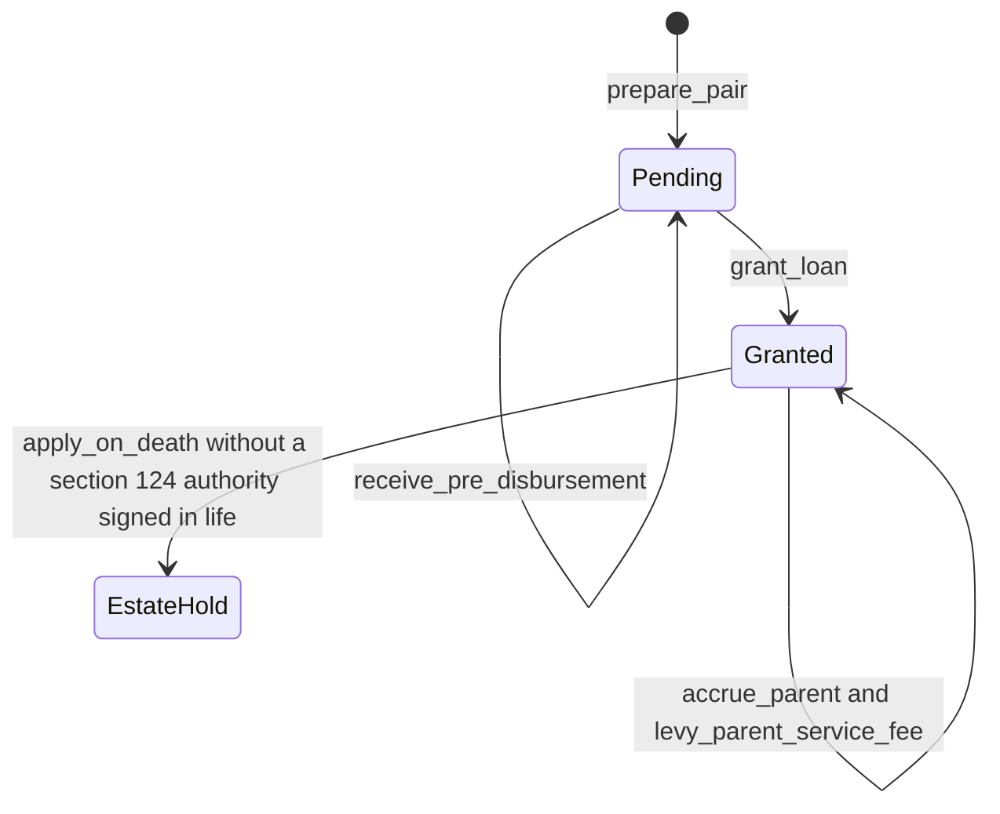

# Laybye and credit life — Layer 1 draft

**Status: Layer 1 draft, now implemented in `lms.laybye`.** This note is not a locked decision. `docs/LOCKED_DECISIONS.md` on this branch is the source of truth (the `main` text of 28 October 2026). Where this note and that file differ, the locked file wins.

The layer calls the calculation engine, configuration, the ledger, and does not re-implement their formulas. It does not implement statements, the collections workflow, or regulatory extracts. Credit-life handling here is the premium collection instruction and the death gate.

## 1. The pair

| Behaviour | Lock | What the code does |
| --- | --- | --- |
| One parent and one child, treated as one loan, not security | §4 | `Ledger.prepare` opens the parent. `Ledger.open_laybye` opens one `laybye_hold` child. A second child is refused. No secured flag is written. |
| Client pays, then the loan is disbursed. Not deposit-taking | §4 | `prepare_pair` posts no principal. `grant_loan` posts the loan-out later. The hold is a credit balance, not a deposit product. |
| Pre-disbursement receipts sit in the Laybye when that account exists. Cash in, not loan out | §4, §1 | `receive_pre_disbursement` calls `Ledger.credit_laybye`: debit cash, credit `laybye_hold`, on the recognition value date. Principal is unchanged. No Laybye account: the receipt is not posted. |
| Once the loan is granted, payments go to the loan first (section 126), then excess to the Laybye | §4, §8 | `allocate_receipt` asks `Ledger.section_126_cents`, which calls `allocate_payment` for due amounts only, then `Ledger.post_payment` for that portion and `Ledger.credit_laybye` for the rest. |
| Value date | §1 | Both postings use `value_date` of the recognition instant. A reversal uses the original value date through `Ledger.reverse`. |
| Interest on max(0, principal − hold). The hold reduces only the interest base | §4, §5 | `accrue_parent` calls `Ledger.accrue_day`. That calls `interest_bearing_cents`. This layer does not subtract the hold again. |
| Principal stays gross for in-duplum and settlement | §4, §7 | The principal bucket is not reduced by the hold. `flag_default` still sets the ceiling from unpaid principal. |
| One service fee, on the parent | §4, §9 | `levy_parent_service_fee` calls `Ledger.levy_service_fee`. The child is refused. A second fee in the same month is refused. The opening month is pro-rata; later months, including settlement, are the full fee, inside the cap the ledger already applies. |
| Day-1 name | §4 | No mirror: `credit-improvement loan child`. A mirror: that product name. Blank mirror name fails closed. |
| Day-1 treatment | §4 | No mirror: `cash-deposit`. A mirror: fail closed. The lock does not say what replaces cash-deposit. |
| Top-up | §4, §13 | `top_up` does not read or write the hold. Layer 0 has no top-up posting, so the call fails closed. No price or schedule is invented. |
| Credit life pays the loan first. Surplus goes to the estate (cash-deposit) | §4 | `apply_credit_life_proceeds` posts the due section 126 portion to the loan. It does not credit the Laybye. The unposted remainder is not paid to an estate account, because none exists. |
| Credit-life accounts and statements stay with the insurer | §4 | `raise_collections` returns instructions only. It posts no `credit_insurance` balance and stores no statement. |
| Automated collections: loan instalment and premium are separate | §4, §3 | When `automated` is true the premium amount is required. Two instructions are returned, even when the premium is R0. When automation is off, no instruction is returned. |
| Funeral beneficiary sits with the insurer | §4 | `store_funeral_beneficiary` fails closed. The loan and the hold are not moved. |
| Death does not apply the hold without a section 124 authority signed in life | §4 | `apply_on_death` fails closed with `s124-missing` when the authority is absent, unsigned in life, or has no id. The hold and principal stay as they are. |
| A present authority is checked, not interpreted | §4 | `guard_s124` checks the id, the cents, and the dates the caller already holds. Enigma is not asked. §15 limits Enigma to identity and access. |
| Elections fail closed | §19 | `Ledger.prepare` calls `resolve_customer_settings`. An unset election is refused there. This layer does not fill one. |
| Identity stays frozen | §16 | The child is opened with the parent's frozen name, identity number, and service address. |

## 2. State machine

Durable states are the ones the ledger can store.

`EstateHold` is the same balances plus the refusal. Funeral does not change state. A top-up does not exist, so it does not change state.

| Event | Result | Stop |
| --- | --- | --- |
| Pre-disbursement receipt, Laybye exists | Cash in on the child. Principal unchanged. | Already granted. No child. |
| Grant | Loan-out on the parent. Hold unchanged. | Already granted. Schedule does not match the cash advanced. |
| Receipt after grant | Due section 126 amount on the loan. Excess on the Laybye. | Nothing due and no Laybye for the excess. Loan portion without an attributed due date (§6). |
| Credit-life proceeds | Due amount on the loan. Excess not posted. Hold unchanged. | Same due-date rule when a loan portion exists. |
| Death, no authority signed in life | No posting. | `s124-missing`. |
| Death, authority present, amount is due | Hold debited and the same cents posted to the loan, after `guard_s124`. | Amount above the due section 126 total. Amount above the mandate. |
| Service fee | Parent only. | Child. Second fee in the month. Before grant. |
| Top-up | No posting. | `top-up-undefined`. |

## 3. Call order on a receipt day

§1: capitalise the day's due amounts, then allocate receipts recognised that day. This layer does not accrue inside `allocate_receipt`. The caller runs `accrue_parent` and `levy_parent_service_fee` (or `Ledger.levy_charge`) for amounts that are due that day, then `allocate_receipt`. Same-day receipts keep the ledger's recognition sequence.

Servicing's statement path does not yet reorder a receipt behind that day's capitalisation. That gap is in the Layer 0 smoke tests. This layer does not implement statements.

## 4. What is still not settled

These are not given a value here.

1. **§13 and §4.** A partial prepayment shortens the term or drops the instalment, by the provider's election. On a linked pair the excess after due section 126 amounts goes to the Laybye instead. The lock does not say the client can choose the prepayment instead of the hold. `Ledger.post_payment` on a loan that is not using this allocator still applies the election.
2. **Mirror treatment.** §4 says cash-deposit until a mirror exists, then the Laybye is called by that product name. It does not say the legal treatment that replaces cash-deposit. `day1_treatment` fails closed when a name is supplied. Configuration has no mirror-product field; the name is an argument.
3. **Top-up.** §4 says it is treated like any other loan top-up. §13 describes a restructure as a new instalment, price, and term. Layer 0 has no top-up posting. None is invented.
4. **Estate surplus.** §4 sends the cash-deposit surplus to the estate. There is no estate payee and no ledger account. `apply_credit_life_proceeds` returns `unposted_cents` and does not post them.
5. **Shortfall above what is due.** §4 says the Laybye covers any shortfall, and that the client can consolidate or settle when the hold is at least the settlement balance. The ledger posts due section 126 amounts. It does not post a settlement of undue principal, and it does not say how consolidate differs from settle. `apply_on_death` fails closed for the extra cents.
6. **Credit life in the instalment.** §6 puts a levied credit-life charge in the threshold instalment and in affordability. §4 says the LMS does not keep credit-life accounts. This layer does not levy `credit_insurance`. It does not change the threshold function, and it does not add an affordability formula.
7. **Section 124 record.** The signed authority's cents, dates, and "signed in life" are arguments. No document schema is given. A missing fact fails closed.
8. **Two interest bases.** `Ledger.accrue_day` uses `interest_bearing_cents`. The pure engine's base adds a deferred initiation fee when that election is permitted, and the ledger's flag instead puts capitalised initiation back into the base. Day-1 initiation is not capitalised (§2), so the pinned case is max(0, principal − hold). This layer does not pick a winner for the other case.
9. **In-duplum trigger.** §7 and §19 store `contractual_breach` or `collections_default`. The booking snapshot does not. This layer does not choose one.
