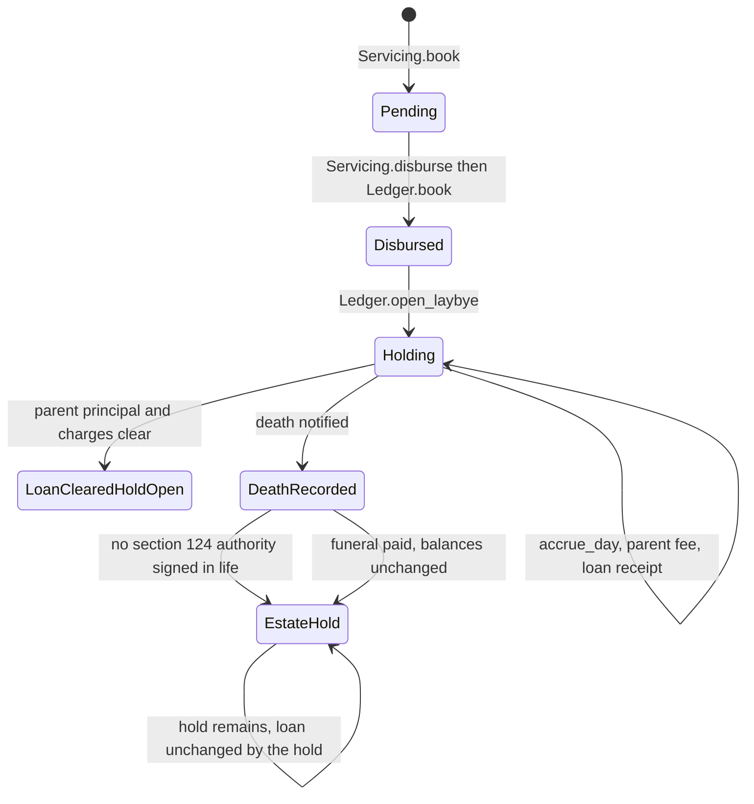

# Laybye and credit life — Layer 1 draft

**Status: Layer 1 draft. Design only. This file is not production code and it is not a locked decision.**

`docs/LOCKED_DECISIONS.md` on `main` (last updated 2026-10-28, commit `d7c6c77`, 10:53 Africa/Johannesburg) is the source of truth. This draft calls the Layer 0 interfaces. It does not re-implement their formulas, journals, elections, or mandate store.

Layer 0 is not on `main`. The interfaces below were read from these commits. Where a branch copy of the locked file differs from `main`, `main` wins. Those differences are conflicts L0-LOCK and L0-DUPLUM.

| Layer | Commit read | When (Africa/Johannesburg) | Surface this draft calls |
| --- | --- | --- | --- |
| Calculation engine | `cursor/day1-calc-engine-928f` at `af656ab`, as included on the smoke branch | 28 Oct 2026, 08:35 | `lms.calc` |
| Configuration | `cursor/lms-owned-config-1a86`, as included on the smoke branch | same tree as the smoke commit | `lms_config` |
| Ledger | `cursor/ledger-account-model-7aa6`, as included on the smoke branch | same tree | `lms.ledger` |
| Servicing orchestration | `cursor/servicing-orchestration-9c3c` at `43f7926`, as included on the smoke branch | same tree | `lms.servicing` |
| Integrated Layer 0 | `cursor/layer0-smoke-4153` at `2ead726` | 28 Oct 2026, 10:30 | the four surfaces above, together |
| Enigma port | `cursor/enigma-interface-d0c7` at `0cabd41` | 28 Oct 2026, 09:22 | `lms.enigma` |

Dates in this note are Africa/Johannesburg civil dates. `lms_config.calendar.value_date` assigns that date. `value_instant` is 00:00 on that date.

## 1. What this layer owns

This layer is the orchestration of one parent loan and its single Laybye child, and of a credit-life or funeral claim against that pair.

It decides when the child may be opened, when a receipt is aimed at the parent, when the hold is compared with the settlement quote, and which claim path runs on death. Amounts, interest, the section 126 order, the in-duplum ceiling, the value date, and the section 124 amount check stay in Layer 0.

In scope:

1. The parent/child lifecycle, including the Day-1 deposit-insurance arrangement.
2. The hold, consolidation, settlement, and claim state machine.
3. The call order into the calculation engine, the ledger, configuration, servicing, and Enigma.

Out of scope, because the locked file does not describe them here:

- A CPA section 62 goods lay-by (`Product.LAYBYE_BNPL`, classification `cpa_layby`). `cancel_laybye` and `lms_config.fees.layby_penalty_cents` belong to that instrument. The linked hold does not.
- Collections, arrears, prescription, and residual write-off policy. Those sit in the collections draft. This layer does not write off.
- Statement artwork. The statements draft already gives the child its own opening and closing balance. This layer agrees with that and does not merge the two balances.
- A Banks Act return. Day-1 is not deposit-taking. That sentence is the whole of the characterisation this draft uses.

## 2. Locked rules this draft applies

Citations only. The text of the rule stays in the locked file.

| Topic | Lock | What this draft does with it |
| --- | --- | --- |
| Value date | §1 | Every receipt, disbursement, settlement, and claim is recognised on its value date at 00:00. Same-day events keep recognition sequence. The day's due amounts are capitalised before that day's receipts are allocated. |
| One pair | §4 | One parent loan, one child. The contract treats the pair as one loan. Nothing in this layer marks the loan secured. |
| Allocation across both | §4 | A loan receipt and a hold receipt are both allowed. The split of one receipt is not defined. See L1. |
| Interest base | §4 | The hold reduces only the interest base, floored at zero. This layer calls `Ledger.accrue_day`. It does not subtract the hold itself. |
| Gross principal | §4 | In-duplum and the settlement quote keep principal gross. The hold is not an input to `duplum_base_cents`. |
| One service fee | §4 | `Ledger.levy_service_fee` is called on the parent only. The ledger already refuses the child. |
| Consolidate or settle | §4 | Both are offered only when the hold is at least the settlement balance. The two words are not given different postings. See L2. |
| Credit life on death | §4 | Proceeds are applied to the loan before the hold is considered for a shortfall. |
| Surplus | §4 | A cash-deposit treatment sends surplus to the estate. An insurance structure follows whether a beneficiary was named. The structure is not stored. See L3 and L4. |
| Funeral | §4 | The named beneficiary is paid. The parent buckets and the hold are left as they are. |
| Death and section 124 | §4 | Without an authority signed in life, death does not apply the hold. The hold stays with the estate. |
| Deposit-insurance | §4 | The client pays for a period, then the loan is disbursed. Day-1 is not deposit-taking. Net-balance interest is the evidence that the hold is treated as a payment against the loan. |
| Credit life in the instalment | §6 and §13 | A levied credit-life charge that shares a due date is already inside `Servicing`'s threshold instalment. Affordability has no formula in the lock. This draft does not add one. |
| Section 126 | §8 | Due interest, then the named fee buckets, then principal. Credit-life proceeds use that order. They do not jump the queue inside the loan. |
| Settlement-month fee | §9 | The parent carries the full monthly service fee in the settlement month, subject to the cap the ledger already applies. |
| Deferred initiation | §10 and §19 | The booking snapshot's election is passed through. An unset election fails closed. |
| In-duplum trigger | §7 and §19 | The trigger is a stored election on `main`. Layer 0 does not store it. See L0-DUPLUM. |
| Residual threshold | §8 and §19 | Client-configurable, default R50, not automatic, and an unset election fails closed. This draft does not write off. See L5. |
| Mandates | §15 | Enigma owns the mandate. Timeout, an ambiguous status, or a suspended enrolment fails closed. Nothing is posted. |
| Identity | §16 | Name, identity number, and service address stay frozen. Death does not rewrite them. |
| Rounding | §17 | Billing cents are already half-up inside Layer 0. This layer does not round again. |

## 3. The pair

### 3.1 Two accounts, one loan

`Ledger.book` creates the parent with `instrument_kind="loan"` and `parent_loan_id` empty. `Ledger.open_laybye` creates one child with `instrument_kind="laybye_hold"` and `parent_loan_id` set to that loan. A second child of the same parent is refused (`laybye-already-linked`). The database unique index `loan_one_laybye_child` is the same rule.

The child is not a second credit agreement. `Agreement` rejects `Product.LAYBYE_BNPL` and `Product.LAYBYE_SECURITY` at construction. The pure engine carries the hold as `Agreement.laybye_hold_cents` plus `LaybyeHold` events on the parent agreement. The ledger carries it as a credit-normal `laybye_hold` bucket on the child. `open_laybye` does not debit `principal`.

`cfg_instrument.kind` may be `credit`, `security_deposit`, or `cpa_layby`. The configuration comment already says a deposit kind is not a CPA lay-by. This draft also does not read `security_deposit` as a security right over the loan. Section 4 says the pair is not security that would make the loan secured. No secured flag is written. `mortgage` stays false.

The child's frozen name, identity number, and service address are the parent's frozen values, passed into `open_laybye`. A later Enigma change does not rewrite either account.

### 3.2 Interest, in-duplum, and the service fee

Daily interest is `Ledger.accrue_day` on the parent. The ledger refuses the child (`laybye-no-interest`). Inside `accrue_day`, `_interest_base` sums the children's `laybye_hold` balances and calls `lms_config.locked.interest_bearing_cents`. The returned base is what `daily_interest_rands` uses. `Accrual.base_cents`, `Accrual.principal_cents`, and `Accrual.hold_cents` are the stored evidence.

That evidence is the Day-1 Banks Act point in section 4. The hold has reduced the interest base. The principal bucket is still the gross unpaid principal. This layer does not add a second narrative and does not post the hold as a principal reduction to make the point.

`flag_default` and `duplum_base_cents` use unpaid principal, including pre-default capitalised initiation. The hold is not passed in. A payment during an episode still does not reset that episode. Which cure rule applies depends on the section 7 trigger, which Layer 0 does not store (L0-DUPLUM).

`Ledger.levy_service_fee` on the parent records one service month for the pair. A second call in that month is refused (`service-fee-once`). The opening month uses `opening_service_fraction`. Later months, including the settlement month, use the full monthly fee. The cap and the VAT basis come from the snapshot and from `service_fee_cents`. This layer does not calculate the fee.

A credit-life premium, once a source for it exists, is `Ledger.levy_charge` with bucket `credit_insurance` on the parent. It is not a second service fee. The pure engine's matching event is `ManualCharge` of kind `insurance`. The premium figure, the frequency, and any section 106 limit are not in the locked file (L6). Until a premium row exists, this layer does not levy one. A zero premium is a real R0 charge under section 3, and it is posted only when the product says the charge is R0. An absent row is not treated as zero.

### 3.3 Deposit-insurance order

Section 4 states the commercial order: the client pays for a period, then the loan is disbursed.

The calls that exist today run in the other order:

1. `Servicing.book` stores the agreement as `pending_disbursement`. No ledger account exists.
2. `Servicing.disburse` calls `Ledger.book`. The parent's value date is the disbursement recognition date.
3. `Ledger.open_laybye` can run only after that parent exists. It posts the opening amount as `laybye_deposit` on the child's value date.

A receipt recognised before disbursement has no ledger home. Putting it on a deposit product would be deposit-taking, which section 4 excludes for Day-1. Folding several earlier receipts into one `open_laybye` amount on the disbursement date would give them the wrong value date under section 1. This draft does neither. Pre-disbursement receipts fail closed (L7).

After the child exists, `open_laybye` has already posted its opening credit. No ledger method posts a later hold receipt (L8).

### 3.4 Payments across both

A receipt aimed at the loan, after disbursement, is the existing path:

1. `lms_config.calendar.value_date` on the recognition instant.
2. `Servicing.accept_payment` or `Servicing.apply_payment`. The attributed due date is required. Without it, servicing fails closed (`due-date-attribution-unset`). This draft does not invent the attribution.
3. On that value date, capitalise due amounts first: `Ledger.accrue_day`, then `Ledger.bill_interest` for interest that is due to be capitalised that day, then `Ledger.levy_service_fee` or `Ledger.levy_charge` for a fee that becomes due that day.
4. `Ledger.post_payment`, which calls `allocate_payment`. Order is due interest, then collection costs, default administration, credit insurance, service fee, initiation fee, then due principal. A short payment that would have to rank `additional_monthly` among those buckets fails closed (`additional-fee-order-unset`). An amount above due principal and the frozen prepayment choice fails closed (`overpayment-unset`).

Same-day loan receipts keep `order_recognised_events` (value date, then recognition sequence). The engine accrues the day's interest on the principal from before those receipts. This draft does not accrue again after the receipt.

A receipt aimed at the hold is the missing top-up (L8). One receipt that names both destinations has no locked split (L1). This draft does not put the whole receipt on the loan, and it does not put the whole receipt on the hold. The receipt stays unapplied.

`Payment.source="laybye_security"` exists on the pure engine only. `Ledger.post_payment` has no source argument. A hold application cannot be told apart from a consumer receipt in the ledger (L9).

### 3.5 Settlement balance

"Settlement balance" in this draft means `quote_settlement(...).total_cents`.

That quote is the section 125 amount from the engine. `payoff_cents` adds gross `principal_cents`, remaining charges, and unbilled interest. The hold is not subtracted. A large agreement is refused. Day-1 early-termination charge is zero. `binding_until` is the section 113 window: the delivery date counts, then five business days from `lms.calc.calendar.binding_until`, using `lms_config.calendar.public_holidays` and `holiday_set`. This draft does not count those days itself.

`lms_config.settlement.settlement_cents` is the same sum once the components are known. It is a check against the quote's components. It is not a second settlement formula. `early_termination_ceiling_cents` is not called.

The pure engine's interest base and the ledger's interest base are not the same function (L0-INTEREST-BASE). A quote is used for the comparison only when its total equals the ledger's gross figure: principal bucket, plus billed cost buckets, plus unbilled accrual memo not yet billed. If they differ, eligibility fails closed. Neither figure is silently preferred.

The comparison is point-in-time. Interest after that instant can lift the quote back above the hold. Eligibility is not a stored status.

The client may consolidate or settle when the hold is greater than or equal to that balance. Below it, neither transition runs. The difference between the two verbs is not locked (L2). Section 4 states the section 124 rule for death. `guard_s124` is still the calculator's check for an application of the hold, because it refuses a request the caller cannot tie to an authorisation. The locked file does not say that the living client's instruction is that authorisation. Without the mandate facts, the application stops (L12). A living client's surplus is not the estate rule. The estate sentence is in the credit-life paragraph. Where a living surplus goes is open (L10).

`execute_settlement` waives, inside the section 113 window, the growth of a fresh payoff over the quoted total, and it parks a payment above the quote in engine suspense. The ledger has no waiver and no suspense bucket. This draft does not post either (L11). Servicing marks the agreement `settled` when principal slices and charges are clear. That test ignores the hold, so a cleared loan can still have an open child. That is the correct gross-principal result. It is not a surplus payment.

## 4. State machine

Durable states are only those Layer 0 can store. `Eligible` is a guard evaluated at the decision instant.

Transitions that the locked file requires and that Layer 0 cannot post stay off this diagram. They are refused in the event table. Drawing them as successful states would invent a posting.

| State | What is stored | How it is recognised |
| --- | --- | --- |
| `Pending` | `AgreementRecord`, status `pending_disbursement`. No ledger row. | After `Servicing.book`, before `disburse`. |
| `Disbursed` | Parent `LoanAccount`, `instrument_kind="loan"`. No child. | `Ledger.book` has returned. |
| `Holding` | Parent plus one `laybye_hold` child. | `open_laybye` has returned. Hold balance is `bucket_balance` of `laybye_hold`. |
| `LoanClearedHoldOpen` | Parent slices and charges clear. Child balance still positive. | `Servicing` status `settled` on the parent, child balance above zero. |
| `DeathRecorded` | A death notification accepted by this layer. No balance movement by itself. | The notification's value date. The frozen identity is unchanged. |
| `EstateHold` | Death recorded, and the hold was not applied. | Section 4: no section 124 authority signed in life, or a funeral payment, or both. |

`EstateHold` is the same balances as `Holding` or `LoanClearedHoldOpen`, plus the fact that death must not move the hold. It is recorded so a later operator does not apply the hold by the living-client path.

| Event | From | Result | Layer 0 call | Stop |
| --- | --- | --- | --- | --- |
| Book the agreement | none | `Pending` | `Servicing.book` | Enigma timeout, ambiguous status, or suspended enrolment. Unset elections. |
| Disburse | `Pending` | `Disbursed` | `Servicing.disburse` → `Ledger.book` | Classification outside Day-1. Schedule does not sum to principal. |
| Open the hold | `Disbursed` | `Holding` | `Ledger.open_laybye` | Parent is not a loan. A child already exists. Negative amount. |
| Pre-disbursement contribution | `Pending` | no change | none | L7. The receipt is not posted. |
| Later hold contribution | `Holding` | no change | none | L8. |
| One receipt split across both | `Holding` | no change | none | L1. The receipt stays unapplied. |
| Loan receipt | `Holding` | `Holding` or `LoanClearedHoldOpen` | `Servicing.accept_payment` → `Ledger.post_payment` | Missing due-date attribution. `overpayment-unset`. `additional-fee-order-unset`. |
| Daily accrual | `Disbursed` or `Holding` | same state | `Ledger.accrue_day` on the parent | Outside the term. Reference data missing where the ledger requires it. |
| Service fee | parent states | same state | `Ledger.levy_service_fee` on the parent | Call on the child. Second fee in the month. |
| Eligibility guard | `Holding` | guard true or false | `quote_settlement`, then compare with the child balance | Quote total disagrees with the ledger gross figure (L0-INTEREST-BASE). |
| Consolidate or settle | guard true | no posting today | `guard_s124` once the facts exist | L2, L9, L12, L13. The hold is not debited. The loan is not credited from the hold. |
| Credit-life proceeds | `DeathRecorded` | no posting today | intended `Ledger.post_payment` on the parent | L14. No due-date attribution is locked for an insurer payment. |
| Shortfall from the hold | proceeds posted, shortfall remains, authority signed in life | no posting today | `guard_s124`, then a hold debit that does not exist | L12, L13. |
| Death without that authority | `DeathRecorded` | `EstateHold` | none against the hold | The hold stays. Credit life may still pay the loan once L14 is closed. |
| Funeral | any state after the child exists | same balances | none on the parent or the child | No named beneficiary (L15). The benefit is not applied to the loan or the hold. |
| Surplus to the estate | loan cleared, or proceeds above the loan | no posting today | none | L3, L4, L11. No estate bucket and no estate payee. |

Reversals use `Servicing.reverse_payment` or `Ledger.reverse`. The value date is the date originally recognised. A reversal of `laybye_deposit` is in the ledger's reversible set. This layer does not choose a new date.

Same-day order, when several of these events share a value date:

1. A `LaybyeHold` replacement in the pure engine is applied before that day's accrual. Interest that day uses the replacement balance. The ledger's `accrue_day` uses the hold already posted, so a future top-up method has to post before `accrue_day` on that date if it is to match the engine.
2. Accrue, then capitalise the day's due interest and fees.
3. Allocate receipts in recognition sequence.
4. A flag-date receipt is visible to `Servicing.morning_check`. The hold is not part of that test.

## 5. Credit life, funeral, and death

### 5.1 Credit life pays the loan first

The proceeds are a receipt on the parent. They are not a reduction of the hold, and they are not a new bucket. Once an attributed due date is locked (L14), the call is `Ledger.post_payment` on the parent loan id, after that day's due amounts are capitalised. `allocate_payment` applies section 126. "Pays the loan first" means this receipt hits the loan before anyone considers the hold. It does not mean the proceeds skip interest and fees and go to principal.

The amount that clears the loan is the amount the ledger actually allocates. A proceeds figure above what `post_payment` will take raises `overpayment-unset`. That excess is part of the surplus question (L3, L11). This draft does not park it in engine suspense and then call that a ledger balance.

The shortfall is the settlement balance minus the allocated proceeds, when that difference is positive. The settlement balance is still the gross quote. It is not recomputed on the net interest base.

### 5.2 The hold covers a shortfall only under section 124

`lms.calc.laybye.guard_s124` is the amount check. It refuses a missing mandate id, a non-positive request, a request above the authorised cents, or a value date outside the authorised dates. It returns the requested cents when those checks pass. It does not read mandate text. The caller must pass the amount and the dates.

`EnigmaPort.lookup_mandate` returns `MandateDecision`: `decision`, `reason`, `mandate_id`, `mandate_version`, `enigma_request_id`. It does not return authorised cents, dates, the obligation, or a fact that the authority was signed in life (L12). This layer does not parse a document to fill those fields. Without them, `guard_s124` is not called with invented numbers, and the hold is not applied.

The death rule is stricter than a missing id. Section 4 requires an authority signed in life. An authority that appears only after death does not qualify. That fact is not on `MandateDecision` (L12). The transition is `EstateHold`.

When the facts are present and `guard_s124` returns, the hold still cannot move. The ledger can credit `laybye_hold` only inside `open_laybye`. It cannot debit it afterwards (L13). Paying the shortfall with `post_payment` alone would clear the loan and leave the hold in place, which counts the same money twice and leaves the interest base wrong. This draft does not do that. Both legs wait for one ledger method that debits the hold and credits the parent for the same cents, on the same value date, after `guard_s124`.

The requested cents are the shortfall, capped by the hold balance and by the authorised cents. This draft does not apply the hold to a larger figure than the shortfall. Applying it to principal on a living default, or to a full settlement, remains the calculator's open point: the mandate must name those cents and that obligation. A clause that only says the deposit is applied on default is not turned into an amount here.

### 5.3 Surplus and the two structures

Section 4 gives two treatments after the loan has been paid:

- Treated as a cash deposit: surplus goes to the estate.
- Structured as insurance: treatment follows whether a beneficiary was named.

Day-1 is also "a deposit-insurance style arrangement" and is not deposit-taking. That sentence does not choose the cash-deposit branch or the insurance branch (L4). `cfg_instrument.kind` is not used as the choice. This layer does not default the pair to either branch.

"Surplus" is not defined as a figure (L3). Candidates that this draft refuses to pick between: credit-life proceeds above the amount allocated to the loan, the hold left after a shortfall payment, and the sum of those two. Until the figure is locked, no estate payment is posted.

The named-beneficiary outcome for an insurance-structured surplus is not stated (L4). The funeral sentence is a different benefit and is not used to fill this gap. A missing beneficiary on that insurance path fails closed. The money is not sent to the estate under the cash-deposit sentence, because the structure itself is unset.

### 5.4 Funeral

The funeral benefit is paid to the named beneficiary. The parent buckets and the `laybye_hold` balance stay as they are. No `post_payment`, no `open_laybye`, no `guard_s124`, no quote.

The beneficiary is not a field on the agreement, the ledger, or `MandateDecision` (L15). This layer does not substitute the frozen consumer, the estate, or a credit-life beneficiary. With no named beneficiary, the funeral is not paid. The loan and the hold still stay as they are.

The funeral payment is outside the loan ledger. It does not change `in_arrears`, the in-duplum episode, or the settlement quote.

### 5.5 What death does not do

Death does not unfreeze the agreement identity. The estate is not written into `frozen_full_name`. Enigma still owns any estate or executor identity, and the LMS still stores only opaque ids.

Death does not call `cancel_laybye`. That function is the CPA goods lay-by penalty and refund. The configuration note on `layby_penalty_cents` already says the penalty must not be applied to a cash security deposit. The linked hold earns no cancellation penalty on death, hospitalisation, or consumer cancellation.

Death does not consolidate the pair by itself. Consolidation remains the living client's transition, and only when the hold covers the settlement balance.

## 6. Call sequences

Each sequence stops at the first failure. A failed Enigma call posts nothing. Policy for a pure-engine call is built from the booking snapshot the way `Servicing` builds `Policy` (`leniency_days`, threshold, repo-fall, prepayment, VAT basis, day count, deferred-initiation flag). `Policy()` is not used. Its field defaults are not the locked elections. An unset snapshot value fails closed inside Layer 0.

### 6.1 Open the pair

1. `EnigmaPort.check_enrolment` for the organisation, person, and product. The servicing stub's `EnigmaStub.check` is the stand-in until the live port is wired. Timeout, ambiguity, or suspension stops the call.
2. `Servicing.book` with the idempotency key. Late disbursement, if the quoted date is earlier than the booking value date, uses the snapshot's `late_disbursement` election. Unset fails closed.
3. `Servicing.disburse` → `Ledger.book`. Principal is the cash advanced, plus a capitalised initiation fee only where the product may capitalise it. Short-term and unsecured stay non-capitalised unless that product permission is set.
4. `Ledger.open_laybye` for the opening hold. The value date is the recognition date of that call, which cannot precede a parent that does not exist yet (L7). Identity fields are the frozen ones. A zero amount creates the child and posts no `laybye_deposit`. The locked file does not say the child row must wait for the first rand. This draft does not add that wait.
5. `cancel_laybye` and `layby_penalty_cents` are not called. `Agreement` is not constructed with a lay-by product enum.

### 6.2 A civil day on the pair

1. `value_date` of the day being closed.
2. `Ledger.accrue_day` on the parent. Read `Accrual.base_cents`, `principal_cents`, and `hold_cents`. Do not call `daily_interest_rands` or `interest_bearing_cents` from this layer.
3. If interest is due to be capitalised that day, `Ledger.bill_interest`.
4. If the monthly service fee is due that day, `Ledger.levy_service_fee` on the parent. Pass the product's monthly cents, the snapshot VAT basis, and `opening=True` only for the opening month.
5. If a credit-life premium is due that day and a premium row exists, `Ledger.levy_charge` with bucket `credit_insurance`. No row: skip the levy, do not invent R0.
6. Loan receipts recognised that day, in recognition sequence: `Ledger.post_payment`.
7. On a flag date, after those receipts, `Servicing.morning_check`. The threshold instalment already includes a credit-life charge that shares the due date. This layer does not add the hold to that instalment.

### 6.3 Eligibility

1. Run section 6.2 through capitalisation for the decision value date, so the quote and the ledger describe the same day.
2. `quote_settlement` with the agreement built from the frozen snapshot, events up to that date, and the holiday set from `public_holidays`.
3. Read parent bucket balances and the unbilled accrual memo. Sum them. Read the child `laybye_hold` balance.
4. If the quote total and the ledger gross sum differ, stop (L0-INTEREST-BASE).
5. The guard is true when the child balance is greater than or equal to `quote.total_cents`.
6. `settlement_cents` may be called with the quote's principal, interest, fees, early-termination of zero, and the agreement size. A mismatch with the quote total stops the guard. `early_termination_ceiling_cents` is not called.

### 6.4 Consolidate or settle

1. Section 6.3 guard is true. Otherwise stop.
2. `EnigmaPort.lookup_mandate` for the action that applies the consumer's hold. Anything other than a clear allow stops the call (section 15).
3. Pass `mandate_id`, authorised cents, requested cents, and the authorised dates into `guard_s124`. Missing facts: stop (L12). Do not read mandate prose.
4. Stop again (L2, L9, L13). There is no ledger method that debits the hold and credits the parent together, and no locked difference between consolidate and settle.
5. Do not call `execute_settlement` as a substitute posting. It does not write the ledger.

### 6.5 Death, credit life, and funeral

1. Record death on the notification's value date. Do not change frozen identity. State becomes `DeathRecorded`.
2. Funeral, if the claim is a funeral benefit. Pay the named beneficiary outside the ledger. If no beneficiary is named, pay nobody (L15). Parent and child balances stay. Stop this branch. Do not continue into the hold.
3. Credit-life proceeds. Stop until L14 locks the attributed due date. The intended continuation is section 6.2's capitalise-then-`post_payment` on the parent, for the proceeds amount, in section 126 order.
4. If the authority signed in life is absent, state becomes `EstateHold`. Do not call `guard_s124`. The shortfall remains on the loan. The hold stays with the estate.
5. If that authority is present, run the section 6.4 gate for the shortfall cents only. The posting still stops on L13.
6. Surplus is not paid. L3 and L4.

## 7. Conflicts with Layer 0

These are disagreements between `main` and the code this draft calls. This draft does not patch them.

**L0-LOCK.** The smoke branch's locked file is behind `main`. `main` now has the section 7 trigger, the section 8 residual threshold, the section 19 elections for that trigger and threshold, and section 20 prescription. `ElectionSnapshot` does not store the trigger or the residual threshold.

**L0-DUPLUM.** `main` section 7: a cure closes the episode only when the client chose `collections_default`. Under `contractual_breach` the ceiling stays fixed. The engine's `_close_if_cured` and the ledger's cure path were written to the earlier rule, which closed the episode on every cure. This layer still calls `Servicing.morning_check` and `Ledger.flag_default`. It does not add a second ceiling.

**L0-INTEREST-BASE.** `interest_bearing_cents`, which `Ledger.accrue_day` uses, starts from principal, subtracts capitalised initiation unless the deferred-initiation election is `permitted`, then subtracts the hold, then floors at zero. The pure engine's `_interest_base_cents` starts from principal minus the hold, and adds remaining initiation charges only when `Policy.interest_on_deferred_initiation` is true. For a non-capitalised Day-1 fee and a "not permitted" election the two bases match, because capitalised initiation is zero and the deferred fee is outside both bases. They diverge when the fee was capitalised, and when the election is "permitted" on a fee that sits in the initiation bucket rather than in principal. Section 10's election is about the deferred fee. The ledger's flag instead puts capitalised initiation back into the base. This draft does not choose which function is right. Eligibility fails closed when the quote and the ledger disagree.

`Policy.interest_on_deferred_initiation` defaults to false in the dataclass. Section 10 says the provider default is no interest. Section 19 says an unset election fails closed. The ledger path fails closed on an unset snapshot. A pure-engine call in this layer uses the snapshot, so the dataclass default is not how this layer answers an unset election.

## 8. Gaps that need a locked decision

Each gap is a point this draft refuses to fill.

| Id | What is locked | What is missing |
| --- | --- | --- |
| L1 | Payments can be allocated across the loan and the Laybye. | The split of a single receipt: which cents go to the hold, which go to the loan, and what happens when the client does not say. |
| L2 | The client can consolidate or settle when the hold is at least the settlement balance. | The difference between consolidate and settle: balances, schedule, surplus, and whether one of them closes the child. |
| L3 | Surplus goes to the estate if the arrangement is treated as a cash deposit. | The surplus figure. Proceeds above the loan, the unused hold, or both. |
| L4 | An insurance structure follows whether a beneficiary was named. Day-1 is a deposit-insurance style arrangement and is not deposit-taking. | Which of the two section 4 branches Day-1 uses. The payee and the amount when a beneficiary was named. The payee and the amount when a beneficiary was not named. The funeral rule is not an answer to this row. |
| L5 | The residual write-off threshold is client-configurable, the stated default is R50, it is not automatic, and an unset election fails closed. | Whether an absent threshold is stored as R50 or is a hard stop. This layer writes nothing off in either reading. |
| L6 | Credit life is inside the affordability instalment and, once levied, inside the default-threshold instalment. | The premium, its frequency, and any cover limit. No premium is levied from an empty row. |
| L7 | The client pays for a period, then the loan is disbursed. Each event keeps its own value date. Day-1 is not deposit-taking. | A posting home for those pre-disbursement receipts that is still the child of the one loan. |
| L8 | The hold balance is what interest uses, and later payments can be allocated to the Laybye. | A ledger method for a hold receipt after `open_laybye`. The engine's `LaybyeHold` is a replacement balance, not a posting. |
| L9 | The engine can mark a payment `source="laybye_security"`. | The ledger payment has no source. An application of the hold is indistinguishable from a consumer receipt. |
| L10 | A cash-deposit surplus on the credit-life path goes to the estate. | Where a surplus goes when a living client consolidates or settles and the hold exceeds the quote. |
| L11 | The engine waives post-quote growth inside the section 113 window and can report engine suspense. | A ledger waiver, and a ledger home for an amount `post_payment` rejects as `overpayment-unset`. |
| L12 | Death does not apply the hold without a section 124 authority signed in life. `guard_s124` needs a mandate id, authorised cents, and dates. | `MandateDecision` does not carry the cents, the dates, the obligation, or "signed in life". The locked file also does not say whether a living client's consolidate or settle instruction is that authority. |
| L13 | Applying the hold must reduce the hold and pay the loan once. | A ledger debit of `laybye_hold` paired with the parent receipt. `open_laybye` only credits the hold. |
| L14 | Credit-life proceeds pay the loan, in section 126 order, on the recognition value date. | The contractual due date an insurer payment is attributed to. Servicing refuses a matched receipt without one. |
| L15 | The funeral benefit is paid to the named beneficiary and does not move the loan or the hold. | Where the beneficiary id is stored, and what is paid when no beneficiary was named. |
| L0-LOCK | `main` sections 7, 8, 19, and 20. | The Layer 0 snapshot and the branch copies of the locked file do not contain those elections. |
| L0-DUPLUM | Cure closes the episode only for `collections_default`. | The engine and the ledger close the episode on cure without reading a trigger. |
| L0-INTEREST-BASE | Interest is on the net balance. A deferred initiation fee earns interest only when the provider stored `permitted`. | The ledger and the pure engine adjust different parts of that base. |

No gap in this table is given a working assumption. A later change belongs in `docs/LOCKED_DECISIONS.md` first. This draft stays a Layer 1 design until that file moves.
