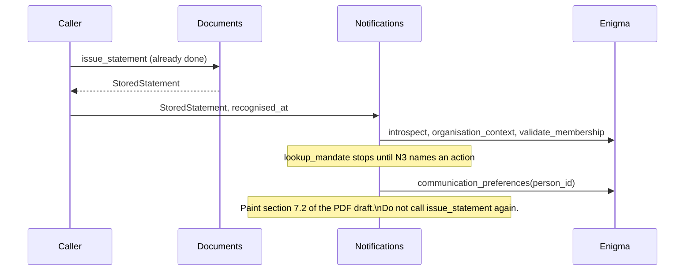
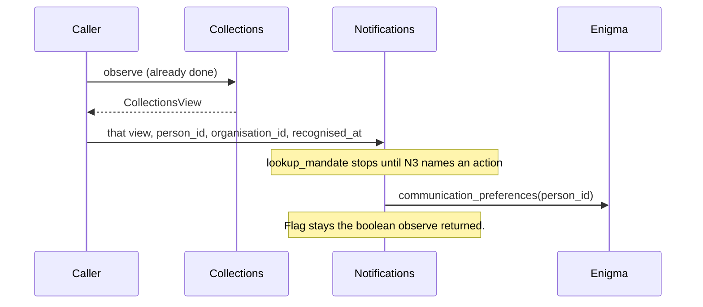
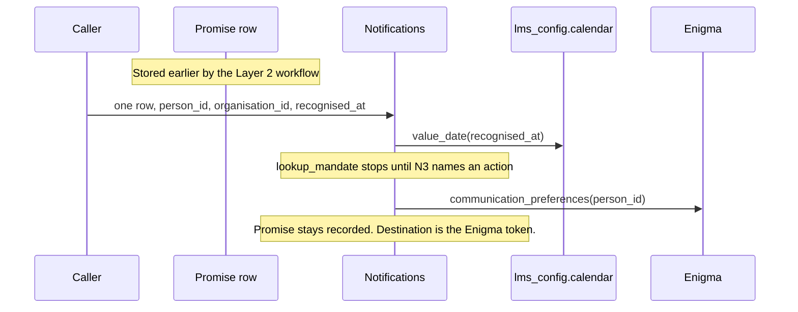
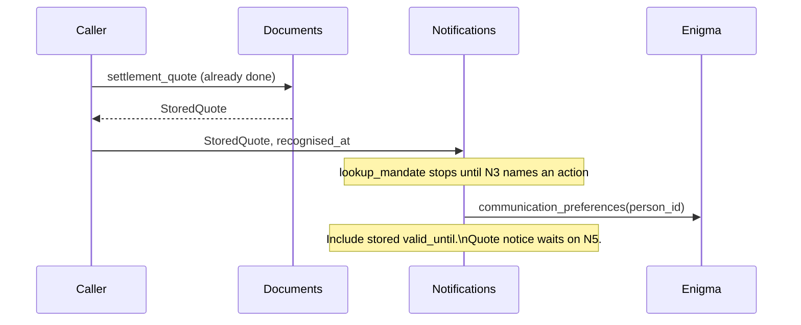

# Notifications — Layer 4 draft

Status: **Layer 4 draft.** Design only. No production code, no migration, and no change to `docs/LOCKED_DECISIONS.md`.

This note describes how the LMS notifies a consumer after a statement is issued, after a collections default is flagged, on or before a promise-to-pay date, and after a section 113 quote is issued. The notice paints figures those layers have already stored. It does not recalculate them, and it does not create a contractual breach or a collections default.

`docs/LOCKED_DECISIONS.md` on `main` at `ebb66b1` (28 October 2026, 15:29 Africa/Johannesburg) is the source of truth. Where this note and that file differ, the locked file wins. A point the locked file does not settle is listed under [Gaps that need a locked decision](#8-gaps-that-need-a-locked-decision) and is not given a value here. A disagreement between the locked file, this task, and an earlier design is listed under [Conflicts recorded, not resolved](#9-conflicts-recorded-not-resolved).

Dates in this note are Africa/Johannesburg civil dates. A recognition instant becomes a civil date only through `lms_config.calendar.value_date`. This layer does not convert time zones and does not move an instant to 00:00 itself.

## Interfaces this draft calls

| Piece | Where it was read | Commit | What this layer uses |
| --- | --- | --- | --- |
| Locked decisions | `main` | `ebb66b1` (15:29 Africa/Johannesburg) | Sections 1, 6, 8, 12, 15, 16, 21, and 23 |
| Enigma port | `cursor/enigma-interface-d0c7` | `0cabd41` (09:22 Africa/Johannesburg) | `communication_preferences` in `src/lms/enigma/identity_freeze.py`. The five `EnigmaClient` methods stay the session port. |
| Statements | `cursor/layer1-gap-closures-ccde` | `a99b1b5` (13:09 Africa/Johannesburg) | `Documents.issue_statement` and `Documents.settlement_quote`. The objects are `StoredStatement` and `StoredQuote`. |
| Statement painting | `cursor/statement-pdf-rendering-a08b` | `8219698` (13:22 Africa/Johannesburg) | Section 7.2 and section 7.4 of `docs/statements/layer2-pdf-draft.md`. |
| Collections | `cursor/layer1-gap-closures-ccde` | `a99b1b5` | `Collections.observe` returns `CollectionsView`. `collections_default` on that view is the flag. |
| Promise row | `cursor/collections-workflows-layer2-6f3a` | `43f7010` (13:26 Africa/Johannesburg) | The row in `docs/collections/layer2-workflows-draft.md` section 3. `Collections` has no promise method. |
| Staff promise screen | `cursor/staff-ui-layer3-408d` | `f9277a1` (14:54 Africa/Johannesburg) | The screen that writes that row. This layer does not write it. |
| Provider compliance | `cursor/layer3-onboarding-7f81` | `96343fd` (14:55 Africa/Johannesburg) | `ComplianceStore` is the onboarding write. Issue already copied it onto `StoredStatement`. This layer does not call `put` or `require`. |

Layer 0 remains the calculation engine, the ledger, the calendar, and the elections. This draft does not call `quote_settlement`, `binding_until`, `add_business_days`, `is_in_default`, `Ledger.flag_default`, or `Servicing.morning_check`.

## What this layer owns

Four notices. Each one is optional: the earlier layer has already finished its own command, and a separate notification command may then run. Issuing a statement, flagging a default, recording a promise, or storing a quote does not itself send.

| Notice | Prepared from | What the consumer is shown |
| --- | --- | --- |
| Statement | The `StoredStatement` `Documents.issue_statement` already returned | The Layer 2 painting of that object. One client, one credit-provider organisation, every loan of that pair. |
| Collections default | The `CollectionsView` `Collections.observe` already returned, and only when `collections_default` is true | That flag, the agreement id, and `open_episode_ceiling` when the view already carries one. |
| Promise-to-pay reminder | One promise row the Layer 2 workflow already stored | The stored amount and the stored promise date. Eligible on the promise date and on any earlier civil date. |
| Section 113 quote | The `StoredQuote` `Documents.settlement_quote` already returned | The Layer 2 quote painting, including the stored `valid_until`. |

The command returns a prepared notice or a refusal. It does not persist the notice, the channel, or the destination. Persistence of those three would be a communication-preference store, which this task forbids and which section 16 does not name.

## Locked rules this draft follows

| Rule | Section | How this draft follows it |
| --- | --- | --- |
| Value date is the system recognition date. The day starts at 00:00. | §1 | Promise eligibility uses `value_date` of the command's recognition instant. The promise date is the civil date already stored. It is not moved onto a business day. |
| Contractual breach and collections default are different facts. A notification is neither. | §6 | The collections notice is offered only from `CollectionsView.collections_default`. The command does not call `observe`, so it cannot record a breach or open an episode. A promise reminder leaves the promise `recorded`. |
| Promise-to-pay adherence is a reporting input, not an LMS score. | §8 | The reminder does not mark the promise kept or broken and does not call `record_provision`. |
| One statement per client per organisation. Show values only where they are charged. | §12 | One statement notice per `StoredStatement`. A blank cell on that object stays blank. The collections notice is one view, one agreement. Section 12's combined statement is not reused as a combined arrears letter. |
| Enigma is identity and access. Timeout, an ambiguous status, or a clear suspended enrolment fails closed. LMS stores opaque `person_id` and `organisation_id`. | §15 | The channel read is `communication_preferences`. A timeout or an ambiguous answer refuses the notice. Nothing is written. |
| Enigma does not hold or return telephone numbers. Telephone numbers are LMS-owned. | §15, §21 | A preferred channel of `mobile` is refused. No consumer-mobile column is added. See [C1](#c1-mobile-number). |
| Freeze name, ID number, and service address at booking. | §16 | Statement consumer lines stay the frozen section fields. Preferences are not written onto the agreement. The quote and the promise row do not carry the frozen lines. See [N5](#n5-quote-letterhead). |
| The NCR number is compulsory, stored on the organisation, and required on NCA communications for micro and unsecured personal loans. It is not required for pure hosting or for Laybye/BNPL. A test number of the same format with all zeros is allowed. | §21 | A statement notice paints `StoredStatement.ncr_registration_number`, including an all-zero test number. A quote notice has no such field. See [N5](#n5-quote-letterhead) and [N6](#n6-blank-ncr-on-a-stored-statement). |
| Every LMS action records who, when, and what. The actor is the staff identity from Enigma. Promise-to-pay and contact changes require a signed-in role. | §23 | No audit event type is seeded for a notice. The command does not invent one. See [N3](#n3-actor-and-mandate). |

## 1. Statement notice

The content is the painting in `docs/statements/layer2-pdf-draft.md` section 7.2. The input is the `StoredStatement` the issuer already holds. Figures, the compliance copy, and the frozen consumer lines are fields on that object.

`pdf_stub` and `pdf_sha256` stay the stub the Statements layer stored. The notice carries the painting. It does not carry the stub and does not replace the hash.

A repeat of `Documents.issue_statement` folds the ledger when the same `Documents` instance no longer holds the period key. This command does not make that call. There is no read by `statement_id`. That limit is P18 and P19 in the painting draft. This layer does not add the read.

The provider telephone on the statement is the credit provider's compliance telephone. It is used as the provider's number on the painting. It is not the consumer's destination.

A stored NCR number is painted as it stands, including an all-zero test number. A blank stored number is refused (`statement-ncr-blank`). The stored loan section does not carry the section 21 classification, so this command cannot see the pure-hosting or Laybye exemption. See [N6](#n6-blank-ncr-on-a-stored-statement).

## 2. Collections-default notice

`Collections.observe` is the command that flags a collections default. It returns `CollectionsView`. `collections_default` on that view is the flag this notice uses.

This command accepts that view from the caller. It prepares a notice only when `collections_default` is true. A view whose flag is false produces a refusal (`collections-default-not-flagged`) and no notice. A contractual breach with the flag false is that refusal. Listing `contractual_breaches` would present the breach as part of this notice. The notice omits that tuple.

`Collections.view` without a recognition instant reports `collections_default` false. `Collections.view` with an instant runs the default test again. This command calls neither. The boolean it was given is the boolean it paints.

`CollectionsView` has no `person_id` and no `organisation_id`. The caller passes both from the agreement `observe` already resolved. They are the opaque ids section 15 allows the LMS to keep. If either is missing, the command refuses (`party-unset`). It does not open the servicing store to find them. The promise row has the same gap: its actor is the staff member, not the consumer. See [N12](#n12-party-on-the-view-and-the-promise-row).

The notice carries:

| Field | Source |
| --- | --- |
| Agreement | `CollectionsView.agreement_id` |
| Collections default | The true flag already on the view |
| Open-episode ceiling | `open_episode_ceiling` when the view carries a number |

A view can show the flag true and the ceiling empty. The ceiling cell is then left empty. This command does not read the ledger to fill it, and it does not call `record_provision` to obtain `arrears_cents`. An arrears amount on this notice is [N7](#n7-arrears-amount-and-repeat-notices).

The notice leaves the case, the episode, the discount, and the agreement status as `observe` left them.

## 3. Promise-to-pay reminder

The row is the one the Layer 2 workflow stored and the Layer 3 staff screen writes: agreement id, amount in cents, promise date, the channel text the staff member typed, recognition instant, and the staff actor. `Collections` has no method that returns the row. This command accepts the row from the caller. It does not add a query.

Eligibility is a comparison of two civil dates. The command date is `value_date(recognised_at)` of this command. The promise date is the date on the row. The reminder may be prepared when the command date is on or before the promise date. A later command date is refused (`promise-date-passed`). No lead time is applied: the locked file does not name one. The workflow already left the promise `recorded` after the date passed, and this command does not change that state.

The body is the stored amount and the stored promise date. The staff channel text on the row is the record of how the promise was taken. It is not the destination. See [N8](#n8-two-channel-fields).

A row with no agreement, no amount, a negative amount, or no promise date is refused (`promise-row-incomplete`). The workflow already refuses those on the way in. This command still refuses them if they are handed over.

Each row is its own command. Several open promises stay several rows (collections gap CW2). This draft does not pick one of them.

The command does not call `observe`, `receive`, `correct_system_error`, `flag_default`, `morning_check`, or `record_provision`. It does not insert a breach and it does not open or close an episode.

## 4. Settlement-quote notice

The content is the painting in the Layer 2 draft, section 7.4. The input is the `StoredQuote` `Documents.settlement_quote` already returned.

The quote binds for five business days. That window is the stored `valid_until`, which the Statements layer set from `binding_until(delivered_on)`. The notice includes that date. It also includes the stored `deliver_by`, because the painting already prints both and they are different counts. This command does not call `binding_until` or `add_business_days`.

The painting draft already refuses a PDF when `early_termination_cents` is not zero or when the components do not add up to `total_cents`. This command then refuses the notice. It does not repair the quote and it does not call `execute_settlement`.

A repeat of `settlement_quote` reprices when the same `Documents` instance no longer holds the key. This command does not make that call.

`StoredQuote` carries no NCR number, no provider compliance, and no frozen consumer identity. A section 113 quote for a short-term or unsecured agreement is an NCA communication, and those are the only classifications `settlement_quote` stores. Section 21 requires the NCR number on that communication. The notice cannot paint a number the quote does not hold, and this command does not call `ComplianceStore.require` to fetch one. Preparation of the quote notice stops (`quote-ncr-absent`) until [N5](#n5-quote-letterhead) is locked. The stored `valid_until` is still the date the notice would include. It is not recomputed while the notice waits.

## 5. Channel and consent

### 5.1 Preferred channel

The read is the existing port function:

```text
communication_preferences(directory, person_id, request_id=...) -> CommunicationPreferences
```

`person_id` is the opaque id on the statement, the quote, or the agreement. The result is `person_id`, `email`, `mobile`, `preferred_channel`, and `enigma_request_id`. Callers of that function already must not write those fields onto the agreement. This command does not write them anywhere else either.

The port raises `AuthorityUnavailable` on timeout or HTTP 5xx, and `AmbiguousAuthority` on any other transport failure or on an answer for a different person. The port raises `AttributesUnavailable` when both `email` and `mobile` are empty. Each of those refusals stops the notice. No notice is sent.

After a result comes back, this command accepts `preferred_channel` only when it is the exact token `email` or the exact token `mobile`. `None`, a blank, or any other token is `channel-missing` or `channel-unrecognised`. No notice is sent. `SMS`, `Email`, and a staff free-text channel are not mapped onto the two tokens.

The destination is the field that matches the token. The other field is not a fallback. An `email` token with a blank email, or a `mobile` token with a blank mobile, is `destination-missing`. No notice is sent.

### 5.2 Mobile number

Section 15 and section 21 say Enigma does not hold or return telephone numbers, and that telephone numbers are LMS-owned. `communication_preferences` returns `mobile` from the live Enigma person. That return is the conflict in [C1](#c1-mobile-number).

A preferred channel of `mobile` is therefore refused (`mobile-not-from-enigma`). The command does not copy the returned number into an LMS column. The provider telephone and `cfg_brand.support_phone` are the credit provider's numbers. They are not substituted.

### 5.3 Email

Section 15's list of facts Enigma does not return does not name email. The port already returns `email` on the same call. A preferred channel of `email` with a non-empty email uses that address as the destination. The locked file has not confirmed that email lives in Enigma. That is port conflict C10, recorded again here as [C2](#c2-email-and-the-preferred-channel-token). This draft does not open an LMS email column to avoid the port.

### 5.4 Consent

The three rules above are the channel rules this task states: the preferred channel comes from Enigma, the LMS does not store communication preferences, and a missing preferred channel fails closed.

No locked sentence defines a further consent flag. Section 23 requires role-based access and an audit record for POPIA audits. It does not define a consent-to-contact record. This draft does not create one. It does not treat a missing flag as consent, and it does not add a fourth refusal for a flag that does not exist. Whether a notice needs a separate consent is [N2](#n2-consent).

Section 113(2)(b) requires the consumer's direction for oral or written delivery. Section 110(3) gives the consumer a direction for an enquiry, to the extent the provider is equipped. Neither direction is a field on `StoredQuote` or on `CommunicationPreferences`. This command does not treat `preferred_channel` as that direction. See [C3](#c3-statutory-direction-and-the-preferred-channel).

### 5.5 What a refusal leaves untouched

A refusal writes nothing. The statement, the quote, the case, the promise row, and the agreement stay as they were. `delivered_on` and `valid_until` stay the dates the quote already stores. A failed or refused notice is not a new delivery date. See [N4](#n4-delivery-and-the-stored-window).

## 6. Sequence of calls

The first call in each sequence has already happened. This layer receives the object and does not repeat the call. Repeating `issue_statement` or `settlement_quote` can fold or reprice. Repeating `observe` records breaches and applies the in-duplum trigger.

The Enigma session methods are the staff prefix the Layer 3 drafts use: `introspect`, `organisation_context`, `validate_membership`. They apply when a person starts the command. The action string those drafts would pass to `lookup_mandate` is not locked for a notice. The sequence stops at that lookup. See [N3](#n3-actor-and-mandate). The steps after it are the preparation once an action id exists. They are not a second implementation of Statements or Collections.

### 6.1 Statement



1. The caller holds the `StoredStatement` returned by `Documents.issue_statement`.
2. Staff session, when a person starts the command: `introspect`, `organisation_context`, `validate_membership` for the statement's organisation. Timeout, an ambiguous status, or a clear suspended enrolment stops the command.
3. `lookup_mandate` waits on [N3](#n3-actor-and-mandate). Until the action id is locked, the sequence ends here. The following steps are the preparation once that id exists.
4. `communication_preferences` for `StoredStatement.person_id`.
5. Channel gate in section 5. A `mobile` token stops at [C1](#c1-mobile-number). A blank `ncr_registration_number` stops at [N6](#n6-blank-ncr-on-a-stored-statement).
6. Paint with the Layer 2 statement rules. Do not call `ComplianceStore`, `cfg_brand`, the ledger, or Enigma for the consumer's name or address.

### 6.2 Collections default



1. The caller holds the `CollectionsView` returned by `Collections.observe`, plus the agreement's `person_id` and `organisation_id`. A missing party refuses (`party-unset`).
2. `collections_default` false ends the command (`collections-default-not-flagged`).
3. The same session prefix as section 6.1, for that organisation, then the same stop at `lookup_mandate`. The following steps run once the action id exists.
4. `communication_preferences` for the supplied `person_id`. This command does not read a live name. The channel gate then applies.
5. The body is the table in section 2.

`observe` remains the only call that flags the default. A later notice does not flag it again.

### 6.3 Promise reminder



1. The caller holds one promise row, plus the agreement's `person_id` and `organisation_id`. A missing party refuses (`party-unset`).
2. `value_date(recognised_at)` on or before the row's promise date continues. A later date refuses.
3. The same session prefix and the same mandate stop. The following steps run once the action id exists.
4. `communication_preferences` for the supplied `person_id`. The row's own channel text is not passed to Enigma and is not the destination.
5. The body is the stored amount and the stored promise date.

### 6.4 Section 113 quote



1. The caller holds the `StoredQuote` returned by `Documents.settlement_quote`.
2. The same session prefix and the same mandate stop. The following steps run once the action id exists.
3. `communication_preferences` for `StoredQuote.person_id`, then the channel gate.
4. The quote has no NCR number. Preparation stops at [N5](#n5-quote-letterhead) (`quote-ncr-absent`). The stop is in force for every quote this path can store, because `settlement_quote` already limits itself to short-term and unsecured agreements.
5. Once N5 is locked in a way that puts the number on the stored quote, paint section 7.4. Include `valid_until` and `deliver_by` from the object. Do not call `quote_settlement`, `binding_until`, `add_business_days`, or `execute_settlement`.

### 6.5 Calls this layer does not make

| Not called | Why |
| --- | --- |
| `Documents.issue_statement`, `Documents.enquire`, `Documents.settlement_quote` | Those commands fold, enquire, or price. The notice paints the object they already returned. |
| `quote_settlement`, `binding_until`, `add_business_days`, `execute_settlement` | The window and the cents are already on `StoredQuote`. |
| `Collections.observe`, `Collections.view`, `Collections.receive`, `Collections.correct_system_error`, `Collections.record_provision` | A notice must not record a breach, re-run the default test, score a promise, or post a provision. |
| `Ledger.flag_default`, `Servicing.morning_check`, `Ledger.post_payment` | The collections module does not use the morning-check path. This layer does not revive it. |
| `ComplianceStore.require`, `cfg_brand` | Statement compliance is the copy on `StoredStatement`. A live read would let a later edit change an issued statement. The quote does not carry the copy. Filling it here is N5. |
| `freeze_at_booking` | Booking has already frozen the three section 16 fields. A notice does not take a new snapshot. |
| Enigma staff-list, organisation create, and the five session methods as a source of email or mobile | Preferences come from `communication_preferences` only. |
| The promise row's channel text as the destination | That text is how the promise was taken. |

## 7. Audit

Section 23 requires an audit record of who, when, and what for every LMS action, with the staff identity from Enigma. A person who changes a promise-to-pay must already have signed in with the role that records the promise. The reminder is a later command. It is not that change.

No seeded audit type names a notice. This draft does not append a row under an invented type, and it does not put the email address or the mobile number in an audit payload. The address is a communication preference. Section 23's "what" can name the notice kind, the organisation, the document or promise, the channel token, and the outcome without storing the address. Whether that payload is enough, and which event type to use, is [N3](#n3-actor-and-mandate).

## 8. Gaps that need a locked decision

### N1. Mobile destination

Sections 15 and 21 assign telephone numbers to the LMS and say Enigma does not return them. The only reader that returns a preferred channel also returns `mobile` from Enigma. There is no consumer telephone column. The provider telephone is a different number. Until a lock names the store for the consumer's mobile number, a `mobile` preference sends nothing. This draft will not add the column and will not take the number from Enigma.

### N2. Consent

The task names consent. The locked file does not define a consent record for a notice. Section 23's POPIA sentence is about access and audit. This draft has no consent flag. A lock needs to say whether consent is a separate fact, where it lives, and whether its absence fails closed.

### N3. Actor and mandate

Day-1 Enigma actions do not include a notification action. Section 19's examples (`lms.elections.write`, `lms.campaign.write`) are edit roles. This draft does not coin `lms.notification.send`. The machine registration is limited to `lms.allocation.run` and cannot be reused.

Until an action id is locked, `lookup_mandate` is not called and the notice is not committed. The same gap covers the audit event type. A committed send needs an actor who can be stored, a mandate, and an event type. This draft supplies none of the three names.

A consumer send has no staff session. Section 15's suspended-enrolment stop is defined on the session port. Whether a suspended product enrolment blocks a notice that a job prepared is part of this gap. This draft does not call `check_enrolment` with an invented product code.

### N4. Delivery and the stored window

`delivered_on` and `valid_until` are inputs and results of `settlement_quote`. This command does not change them. If the Act treats the notice itself as the section 113 delivery, the stored window was fixed before the notice existed. This draft does not move `valid_until` to five business days after a successful send, because that would call `binding_until` again and would edit a stored quote.

No carrier is named in Layers 0 to 3. This draft does not choose an email or SMS provider. The prepared notice is the body, the channel token, and, when the channel gate allows it, the destination. Recording that preparation as "delivered" is outside this draft.

### N5. Quote letterhead

`StoredQuote` has no legal name, NCR number, addresses, telephone, payment details, or frozen consumer identity. The painting draft records that as P16 and does not call `ComplianceStore` at paint time. Section 21 requires the NCR number on an NCA communication for a micro or unsecured loan, which is every quote this path stores. Pure hosting and Laybye/BNPL are not on this quote path.

The quote notice stays refused until a lock either copies those fields onto the quote at issue, or allows a send-time read that does not rewrite the stored cents or the stored `valid_until`. This draft does neither.

### N6. Blank NCR on a stored statement

The current section 21 says the NCR number is compulsory and required on NCA communications for micro and unsecured personal loans, and not required for pure hosting or Laybye/BNPL. It no longer contains the earlier sentence that a blank number blocks those communications. The onboarding draft was written against that earlier sentence.

`StoredStatement.ncr_registration_number` is painted as stored. `LoanSection.instrument_kind` is not the section 21 classification, and pure hosting is not a column (onboarding gap O3). A blank stored number cannot be matched to the exemption from the statement object. This draft refuses that statement notice (`statement-ncr-blank`) rather than invent the exemption. An all-zero test number is a present number and is painted. A lock still needs to say whether a blank on an already stored statement is possible, and how a mixed statement of loan and Laybye sections is classified.

### N7. Arrears amount and repeat notices

`CollectionsView` has no arrears amount. `ProvisionFacts.arrears_cents` is built inside `record_provision`, which stores a provision. This notice does not carry an amount.

The flag on the view is recomputed by each `observe`. This draft does not record that a notice was already sent, because that record is not a locked fact and would be easy to mistake for a preference or a collections state. A later command with a later true view can prepare another notice. Whether one notice per episode is required is open.

### N8. Two channel fields

The promise row stores the channel text the staff member entered. Enigma stores `preferred_channel` as `email` or `mobile`. This draft sends only on the Enigma token. It does not parse the staff text. A lock needs to say whether those two fields are allowed to differ.

### N9. Who may run a reminder, and how often

The reminder is allowed on the promise date and on any earlier civil date. The locked file does not say whether a job may run it, whether staff must start it, or whether one reminder is the limit. This draft leaves the command unscheduled. Collections gap CW2 (several promises, no withdrawal) is unchanged: each stored row can be presented on its own.

### N10. Section 129

The collections workflow draft leaves section 129 and section 130 out of scope. This collections-default notice is the operational flag on `CollectionsView`. It is not specified as a section 129 notice. Whether the LMS must produce the section 129 notice, and whether this notice is that document, needs a lock before any section 129 wording is added.

### N11. Preferred-channel vocabulary

The port's remaining detail 5 is that the live Enigma field names for email, mobile, and preferred channel are unread. This draft accepts only the Python tokens `email` and `mobile` on `CommunicationPreferences.preferred_channel`. It does not add a mapping from an unread Enigma value.

### N12. Party on the view and the promise row

`CollectionsView` carries `agreement_id` and does not carry `person_id` or `organisation_id`. The promise row's actor is the staff member who recorded it. The consumer's opaque `person_id` lives on the agreement. No public read on `Collections` or on the workflow returns it. This command requires the caller to pass the two ids and refuses when they are absent. It does not add a getter and it does not call the private agreement lookup.

### Earlier gaps this draft inherits

| Gap | Where it already sits | What this draft does |
| --- | --- | --- |
| P16, P18, P19 | Statement PDF draft | Paint the object in hand. No read by id. No live letterhead on the quote. |
| P1, S11 | Logo and look-and-feel | The painting leaves the logo empty. This notice does not add a header. |
| C10 | Enigma port | Email and the channel token are read at send time and are not frozen. |
| CW2, CW4 | Collections workflows | Several promises stay several rows. No kept or broken transition. |
| O3 | Onboarding | Pure hosting is not a column. N6 refuses a blank NCR rather than guessing the exemption. |
| CA1 | Collections Layer 1 | The notice uses `collections_default` on the view. It does not use servicing status `in_arrears` as a second flag. |

## 9. Conflicts recorded, not resolved

### C1. Mobile number

This task says the preferred channel is stored in Enigma and may be mobile. Port decision 6 and `communication_preferences` return the mobile number from the live person. Sections 15 and 21 say Enigma does not hold or return telephone numbers, and that telephone numbers are LMS-owned.

This draft follows the locked file for the number. A `mobile` token sends nothing. It follows the task for the token: the token is still read from Enigma, and it is not stored in the LMS. No new column is added to make the two sentences agree.

### C2. Email and the preferred-channel token

Port conflict C10 already says the preference read is not a locked sentence. Section 16 names name, ID number, and service address, and no others. This task says the LMS does not store the preference and that Enigma holds the channel.

Email is absent from the section 15 exclusion list. This draft uses a non-empty Enigma email when the token is `email`, and records that the lock has not said so. It does not treat the word "addresses" in sections 15 and 21 as the consumer's email. Onboarding stored that word as the provider's physical and postal addresses.

### C3. Statutory direction and the preferred channel

Section 113(2)(b) and section 110(3) give the consumer a direction for how a quote or an enquiry is delivered. The Statements layer stores `delivered_on` and does not store the direction. The Enigma token is a different fact. This draft does not record the token as compliance with either subsection.

### C4. NCR sentence that moved

The onboarding draft quotes a section 21 sentence that a blank NCR number blocks NCA communications and does not block booking. The locked file at `ebb66b1` says the number is compulsory, required on those communications for micro and unsecured personal loans, and not required for pure hosting or Laybye/BNPL. The blank-blocks sentence is not in the current file. This draft does not restore that sentence and does not block booking. [N6](#n6-blank-ncr-on-a-stored-statement) refuses a statement notice whose stored number is blank only because the stored object cannot show the exemption. That refusal is the fail-closed reading of "required". It is not a booking rule.

### C5. Audit without a seeded type

Section 23 requires an audit record for every action. The configuration audit catalogue has no notice type. Writing a row under a new name would invent the type. Sending with no row would miss section 23. This draft commits neither a send nor an audit row until N3 names both.

## 10. Out of scope

Production code, templates, and a carrier. A consent store. A consumer mobile column. A read of a statement or a quote by id. Section 110 enquiry notices. Section 104 notices. Section 129 and section 130 notices. Contact-attempt notices. Scoring promise adherence. Merging several agreements into one arrears letter. Editing `delivered_on` or `valid_until`. Any change to `docs/LOCKED_DECISIONS.md`.
