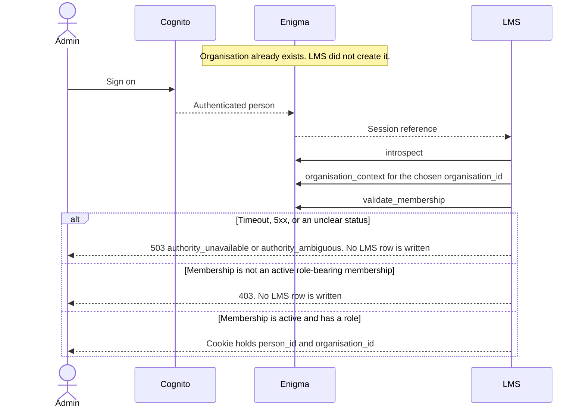

# Multi-tenant onboarding

**Status: Layer 3 draft.** Design only. This note does not add production code, and it does not amend `docs/LOCKED_DECISIONS.md`.

Last updated: 28 October 2026 (Africa/Johannesburg).

Layer 0 (configuration and the calculation read path), Layer 1 (the Enigma port, statements, and regulatory extracts), and Layer 2 (operational ceilings, campaign administration, and statement painting) already implement the rules this layer administers. This draft calls those interfaces. It does not restate their arithmetic, and it does not open a second staff list, a second ceiling comparison, or a second NCR rule.

The interfaces were read from:

| Layer | Branch | Commit | What this draft calls |
| --- | --- | --- | --- |
| Locked decisions | `main` | `d5db995` | Sections 5, 6, 8, 9, 10, 11, 12, 15, 16, 19, 21, 22, 23 |
| Layer 0 configuration, as integrated with statements and extracts | `cursor/layer1-gap-closures-ccde` | `a99b1b5` | `OrganisationSettings`, `resolve_customer_settings`, `resolve_in_duplum_trigger`, `resolve_residual_threshold_cents`, `ComplianceStore`, `ProviderCompliance`, `lms.regulatory.ncr` |
| Layer 1 Enigma port | `cursor/enigma-interface-d0c7` | `0cabd41` | `EnigmaClient`, `establish_session`, `validate_membership`, `lookup_mandate`, `authorize_ceiling_change`, `enforce_amount`, `CeilingStore` |
| Layer 2 ceilings and campaigns | `cursor/operational-ceilings-campaigns-2b69` | `263eabe` | The ceiling write sequence in that draft. This layer does not write a second comparison |
| Layer 1 statements and Layer 2 painting | `cursor/statements-documents-design-a789` at `144e331`, painting at `cursor/statement-pdf-rendering-a08b` `8219698` | | `Documents` reads `ComplianceStore`. Painting does not read `cfg_brand` |

Those modules are not on `main` at `d5db995`. A later implementation has to land on a tree that contains them. This draft does not vendor a second copy.

`docs/LOCKED_DECISIONS.md` on `main` is the source of truth. Where an older design note, a schema comment, or a port field disagrees with that file, the disagreement is listed in [Gaps](#8-gaps-that-need-a-locked-decision). This draft does not pick a winner.

## What this layer is

The path that brings one credit-provider organisation onto the LMS:

1. Enigma creates the organisation and holds its staff list. The LMS stores the opaque `organisation_id` and nothing that re-implements that identity.
2. The LMS captures the facts Enigma does not hold: NCR registration number, trading name, addresses, telephone, payment-account details, and brand assets, plus the provider legal name the statement store already requires.
3. Organisation-level elections are stored. Unset values fail closed. An optional product override stays on the product, and this layer does not publish one.
4. TSDG sets the solution-wide operational ceiling. A company admin sets the company ceiling. The LMS applies the tighter of the two by the Layer 2 call to `enforce_amount`.
5. The platform's basic document templates stay shared. The client supplies a logo and look-and-feel through one brand record, so a later change is one edit.
6. An admin role in Enigma amends the staff list. Sign-on stays Cognito, fronted by Enigma. The LMS trusts the membership and the role Enigma returns on the next request.

## Locked rules this draft follows

| Topic | Locked section | How this draft uses it |
| --- | --- | --- |
| Enigma is identity and access. The LMS stores opaque `person_id` and `organisation_id` and does not re-implement person or organisation identity | 15 | No LMS call creates an organisation, a person, a membership, or a role |
| Fail closed on Enigma timeout, an ambiguous status, or a clear suspended enrolment | 15 | Every LMS command below stops on `AuthorityUnavailable`, `AmbiguousAuthority`, or `EnrolmentDenied`. Nothing is written |
| NCR number, trading name, addresses, telephone, payment-account details, brand assets, operational ceilings, and campaigns are LMS data. Enigma does not hold or return them | 15, 21, 22 | Captured on the LMS rows those layers already read. Not copied from `OrganisationContext` |
| A blank NCR number blocks NCA communications and extracts for micro and unsecured personal. It does not block booking. It is not required for pure hosting or for Laybye/BNPL | 21 | Extracts keep calling `require_ncr_for_extract`. This layer adds no booking gate |
| Elections at organisation level, optional product override. Unset fails closed | 6, 19 | The organisation row is the write. The product columns stay null until a later product publish |
| Day count is the provider's choice. Actual/actual is the recommendation for new products. 30/360 stays selectable | 5 | Stored only when the provider chooses `actual_actual` or `thirty_360` |
| Repo-rate fall has no platform default | 11 | `contract_rate` or `lower_of_contract_and_cap`, stored explicitly |
| In-duplum trigger is the client's choice. No platform default | 6, 19 | `contractual_breach` or `collections_default` |
| Residual write-off threshold is client-configurable. Section 8 names R50. It is not automatic | 8, 19 | The admin stores a cent amount. See [O7](#o7-residual-write-off-threshold) |
| Campaign fall-away is a client choice, and the triggering default event must be clear when the discount falls away | 3, 19 | Named in the election list. No current column holds them. See [O10](#o10-campaign-fall-away-has-no-column) |
| Solution-wide ceiling by TSDG. Company ceiling by a company admin. The LMS applies the tighter of the two. A missing platform ceiling stops the command. These are authorization limits | 22 | The Layer 2 sequence. Statutory maxima stay in the calculation engine |
| Logo and look-and-feel are client-specific. The platform provides basic templates. Shared headers and footers, so one change flows through | 12 | One LMS brand record. This layer does not paint |
| Freeze consumer name, ID number, and service address at booking. A later Enigma change does not rewrite the agreement | 16 | Not captured on the organisation row. Booking already calls `freeze_at_booking` |
| Every LMS action records who, when, and what. Who is the Enigma staff identity | 23 | Settings and brand use the audit types already seeded. Compliance has no type. See [O14](#o14-audit-event-type) |

## 1. Organisation setup

### 1.1 Created in Enigma

A new credit-provider organisation is created in Enigma. `EnigmaPort` has no create-organisation operation, and this layer does not add one.

The LMS learns the opaque `organisation_id` when a signed-in person presents it:

1. Cognito authenticates the person. Enigma maps that person to memberships.
2. `establish_session(session_ref, organisation_id, ...)` calls `introspect`, `organisation_context`, and `validate_membership`.
3. The id on the LMS cookie is the id Enigma returned. That id is the only organisation identity the LMS stores.

`SessionView.organisations` can list more than one membership. The person chooses one. The LMS does not merge two organisations and does not invent a parent tenant.

How the id arrives before any person has a session is [O20](#o20-how-the-lms-learns-a-new-organisation_id). The real Enigma role id for the person who creates the organisation is [O22](#o22-staff-admin-role-id).

### 1.2 What the LMS stores against that id

| Fact | Where it already lives | This layer |
| --- | --- | --- |
| `organisation_id` | Primary key of `cfg_organisation_settings`, `cfg_provider_compliance`, `cfg_brand` | The key. No second organisation table |
| Provider legal name, NCR number, trading name, physical address, postal address, telephone, bank name, account number, branch code, payment reference | `ProviderCompliance` / `cfg_provider_compliance`, read by `ComplianceStore` | `ComplianceStore.put` when every field that function accepts is present |
| Elections | `cfg_organisation_settings`, read by `resolve_customer_settings` | Section 2 |
| Operational ceilings | `CeilingStore` | Section 2.2, by the Layer 2 sequence |
| Logo, display name, support contacts, statement footer | `cfg_brand` | Section 3 |
| Consumer name, ID number, service address | Frozen on the agreement by `freeze_at_booking` | Not an onboarding write. See [O23](#o23-two-different-addresses) |

`OrganisationContext` on the Enigma port still carries `legal_name` and `trading_name`. Section 15 says Enigma does not return trading names. This layer does not copy either field onto `ProviderCompliance`. See [O4](#o4-legal-name-and-the-port-fields).

`docs/lms-owned-configuration.md` and the comment on `cfg_organisation_settings` still say the legal name and the NCR number are read from Enigma. That text is older than sections 15 and 21. This layer follows the locked file. See [O5](#o5-stale-configuration-text).

### 1.3 LMS-owned data

`ComplianceStore.put` is the writer the statements layer already reads back through `ComplianceStore.require` and `ComplianceStore.find`.

| Locked fact | Field `put` accepts |
| --- | --- |
| NCR registration number | `ncr_registration_number` |
| Trading name | `trading_name`. Blank is accepted. Regulation 35(a)(ii) says "if any", and the store already treats trading name that way |
| Addresses | `physical_address`, `postal_address` |
| Telephone | `telephone` |
| Payment-account details | `bank_name`, `bank_account_number`, `branch_code`, `payment_reference` |
| Legal name, required by the statement store | `legal_name` |

Section 21 names the NCR number, trading name, addresses, telephone, and payment-account details. It does not name the four payment columns or the two address columns. This layer uses the columns `ProviderCompliance` already has. It does not add a column. See [O6](#o6-address-and-payment-columns).

`put` calls `_require_complete`. A blank `organisation_id`, legal name, NCR number, address, telephone, or payment field raises `CalculationInputError` and stores nothing. Trading name may be blank. A later `put` replaces the row. A statement already issued keeps the copy taken at issue. `Documents` copies the compliance row inside `issue_statement`. Painting does not read the row again.

### 1.4 Blank NCR number

Decision 21:

- The number is an LMS tenant attribute.
- It is required on NCA communications and on regulatory extracts for micro and unsecured personal loans.
- It is not required for pure hosting or for Laybye/BNPL.
- A blank number blocks those communications and extracts.
- A blank number does not block booking.

The extract gate already implements that rule. This layer calls it and does not rewrite it:

- `ncr_number_required(*, classification, pure_hosting)` in `lms.regulatory.ncr`.
- `read_ncr_number(compliance, organisation_id)` returns `None` when the row is missing or the number is blank. It does not invent a number.
- `require_ncr_for_extract(...)` raises `ncr-number-unset` when a classification in the extract requires the number and the number is missing. When none of the classifications require it, a missing number stays `None`.
- `build_form39_readiness` and `build_sacrra_extract` already call `require_ncr_for_extract`. This layer does not wrap them.

Booking is unchanged. The servicing book path does not read the NCR number. This layer does not add a check on that path.

`lms.enigma.regulatory.ncr_number_required` is a second predicate, keyed by product code. This layer does not call it. See [O2](#o2-two-ncr-predicates).

`pure_hosting` is an argument of the regulatory function. It is not a column. This layer does not invent the flag. See [O3](#o3-pure-hosting).

The writer and the decision disagree. `ComplianceStore.put` and the check on `cfg_provider_compliance` refuse a blank `ncr_registration_number`, so the other LMS fields on that row cannot be saved while the number is blank. The regulatory reader can represent a blank number only by the absence of a row, which also drops legal name, addresses, telephone, and payment details. The statements module already records this as RX52. This layer does not add a second table and does not change `put`. See [O1](#o1-a-blank-ncr-number-cannot-be-stored).

## 2. Elections and ceilings

### 2.1 Organisation elections

"Customer" in decision 6 is the credit-provider organisation. `OrganisationSettings` is that row. A non-null column on `ProductTerms` overrides it inside `resolve_customer_settings`. A null product column inherits. This layer writes the organisation row. It does not publish a product and it does not call `validate_terms`.

The brief names leniency, the full-payment threshold, day count, repo-rate fall, the in-duplum trigger, the residual write-off threshold, and the campaign fall-away choice. Decision 19 stores those, and it also stores the VAT election, the late-disbursement choice, the partial-prepayment choice, interest on a deferred initiation fee, and the campaign fall-away trigger. The same organisation write includes the full decision 19 set. Leaving one of them unset is what `resolve_customer_settings` or `resolve_in_duplum_trigger` already rejects when a later booking or a later default test asks for it.

Examples in the locked file are not defaults. Leniency of 4 or 5 days, and a threshold of 95 percent, are not written unless the provider submitted those numbers.

| Election | Stored token | Read path | Unset |
| --- | --- | --- | --- |
| `leniency_days` | Integer, zero or greater. Calendar days, including weekends and public holidays | `resolve_customer_settings` | `CalculationInputError`. Not filled |
| `full_payment_threshold_percent` | A percent above 0 and at most 100. 95 means 95 percent | `resolve_customer_settings` | `CalculationInputError`. Not filled |
| `day_count_code` | `actual_actual` or `thirty_360` | `resolve_customer_settings` | A credit product fails closed. A zero-cost or CPA lay-by product may omit it. The section 5 recommendation is not written in. See [O8](#o8-day-count-recommendation) |
| `repo_rate_fall` | `contract_rate` or `lower_of_contract_and_cap` | `resolve_customer_settings` | `CalculationInputError`. Option A and option B are not filled |
| `in_duplum_trigger` | `contractual_breach` or `collections_default` | `resolve_in_duplum_trigger` | `CalculationInputError` when something asks for the trigger. See [O9](#o9-in-duplum-trigger-on-the-booking-resolver) |
| `residual_write_off_threshold_cents` | Cents, zero or greater. Zero is a stored choice | The column on `cfg_organisation_settings` | See [O7](#o7-residual-write-off-threshold). This layer does not call `resolve_residual_threshold_cents` to fill a null |
| Campaign fall-away choice | `falls_away_on_default` or `does_not_fall_away` | No column and no function | [O10](#o10-campaign-fall-away-has-no-column) |
| Campaign fall-away trigger | `contractual_breach` or `collections_default`, when the choice is `falls_away_on_default` | No column and no function | [O10](#o10-campaign-fall-away-has-no-column) |
| `vat_on_rand_maxima` | `exclusive` or `inclusive` | `resolve_customer_settings` | `CalculationInputError`. `exclusive` is how the provider takes the decision 9 treatment. It is stored, not filled |
| `late_disbursement` | `adjust_instalment` or `keep_instalment` | `resolve_customer_settings` | `CalculationInputError` |
| `partial_prepayment` | `shorten_term` or `drop_instalment` | `resolve_customer_settings` | `CalculationInputError`. The preference to keep the contractual instalment is not a silent default |
| `interest_on_deferred_initiation` | `none` or `permitted` | `resolve_customer_settings` | `CalculationInputError`. Decision 10 names `none` as the substantive default. The resolver does not write `none` into a null. The provider stores `none` when that is the choice |

`cfg_organisation_settings` also requires `timezone = Africa/Johannesburg`, `currency = ZAR`, and a non-null `vat_vendor`. Timezone and currency are the schema's fixed values. `vat_vendor` is not a decision 19 election, and decision 9 describes a VAT rate rather than that boolean. This layer does not set `vat_vendor` and does not store a rate of 15 percent. See [O12](#o12-vat-rate).

The campaign price (base rate and discount) is a Layer 2 publish onto this same organisation row, or onto a product version. This layer does not call `campaign_rate` to invent a price. A later credit booking fails inside `resolve_customer_settings` when both the organisation pair and the product pair are unset. That failure stays in the booking path.

`resolve_customer_settings` takes a product. The day-1 templates `micro_short_term()` and `unsecured_personal()` set `day_count` to `actual_actual` and set a campaign pair on the instrument. A successful call that passes one of those templates does not show that the organisation day count was stored. This layer does not use those templates as the organisation election, and it does not add an organisation-only resolver. See [O8](#o8-day-count-recommendation).

A product override is a later `validate_terms` publish with the override column set. Null on the product keeps inheriting. This layer does not pre-create the five day-1 templates for the new organisation.

### 2.2 Ceilings

Operational rand ceilings are authorization limits. Statutory NCA maxima stay in `lms_config.interest`, `lms_config.fees`, and `resolve_charge`. In-duplum episode ceilings stay in the calculation path. This layer does not read or write them.

The write is the Layer 2 sequence. This layer does not restate `enforce_amount`.

| Who | Port role the adapter maps | Scope | Gate |
| --- | --- | --- | --- |
| TSDG, the platform owner | `lms.ceiling.platform.write` (`PLATFORM_CEILING_ROLE`) | `platform` | `authorize_ceiling_change` with both organisation ids equal to the platform organisation |
| Company admin | `lms.ceiling.company.write` (`COMPANY_CEILING_ROLE`) | `company` | `authorize_ceiling_change` with the actor's organisation equal to the target company, and not equal to the platform organisation |

`CeilingStore.platform(action)` returns `None` when TSDG has not set that action. `enforce_amount` then raises `AmbiguousAuthority` and the amount command stops. A new company has `CeilingStore.company` returning `None` until a company admin stores a row. `None` means the company has not tightened the platform ceiling. The effective limit is then the platform amount.

A company figure above the platform figure is stored and does not raise the limit. The comparison that enforces that is `enforce_amount`, called by the later amount command and by the Layer 2 preview at `amount_cents=0`. This layer does not compute the minimum itself.

The platform organisation id that `authorize_ceiling_change` requires is not a locked constant. See [O18](#o18-platform-organisation-id). The catalogue of actions that carry a ceiling is not locked. See [O19](#o19-which-commands-carry-a-ceiling). This layer does not hard-code an id and does not invent an action. The worked action already in the port is `lms.account.write_off`.

A ceiling edit is not sent through `handle_request` as an `amount_cents` command. Layer 2 already records why: that branch would compare the new ceiling with the old ceiling.

## 3. Brand and look-and-feel

Decision 12:

- The platform provides basic templates.
- Logo and look-and-feel are client-specific. The client may supply their own.
- Documents use shared headers and footers, and a centralised look-and-feel, so one change flows through.

The basic templates in this sentence are document templates. `lms_config.templates` (`micro_short_term`, `unsecured_personal`, `bnpl_zero`, `layby_goods`, `layby_security_short_term`) are product-parameter templates. This layer does not treat a product template as a document template, and it does not publish one.

The central brand record that already exists is `cfg_brand`, keyed by `(organisation_id, brand_code)`:

| Column | What it holds |
| --- | --- |
| `display_name` | Presentation name |
| `support_phone`, `support_email` | Support contacts on the brand row |
| `logo_object_key` | The client's logo |
| `statement_footer` | One footer string |

There is no Python reader. The Layer 2 painting draft does not read the table, and it leaves the logo position empty. `Documents.issue_statement` copies legal name, NCR number, addresses, telephone, and payment details from `ComplianceStore`. It does not copy a logo key. Regulation 35 telephone and addresses stay the compliance fields. `cfg_brand.support_phone` is not the compliance telephone.

This layer's write is one `cfg_brand` row for the organisation's `brand_code`, holding the logo key and the footer the client supplied. A later edit is an update of that same row, audited as `BRAND_CHANGED`. Document types share that row rather than each carrying a private copy of the artwork instruction.

The table has no header column and no look-and-feel tokens, and no document-template id is locked. The painting path does not yet take the row. See [O15](#o15-shared-header-footer-and-look-and-feel) and [O16](#o16-which-brand-and-what-a-store-is).

Issued statements already keep the compliance copy taken at issue, so a later compliance edit does not rewrite a stored statement. Reading decision 12's "one change flows through" as "the next document copies the current central header, footer, and logo" is this draft's use of the existing copy-at-issue rule. The locked file does not say that an issued statement stays visually frozen. See [O17](#o17-one-change-and-an-issued-statement).

The calculation engine does not read `cfg_brand`. This layer does not put the logo on the accrual path.

## 4. Staff and roles

Enigma links individuals to companies and roles. An admin amends that list in Enigma. The port names the role `lms.staff.admin` (`STAFF_ADMIN_ROLE`). The Enigma role id behind that port name is unread. See [O22](#o22-staff-admin-role-id).

Individual sign-on stays Cognito, fronted by Enigma. The LMS does not collect a password and does not keep a credential.

The LMS does not keep a staff table that can grant access. It does not amend the list. The next request after an admin change sees the new membership because the request calls Enigma again:

1. `introspect`
2. `organisation_context` for the active `organisation_id`
3. `validate_membership`
4. `lookup_mandate` for the action being attempted
5. `check_enrolment` when the action is for a product

An active membership with an empty role list is `AmbiguousAuthority`. The request stops. A menu may show a stale action. The command calls `lookup_mandate` again. Session, membership, mandate, and enrolment authorise only inside the request that fetched them.

Section 15 fails closed on timeout, an ambiguous status, and a clear suspended enrolment. The port also stops a suspended or absent membership and a suspended or closed organisation. This layer calls that port. See [O21](#o21-suspended-membership).

Machine members stay on the Enigma registration. `MachineRegistration` is amended in Enigma by the same admin role. This layer does not store it and does not call `exchange`.

## 5. Sequence of calls

Dates and times in a worked example are Africa/Johannesburg civil time. The Enigma session clock is not moved to 00:00. The Enigma port's conflict C7 stays as that port left it.

### 5.1 Bind the organisation

Calls, in order, all with the same `request_id`:

1. `EnigmaClient.introspect(session_ref, request_id=...)`
2. `EnigmaClient.organisation_context(session_ref, organisation_id, request_id=...)`
3. `EnigmaClient.validate_membership(session_ref, person_id, organisation_id, request_id=...)`
4. `establish_session` stores the LMS cookie. Generation starts at 1.

`organisation_context`'s `legal_name` and `trading_name` are not written.

### 5.2 Capture LMS-owned provider data

The actor is the person from step 5.1, still inside that organisation.

1. `introspect`, `organisation_context`, `validate_membership`, as in 5.1. A failure writes nothing.
2. `lookup_mandate` for the action that may write provider compliance. That action string is not locked. This draft does not substitute `lms.staff.admin` or either ceiling role, and it does not skip the lookup. The command stops until the action exists. See [O13](#o13-mandate-action-for-lms-onboarding-writes). No seeded audit type names a compliance write either, and decision 23 requires the audit row in the same transaction. See [O14](#o14-audit-event-type). Steps 3 to 5 are the write once both gaps are closed. Until then the sequence ends here and nothing is stored.
3. Build a `ProviderCompliance` whose `organisation_id` is the cookie's organisation, and whose other fields are what the operator typed.
4. `ComplianceStore.put(record)`. A blank required field raises `CalculationInputError`. The previous row, if any, stays. A blank NCR number takes this path and is refused by `put`. See [O1](#o1-a-blank-ncr-number-cannot-be-stored).
5. The same transaction appends an audit row: actor kind `person`, `actor_enigma_id` equal to `person_id`, the organisation id, and the fact that the compliance row was replaced. The payload follows the existing audit rule: no identity number, card number, or credential. Whether the payment-account number may sit in that payload is not locked. This draft does not put it there and does not add it to the prohibited list.

A later extract calls `require_ncr_for_extract` with the classifications on that extract and the `pure_hosting` value the caller already has. This capture sequence does not call it. Booking does not call it.

### 5.3 Set organisation elections

1. The same Enigma prefix as 5.2. The mandate action for this write is the same open point as [O13](#o13-mandate-action-for-lms-onboarding-writes). The sequence ends at that lookup, with nothing stored, until the action is locked. `ORGANISATION_SETTINGS_CHANGED` is already seeded, so the audit type is not the blocker.
2. Build an `OrganisationSettings` from the submitted tokens in the table in section 2.1. Leave a token null only when the operator did not choose it. Do not substitute an example, `actual_actual`, `none`, `exclusive`, or 5_000 cents.
3. The columns that exist are written on `cfg_organisation_settings` for this `organisation_id`, version plus one, with `actor_kind` and `actor_enigma_id` set from the session. There is no Python writer. The table is the store `resolve_customer_settings` already reads. This draft does not add a second settings object.
4. The same transaction writes audit type `ORGANISATION_SETTINGS_CHANGED`.
5. Campaign fall-away choice and trigger have nowhere to go. Step 3 does not invent columns for them, and it does not set `Agreement.campaign_falls_away_on_default`. See [O10](#o10-campaign-fall-away-has-no-column).
6. This sequence does not call `resolve_customer_settings`. That function needs a product, and the day-1 templates override day count and the campaign pair. The next credit booking calls it with the product being booked. An unset organisation election then fails closed unless that product overrides it.

`resolve_in_duplum_trigger` is what a later default test calls. This sequence does not call it to fill a value. If the stored trigger is null, that later call fails closed.

`resolve_residual_threshold_cents` returns 5_000 cents when both levels are null. This sequence does not call it, so a null column is not turned into R50 by onboarding. The resolver's fill remains the conflict in [O7](#o7-residual-write-off-threshold).

### 5.4 Set ceilings

Platform write, as Layer 2 specifies it. Repeated here only as the call list this layer uses:

1. `EnigmaClient.introspect`
2. `EnigmaClient.organisation_context` for `platform_organisation_id`
3. `EnigmaClient.validate_membership` in the platform organisation
4. `EnigmaClient.lookup_mandate` with action `lms.ceiling.platform.write`. `product_code` stays the optional field on `MandateQuery`. This layer does not invent a product code to satisfy `handle_request`.
5. `authorize_ceiling_change(membership, scope="platform", actor_organisation_id=platform_organisation_id, target_organisation_id=platform_organisation_id, platform_organisation_id=platform_organisation_id)`
6. Write one `RandCeiling`: `scope="platform"`, the action string, `amount_cents`, `currency="ZAR"`, empty `organisation_id`, `version` previous plus one starting at 1.

Company write, with the substitutions Layer 2 already makes:

1. Steps 1 to 3 use the company `organisation_id`.
2. `lookup_mandate` action `lms.ceiling.company.write`.
3. `authorize_ceiling_change(..., scope="company", actor_organisation_id=company_id, target_organisation_id=company_id, platform_organisation_id=platform_organisation_id)`.
4. The row is `scope="company"` and `organisation_id=company_id`.
5. The screen may then call `enforce_amount(action, amount_cents=0, platform=store.platform(action), company=store.company(company_id, action))`. That call does not persist a second amount. `AmbiguousAuthority` from a missing platform row leaves the company row saved and leaves later amount commands stopped.

A company admin cannot write the platform row. TSDG, while acting inside the platform organisation, cannot write a company row. That split is the body of `authorize_ceiling_change`.

Worked example, carried forward from the port. Platform write-off ceiling R10 000 (`1_000_000` cents). The company admin saves R1 000 (`100_000` cents). A later write-off of R1 500 is denied by `enforce_amount` after `lookup_mandate` has allowed `lms.account.write_off`. A write-off of R1 000 is inside the limit. If the company admin saves R50 000, the stored company row is R50 000 and the effective limit stays R10 000 until TSDG raises the platform row. This layer does not recalculate that minimum.

### 5.5 Brand

1. The same Enigma prefix as 5.2. The mandate action for this write is [O13](#o13-mandate-action-for-lms-onboarding-writes). The sequence ends at that lookup, with nothing stored, until the action is locked. `BRAND_CHANGED` is already seeded, so the audit type is not the blocker.
2. Insert or replace the `cfg_brand` row for `(organisation_id, brand_code)`: `logo_object_key`, `statement_footer`, and the display and support fields the operator supplied.
3. The same transaction writes audit type `BRAND_CHANGED`.
4. No call into `Documents` or into the painting path. The next statement issue still reads `ComplianceStore`, not `cfg_brand`.

If the organisation already has another `brand_code`, this sequence does not choose which one a document will copy. See [O16](#o16-which-brand-and-what-a-store-is).

### 5.6 Staff list

No LMS call. The admin amends the list in Enigma. The way that screen is reached (a deep link or an Enigma API) is unread. See [O22](#o22-staff-admin-role-id).

The next LMS request from a person who was added, removed, or re-roled calls `validate_membership` and `lookup_mandate` again. The LMS does not cache the previous role into the new request.

### 5.7 What a finished organisation still does not unlock

| Later command | Why it can still stop |
| --- | --- |
| Credit booking | `resolve_customer_settings` fails closed while a required election is null on both the organisation and the product. A missing campaign pair fails the same way. `check_enrolment` fails closed while Enigma has not enrolled the product |
| Amount command, including write-off | `enforce_amount` stops while the platform ceiling for that action is missing |
| NCA extract for micro or unsecured personal | `require_ncr_for_extract` raises `ncr-number-unset` while the number is blank, and `pure-hosting-unset` while `pure_hosting` is `None` and a requiring classification is present |
| Statement | `ComplianceStore.require` fails closed while the compliance row is missing or a required field is blank |
| In-duplum episode | `resolve_in_duplum_trigger` fails closed while the trigger is unset. The clip stays off (decision 7). This layer does not turn it on |

Booking itself is not refused for a blank NCR number.

## 6. Calls this layer does not make

| Interface | Why it stays where it is |
| --- | --- |
| `resolve_charge`, `cap_monthly_rate`, `cap_annual_rate`, `initiation_fee_cents`, `campaign_rate` | Calculation. Onboarding does not price an agreement |
| `validate_terms`, `micro_short_term`, `unsecured_personal`, `bnpl_zero`, `layby_goods` | A later product publish. The template's `actual_actual` is not the organisation election |
| `check_enrolment` as a grant | Enrolment is Enigma's. A feature flag does not grant it |
| `freeze_at_booking` | Booking freezes the consumer. Onboarding does not |
| `lms.enigma.regulatory.ncr_number_required` | A second NCR predicate. Extracts call `lms.regulatory.ncr` |
| `lms.collections.authority._ceiling` | Parallel copy of `enforce_amount`. Layer 2 gap 11 |
| `handle_request` with the new ceiling in `amount_cents` | Would compare the new ceiling with the old one |
| `Documents.issue_statement` and the Layer 2 paint sequence | No document is issued by saving a brand row |
| Enigma staff-list and organisation-create operations | Not on `EnigmaPort`. The LMS does not amend them |

## 7. Audit

Decision 23: who, when, and what. Who is the `person_id` from `introspect` on this request.

| Write | Seeded type |
| --- | --- |
| Organisation elections | `ORGANISATION_SETTINGS_CHANGED` |
| Brand row | `BRAND_CHANGED` |
| Provider compliance | No seeded type. [O14](#o14-audit-event-type) |
| Ceiling row | No seeded type. Layer 2 gap 15, restated as [O14](#o14-audit-event-type) |

The settings row already stores `actor_kind` and `actor_enigma_id`. A person actor requires an Enigma id. The audit insert shares the transaction with the write. If the audit insert fails, the write rolls back. That is the existing configuration rule.

`audit_idempotency` is the existing unique pair `(organisation_id, idempotency_key)`. A retry of the same onboarding command uses that pair. This layer does not add a second idempotency store.

## 8. Gaps that need a locked decision

Each row is unresolved. Closing it means editing `docs/LOCKED_DECISIONS.md`. This draft does not close any row.

### O1. A blank NCR number cannot be stored

Decision 21 allows a blank NCR number. The blank blocks NCA communications and extracts for micro and unsecured personal, and it does not block booking. `ComplianceStore.put` and the check constraint on `cfg_provider_compliance` reject a blank `ncr_registration_number`, so legal name, addresses, telephone, and payment details cannot be saved on that row either. The statements note records the same refusal as RX52, because a stored statement currently requires the number even when the document also contains a zero-cost or lay-by section.

This draft calls `put` and does not add a writer that accepts a blank number.

### O2. Two NCR predicates

`lms.regulatory.ncr.ncr_number_required` keys off ledger classification. Unknown classifications are required. `lms.enigma.regulatory.ncr_number_required` keys off `lms.micro_short_term` and `lms.unsecured_personal`, returns false when `product_code` is `None`, and treats `lms.laybye_security` as exempt. Decision 21 says "micro and unsecured personal" and "Laybye/BNPL" and does not name either string set. The regulatory note records the classification strings as RX24.

This draft calls the regulatory function for extracts.

### O3. Pure hosting

Decision 21 exempts pure hosting. `pure_hosting` is not a column on `cfg_provider_compliance` or `cfg_organisation_settings`. The regulatory note records that as RX23. `require_ncr_for_extract` fails closed when the argument is `None` and a requiring classification is present. It is not read as false.

This draft does not add the column and does not pass `False` for an unknown tenant.

### O4. Legal name and the port fields

Decision 21's list does not name the provider's legal name. Decision 15 says the LMS holds all data required for statements, and `ProviderCompliance.legal_name` is required by the statement store. Decision 15 also says Enigma does not return trading names. `OrganisationContext` still has `legal_name` and `trading_name`.

This draft writes both strings only through `ComplianceStore.put`. It does not copy `OrganisationContext`.

### O5. Stale configuration text

`docs/lms-owned-configuration.md` says the NCR number is read from Enigma at origination and copied onto the agreement pin, and that the LMS does not own the legal name or the NCR number. The comment on `cfg_organisation_settings` says the same. Decisions 15 and 21 say Enigma does not hold or return the NCR number, trading name, addresses, telephone, payment-account details, or brand assets.

This draft follows the locked file. It does not edit the other branch.

### O6. Address and payment columns

Decision 21 says "addresses" and "payment-account details". The store has `physical_address`, `postal_address`, `bank_name`, `bank_account_number`, `branch_code`, and `payment_reference`. This draft uses those fields because `put` already requires them. It does not add an address or an account field.

### O7. Residual write-off threshold

Decision 8 says the threshold is client-configurable, that the default value is R50, and that it is not automatic. Decision 19 lists the threshold with the elections whose unset values fail closed. `resolve_residual_threshold_cents` returns 5_000 cents when both the organisation and the product are null. The column comment states that fill. A stored zero remains a client choice inside the resolver.

This draft requires the operator to submit a cent amount, including 5_000 if R50 is what they want, and it does not call the resolver to fill a null. It does not change the resolver. A lock has to say whether a null column is R50 or is a failure.

### O8. Day-count recommendation

Decision 5 recommends actual/actual for new products and calls it a default, and it keeps 30/360 selectable. `resolve_customer_settings` fails closed for a credit product when the resolved code is neither `actual_actual` nor `thirty_360`, and it does not write `actual_actual`. `micro_short_term()` and `unsecured_personal()` set `day_count` to `actual_actual` on the instrument, which overrides a null organisation value. There is no function that checks the organisation row without a product.

This draft stores a day count only when the provider chooses one. It does not publish a template in order to apply the recommendation.

### O9. In-duplum trigger on the booking resolver

Decision 6 and decision 19: an unset trigger fails closed, and there is no platform default. `resolve_in_duplum_trigger` does that. `resolve_customer_settings` still returns `None` and its comment says whether booking itself must reject a missing trigger is not settled.

This draft will not store a null trigger as a completed election. It does not change either function. A lock has to say whether booking calls `resolve_in_duplum_trigger` or may proceed while the trigger is null.

### O10. Campaign fall-away has no column

Decision 3 stores the fall-away choice per campaign, and it requires the triggering event (contractual breach or collections default) when the discount falls away. Decision 19 stores `falls_away_on_default` / `does_not_fall_away` and the trigger at organisation level with an optional product override. `OrganisationSettings` and `cfg_organisation_settings` have neither field. `campaign_rate` takes `discount_fallen_away` from the caller. `Agreement.campaign_falls_away_on_default` defaults to `False`, which is a silent "does not fall away".

This draft does not add the columns, does not choose per campaign versus per organisation, and does not set the agreement flag.

### O11. Interest on a deferred initiation fee

Decision 10 says the default is no interest. Decision 19 says an unset value fails closed. `resolve_customer_settings` accepts only a stored `none` or `permitted` and does not fill `none`.

This draft stores the token the provider submitted. It does not write `none` into a null column. The two sentences in the locked file still differ on what a null means.

### O12. VAT rate

Decision 9 requires the LMS to calculate VAT. An exempt client is a rate of 0 percent on a vatable component. A component that is not legally vatable shows no VAT rate, so the two cases stay distinct. `vat_on_rand_maxima` is the inclusive or exclusive election for the rand maxima. `cfg_organisation_settings.vat_vendor` is a non-null boolean the lock does not define. No column stores the rate. `vat_on_top_cents` in the fee module defaults its argument to `Decimal("0.15")`. The statements layer already refuses to assume a rate.

This draft does not set `vat_vendor` and does not store 15 percent.

### O13. Mandate action for LMS onboarding writes

Ceiling writes have port actions: `lms.ceiling.platform.write` and `lms.ceiling.company.write`. Decision 15 does not name an action for provider compliance, organisation elections, or brand. The staff-admin port role amends the Enigma staff list. It is not a mandate to write LMS rows.

This draft does not invent an action string and does not treat a clear active membership as authority to write those rows. `lookup_mandate` is not called with a placeholder. The write stops.

### O14. Audit event type

Decision 23 requires an audit record for every LMS action. The seed contains `ORGANISATION_SETTINGS_CHANGED` and `BRAND_CHANGED`. It has no type for a compliance write or a ceiling write. Layer 2 gap 15 already records the ceiling case, including retention.

This draft uses the two seeded types for the writes they name. It does not add a code for compliance or for ceilings.

### O15. Shared header, footer, and look-and-feel

Decision 12 requires basic document templates, client-supplied logo and look-and-feel, and shared headers and footers. `cfg_brand` stores a logo key and `statement_footer`. It has no header column and no look-and-feel tokens. No document-template id is locked. There is no Python reader. The Layer 2 painting draft leaves the logo unpainted and describes branding as the logo only (its P1 and C2). Product templates in `lms_config.templates` are prices.

This draft writes the columns the table already has. It does not add a header, a token, or a template id, and it does not paint.

### O16. Which brand, and what a store is

Decision 15 lists stores and brands linked to a company as LMS data. `cfg_brand` is keyed by `(organisation_id, brand_code)`. Nothing in the locked file defines a store, or says which `brand_code` a document copies when zero rows or several rows exist. The statements gap G18 and the painting gap P1 already leave that choice open. A booking record does not store a `brand_code`.

This draft can save a row the operator names. It does not choose among rows and does not create a store entity.

### O17. One change and an issued statement

Decision 12 says one change flows through, so documents are not edited one by one. The statements layer copies provider facts onto the stored statement at issue, and painting reads that copy. A later edit of the central row then changes the next document and leaves the stored statement as it was issued.

The locked file does not say the issued statement stays visually frozen. This draft uses the copy the statements layer already takes. It does not rewrite stored statements, and it does not make painting read `cfg_brand` live.

### O18. Platform organisation id

`authorize_ceiling_change` takes `platform_organisation_id`. No locked constant names it. Layer 2 gap 12 already records this. This draft does not hard-code an id.

### O19. Which commands carry a ceiling

`enforce_amount` is per action. The port's worked command is `lms.account.write_off`. Decision 22 does not list the actions. Layer 2 gap 9 already records this. An action with no platform row stops when an amount is submitted. This draft does not extend the catalogue during onboarding.

### O20. How the LMS learns a new organisation_id

The organisation is created in Enigma. `EnigmaPort` has no create operation and no organisation-created event. The port's remaining wire list already marks events and the staff-admin screen as unread. `establish_session` needs an `organisation_id` the caller already has, which today means a person whose `introspect` result includes that membership.

This draft does not subscribe to an event and does not poll Enigma for new organisations.

### O21. Suspended membership

Decision 15 fails closed on timeout, an ambiguous status, and a clear suspended enrolment. The port also returns `not_a_member` for a suspended or absent membership and `organisation_unavailable` for a suspended or closed organisation. The port recorded the broader stop as conflict C3 before decision 15 named suspended enrolment.

This draft calls the port, so those stops still apply. It does not add suspended membership or a suspended organisation to the locked file.

### O22. Staff-admin role id

The port names `lms.staff.admin` and says that role amends the staff list in Enigma. Decision 15 says Enigma links individuals to companies and roles. It does not name the admin role. The Enigma role id, and whether the LMS deep-links to the Enigma screen or calls an Enigma API, are unread (port remaining details 3 and 10, port conflict C9).

This draft does not amend the list and does not map the port name onto an Enigma id.

### O23. Two different addresses

Decision 16 freezes the consumer's service address, with the consumer's name and ID number, and a later Enigma change does not rewrite it. `freeze_at_booking` reads that address from `PersonDirectory`. Decision 21's addresses sit with the trading name and the payment-account details, and `ProviderCompliance` stores them as the provider's physical and postal addresses.

Decision 15 uses the word "addresses" once, in the list of facts Enigma does not hold. This draft keeps the consumer service address on the Enigma person and the provider addresses on `ProviderCompliance`. It does not copy the consumer address onto the organisation row. A reading that puts the consumer service address in the LMS compliance row would conflict with decision 16.

## 9. Interface index

| Call | Module | Used for |
| --- | --- | --- |
| `introspect`, `organisation_context`, `validate_membership`, `lookup_mandate` | `lms.enigma.client.EnigmaClient` | Fail-closed identity before any LMS write |
| `establish_session` | `lms.enigma.middleware` | Cookie holding `person_id` and `organisation_id` |
| `ComplianceStore.put`, `find`, `require` | `lms_config.compliance` | Provider legal name, NCR number, trading name, addresses, telephone, payment-account details |
| `read_ncr_number`, `ncr_number_required`, `require_ncr_for_extract` | `lms.regulatory.ncr` | The decision 21 gate. Not called to block booking |
| `OrganisationSettings`, `resolve_customer_settings` | `lms_config.locked` | The read path a later booking uses. Not called here to fill a null |
| `resolve_in_duplum_trigger` | `lms_config.locked` | Later use of the trigger. Unset fails closed |
| `authorize_ceiling_change`, `enforce_amount` | `lms.enigma.ceilings` | The Layer 2 edit gate and the tighter-of comparison |
| `CeilingStore.platform`, `CeilingStore.company` | `lms.enigma.ceilings` | Rows this layer writes by the Layer 2 sequence |
| `PLATFORM_CEILING_ROLE`, `COMPANY_CEILING_ROLE` | `lms.enigma.models` | `lms.ceiling.platform.write`, `lms.ceiling.company.write` |
| `cfg_brand` | `db/migrations/0001_lms_owned.sql` | Logo key and statement footer. No reader in the painting path |
| `ORGANISATION_SETTINGS_CHANGED`, `BRAND_CHANGED` | `db/seed/001_reference.sql` | Audit types for the two writes that have one |
