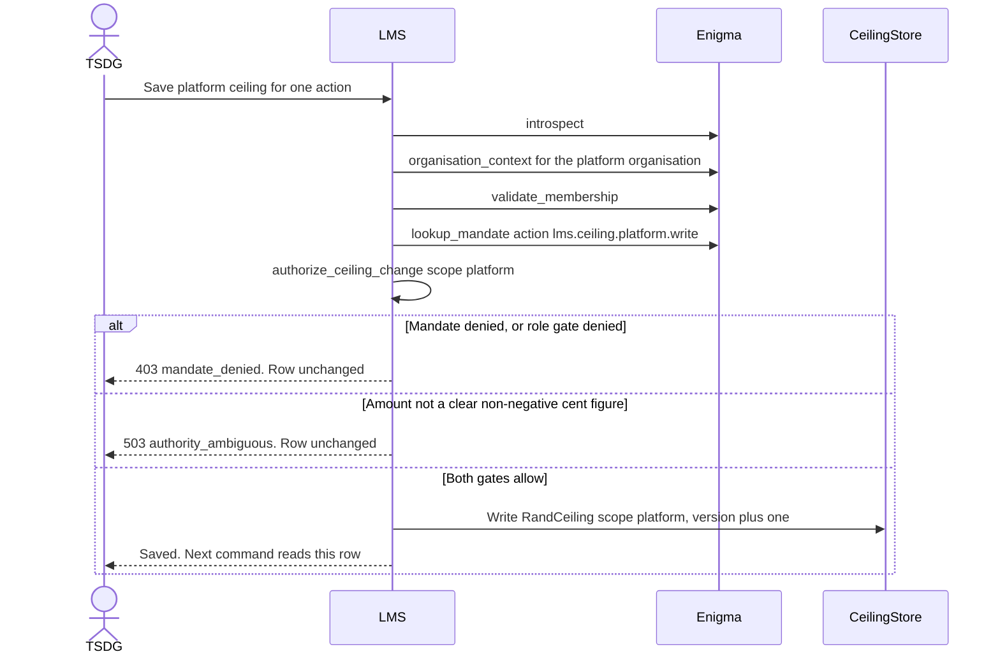
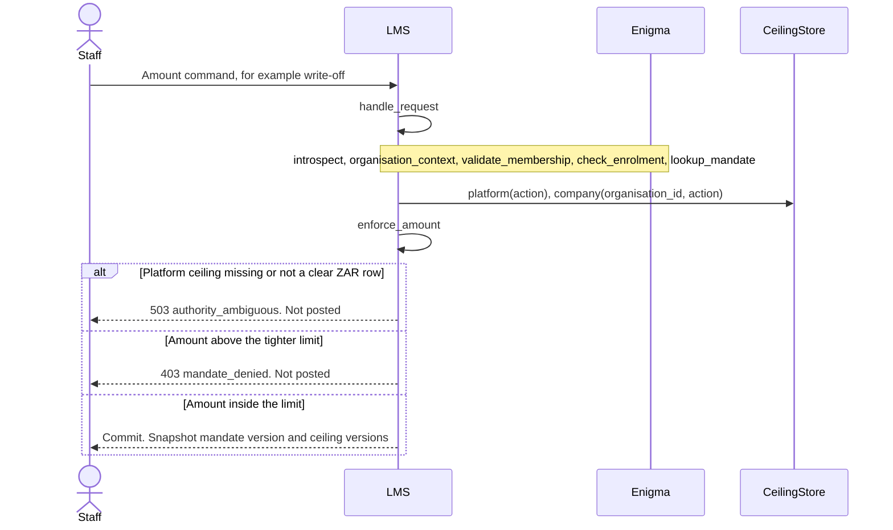
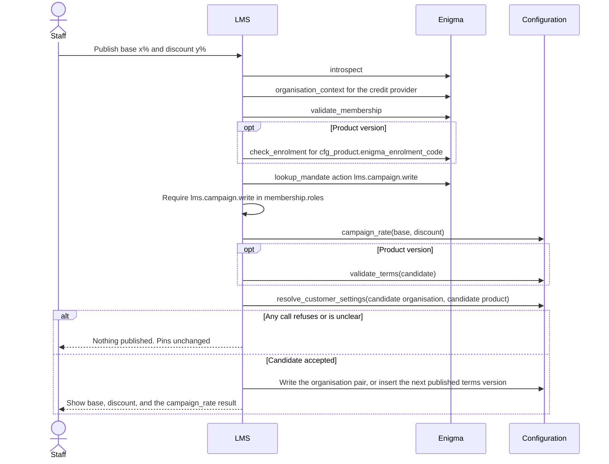

# Operational ceilings and campaign management

**Status: Layer 2 draft.** Design only. This note does not add production code, and it does not amend `docs/LOCKED_DECISIONS.md`.

Last updated: 28 October 2026 (Africa/Johannesburg).

Layer 0 (configuration and the calculation read path) and Layer 1 (the Enigma port, the ledger, and collections) already implement the rules this layer administers. This draft calls those interfaces. It does not restate their arithmetic.

The interfaces were read from:

| Layer | Branch | Commit | What this draft calls |
| --- | --- | --- | --- |
| Layer 1 Enigma port | `cursor/enigma-interface-d0c7` | `0cabd41` | `EnigmaClient`, `authorize_ceiling_change`, `enforce_amount`, `CeilingStore` |
| Layer 0 configuration, as integrated with the ledger | `cursor/layer1-gap-closures-ccde` | `a99b1b5` | `campaign_rate`, `resolve_customer_settings`, `validate_terms`, `resolve_charge`, `AgreementPin` |

Those modules are not on `main` at `197600d`. A later implementation has to land on a tree that contains them. This draft does not vendor a second copy.

`docs/LOCKED_DECISIONS.md` on `main` is the source of truth. Where this brief, an interface, and the locked file disagree, the disagreement is listed in [Gaps](#5-gaps-that-need-a-locked-decision). This draft does not pick a winner.

## What this layer is

Two administration surfaces:

1. **Operational rand ceilings.** Authorization limits on a command that moves or forgives rands. TSDG adjusts the solution-wide ceiling. A company admin adjusts that company's ceiling. LMS applies the tighter of the two by calling `enforce_amount`. A missing platform ceiling stops the command. Statutory NCA maxima stay in the calculation engine (`lms_config.interest`, `lms_config.fees`, `resolve_charge`).
2. **Campaign administration.** Staff publish the stored price as a base rate (x %) and a campaign discount (y %). The performing rate for a new booking is the result of `lms_config.locked.campaign_rate`. A later publish does not rewrite an `AgreementPin`. Fall-away on the default flag date, survival through leniency, and the refusal to restore the discount after a cure stay in the accrual path that already calls `campaign_rate`.

In-duplum episode ceilings (`duplum_base_cents`, `lms.default_episode.ceiling_cents`) are a third figure. This layer does not read or write them.

## Locked rules the draft follows

| Topic | Locked section | How this draft uses it |
| --- | --- | --- |
| Campaign stored as base x % minus discount y %; a 0 % result is a real rate; the discount stays through leniency, falls away on the flag date, and does not return after a cure | 3 | Publish stores both numbers. Accrual timing stays inside `campaign_rate`. |
| Penalty interest may not exceed the contractual interest rate | 3 | The draft calls `campaign_rate`. It does not define "contractual" again. See gap 2. |
| Fees and interest charged may not exceed NCA limits | 8, and the cap tables the engine already reads | The campaign screen does not apply regulation 42, regulation 43, or regulation 44. The next booking and the next accrual call `resolve_charge`. |
| Fail closed on Enigma timeout, an ambiguous status, or a clear suspended enrolment | 15 | Every command below stops on `AuthorityUnavailable`, `AmbiguousAuthority`, or `EnrolmentDenied`. Nothing is written. |
| LMS stores opaque `person_id` and `organisation_id` and does not re-implement identity | 15 | The actor and the tenant are the ids Enigma returned on this request. |
| A later Enigma change does not rewrite a concluded agreement | 16 | Campaign and ceiling edits do not touch frozen name, ID number, or service address. |
| Half-up to cents on billing | 17 | The operational-ceiling comparison stays in integer cents, which is what `enforce_amount` already does. This draft does not run `half_up_cents` on a ceiling. |
| Unset elections fail closed | 6, 19 | A campaign publish calls `resolve_customer_settings` on the candidate pair together with the elections already stored. It does not fill a null election. |

## 1. Operational rand ceilings

### Facts the Enigma port already owns

`src/lms/enigma/ceilings.py` is the comparison and the edit gate. `src/lms/enigma/models.py` names the port roles. The adapter maps those strings onto Enigma's real role ids. This draft does not supply the Enigma ids. The port's remaining-detail list already records that those ids are unread (`lms.ceiling.platform.write`, `lms.ceiling.company.write`).

| Port role | Who | Where the membership must sit |
| --- | --- | --- |
| `lms.ceiling.platform.write` | TSDG, the platform owner | The platform organisation |
| `lms.ceiling.company.write` | Company admin | That company. The platform organisation is refused by `authorize_ceiling_change` |

`CeilingStore` is read-only:

- `platform(action) -> RandCeiling | None`. `None` means TSDG has not set a ceiling for that action.
- `company(organisation_id, action) -> RandCeiling | None`. `None` means the company has not tightened the platform ceiling.

`RandCeiling` is `scope`, `action`, `amount_cents`, `currency`, `organisation_id`, `version`.

`enforce_amount(action, amount_cents, platform, company) -> AppliedCeiling` is the only comparison:

- A missing platform row, a scope or action that does not match, a currency other than `ZAR`, or a negative amount raises `AmbiguousAuthority`. The command stops. HTTP 503 `authority_ambiguous`.
- When the company row is absent, the limit is the platform amount.
- When the company row is present, the limit is the lower of the two. A company figure above the platform figure does not raise the limit. The company figure is still stored.
- `amount_cents` equal to the limit is inside the ceiling. One cent over raises `MandateDenied`. HTTP 403 `mandate_denied`.
- The return value carries `limit_cents`, `platform_version`, and `company_version` (`None` when the company has not tightened).

`authorize_ceiling_change(membership, scope, actor_organisation_id, target_organisation_id, platform_organisation_id)` is the edit gate. The caller has already validated the membership with Enigma. An inactive membership or an empty role list is `AmbiguousAuthority`. The wrong role, the wrong organisation, or a company-scope write aimed at the platform organisation is `MandateDenied`.

`handle_request` already runs the money-command order: introspect, organisation context, membership, enrolment, `lookup_mandate`, then `enforce_amount` when the command carries `amount_cents`. This layer does not replace that function.

`lms.collections.authority.authorise_write_off` repeats the same comparison in `_ceiling`, because that branch does not import `lms.enigma`. This draft does not add a third copy and does not extend `_ceiling`. Amount commands call `enforce_amount`. Retiring the collections copy is an integration gap (gap 11), not a new rule.

### What this layer adds

A write, behind the gates above, of one `RandCeiling` row that the existing `CeilingStore` will return on the next command. The row is LMS data. Enigma keeps the role and the mandate. No deploy is required for the next command to see the new amount.

The writer fills the fields `_clear_ceiling` already requires, so the next `enforce_amount` can read the row:

| Field | Platform write | Company write |
| --- | --- | --- |
| `scope` | `platform` | `company` |
| `action` | The action string the later command will pass to `lookup_mandate` and to `enforce_amount` | The same action string |
| `amount_cents` | The figure TSDG submitted, in cents | The figure the company admin submitted, in cents |
| `currency` | `ZAR` | `ZAR` |
| `organisation_id` | Empty on a platform row | That company's `organisation_id` |
| `version` | Previous version plus one, starting at 1 | Previous version plus one, starting at 1 |

The two screens are separate. The platform screen calls `authorize_ceiling_change` with `scope="platform"` and both organisation ids equal to the platform organisation. The company screen calls it with `scope="company"` and the actor's organisation equal to the target company. A company admin cannot write the platform row. TSDG, while acting inside the platform organisation, cannot write a company row. That split is the body of `authorize_ceiling_change`.

The worked example already in the Enigma port stays the example here. Platform write-off ceiling R10 000 (`1_000_000` cents). Cape Credit saves R1 000 (`100_000` cents). A later write-off of R1 500 is denied by `enforce_amount` after `lookup_mandate` has allowed `lms.account.write_off`. A write-off of R1 000 is inside the limit. If Cape Credit saves R50 000, the stored company row is R50 000 and the effective limit stays R10 000 until TSDG raises the platform row. This draft does not recalculate that minimum.

A platform ceiling of zero is a clear ZAR amount. `enforce_amount` then allows only a zero amount. This draft does not treat zero as "missing". Missing is `CeilingStore.platform` returning `None`.

### Preview

The screen shows the effective limit by calling `enforce_amount` with `amount_cents=0` and the rows `CeilingStore` just returned. Zero is inside any clear non-negative limit, so the call returns `AppliedCeiling.limit_cents` without posting a journal. A missing or unclear platform ceiling raises `AmbiguousAuthority`. The screen reports that commands for that action will stop until TSDG sets a clear platform row. The preview is the same function the command will call. It is not a second formula.

### What a ceiling edit must not do

- It must not pass the new ceiling through `handle_request`'s `amount_cents` branch. That branch would compare the new ceiling with the old ceiling and could deny a lawful edit.
- It must not call `cap_monthly_rate`, `cap_annual_rate`, `chargeable_rate`, `initiation_fee_cents`, `subsequent_service_fee_cents`, or `duplum_base_cents`. Those are statutory or in-duplum measures.
- It must not hard-code a rand default. An action with no platform row stays stopped.

The only action the port sketch works through end to end is `lms.account.write_off`. This draft keys every row by the action string the caller names. It does not publish a catalogue of further actions (gap 9).

## 2. Campaign administration

### Facts configuration already owns

Decision 3 stores the price as two numbers. Configuration stores them as a pair.

| Place | Columns | Rule already implemented |
| --- | --- | --- |
| `lms.cfg_organisation_settings` | `base_rate`, `discount_rate` | Both null, or both set with `discount_rate <= base_rate`. A null discount is unset. It is not a zero discount. |
| `lms.cfg_product_terms` / credit instrument | `base_rate`, `discount_rate`, and the contractual column (`monthly_rate`, `annual_rate`, or `repo_margin`) | The pair inherits together. A product discount is not read while the product base is null. Published terms are immutable. An agreement pins `terms_version_id`. |
| `AgreementPin` | `base_rate`, `discount_rate`, plus the contractual rate | Copied at origination. A later edit of the organisation row or a later terms version does not flow into this pin. |

The stored unit is the fraction the column check already requires (`0 <= rate < 1`). Five percent is `0.05`. The screen displays that fraction as x % and y %, which is the display decision 3 requires. This draft does not store `5` in the column.

`lms_config.locked.campaign_rate(base_rate, discount_rate, *, in_default=False, discount_fallen_away=False) -> Decimal`:

- A negative base or a negative discount raises `CalculationInputError`.
- A discount above the base raises `CalculationInputError` (`campaign discount cannot exceed the base rate`).
- With both flags false, the result is `base_rate - discount_rate`, which is zero when the two are equal.
- With `in_default` or `discount_fallen_away` true, the result is the base.

`lms_config.locked.resolve_customer_settings(organisation, product)` resolves the pair future bookings will pin. A zero-cost or CPA lay-by product resolves to `(0, 0)` and does not inherit a campaign. `_require_zero_deposit` rejects a campaign on a security deposit. This layer does not attach a campaign to those products.

`lms_config.validate.validate_terms` calls `_require_campaign`. The performing column must equal base minus discount, including when that difference is zero. A discount of zero is accepted there as a campaign with nothing taken off. The base is what is charged if the discount falls away, so a campaign cannot hide a higher penalty.

`lms_config.context.resolve_charge` is the accrual rate. On the origination date it refuses a base that would exceed the statutory maximum once the discount has fallen away. On a later date it applies decision 11 through the pinned `repo_rate_fall`. This layer does not call it to approve a publish. The next booking does.

`lms.calc.interest.campaign_terms` returns `(base, stored discount, effective)` for the calculator. Its effective rate is never negative: a discount above the base becomes 0 %. The ledger does not use that function for the charged rate. It uses `campaign_rate`. See gap 1.

The ledger refuses a non-zero `discount_rate` on an unsecured agreement (`unsecured-campaign-base-unset`). Decision 3 does not say whether y % is taken off the repo margin or off the repo-plus-margin rate. Configuration can store the difference on `repo_margin`. This draft does not publish a non-zero unsecured discount, because the accrual path would then stop. It also does not choose which figure y % comes off. See gap 3.

Fee discounts in the calculator are cents (`apply_ex_vat_discount`), and a discount at or above the ex-VAT fee yields R0. Decision 3 does not say a fee campaign is a percentage, and it does not say a fee discount falls away on the flag date. This layer administers the interest pair only. See gap 4.

### Commands

All three commands are prospective. They change the organisation pair, or they publish a new product-terms version. They do not update `AgreementPin`, `discount_fallen_away`, or any open in-duplum episode. An agreement already booked keeps the base and the discount it pinned. That agreement still loses the discount on its own flag date, and a later cure still leaves the discount off, because that is `campaign_rate` on the accrual path.

The locked file does not itself say that an administrative edit is prospective. The pin and the immutable published terms are what Layer 0 already does, and this brief requires the same result. See gap 6.

| Command | When | What is written |
| --- | --- | --- |
| Create | The resolved pair for that scope is unset | Organisation: set both columns on `cfg_organisation_settings`. Product: publish version 1, or the next version, with both numbers set. |
| Amend | A pair is already published for that scope | Organisation: replace both columns on the same row and increment `version`. Product: insert a new published version. The previous version stays as it was. |
| End | Staff withdraw the discount for future bookings | Unresolved. See gap 5. The command still refuses to touch booked pins. |

A product write and an organisation write are different rows. The product pair wins as a pair inside `resolve_customer_settings`. Amending the organisation pair does not change a product that has its own base. Creating a product pair does not clear the organisation pair.

Before the write, the command builds the candidate `OrganisationSettings` and `ProductTerms` and calls:

1. `campaign_rate(base, discount)` with both flags false. `CalculationInputError` stops the command. The draft does not replace that call with `max(0, base - discount)`.
2. `validate_terms` when the target is a product version. The contractual column on that version is the value `campaign_rate` just returned, so `_require_campaign` sees base minus discount.
3. `resolve_customer_settings` on the candidate, so a credit product that would fail closed for an unrelated null election fails here too. The command does not fill those nulls.

The screen then shows three figures: the base, the discount, and the `Decimal` returned by `campaign_rate`. A 5 % base and a 5 % discount are stored as `0.05` and `0.05` and displayed as 5 % − 5 % = 0 %. A zero result is a successful publish.

Organisation settings are one mutable row (`version`, `actor_kind`, `actor_enigma_id`). Product terms are immutable once published, with `effective_from`. This draft uses those two stores as they are. It does not add a history table for the organisation row (gap 13) and it does not put a campaign into `cfg_feature_flag`.

`effective_from` on a new product version is a date. Configuration already treats business dates as Africa/Johannesburg. This draft writes that calendar date. Decision 1's 00:00 value date is about allocation and reversals. It does not mention a configuration edit (gap 14).

### Booked agreements after an edit

Example. On 1 March a short-term agreement pins base `0.05` and discount `0.05`. On 1 April staff amend the product to base `0.05` and discount `0`. The March agreement's pin stays `0.05` / `0.05`. While the discount applies, accrual calls `campaign_rate(0.05, 0.05)` and charges 0. On the flag date the accrual path calls `campaign_rate(0.05, 0.05, discount_fallen_away=True)` and charges the base. A cure does not clear `discount_fallen_away`. Staff ending or amending the campaign is not that call. A booking accepted after the new version's `effective_from` pins the new pair.

## 3. Role gates

Role strings in this section are LMS port names. The Enigma adapter maps them onto Enigma role ids. This draft does not invent those ids. `STAFF_ADMIN_ROLE` (`lms.staff.admin`) remains the Enigma staff-list role. LMS does not amend the staff list, and holding the staff-list role is not by itself a ceiling or campaign grant.

| Action and role string | Membership | Mandate action passed to `lookup_mandate` |
| --- | --- | --- |
| `lms.ceiling.platform.write` | TSDG, in the platform organisation. Already `PLATFORM_CEILING_ROLE`. | The same string |
| `lms.ceiling.company.write` | Company admin, in that company. Already `COMPANY_CEILING_ROLE`. | The same string |
| `lms.campaign.write` | Proposed here. Staff, in the credit-provider organisation whose pair or product is being published. | The same string |

`lms.campaign.write` is one role for create, amend, and end, at organisation scope and at product scope. The target (organisation row or product version) is the command, not a second role. The brief asks for a defined role. Decision 15 does not name it. See gap 8.

A campaign actor is a member of the credit-provider organisation. The platform organisation is not given this role by this draft. Decision 3 stores the pair on the organisation and, optionally, the product. It does not store a solution-wide campaign.

Ceiling edits use both gates that already exist: `lookup_mandate` for the action, then `authorize_ceiling_change` for the role and the organisation. Either refusal stops the write. A campaign edit uses `lookup_mandate` for `lms.campaign.write`, then requires that same string in the `roles` tuple `validate_membership` just returned. There is no `authorize_campaign_change` in Layer 1. This draft does not add one in code. The check is the same shape as the role test inside `authorize_ceiling_change`: the membership is already active and has a non-empty role list (the client enforces that), and the proposed role is in `roles`. A missing role is `MandateDenied`. An empty role list has already become `AmbiguousAuthority` inside `validate_membership`.

The brief's phrase "restricted to certain roles" is, on the implemented ceiling gate, the single company role above. This draft does not add further ceiling roles.

## 4. Sequence of calls

Timeout, HTTP 5xx, and an unrecognised payload follow `EnigmaClient`: `authority_unavailable` or `authority_ambiguous`. The write is not committed. A suspended enrolment, when enrolment is checked, is `EnrolmentDenied`. Cache rules from the port still apply: the mandate authorises only this request. The command calls `lookup_mandate` again even if a menu drew the action earlier.

`platform_organisation_id` is the argument `authorize_ceiling_change` already takes. This draft does not hard-code it (gap 12).

### 4.1 Set a platform ceiling

Calls, in order:

1. `EnigmaClient.introspect(session_ref, request_id=...)`
2. `EnigmaClient.organisation_context(session_ref, platform_organisation_id, request_id=...)`
3. `EnigmaClient.validate_membership(session_ref, person_id, platform_organisation_id, request_id=...)`
4. `EnigmaClient.lookup_mandate(MandateQuery(session_ref, person_id, platform_organisation_id, action="lms.ceiling.platform.write", product_code=...), request_id=...)`
5. `authorize_ceiling_change(membership, scope="platform", actor_organisation_id=platform_organisation_id, target_organisation_id=platform_organisation_id, platform_organisation_id=platform_organisation_id)`
6. LMS write of the platform `RandCeiling` described in section 1.
7. Same transaction: record `person_id`, `mandate_id`, `mandate_version`, and `enigma_request_id` from steps 3 and 4. The port's authority snapshot already has those fields for a command that commits after an allow. Whether a ceiling edit is that kind of command is gap 15. This draft writes them with the row so the version on the snapshot matches the row. It does not define a retention period.

`check_enrolment` is not in this list. `handle_request` requires a product code before it will call `lookup_mandate`. A platform ceiling is not a product command. See gap 10. Step 4 leaves `product_code` as the query field already typed `str | None`. Passing a product code only to satisfy `handle_request` is not specified.

No configuration call.

### 4.2 Set a company ceiling

The same sequence, with these substitutions:

- `organisation_context`, `validate_membership`, and `lookup_mandate` use the company `organisation_id`. The action is `lms.ceiling.company.write`.
- `authorize_ceiling_change(..., scope="company", actor_organisation_id=company_id, target_organisation_id=company_id, platform_organisation_id=platform_organisation_id)`.
- The row is `scope="company"` and `organisation_id=company_id`.
- The screen may then call `enforce_amount(action, amount_cents=0, platform=store.platform(action), company=store.company(company_id, action))` to show `limit_cents`. That call does not persist a second amount. If it raises `AmbiguousAuthority`, the company row can still have been saved: a company row does not satisfy a missing platform ceiling. Commands that need the action stay stopped until the platform row exists.

### 4.3 Apply the ceiling on a later amount command

This is the path that already exists. Administration does not wrap it.

`AppliedCeiling.platform_version` and `company_version` are the versions section 1 wrote. Collections' `authorise_write_off` is not this sequence. See gap 11.

### 4.4 Create or amend a campaign

Calls, in order:

1. `EnigmaClient.introspect`
2. `EnigmaClient.organisation_context` for the credit-provider organisation
3. `EnigmaClient.validate_membership` for that organisation
4. Product target only: `EnigmaClient.check_enrolment(session_ref, organisation_id, product_code, request_id=...)` where `product_code` is `cfg_product.enigma_enrolment_code`. An organisation-level pair has no enrolment code. See gap 10.
5. `EnigmaClient.lookup_mandate` with `action="lms.campaign.write"` and the same organisation. `product_code` is the enrolment code on a product target, and is otherwise the open point in gap 10.
6. Role test: `lms.campaign.write` is in `membership.roles`. Absence is `MandateDenied`.
7. `lms_config.locked.campaign_rate(base_rate, discount_rate)` with the flags left at their defaults.
8. Product target: `lms_config.validate.validate_terms(candidate)`.
9. `lms_config.locked.resolve_customer_settings(candidate_organisation, candidate_product)`.
10. Unsecured stop. When the candidate classification is unsecured and `discount_rate` is not zero, stop before the write. The ledger already raises `unsecured-campaign-base-unset` on that pair. This draft does not choose the figure y % comes off (gap 3). A zero unsecured discount is the pair `campaign_rate` and the ledger both accept.
11. Write. Organisation: update `base_rate` and `discount_rate` together, increment `version`, set `actor_kind="person"` and `actor_enigma_id` to the opaque `person_id`. Product: insert the next `cfg_product_terms` version with `status="published"`, the pair, and the contractual column equal to the step 7 result. Do not update an older published version. Do not update any `AgreementPin`.

`resolve_charge` is not in this list. A base that exceeds the statutory maximum on the origination date is refused when that agreement is booked, by the guard already inside `resolve_charge`. Publishing does not move that guard forward (the brief keeps statutory maxima in the calculation engine). A published base can therefore sit in configuration until the first booking of that version, which then fails closed. See gap 16.

`lms.calc.interest.campaign_terms` is not in this list. It is the calculator's display helper on an agreement. The administration result is step 7.

`nominal_annual_rate` stays on the booking disclosure path (decision 17). The campaign screen shows the periodic base and the periodic discount.

### 4.5 End a campaign

Steps 1 to 6 are the create/amend sequence. Step 7 onward waits on gap 5. The command does not call `campaign_rate(..., discount_fallen_away=True)` against booked agreements, and it does not clear `discount_fallen_away`.

### 4.6 Calls this layer does not make

| Interface | Why it stays where it is |
| --- | --- |
| `resolve_charge`, `cap_monthly_rate`, `cap_annual_rate`, `chargeable_rate` | Statutory rate on a real agreement and a real value date |
| `initiation_fee_cents`, `opening_service_fee_cents`, `subsequent_service_fee_cents` | Statutory fee maxima |
| `duplum_base_cents`, `lms_config.duplum.post_month` | In-duplum episode. The clip stays off (decision 7) |
| `apply_ex_vat_discount` | Fee discount in cents, on an agreement, in the calculator |
| `lms.collections.authority._ceiling` | Parallel copy of `enforce_amount`. Not a second rule |
| Enigma staff-list and machine-list edits | Port decision: LMS does not amend them |

## 5. Gaps that need a locked decision

Each row is unresolved. Closing it means editing `docs/LOCKED_DECISIONS.md`. This draft does not close any row.

| # | Gap | What is already on the page | Why a lock is still required |
| --- | --- | --- | --- |
| 1 | Discount above the base | This brief says the effective rate is floored at 0 % and cannot exceed the base. `campaign_rate` and the schema check `discount_rate <= base_rate` refuse a larger discount. `campaign_terms` floors that case at 0 %. Decision 3 describes a 0 % campaign as the real rate less the discount, which is the equal case. | This draft calls `campaign_rate` and refuses y > x. It does not add the floor. A screen that accepts y > x needs a locked sentence, and then one of the two functions has to change. That change is outside this draft. |
| 2 | "Contractual interest rate" after the discount falls away | Decision 3: penalty interest may not exceed the contractual interest rate, and on the flag date the rate becomes the base. `campaign_rate` returns the base once `discount_fallen_away` is set, and its docstring treats that base as the contractual rate. Servicing gap G3 records the other reading: contractual might mean the net campaign rate, in which case the flag-date rate would exceed it. | This draft does not choose. Accrual keeps calling `campaign_rate`. |
| 3 | Unsecured campaign base | Decision 3 does not say whether y % is deducted from the repo margin or from the repo-plus-margin rate. The ledger raises `unsecured-campaign-base-unset` when `discount_rate != 0`. `validate_terms` can store `repo_margin = base_rate - discount_rate`. | This draft does not publish a non-zero unsecured discount, and it does not tell the ledger to start charging one. |
| 4 | Fee campaigns | Decision 3 requires a fee of R0 to calculate, and it describes the interest price as x % minus y %. `apply_ex_vat_discount` takes cents. The day-1 note records that fee-discount fall-away is not locked, so the calculator leaves fee discounts in place. | This layer does not add a fee percent, a fee-discount column on the campaign screen, or a flag-date fall-away for fees. |
| 5 | What "end a campaign" writes | Decision 3 has create-by-storage and the fall-away timing. It has no end verb. `_require_campaign` accepts discount 0 as a campaign with nothing taken off. A null pair makes the next credit booking fail inside `resolve_customer_settings`. | This draft does not select discount 0, a null pair, or a status flag. End stops before the write. |
| 6 | Prospective edits | This brief says a campaign change does not affect agreements already booked. `AgreementPin` and the published-terms comment already behave that way. Decision 3 does not say an administrative amendment leaves booked agreements unchanged. | This draft follows the pin. A locked sentence is what stops a later agent from repricing open agreements when a campaign is amended. |
| 7 | Where operational ceiling rows live | This brief and Enigma port decision 5 store the amounts in LMS and the role in Enigma. Decision 15 says the LMS stores opaque `person_id` and `organisation_id`, and lists further LMS-owned facts (NCR number, trading name, addresses, telephone numbers, payment-account details, brand assets). Ceiling rows are not in that list. The port records this as conflict C2. | This draft keeps the rows in LMS because `CeilingStore` and `enforce_amount` already do. It does not add them to the locked file. |
| 8 | Campaign role | Proposed port name: `lms.campaign.write`, held in the credit-provider organisation, mapped by the adapter onto an Enigma role id. Decision 15 does not name the action. The Enigma role id is unread, as with the two ceiling roles. | Confirm the port name, which organisation holds it, and whether product publish and organisation publish are the same role. The Enigma id has to come from Enigma. |
| 9 | Which commands carry an operational ceiling | `enforce_amount` is per action. The port's worked command is `lms.account.write_off`. Decision 15 does not name that action. | This draft does not invent the rest of the catalogue. An action with no platform row stops when an amount is submitted. |
| 10 | Product code and enrolment on a ceiling edit, and on an organisation-level campaign | `handle_request` treats a missing product code as `AmbiguousAuthority` and always calls `check_enrolment`. Decision 15 fails closed on a clear suspended enrolment. A platform ceiling and an organisation campaign pair are not product commands. `MandateQuery.product_code` is already optional. | This draft calls the client methods and does not route the ceiling edit through `handle_request`. It does not invent a product code to satisfy the gate. |
| 11 | Two ceiling comparisons | `enforce_amount` is the port rule. It also requires the row's `scope` and `action` to match the command. `lms.collections.authority._ceiling` repeats the minimum and the missing-platform stop, and documents that `lms.enigma` is absent on that branch. The collections copy does not check `scope` or `action` on the row. | This draft calls `enforce_amount` only. Removing the collections copy is integration work, after both modules are on one tree. The two copies are not interchangeable until that check is the same. |
| 12 | Platform organisation id | `authorize_ceiling_change` takes `platform_organisation_id`. No locked constant and no LMS setting names it. | This draft does not hard-code an id. |
| 13 | History of an organisation campaign | Product terms keep every published version. `cfg_organisation_settings` is one row. The pin still protects booked agreements. `version` on that row is a single integer. | This draft increments `version` and overwrites the pair. It does not add a history table. |
| 14 | Effective date of a campaign publish | Product terms store `effective_from` as a date. Configuration business dates are Africa/Johannesburg. Decision 1 fixes 00:00 for allocation and reversals. The Enigma port's conflict C7 says the mandate is not judged on that clock. | This draft writes the Johannesburg calendar date into `effective_from`. It does not move the Enigma call to 00:00. |
| 15 | Audit shape of a ceiling or campaign write | The port's authority snapshot stores mandate id and version, and ceiling versions, for a regulated command that commits. Decision 15 does not say a ceiling edit or a campaign publish is that command. Retention is already an open compliance point on the port. | This draft stores the ids the calls just returned, in the same transaction as the row. It does not set a retention period. |
| 16 | When an unlawful campaign base is refused | `resolve_charge` refuses, on the origination date, a base that would exceed the statutory maximum after the discount falls away. There is no publish-time function that runs that test without an agreement. This brief keeps statutory maxima in the calculation engine. | This draft does not call `cap_monthly_rate` or `cap_annual_rate` from the screen. The first booking of that version is where the existing guard runs. A lock is required if the screen must refuse the base before publish. |

Port conflicts C1, C3, C4, C5, C6, C8, C9, and C10 in `docs/enigma/lms-enigma-interface.md` are about other surfaces. This draft does not reopen them. C3 in that note says a clear suspended enrolment is outside section 15. The locked file on `main` now includes a clear suspended enrolment in section 15. This draft follows the locked file. C2, and C7 as it touches gap 14, remain relevant and are cited above.

## 6. Interface index

| Call | Module | Used for |
| --- | --- | --- |
| `introspect`, `organisation_context`, `validate_membership`, `lookup_mandate`, `check_enrolment` | `lms.enigma.client.EnigmaClient` | Mandate check and fail-closed identity |
| `authorize_ceiling_change` | `lms.enigma.ceilings` | Role and organisation gate on a ceiling edit |
| `enforce_amount` | `lms.enigma.ceilings` | Tighter of the two ceilings, and the screen preview at 0 cents |
| `CeilingStore.platform`, `CeilingStore.company` | `lms.enigma.ceilings` | Read the rows this layer writes |
| `PLATFORM_CEILING_ROLE`, `COMPANY_CEILING_ROLE` | `lms.enigma.models` | `lms.ceiling.platform.write`, `lms.ceiling.company.write` |
| `campaign_rate` | `lms_config.locked` | Performing rate, and the refusal when the discount exceeds the base |
| `resolve_customer_settings` | `lms_config.locked` | Pair that the next booking will pin |
| `validate_terms` | `lms_config.validate` | Product version, including `_require_campaign` |
| `resolve_charge` | `lms_config.context` | Not called here. Booking and accrual already call it |
| `AgreementPin` | `lms_config.context` | Not written here. Origination already copies the pair |
