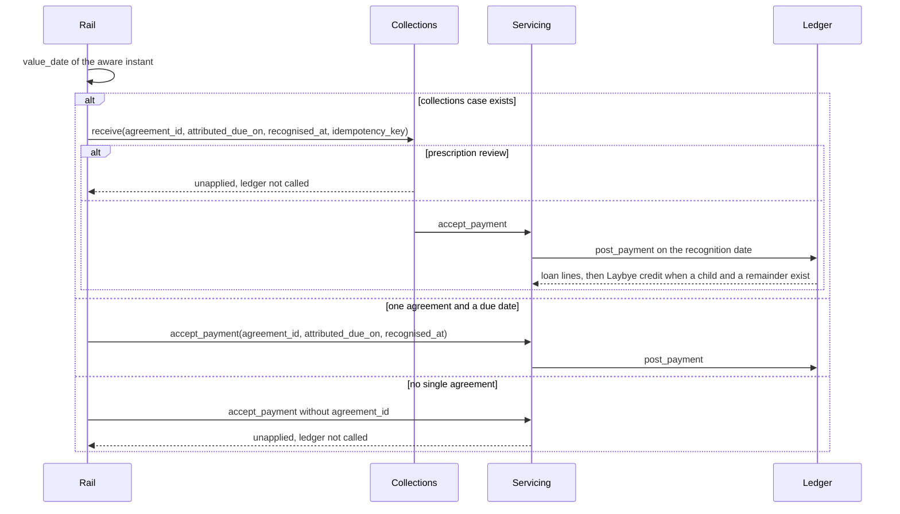
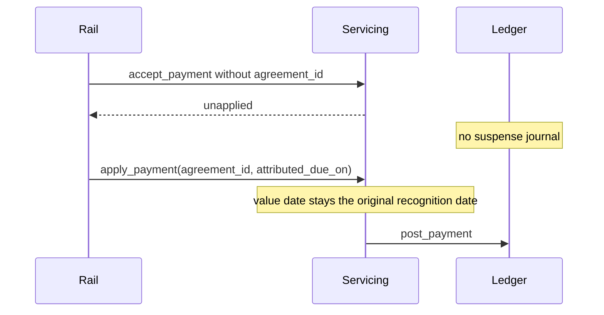
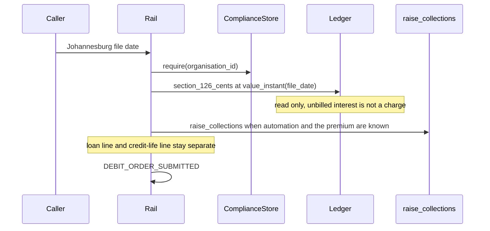
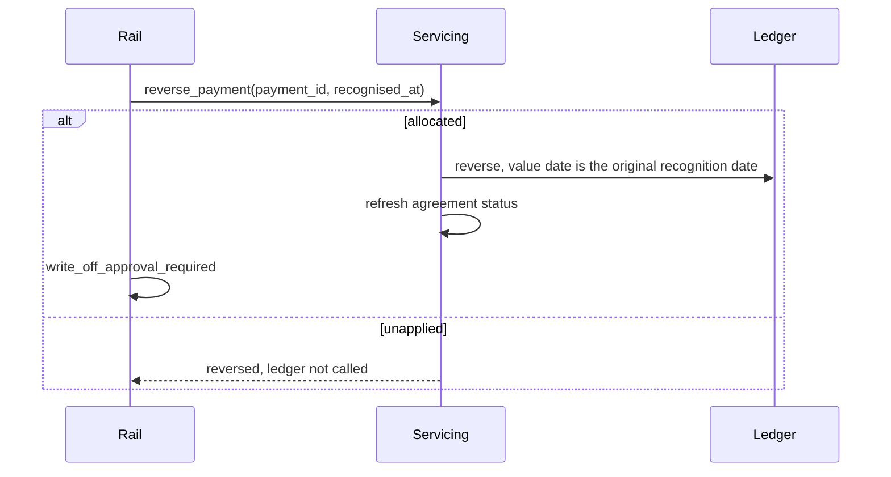

# Payment rails and debit orders — Layer 4 draft

**Status: Layer 4 draft. Design only. This file is not production code and it is not a locked decision.**

`docs/LOCKED_DECISIONS.md` on `main` at `ebb66b1` (28 October 2026, 15:29 SAST) is the source of truth. This draft calls the Servicing, Ledger, and Collections interfaces. It does not re-implement section 126 allocation, Laybye excess, accrual, capitalisation, the morning check, or a write-off journal.

The interfaces were read from `origin/cursor/layer1-gap-closures-ccde` at `a99b1b5`. That module is not on `main`. Collections workflows were read from `origin/cursor/collections-workflows-layer2-6f3a` at `43f7010`. Where an older servicing note still posts an `unallocated_receipts` suspense journal, the module is what this draft calls: `Servicing.accept_payment` leaves an unmatched receipt unapplied and does not call the ledger.

## 1. What this layer owns

Payment rails sit in front of Servicing. They recognise an inbound receipt, generate a debit-order file, hold an unmatched receipt, and flag a returned unpaid item. They do not decide the waterfall, post a second journal, or approve a write-off.

Four flows are in scope:

1. Inbound payment intake. The system recognition date is the value date, at 00:00 Africa/Johannesburg. A matched receipt is `Collections.receive` when a collections case exists, otherwise `Servicing.accept_payment`. Both of those already call `Ledger.post_payment` when the receipt is applied.
2. Debit-order file generation. The file date is the Johannesburg date the caller supplies. The loan line is a due amount already on the ledger. Unbilled interest is not billed by this layer in order to put it in the file.
3. Unmatched receipts. Zero agreements, or more than one, stay on the servicing payment with status `unapplied`. Nothing is posted to a ledger suspense account. A later staff member or a matching rule allocates by `Servicing.apply_payment`.
4. Returned unpaid items. A return of a receipt this system already recognised is `Servicing.reverse_payment`. The ledger value date stays the original recognition date. The item is flagged so a write-off needs approval. This layer does not call `Collections.write_off` or `Collections.propose_residual_write_off`.

## 2. Locked rules this draft applies

Citations only. The text of the rule stays in the locked file.

| Topic | Lock | What this draft does with it |
| --- | --- | --- |
| Value date | §1 | `lms_config.calendar.value_instant` is 00:00 Africa/Johannesburg on the recognition date. `value_date` is the Johannesburg calendar date of an aware instant. |
| Same-day order | §1 | Receipts already on the ledger are ordered by `order_recognised_events` (value date, then recognition sequence). This layer submits a batch in that order. It does not sort by amount. |
| Capitalise, then allocate | §1, §8 | Stated in the sequence as the order those layers already own. This layer does not call `accrue_day`, `bill_interest`, `levy_service_fee`, or `levy_charge`. See [PR1](#pr1-capitalise-then-allocate). |
| Section 126 | §8 | Applied inside `Ledger.post_payment` via `allocate_payment`. Order is due interest, then due fees, then principal. Fee rank is the one `allocate_payment` already uses. |
| Due amounts only | §8 | `Ledger.section_126_cents` is the due-amount read. Unbilled interest is not a charge, so it is not in that read. Principal with a due date after the value date is outside it when prepayment is not applied. |
| Laybye excess | §4 | `Ledger.post_payment` credits a remainder to the Laybye child when one exists. This layer does not also call `laybye.allocate_receipt` or `Ledger.credit_laybye`. |
| Pre-disbursement cash | §4 | Opening hold is `Servicing.book_linked_laybye`, which already calls `receive_pre_disbursement`. A later receipt before disbursement is not given a new path here. See [PR2](#pr2-receipt-before-disbursement). |
| Credit life collection | §4 | A separate collection is `laybye.raise_collections`. The premium is not folded into the loan line. |
| Reversal date | §1 | `Servicing.reverse_payment` calls `Ledger.reverse`, which posts the contra on the original `value_date`. The method's `recognised_at` is the processing instant only. |
| Returned unpaid | §8 | The return reopens whatever `reverse_payment` already restores, and the item is flagged for approval. No write-off method is called. |
| Receipts before write-off | §8 | An unapplied receipt is not a ledger balance. This layer does not sweep it into `Collections.write_off`. See [PR3](#pr3-unapplied-receipts-and-write-off). |
| Income after write-off | §8 | A new receipt after write-off is not posted on the loan. A return of a receipt already taken into the write-off is the reopen path, not a recovery. See [PR4](#pr4-reopen-versus-recovery). |
| Prescription | §20 | While review is open, `Collections.receive` stores the receipt `unapplied` and does not call `Ledger.post_payment`. |
| Audit and role | §15, §23 | Enigma is the access check already inside the method this layer calls. This layer does not add a second check and does not coin a role name. |
| Locate | §12, §25 | Staff locate by the identity number frozen on the agreement, or by a loan number. The agreement record has the frozen identity number. It has no loan number. See [PR5](#pr5-loan-number). |
| Payment account | §21 | The collection account is `ComplianceStore.require`: bank name, account number, branch code, and payment reference. Enigma is not asked for them. |
| Residual threshold | §8, §19, §24 | This layer does not read `resolve_residual_threshold_cents` and does not post a residual. The resolver on the Layer 1 branch still returns R50. See [PR6](#pr6-residual-threshold-amount). |

## 3. Inbound payment intake

### 3.1 Recognition

The caller supplies an aware instant. The value date is `value_date` of that instant. A receipt recognised at any time on a Johannesburg calendar day is 00:00 that day. The rail does not pass the bank's tender date as the value date. `PaymentRecord` has `recognised_at` and `value_date`. It does not have a tender date, and this layer does not add one.

A negative amount is refused by `accept_payment` and `Collections.receive`. This layer does not send a reversal as a negative receipt. A reversal is section 4.

Idempotency is the key `Servicing.accept_payment` and `Collections.receive` already store. A repeated key with the same fingerprint returns the stored payment. This layer does not allocate the same source event twice.

### 3.2 Where the receipt goes

| Situation | Call | Ledger |
| --- | --- | --- |
| A collections case exists for the agreement | `Collections.receive` | Only when that method delegates to `Servicing.accept_payment`. In prescription review the receipt stays `unapplied` and the ledger is not called. |
| No collections case, and exactly one agreement is named, and `attributed_due_on` is present | `Servicing.accept_payment` | `Ledger.post_payment` on the recognition date. Excess to a linked Laybye is inside that post. |
| No agreement, or more than one agreement | `Servicing.accept_payment` with `agreement_id` omitted | Not called. Status `unapplied`. |
| Agreement named, `attributed_due_on` absent | No call | Not called. See [PR7](#pr7-due-date-attribution). |

`Collections.receive` requires a case. Calling it when `Collections` has no case raises. This layer does not call `Collections.bind` to create one.

`Servicing.accept_payment` matches only an `agreement_id` that belongs to that organisation and person. It does not search by payer reference, mandate id, or loan number. A matching rule is an input that yields one `agreement_id` or yields none. The rule's keys are not locked. See [PR8](#pr8-matching-rule).

`attributed_due_on` is required once the receipt is allocated. Section 6 compares the amount received for a due date. Section 8 does not say which due date a receipt belongs to. This layer passes the date through when the inbound item or the staff member supplies it. It does not choose the oldest arrears date, the file date, or the recognition date.

Same-day receipts are submitted in recognition order. `order_recognised_events` is the sort for receipts the ledger already holds. An unapplied payment has no ledger sequence until `apply_payment` posts it. See [PR9](#pr9-sequence-of-an-unapplied-receipt).

### 3.3 What allocation already does

`Servicing._allocate` calls `Ledger.post_payment` and then stores the payment. This layer does not call `allocate_payment` itself.

`post_payment` on a loan with a Laybye child takes the section 126 due amount and credits the remainder with `credit_laybye`. A loan with no child keeps the partial-prepayment election and raises `overpayment-unset` when a remainder has no home. This layer does not catch that error and open a surplus account. `accept_payment` stores the payment only after `_allocate` returns, so a refused matched receipt is not left `unapplied` either. See [PR10](#pr10-refused-matched-receipt).

Statuses `accept_payment` will allocate to are `active` and `in_arrears`. `written_off`, `settled`, and `pending_disbursement` are outside that set.

### 3.4 Calls this intake does not make

`Ledger.post_payment` from the rail, `laybye.allocate_receipt`, `Ledger.credit_laybye`, `Servicing.morning_check`, `Ledger.flag_default`, and `Collections.observe`. A receipt recognised on the flag date is visible to the morning check because its value date is that day. The check remains the value-date run those layers already describe. This layer does not start it.

Capitalisation of amounts that become due that day stays on the servicing and ledger methods that bill. See [PR1](#pr1-capitalise-then-allocate).

## 4. Debit-order file

### 4.1 When a file is produced

The caller supplies one Johannesburg date. The recognition instant for every read in that file is `value_instant` of that date. The date is not moved off a weekend or a public holiday. Leniency is a default-flag count, not a file-date rule.

`debit_orders_enabled` is a name in the configuration catalogue. The Layer 1 branch has no reader for it. This draft does not treat a missing flag as on. See [PR11](#pr11-debit-order-flag).

The collection account on each file is `ComplianceStore.require` for the organisation. A missing compliance row fails closed. The account is not read from Enigma.

The audit type `DEBIT_ORDER_SUBMITTED` is already named on the regulatory extract catalogue. A produced file is that operational event: organisation, the caller-supplied date, and no amount on the operational row. This layer does not append a second financial audit per loan line. Allocation audits stay on `PAYMENT_ALLOCATED` when a later result is applied.

### 4.2 What a loan line contains

The line is the due amount on that date. It is not the contractual instalment. Section 13 keeps the contractual instalment unchanged and adds arrears to the amount due. The contractual instalment is not substituted here.

The due amount is the figure `Ledger.section_126_cents` returns for that loan at `value_instant(file_date)`. That method asks `allocate_payment` how much of a candidate receipt is due interest, due fees, and principal due on or before the date. Unbilled interest has not been passed through `bill_interest`, so it is not a charge and it is not returned. This layer does not call `accrue_day` or `bill_interest` to make the file larger.

`section_126_cents` takes a candidate size. A candidate that is short of the named fees plus an additional monthly fee raises `additional-fee-order-unset`. A candidate that only covers part of the due amount returns that part. No locked candidate means "all of the due amount". This draft does not pick one and does not add the buckets up itself. See [PR12](#pr12-due-total-read). Until that read is locked, the file is not filled with a guessed total.

A zero return is not a line. Future principal is not a line. A charge that is billed with a due date after the file date is still inside `section_126_cents`, because that method does not drop a remaining charge for `due_on`. See [PR13](#pr13-billed-not-yet-due).

### 4.3 Credit life

`laybye.raise_collections(automated, loan_instalment_cents, credit_life_premium_cents)` returns two instructions when automation is on and the premium is known: `loan_instalment` and `credit_life_premium`. The premium stays a separate line. It is not added to the loan line.

The Layer 1 agreement and loan have no premium field. When the premium is missing, `raise_collections` raises `premium-unknown` if `automated` is true, and returns no instructions if `automated` is false. This draft does not pass R0. See [PR14](#pr14-credit-life-premium-and-automation).

The bank layout, the user reference, and whether that reference is the loan number are not locked. This draft does not name a file format. See [PR15](#pr15-file-layout).

### 4.4 What file generation does not call

`Ledger.post_payment`, `Servicing.accept_payment`, `accrue_day`, `bill_interest`, `levy_service_fee`, `levy_charge`, `Collections.write_off`, and `Collections.observe`. Producing the file does not recognise a receipt and does not change a balance.

## 5. Unmatched receipts

An unmatched receipt is a `PaymentRecord` with status `unapplied`, produced by `Servicing.accept_payment` when `agreement_id` is omitted, or by `Collections.receive` while prescription review is open. The ledger has no unallocated-suspense account on this module. This layer does not post bank against `unallocated_receipts`. The older servicing note that does post that journal is recorded in section 9. It is not the call.

The receipt stays unapplied until either:

- a staff member names one agreement and one `attributed_due_on`, and this layer calls `Servicing.apply_payment`, or
- a matching rule yields one agreement and one `attributed_due_on`, and this layer calls `Servicing.apply_payment`.

`apply_payment` keeps the original `value_date`. It allocates through `Ledger.post_payment` on that date. It does not take a new recognition date.

`apply_payment` has no actor argument and does not call Enigma. Section 23 requires a signed-in role on a staff change. The action string is not in the locked file. This draft does not invent one and does not wrap `apply_payment` in a new check. See [PR16](#pr16-staff-role-on-apply).

A rule that finds two agreements allocates neither. The receipt stays `unapplied`. A rule that finds one agreement and no due date does not call `apply_payment`. See [PR7](#pr7-due-date-attribution) and [PR8](#pr8-matching-rule).

Staff locate the agreement by the frozen identity number. Locating by loan number waits on [PR5](#pr5-loan-number). The apply call still needs `agreement_id`, which is what `apply_payment` accepts.

Prescription review is not cleared by a match. `Collections.receive` is the hold. Opening review sets the agreement status to `prescription_review`. `apply_payment` then reaches `_allocate`, which allocates only `active` and `in_arrears`, so the call refuses. This draft does not call `apply_payment` on that receipt and does not change the status. See [PR17](#pr17-prescription-hold).

## 6. Returned unpaid items

A return names the original `payment_id`. It is not a new inbound receipt and it is not a negative `accept_payment`.

| Original status | Call | Balance |
| --- | --- | --- |
| `unapplied` | `Servicing.reverse_payment` | No ledger post. Status `reversed`. The original value date is stored on the payment. No write-off flag: the receipt was never applied, so no balance changes. |
| `allocated` | `Servicing.reverse_payment` | `Ledger.reverse` on the original value date. Later transactions on that loan have to be reversed first (`reversal-order`). The servicing method then calls `_refresh_status`, which sets `settled`, `in_arrears`, or `active` from the ledger and does not keep `prescription_review` or `written_off`. |
| `reversed` | `Servicing.reverse_payment` | Returns the existing row. No second flag. |

The processing instant is `recognised_at` on `reverse_payment`. The body has no new value date. A return processed on a later Johannesburg day still undoes the allocation on the day the receipt was recognised.

After a successful reverse of an allocated receipt, this layer sets `write_off_approval_required` on the return. That is the section 8 flag. The flag does not post. `Collections.write_off` and `Collections.propose_residual_write_off` are not called. A later approval, if one is given, is those existing methods, called by the collections workflow, not by this layer.

`write_off` is not in the ledger's reversible set. `Ledger.reverse` of the payment raises `reversal-order` while a later write-off journal exists, and the write-off journal itself cannot be reversed by that method. `Servicing.reverse_payment` does not clear `Case.written_off`. This layer does not post a reopening journal of its own. See [PR4](#pr4-reopen-versus-recovery).

A debit-order result that never recognised a success has no `payment_id`. `reverse_payment` is not called. Nothing is flagged, because nothing was allocated.

A new receipt that arrives after status `written_off`, and that is not a return of a recognised payment, is income after write-off. Section 8 places that recovery outside the LMS. `accept_payment` refuses the status and does not store the payment. This layer does not open a recovery account.

The flag has no seeded audit type. Section 23 requires an audit of who flagged it. This draft does not add a catalogue code. See [PR18](#pr18-audit-type-for-the-flag).

`Collections.write_off` does not read `write_off_approval_required`. This layer does not change that method. See [PR3](#pr3-unapplied-receipts-and-write-off).

## 7. Sequences

### 7.1 Matched receipt

`morning_check`, `flag_default`, and `observe` are not in this sequence.

### 7.2 Unmatched, then allocated

### 7.3 Debit-order file

`post_payment` and `bill_interest` are not in this sequence.

### 7.4 Returned unpaid

`Collections.write_off` is not in this sequence.

## 8. Gaps that need a locked decision

None of these is given a value in this draft. Closing one means editing `docs/LOCKED_DECISIONS.md`.

| Id | Decision still required |
| --- | --- |
| PR1 | Section 1 and section 8 capitalise the day's due amounts at 00:00 before payments recognised that day are allocated. `Servicing.accept_payment` posts the receipt and does not call `accrue_day` or `bill_interest`. Billing currently runs inside statement issue. This draft does not insert a billing call into intake or into the debit-order file. |
| PR2 | Section 4 puts a pre-disbursement receipt in the Laybye when a Laybye exists. The only servicing call that does this is `book_linked_laybye`, for the opening hold. `accept_payment` allocates only `active` and `in_arrears`. A receipt after booking and before disbursement has no intake method. This draft does not call `Ledger.credit_laybye`. |
| PR3 | Section 8 requires every receipt to be allocated before a write-off, and requires a returned unpaid item to be flagged before a further write-off. `Collections.write_off` compares the outstanding ledger position and posts. It does not read unapplied payments or `write_off_approval_required`. This draft does not sweep and does not call `write_off`. |
| PR4 | Section 8 says a balance opens again when a payment taken into a write-off is returned unpaid, and also says income received after a write-off is a recovery outside the LMS. `Ledger.reverse` will not reverse a `write_off` journal, and it will not reverse the earlier payment while that journal is later. `_refresh_status` after a successful reverse replaces the agreement status with `settled`, `in_arrears`, or `active`. This draft flags the return, does not post a reopening journal, and does not post a new post-write-off receipt. The test that separates the two section 8 sentences is not locked. |
| PR5 | Section 12 says staff locate by identity number or loan number. Section 25 says the LMS generates the loan number. `AgreementRecord` stores `frozen_id_number`, `agreement_id`, and `ledger_loan_id`. It does not store a loan number. This draft does not start a number series. |
| PR6 | Section 8 and section 19 now say the residual threshold defaults to R100. Section 19 also says unset elections fail closed. Section 24 says any R50 reference is replaced with R100, in a pricing section. `resolve_residual_threshold_cents` on the Layer 1 branch still returns 5 000 cents when both levels are null. This draft does not call the resolver and does not choose between R100, fail closed, and the code. |
| PR7 | Which due date a receipt is "for" is not locked. `apply_payment` and a matched `accept_payment` require `attributed_due_on`. Omitting the agreement holds the receipt and forgets the agreement. Passing the agreement without the date raises and stores nothing. This draft does not add a third state and does not choose a due date. |
| PR8 | The matching rule's inputs are not locked. Loan number, frozen identity number, mandate reference, amount, and payment reference are all unsigned as automatic keys. A rule that is not exactly one agreement leaves the receipt `unapplied`. |
| PR9 | Section 1 orders same-day events by recognition sequence. An unapplied receipt has no ledger sequence. `apply_payment` stamps the sequence when it posts, which may be a later day and after other posts. This draft does not reserve a sequence at intake, because that would be a ledger row for an unmatched receipt. |
| PR10 | A matched receipt that `post_payment` refuses (`overpayment-unset`, `additional-fee-order-unset`, `capitalised-principal-reduction-unset`, or a status outside `active` and `in_arrears`) is not stored by `accept_payment`. This draft does not catch the error into the unmatched hold and does not post `customer_surplus`. |
| PR11 | `debit_orders_enabled` is catalogue text. No read method exists on the Layer 1 branch, and the lock does not say the flag defaults to on. This draft does not generate a file from an unread flag. |
| PR12 | The debit-order loan line needs the full due amount. `section_126_cents` needs a candidate receipt size and can refuse a short candidate that would split an additional monthly fee. This draft does not choose a candidate and does not sum charges and slices beside that method. |
| PR13 | `section_126_cents` includes every remaining charge. It does not test `due_on` against the file date. A fee billed before its due date would be collected early. The lock does not say whether the file may include it. This draft does not filter the charges. |
| PR14 | Section 4 requires a separate credit-life collection when collections are automated, and it requires the premium amount. No agreement field holds the premium. `raise_collections` fails closed when automated and the premium is absent, and it returns nothing when not automated, which the method records as a path the lock does not describe. This draft does not treat `debit_orders_enabled` as that automation switch and does not emit R0. |
| PR15 | The debit-order file layout, the destination scheme, and the user reference are not locked. This draft states the logical lines only. |
| PR16 | `apply_payment` does not take a staff actor. `accept_payment` checks Enigma with the borrower's `person_id` and the action `payment.accept`. `reverse_payment` checks `payment.reverse`. Section 19's examples are `lms.elections.write` and `lms.campaign.write`. Section 23 requires the signed-in role on the audit. The payment action strings are not locked. This draft does not rename them. |
| PR17 | A receipt held by `Collections.receive` during prescription review is `unapplied` and names the agreement. Opening review sets the agreement status to `prescription_review`. `apply_payment` refuses that status. Section 20 does not say that a later match ends the review, and this draft does not put the status back to `active`. How review ends remains CW8. |
| PR18 | The returned-unpaid approval flag has no seeded audit type. `DEBIT_ORDER_SUBMITTED` is the type for producing a file, not for the flag. This draft does not add a code. An unmatched intake also writes no audit row: `accept_payment` audits inside `_allocate`, which the unmatched path does not reach. |

## 9. Conflicts recorded, not resolved

1. **Suspense.** The servicing primary-flow note posts a suspense journal to `unallocated_receipts` before match, and it treats that journal as acceptance under section 126(2). The ledger module this draft calls has no that account. `Servicing.accept_payment` holds an unmatched receipt off the ledger. This draft follows the module and the instruction that an unmatched receipt is not posted to a suspense account. It does not add the journal.
2. **Capitalise then allocate.** PR1. The lock orders billing before allocation on the recognition date. The intake method posts the receipt against whatever is already due. Unbilled interest stays out, which matches the debit-order rule, and it also means a payment on a billing date does not wait for that day's capitalisation unless something else has already billed.
3. **Reopen and recovery.** PR4. Both sentences are in section 8. The interfaces can reverse an allocated payment when no later write-off journal exists. They cannot reopen a written-off balance. They refuse a new receipt on a written-off agreement.
4. **Residual amount.** PR6. The locked file now says R100. The interface still returns R50. Section 19 also says unset fails closed. This draft leaves the resolver where it is.
5. **Staff role strings.** PR16. The code checks `payment.accept` and `payment.reverse` on the borrower id. The locked examples use a different shape, and `apply_payment` checks nothing.
6. **Receipts before write-off.** PR3. The new section 8 sentence is stricter than `Collections.write_off`. The staff write-off screen calls that method and does not sweep. This draft does not change the screen or the method.
7. **Where the code lives.** Servicing, Ledger, and Collections as called here are on `origin/cursor/layer1-gap-closures-ccde`, not on `main`. An implementation of this draft has to build against that module. This file does not copy it onto `main`.

## 10. Out of scope

Production code, migrations, and tests. A bank file schema. A matching-rule catalogue. A loan-number series. A suspense account. A surplus or recovery account. A replay of later transactions after a back-dated receipt. A billing run. The morning default check. An in-duplum episode. A write-off journal. A residual write-off. A prescription decision. Section 129 and section 130. Refunds. Credit-life accounts and insurer statements.
