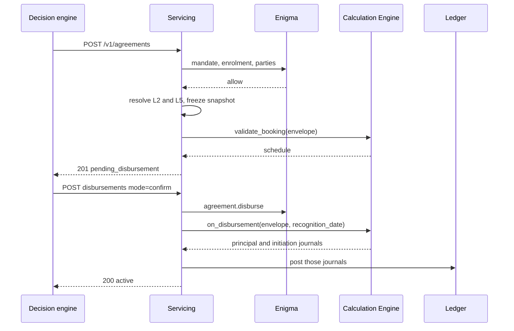
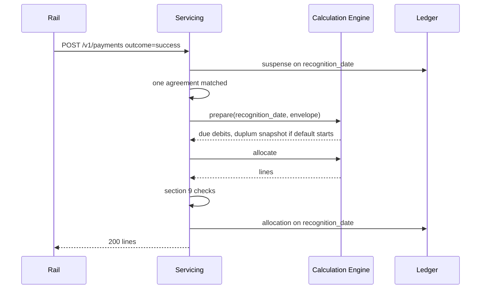
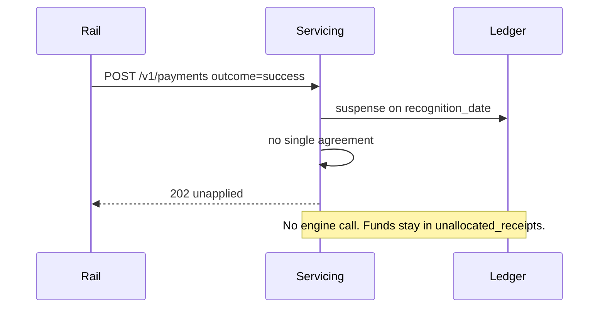
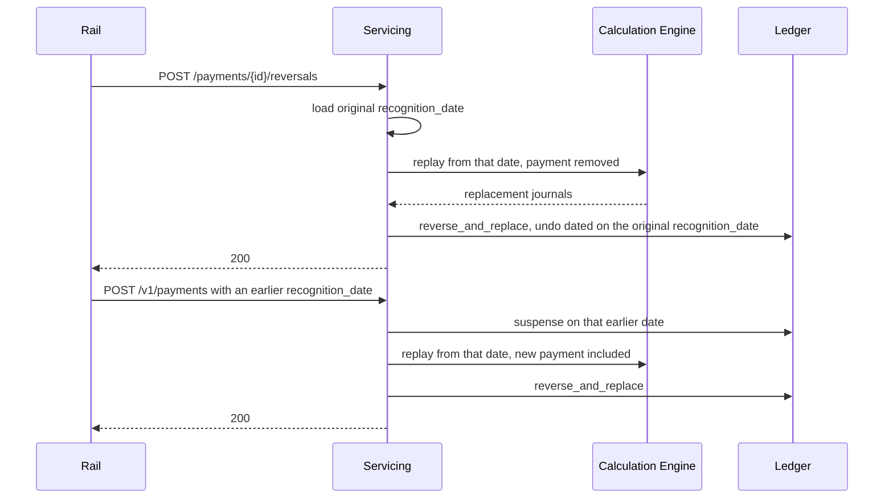
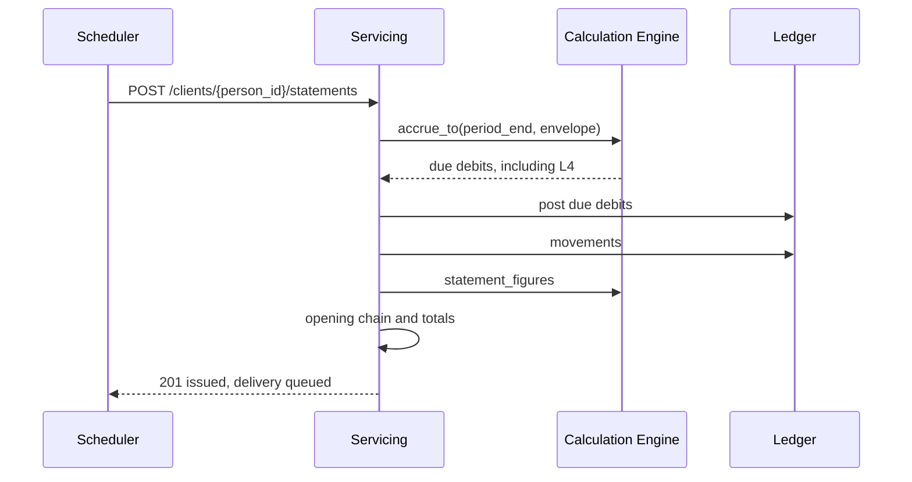

# Servicing implementation design

Orchestration contract for booking, disbursement, payments, and statements. The Calculation Engine and the Ledger are not implemented here. This note defines the calls servicing makes and the invariants it checks before it commits.

`docs/LOCKED_DECISIONS.md` (28 October 2026) is the source of truth. The running orchestration is `src/lms/servicing/`. Stable routes, call sites, and open gaps are in [implementation-note.md](implementation-note.md).

| Route | Locked sections |
| --- | --- |
| `POST /v1/agreements` | §1, §2, §5, §6, §10, §11, §13, §14, §15, §16, §17, §19 |
| `POST /v1/agreements/{id}/disbursements` | §1, §2, §13, §16 |
| `POST /v1/payments` and `POST /v1/payments/{id}/applications` | §1, §8 |
| `POST /v1/payments/{id}/reversals` | §1 |
| `POST /v1/organisations/{organisation_id}/clients/{person_id}/statements` | §5, §9, §12, §17 |
| Morning check | §1, §6, §7 |

Dates are civil dates in Africa/Johannesburg. Timestamps are UTC. Money is integer cents, currency `ZAR`.

## 1. Locked elections on the agreement

| Id | Scope | Frozen value |
| --- | --- | --- |
| L1 | Platform | `value_date_basis = system_recognition_date`. Reversal value date equals the original recognition date |
| L2 | Organisation, product override, else `no_interest` | `initiation_fee_interest` |
| L3 | Platform | Duplum base = unpaid principal at the first day of that default, including a pre-default initiation fee only when that fee was journaled into `principal`. Post-default accruals stay charges |
| L4 | Platform | One pro-rata service fee from disbursement inclusive to the day before first due. Full monthly fee after that, including the settlement month, capped at the contractual fee and at R60 |
| L5 | Organisation, product override. No platform default | `rate_after_repo_fall` |

L1, L3, and L4 are sent on every engine call so a replay does not depend on a later code default. L2 and L5 are sent from the agreement snapshot, not from a fresh read of policy.

### 1.1 Where the choice is stored

Policy lives in servicing, not in Enigma. Enigma still decides whether the caller may edit it.

`election_policy`

| Column | Meaning |
| --- | --- |
| `id` | Policy row id |
| `organisation_id` | Enigma organisation id |
| `product_code` | Null means the organisation default. Set means an override for that product |
| `initiation_fee_interest` | `no_interest` or `interest_permitted`, or null on a product row to inherit |
| `rate_after_repo_fall` | `contract_rate_continues` or `lower_of_contract_and_cap`, or null to inherit |
| `effective_from` | Civil date inclusive |
| `created_by` | Enigma actor id |

Unique on `(organisation_id, product_code, effective_from)`.

`PUT /v1/organisations/{organisation_id}/election-policies` writes a row. Mandate `election.write`. A row does not rewrite agreements already booked.

Resolution at booking, using the agreement date:

1. Take the latest product row with `effective_from` on or before the agreement date.
2. Take the latest organisation row the same way.
3. For each field, use the product value when it is non-null, otherwise the organisation value.
4. `initiation_fee_interest` falls through to `no_interest`.
5. `rate_after_repo_fall` has no fall-through. An RR-linked cap (unsecured personal) with no resolved value returns 422 `election_required`. A short-term cap is not RR-linked; the snapshot stores `not_applicable`.

The snapshot is inserted in the same transaction as the agreement:

```json
{
  "election_snapshot_id": "elc_01J0",
  "rule_pack_version": "2026.10.27",
  "value_date_basis": "system_recognition_date",
  "initiation_fee_interest": "no_interest",
  "duplum_base": "unpaid_principal_at_first_default",
  "include_pre_default_capitalised_initiation_fee": true,
  "post_default_accruals_are_charges": true,
  "service_fee_proration": "opening_period_only",
  "service_fee_cap_cents": 6000,
  "rate_after_repo_fall": "not_applicable",
  "policy_ids": ["epl_org_01J0"]
}
```

`initiation_fee_capitalised` is stored on the agreement. True means the fee is principal and, if posted before the default date, is inside the in-duplum ceiling. False means the fee is a section 126 fee. Booking returns 422 `unresolved_conflict` when the flag is true and the subsector is `short_term` or `unsecured`, until the locked decisions name the products section 102 allows. That reject is a fail-closed conflict, not a finding that the fee can never be capitalised.

### 1.2 Envelope on every engine call

```json
{
  "rule_pack_version": "2026.10.27",
  "election_snapshot_id": "elc_01J0",
  "elections": {
    "value_date_basis": "system_recognition_date",
    "initiation_fee_interest": "no_interest",
    "duplum_base": "unpaid_principal_at_first_default",
    "include_pre_default_capitalised_initiation_fee": true,
    "post_default_accruals_are_charges": true,
    "service_fee_proration": "opening_period_only",
    "service_fee_cap_cents": 6000,
    "rate_after_repo_fall": "not_applicable"
  }
}
```

Servicing loads this from the agreement row. It does not re-resolve policy. The engine must apply these fields and must not replace `no_interest` with `interest_permitted`, or `contract_rate_continues` with a cut to the statutory cap.

Worked L2 call. Organisation default `no_interest`, product `unsecured_v1` override `interest_permitted`. A short-term booking sends `no_interest`. An unsecured booking on that product sends `interest_permitted`. Cash R5 000 and a deferred fee of R565 produce R250.00 or R278.25 of interest for a 30-day month at 5%, as in the primary-flows example. The principal journal is R5 000 either way.

Worked L5 call. The same unsecured agreement was snapshotted as `contract_rate_continues` at 24% while RR was 7% (cap 28%). A later feed sets RR to 2% (cap 23%). `on_rate_change` receives `contract_rate_continues` and returns the rate unchanged. A sibling product snapshotted as `lower_of_contract_and_cap` returns 23%, and servicing queues the s 104(2) notice.

## 2. HTTP conventions

| Header or field | Rule |
| --- | --- |
| `Authorization` | Bearer token of an Enigma actor, except rail webhooks |
| `Idempotency-Key` | Required on every POST. Same key and same body returns the original response. Same key and a different body returns 409 |
| Rail webhook | HMAC over the raw body. The collection account, not the body, selects the organisation |

Error body:

```json
{
  "error": {
    "code": "cap_exceeded",
    "message": "Initiation fee exceeds the prescribed maximum.",
    "rule_id": "nca.reg42.table_b"
  }
}
```

`rule_id` is present when the engine rejected the call. Servicing does not invent a second calculation to explain the reject.

## 3. `POST /v1/agreements`

Books an accepted agreement as `pending_disbursement`. Does not move cash and does not levy a fee.

Mandate `agreement.book` on `credit_provider_org_id` and `product_code`. Enigma calls, in order, before the engine: `get_organisation`, `get_person`, `check_mandate`, `get_product_enrolment`. Any denial stops the call. The engine is not invoked.

Request:

```json
{
  "decision_reference": "dec_01J0",
  "credit_provider_org_id": "org_01J0",
  "consumer_person_id": "per_01J0",
  "brand_id": "brand_01J0",
  "product_code": "short_term_v1",
  "nca": {
    "form": "credit_transaction",
    "subsector": "short_term",
    "size": "small",
    "security": "none"
  },
  "money": {
    "currency": "ZAR",
    "principal_cents": 500000,
    "initiation_fee_cents": 56500
  },
  "disclosed": {
    "initiation_fee_interest": "no_interest",
    "rate_after_repo_fall": "not_applicable"
  },
  "interest": {
    "structure": "fixed_monthly",
    "monthly_rate": "0.050000",
    "annual_rate_disclosure": "0.600000",
    "day_count": "actual_actual"
  },
  "service_fee": { "basis": "monthly", "amount_cents": 6000 },
  "credit_life": null,
  "term": {
    "agreement_date": "2026-10-26",
    "first_due_date": "2026-11-25",
    "maturity_date": "2026-11-25",
    "instalment_cents": 583150,
    "payment_frequency": "monthly"
  },
  "prepayment_application": "reduce_term",
  "quote_disbursement_rule": "adjust_instalment",
  "initiation_fee_capitalised": false,
  "statement_election": { "offered": true, "frequency": "monthly", "channel": "email" },
  "agreement_document": { "uri": "s3://agreements/dec_01J0.pdf", "sha256": "abc" },
  "linked_deposit_id": null
}
```

`disclosed` is required. It must equal the resolved L2 and L5 values. A mismatch is 422 `election_mismatch`. The caller does not send a pro-rata method or a value-date basis.

`payment_frequency` is one of `weekly`, `fortnightly`, `monthly`, `quarterly`, `bi_annual`, `annual`. There is no `single` token in the locked list. `prepayment_application` is `reduce_term` or `reduce_instalment` when the provider has chosen. Absent, booking fails closed. The preference to keep the instalment unchanged is not substituted automatically. `day_count` is `actual_actual` or `30_360`. Absent, booking fails closed. `quote_disbursement_rule` is `adjust_instalment` or `keep_instalment`. Absent, booking fails closed.

Engine call `validate_booking` after the snapshot is built and before insert. Inputs: the request, the envelope in section 1.2, and this person's disbursed short-term agreements at this organisation, each with its agreement date. The calendar-year filter is gap G7. It is not applied and it is not dropped. Output: `accepted` plus `schedule`, or `rejected` plus `rule_id`. On reject, servicing persists nothing and returns 422. `annual_rate_disclosure` is stored and disclosed. It is not checked against a formula.

Response 201:

```json
{
  "agreement_id": "agr_01J0",
  "status": "pending_disbursement",
  "election_snapshot_id": "elc_01J0",
  "rule_pack_version": "2026.10.27",
  "schedule_id": "sch_01J0"
}
```

| Condition | Status |
| --- | --- |
| Mandate, enrolment, person, or organisation failure | 403 or 404 |
| Idempotency conflict | 409 |
| Engine reject, election mismatch, missing L5 on an RR-linked product, large agreement, prohibited deposit | 422 |
| Engine or Enigma timeout | 503, idempotency row left in progress |

## 4. `POST /v1/agreements/{agreement_id}/disbursements`

Mandate `agreement.disburse` when the caller is a user or the decision engine. No second enrolment check. The agreement's organisation is already fixed.

```json
{
  "mode": "confirm",
  "amount_cents": 500000,
  "recognition_date": "2026-10-26",
  "rail_reference": "eft_01J0",
  "destination_account_ref": "acct_01J0"
}
```

`mode` is `instruct` or `confirm`. `recognition_date` on `confirm` is the civil date the consumer received the funds, and it is the value date of the principal journal. It must not be after today.

`instruct` records `disbursement_status = instructed` and leaves `status = pending_disbursement`. No engine call and no consumer journal.

`confirm` requires `status = pending_disbursement` and `amount_cents` equal to booked principal. Engine call `on_disbursement` with the envelope, the recognition date, and the frozen fee treatment. The engine returns the journals: principal receivable against disbursement clearing for the cash advanced, and, when the initiation fee is deferred, a separate initiation-fee receivable. The opening-month service fee is not calculated until gap G4 names the numerator. No estimated fraction is posted. Servicing posts only those journals, then sets `status = active`.

Response 200:

```json
{
  "agreement_id": "agr_01J0",
  "status": "active",
  "recognition_date": "2026-10-26",
  "journal_ids": ["jnl_principal", "jnl_initiation"]
}
```

A failed `instruct` rail result is `POST` the same path with `mode = failed`. Status becomes `disbursement_failed`. Any journals already posted are reversed on their original value dates. No interest is levied.

## 5. `POST /v1/payments`

```json
{
  "source": "debicheck",
  "source_event_id": "evt_01J0",
  "collection_account_ref": "cpacc_01J0",
  "amount_cents": 50000,
  "currency": "ZAR",
  "tendered_on": "2026-10-24",
  "recognition_date": "2026-10-26",
  "instrument": "debicheck_collection",
  "outcome": "success",
  "mandate_reference": "man_01J0",
  "agreement_id": "agr_01J0",
  "payer_reference": "AGR01J0"
}
```

`source` is `debicheck`, `eft`, `payshap`, `retail_cash`, `staff`, or `deposit_appropriation`. Uniqueness is `(organisation_id, source, source_event_id)`.

`outcome` `submitted` or `tracking` stores the event and returns 202 with `status = observed`. No journal and no engine call.

`outcome` `success` is the allocation path. `recognition_date` defaults to today when omitted and must not be after today. `tendered_on` is stored and is not sent to the engine as a value date.

Staff source requires mandate `payment.capture`. Other sources authenticate by rail signature. The collection account selects the organisation. A body organisation id that disagrees is 422.

Steps for `success`:

1. Insert intake. Post suspense: bank against `unallocated_receipts`, value date = `recognition_date`. Failure to post returns 503 and does not acknowledge the payment.
2. Resolve one agreement from `agreement_id`, else the DebiCheck mandate, else `payer_reference`. Zero or several matches: intake `unapplied`, emit `payment.unapplied`, return 202. No engine call.
3. Prescription flag: intake `prescription_review`, return 202. No engine call.
4. If this recognition date is earlier than an allocation already on the agreement, do not stack. Run the replay in section 7 from this recognition date with the new payment included.
5. Otherwise lock the agreement. Engine `prepare` at `recognition_date` with the envelope and the ledger position. Post any due-debits it returns, including an L4 full monthly fee when this date is a fee-due date after the opening period.
6. Engine `allocate` with the amount, the due buckets, the settlement total, and the envelope. Servicing checks the invariants in section 9. On failure, leave the suspense journal, set `allocation_pending`, alert `allocation_invariant`, return 500. Do not refund automatically.
7. Post the allocation on the recognition date. Update status from the engine's arrears result. If this call starts a default, persist `default_occurred_on` and `duplum_base_cents` from `prepare` and do not change them for the life of that episode.

Response 200:

```json
{
  "payment_id": "pay_01J0",
  "status": "allocated",
  "recognition_date": "2026-10-26",
  "agreement_id": "agr_01J0",
  "agreement_status": "active",
  "lines": [
    { "bucket": "interest_due", "amount_cents": 20000 },
    { "bucket": "service_fee", "amount_cents": 6000 },
    { "bucket": "principal", "amount_cents": 24000 }
  ]
}
```

Response 202 when unapplied:

```json
{
  "payment_id": "pay_01J0",
  "status": "unapplied",
  "recognition_date": "2026-10-26"
}
```

`POST /v1/payments/{payment_id}/apply` with `{ "agreement_id": "agr_01J0" }` runs from step 3. Mandate `payment.apply`.

Worked matched allocation, charges already due on the recognition date: interest R200, service fee R60, principal R5 000, payment R500. Lines are R200, R60, R240. Principal becomes R4 760.

## 6. Statements

The issued document is one per client and contains every loan. The steps below are the per-loan section. The client key is gap G9. Do not sum the sections into one balance.

`POST /v1/agreements/{agreement_id}/statements` builds one section. The client run calls it for each loan in the unsigned client set, then writes one PDF.

Scheduler identity, or mandate `statement.issue`. Idempotent on `(agreement_id, period_end)`.

```json
{ "period_end": "2026-11-30" }
```

`period_end` is required. `period_start` is the day after the previous statement's `period_end`, or the disbursement recognition date when this is the first statement.

Calls inside the agreement lock:

1. Engine `accrue_to(period_end)` with the envelope. Post the due-debits it returns. L4 means a settlement inside the period levies the full monthly fee when `period_end` is on or after the first due date, and levies only the opening pro-rata when the agreement ends before the first due date.
2. Read the previous `closing_total_cents`. That is `opening_total_cents`.
3. Ledger `movements` for the period, ordered by value date.
4. Engine `statement_figures`. Servicing checks opening plus signed movements equals closing, and that each regulation 35 total equals its lines. A mismatch returns 500 `statement_invariant` and does not publish.
5. Render the PDF from the stored figures. Insert the statement row. Queue delivery. The issue time is this insert. Delivery retries do not change it.

Response 201:

```json
{
  "statement_id": "stmt_01J0",
  "status": "issued",
  "delivery_status": "pending",
  "period_start": "2026-10-26",
  "period_end": "2026-11-30",
  "opening_total_cents": 556500,
  "closing_total_cents": 520000,
  "pdf_path": "/v1/agreements/agr_01J0/statements/stmt_01J0/pdf"
}
```

`GET /v1/agreements/{agreement_id}/statements` returns the issued rows, newest period first. Mandate `statement.read`.

`GET /v1/agreements/{agreement_id}/statements/{statement_id}` returns one row, including the regulation 35 totals and the component balances. The component balances are part of this payload even if the Form 26 artwork later omits them from the PDF.

`GET .../pdf` returns the immutable object. A replay after issue does not replace the PDF. The next statement carries the s 112(3) adjustment, and this row gains `affected_by_replay = true`.

## 7. Reversal and back-dated recognition

`POST /v1/payments/{payment_id}/reversals`

```json
{
  "source_event_id": "evt_rev_01J0",
  "reversed_on": "2026-04-15"
}
```

The body has no recognition date. Servicing loads `recognition_date` from the original payment. Engine `replay` starts at that date, excludes the reversed payment, and includes every later event. Ledger `reverse_and_replace` commits the contra journals on the original recognition date and the replacement journals on their own recognition dates. `reversed_on` is audit only.

A new `POST /v1/payments` whose `recognition_date` is earlier than an allocation already posted on that agreement uses the same replay, with the new payment included at its recognition date. The agreement lock serialises the two.

Worked L1 reversal. Receipt recognised 7 April and allocated that day. Reversal processed 15 April. The undo journals are dated 7 April. Interest that was removed on 7 April is rebuilt by replay from 7 April forward. 15 April is not an allocation date.

## 8. Agreement state machine

Status is servicing's. An open in-duplum episode, a dispute, and prescription review are flags. The episode flag does not suppress charges.

| From | Event | Enigma | Engine | To |
| --- | --- | --- | --- | --- |
| — | `POST /agreements` accepted | Mandate, enrolment, both parties | `validate_booking` | `pending_disbursement` |
| `pending_disbursement` | `mode = instruct` | `agreement.disburse` | none | `pending_disbursement`, disbursement instructed |
| `pending_disbursement` | `mode = confirm` | `agreement.disburse` | `on_disbursement` | `active` |
| `pending_disbursement` | rail failure | same | none, beyond reversing journals | `disbursement_failed` |
| `active` | end of a due date with a due bucket unpaid | none | `prepare` returns the duplum snapshot | `in_arrears`, flags set |
| `in_arrears` | allocation clears due buckets | none | `prepare`, `allocate` | `active`, episode flags cleared |
| `active` or `in_arrears` | allocation equals the settlement total | none | `allocate` | `settled` |
| any non-terminal | origination rescission | `agreement.rescind` | `replay` of an empty suffix after the rescission date | `rescinded` |

`disbursement_failed`, `rescinded`, and `settled` are terminal. A payment recognised against a settled agreement allocates only up to a zero settlement total and the remainder is surplus.

Default is flagged by the morning check on the flag date (contractual due date plus customer `leniency_days`). `default_occurred_on` is that flag date. Unset leniency or threshold fails closed. The check includes payments whose recognition date is the flag date. The clip is not turned on when the episode opens.

Non-NCA payment plans use the same statuses except `in_arrears` and the duplum flag. A missed instalment is a contract marker and is not sent to the engine as a default.

## 9. Invariants servicing checks

Servicing commits a ledger batch only when all of these hold. The engine is the only source of amounts. The ledger is the only store of journals.

| Check | Applies to |
| --- | --- |
| Allocation lines sum to the payment | `allocate` |
| Group order is interest, then fees, then principal, then surplus | `allocate` |
| No line exceeds the due bucket `prepare` just returned | `allocate` |
| No consumer bucket goes negative | every post |
| Every consumer journal was returned by this engine call | every post |
| `duplum_base` is set once on the flag date that opens the episode and does not change until the episode closes | `prepare` |
| A charge is not deleted or reduced because `duplum_accrued` reached `duplum_base` | every post. The clip is off |
| Statement opening equals the previous closing | `statement_figures` |
| Reversal value date equals the original recognition date | reversals |
| `recognition_date` is not after today | payments and disbursement confirm |

Ledger contract, which servicing relies on and does not reimplement:

| Operation | Guarantee |
| --- | --- |
| `post` | Balanced, idempotent, value date stored, memo accounts distinct from due accounts |
| `position` | Buckets as at a value date, repeatable inside the agreement lock |
| `movements` | Period lines in value-date order |
| `reverse_and_replace` | One commit for the contra set and the replacement set |

Buckets servicing will post, and will not merge: `principal`, `initiation_fee`, `service_fee`, `interest_due`, `interest_accrued_memo`, `credit_life`, `default_admin`, `collection_cost`, `customer_surplus`, `unallocated_receipts`, `duplum_base`, `duplum_accrued`. Post-default interest never moves into `principal`. A statement figure that adds them together is a display total.

Engine operations and the elections they must read:

| Operation | Elections that change the result |
| --- | --- |
| `validate_booking` | L2, L4 cap, L5 when the cap is RR-linked |
| `on_disbursement` | L2, L4 opening window |
| `prepare` | L1 as-of date, L3 snapshot, L4 levy |
| `allocate` | L1 value date already applied by `prepare` |
| `accrue_to` / `statement_figures` | L2, L3 display does not move the base, L4, L5 |
| `replay` | The same snapshot as the original calls |
| `on_rate_change` | L5. `contract_rate_continues` returns the contractual rate. `not_applicable` returns the contractual monthly rate |

## 10. Sequences

### Booking and disbursement



### Matched payment



### Unmatched payment



### Reversal and a back-dated payment



### Statement



## 11. Open points

Unsigned points are in [implementation-note.md](implementation-note.md). The 28 October lock sets the statement to one document per client per credit-provider organisation (§12). Each loan section keeps its own opening and closing balance. The in-duplum clip stays off (§7). A lay-by hold is not booked as security (§4).
