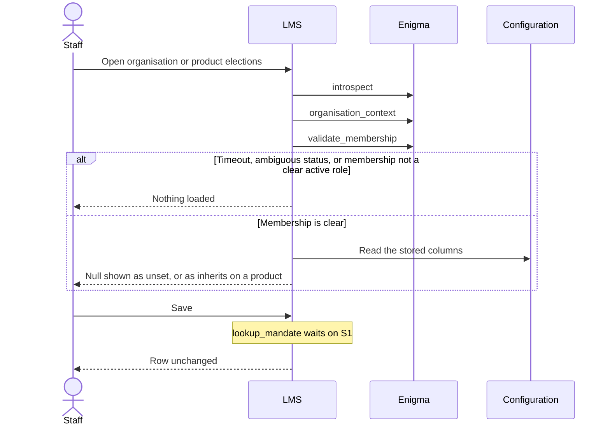
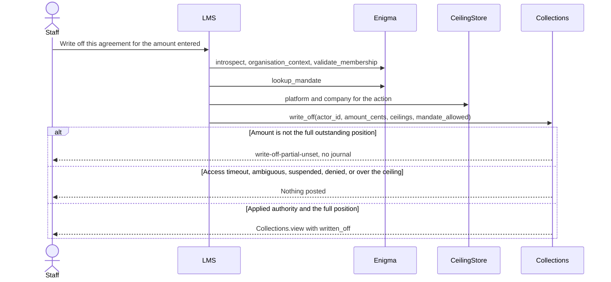
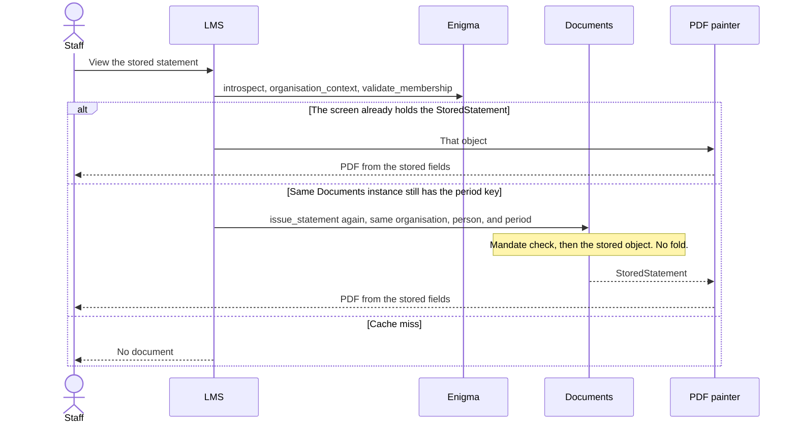

# Staff UI surfaces

**Status: Layer 3 draft.** Design only. This note does not add production code, and it does not amend `docs/LOCKED_DECISIONS.md`.

Last updated: 28 October 2026 (Africa/Johannesburg).

`docs/LOCKED_DECISIONS.md` on `main` at `d5db995` (14:34 Africa/Johannesburg) is the source of truth. Layer 0, Layer 1, and Layer 2 already own configuration, the Enigma port, collections, statements, and PDF painting. This draft calls those interfaces. It does not restate their arithmetic, and it does not vendor a second copy of their modules.

An implementation has to land on a tree that contains the modules below. They are not on `main`.

| Layer | Branch | Commit | What this draft calls |
| --- | --- | --- | --- |
| Layer 0 configuration storage, as integrated with the ledger | `cursor/layer1-gap-closures-ccde` | `a99b1b5` (13:09 Africa/Johannesburg) | `cfg_organisation_settings`, `cfg_product_terms`, `OrganisationSettings`, `ProductTerms`, `validate_terms`, `campaign_rate`, `resolve_customer_settings`, `resolve_in_duplum_trigger`, `resolve_residual_threshold_cents`, `AgreementPin`, `audit_event` |
| Layer 1 Enigma port | `cursor/enigma-interface-d0c7` | `0cabd41` (09:22 Africa/Johannesburg) | `EnigmaClient`, `authorize_ceiling_change`, `enforce_amount`, `CeilingStore`, `PLATFORM_CEILING_ROLE`, `COMPANY_CEILING_ROLE` |
| Layer 1 collections | `cursor/layer1-gap-closures-ccde` | `a99b1b5` | `Collections.view`, `Collections.write_off`, `Collections.correct_system_error`, `authorise_write_off` |
| Layer 1 statements | `cursor/layer1-gap-closures-ccde` | `a99b1b5` | `Documents.issue_statement` (repeat of a period key only), `StoredStatement`, `LoanSection`, `ComplianceStore` as already copied at issue |
| Layer 2 ceilings and campaigns | `cursor/operational-ceilings-campaigns-2b69` | `263eabe` (13:23 Africa/Johannesburg) | The ceiling write and the campaign create/amend sequence in `docs/operational/layer2-draft.md` |
| Layer 2 collections workflows | `cursor/collections-workflows-layer2-6f3a` | `43f7010` (13:26 Africa/Johannesburg) | The promise row, the contact row, and the write-off sequence in `docs/collections/layer2-workflows-draft.md` |
| Layer 2 statement PDF | `cursor/statement-pdf-rendering-a08b` | `8219698` (13:22 Africa/Johannesburg) | The painter in `docs/statements/layer2-pdf-draft.md` section 7.2 |

Where this brief, an interface, and the locked file disagree, the disagreement is listed in [Gaps](#6-gaps-that-need-a-locked-decision). This draft does not pick a winner.

## What this layer owns

Four staff screens. Each one is a caller.

1. **Product configuration.** View and edit the organisation row and the product override for leniency, the full-payment threshold, day count, the repo-rate fall, the in-duplum trigger, and the residual write-off threshold. The campaign fall-away choice is on the same form and has no column to write.
2. **Ceiling and campaign administration.** The ceiling screens are the Layer 2 ceiling sequences. The campaign screen creates or amends the stored base and discount by the Layer 2 campaign sequence. Start date, end date, fall-away choice, fall-away trigger, and the end command stop where that sequence already stops.
3. **Collections.** Promise-to-pay and contact attempts are the Layer 2 workflow rows. A write-off is `Collections.write_off`. A system-error correction stops before `Collections.correct_system_error`.
4. **Statement viewing.** Paint one `StoredStatement` the Statements layer has already returned. The painter is the Layer 2 PDF draft.

## Locked rules this draft follows

Citations only. The text of the rule stays in the locked file.

| Topic | Lock | What this draft does with it |
| --- | --- | --- |
| Unset leniency and full-payment threshold fail closed. The examples 4, 5, and 95 are not defaults | §6 | The form shows a null column as unset. A blank save writes null. |
| Day count is the provider's choice. Actual/actual is the recommendation for a new product. 30/360 stays selectable | §5 | The control has no preselected value. The recommendation is guidance text. The stored codes are the existing `actual_actual` and `thirty_360`. |
| Repo-rate fall has no platform default and fails closed until the provider chooses | §11, §19 | A blank save writes null. The screen does not write `contract_rate` or `lower_of_contract_and_cap` for a blank field. |
| In-duplum trigger is `contractual_breach` or `collections_default`. Unset fails closed | §6, §19 | Same display and save rule. |
| Residual write-off threshold is client-configurable. The locked file also names R50 and says unset elections fail closed | §8, §19 | The form shows a null column as unset and writes null. It does not call `resolve_residual_threshold_cents`. See [S4](#s4-residual-threshold). |
| Elections sit on the organisation, with an optional product override, in the same pattern as leniency | §19 | Organisation null is unset. Product null inherits. The configuration module already reads "customer" in §6 as this organisation. |
| A later edit does not rewrite a booked agreement | §3, §16, and the pin | No screen writes `AgreementPin`, frozen name, ID number, or service address. |
| Campaign price is base x % minus discount y %. A campaign edit or end does not reprice agreements already booked | §3 | Create and amend call the Layer 2 sequence, which writes the pair and does not touch a pin. |
| Discount above the base is capped at 0 % by the lock. `campaign_rate` refuses that pair | §3 | The screen calls `campaign_rate` and publishes nothing when that call raises. See [S3](#s3-discount-above-the-base). |
| Fall-away is a per-campaign choice, and it is also an organisation election with a product override | §3, §19 | Both screens show the choice. Neither screen writes it. See [S2](#s2-where-campaign-fall-away-is-stored). |
| Every campaign has a start date and an end date supplied by the decision engine | §3 | The campaign form shows the dates. It does not write them. See [S5](#s5-campaign-dates). |
| Solution-wide ceilings are adjusted by TSDG. Company ceilings are adjusted by a company admin. LMS applies the tighter of the two. A missing platform ceiling stops the command | §22 | The screens call `authorize_ceiling_change`, `CeilingStore`, and `enforce_amount`. |
| Enigma is identity and access. Timeout, an ambiguous status, or a clear suspended enrolment fails closed. LMS stores opaque `person_id` and `organisation_id` | §15 | Every command starts with the Enigma session. A failure writes nothing. |
| A write-off is the outstanding balance, after payments have been accounted for. Anything else is not a write-off | §8 | The screen calls `Collections.write_off` and does not post a journal itself. |
| A system-error correction restores the campaign discount, clears the in-duplum ceiling, and records the staff identity | §6, §23 | The screen stops before `Collections.correct_system_error`. See [S7](#s7-system-error-correction). |
| One statement per client per credit-provider organisation. The PDF paints stored figures. Provider details are LMS configuration. Consumer details are the frozen agreement | §12, §15, §16, §21 | The screen paints `StoredStatement`. Provider lines are the compliance copy already on that object. Consumer lines are `LoanSection.frozen_full_name`, `frozen_id_number`, and `frozen_service_address`. |
| Every LMS action records who, when, and what. The actor is the staff identity from Enigma | §23 | Election, campaign, and ceiling writes record that identity in the transaction the lower layer already uses. Paths with no audit write are [S8](#s8-audit-on-staff-commands). |
| Value date is 00:00 on the system recognition date | §1 | A promise date is the calendar date the staff member entered. The command's own recognition instant is `lms_config.calendar.value_date`. The Enigma session clock is not moved to 00:00. |

## 1. Product configuration

Two forms, one field list. The organisation form edits `cfg_organisation_settings` for the active organisation. The product form publishes the next `cfg_product_terms` version for one product of that organisation.

### 1.1 Fields

| Field | Organisation column | Product column | Stored tokens |
| --- | --- | --- | --- |
| Leniency | `leniency_days` | `leniency_days` | Integer calendar days, zero or more. Null is unset on the organisation and inherits on the product. |
| Full-payment threshold | `full_payment_threshold_percent` | `full_payment_threshold_percent` | A percent greater than 0 and at most 100. Null is unset or inherits, as above. |
| Day count | `day_count_code` | `day_count_code` | `actual_actual` or `thirty_360`. |
| Repo-rate fall | `repo_rate_fall` | `repo_rate_fall` | `contract_rate` or `lower_of_contract_and_cap`. |
| In-duplum trigger | `in_duplum_trigger` | `in_duplum_trigger` | `contractual_breach` or `collections_default`. |
| Residual write-off threshold | `residual_write_off_threshold_cents` | `residual_write_off_threshold_cents` | Integer cents, zero or more. Zero is a stored choice. |
| Campaign fall-away choice | No column | No column | The locked tokens `falls_away_on_default` and `does_not_fall_away` have nowhere to go. See [S2](#s2-where-campaign-fall-away-is-stored). |

The in-duplum trigger and the campaign fall-away trigger are different elections. This form does not write a fall-away trigger into `in_duplum_trigger`.

The other §19 elections (`vat_on_rand_maxima`, `late_disbursement`, `partial_prepayment`, `interest_on_deferred_initiation`) stay on the row and are outside this form. A save does not fill them.

### 1.2 How unset is shown and saved

The form reads the stored columns. It does not call `resolve_customer_settings`, `resolve_in_duplum_trigger`, or `resolve_residual_threshold_cents` to build the form. Those functions raise, or, for the residual threshold, return 5 000 cents when both levels are null.

| Stored value | Organisation form | Product form |
| --- | --- | --- |
| Null | Unset | Inherits. The organisation value is shown beside it, and that value is unset when the organisation column is null. |
| A token or a number | That stored value | That stored value. It is the override. |

A blank control saves null. The save does not write 4, 5, 95, `actual_actual`, `contract_rate`, `none`, `exclusive`, or 5 000 cents in place of a blank. The §5 recommendation of actual/actual for a new product is guidance on the day-count control. The control stays empty until a person chooses a token.

Clearing a product override writes null on that column of the new version. It does not copy the organisation value down.

`interest_on_deferred_initiation` is not on this form. The save does not write `none` into it. Migration `0003_elections.sql` already dropped the column default, so an update of the fields in the table above leaves that column as it stands.

### 1.3 Role gate

§15 and §19 do not name an action for this form. The Enigma port's role constants are `lms.staff.admin`, `lms.ceiling.platform.write`, and `lms.ceiling.company.write`. The staff-list role is the Enigma staff list. The ceiling roles are the ceiling screens. This draft does not reuse any of those three for an election edit, and it does not coin a fourth.

Until an action string is locked ([S1](#s1-election-action)), the save runs the session calls and then stops. It does not call `lookup_mandate` with a made-up action.

### 1.4 Sequence

Calls, in order, for a view:

1. `EnigmaClient.introspect(session_ref, request_id=...)`
2. `EnigmaClient.organisation_context` for the active organisation.
3. `EnigmaClient.validate_membership` for that organisation and the staff `person_id`.
4. Product form only: `EnigmaClient.check_enrolment` with `cfg_product.enigma_enrolment_code`. A suspended or absent enrolment stops the view.
5. Read `cfg_organisation_settings` for that `organisation_id`. On the product form, also read the current published `cfg_product_terms` for that product.

A timeout, an HTTP 5xx, an unrecognised payload, an inactive membership, or an empty role list stops the screen. Nothing is shown from a cache of an earlier request. The port's cache rule still applies: a menu may have drawn the link; the command asks Enigma again.

The organisation form has no product code. Passing one in to satisfy `handle_request` is the open point already recorded as gap 10 in the ceilings draft. This draft does not invent a product code for the organisation form. A suspended enrolment on a product the organisation form cannot name is [S1](#s1-election-action).

The save, once [S1](#s1-election-action) names an action, continues:

5. `EnigmaClient.lookup_mandate` for that action. A deny writes nothing.
6. Organisation target: update the columns in section 1.1, increment `version`, set `actor_kind` to `person` and `actor_enigma_id` to the opaque `person_id`. Same transaction: append `audit_event` with the existing operational type `organisation settings changed`, the staff `person_id`, the time, and the columns written.
7. Product target: insert the next `cfg_product_terms` version. Copy the previous version's price columns, fee rules, and instruments unchanged. Apply only the election columns the staff member submitted. `effective_from` is the Africa/Johannesburg calendar date of the command, which is the date the campaign publish already writes. Call `validate_terms` on that candidate before the status flip to `published`. Published rows stay immutable. Set `published_by_enigma_id` to the staff `person_id`. Same transaction: append `audit_event` with the existing operational type `terms published`.

`resolve_customer_settings` is not in this list. It substitutes 5 000 cents for a null residual pair and raises on the other nulls. Storing null is the point of a blank save.

A second product publish on a date that already has a published version hits `cfg_product_terms_one_published_per_day`. The screen reports that refusal and leaves the published version as it is. See [S6](#s6-two-product-edits-on-one-day).

There is no insert of `cfg_organisation_settings` on this form. The row also requires `vat_vendor`, which this form does not collect. A missing row is shown as unset, and the save stops. See [S1](#s1-election-action).

### 1.5 What a save leaves alone

Booked agreements keep the elections copied at origination. The save does not update `AgreementPin`, `discount_fallen_away`, or an open in-duplum episode. It does not call `campaign_rate`, `resolve_charge`, `Collections.bind`, or `Collections.observe`. A later booking reads the new row through the existing resolvers and fails closed while a required election is still null. The residual resolver will still return 5 000 cents for a null pair. That difference is [S4](#s4-residual-threshold).

## 2. Ceiling and campaign administration

### 2.1 Ceilings

The platform screen and the company screen are the sequences in `docs/operational/layer2-draft.md` sections 4.1 and 4.2. This draft does not add a third comparison.

| Screen | Role string already on the port | Gate |
| --- | --- | --- |
| Solution-wide ceiling | `lms.ceiling.platform.write` | `lookup_mandate` for that action, then `authorize_ceiling_change(..., scope="platform")`. The actor's organisation and the target are the platform organisation. |
| Company ceiling | `lms.ceiling.company.write` | `lookup_mandate` for that action, then `authorize_ceiling_change(..., scope="company")`. The actor's organisation is the target company. The platform organisation is refused by that function. |

`platform_organisation_id` is the argument `authorize_ceiling_change` already takes. This draft does not hard-code it. The Enigma role ids behind the two port strings are still unread. The adapter maps them. This draft does not supply the Enigma ids.

The preview of the effective limit is `enforce_amount(action, amount_cents=0, platform=CeilingStore.platform(action), company=CeilingStore.company(...))`. Zero cents posts no journal. A missing platform row raises `AmbiguousAuthority`. The screen reports that commands for that action stay stopped. A company row above the platform row is stored and does not raise the limit. The screen shows `AppliedCeiling.limit_cents` from that call and does not compute the minimum itself.

The only action the port sketch carries through `enforce_amount` is `lms.account.write_off`. This draft keys the row by the action string the caller names and does not publish a further catalogue. That is gap 9 of the ceilings draft, still open.

A ceiling edit does not pass the new amount through `handle_request`'s `amount_cents` branch, and it does not call `cap_monthly_rate`, `cap_annual_rate`, `chargeable_rate`, or `duplum_base_cents`.

### 2.2 Campaign create and amend

One role string, `lms.campaign.write`, for create and amend, at organisation scope and at product scope. The task names that string. §15 does not. The Enigma id is unread, as with the ceiling roles. Create and amend are the same role. The target is the command.

The command is the sequence in `docs/operational/layer2-draft.md` section 4.4:

1. `EnigmaClient.introspect`
2. `EnigmaClient.organisation_context` for the credit-provider organisation
3. `EnigmaClient.validate_membership`
4. Product target only: `EnigmaClient.check_enrolment` with `cfg_product.enigma_enrolment_code`
5. `EnigmaClient.lookup_mandate` with `action="lms.campaign.write"`
6. `lms.campaign.write` is in `membership.roles`. Absence is `MandateDenied`.
7. `campaign_rate(base_rate, discount_rate)` with both flags left at their defaults
8. Product target: `validate_terms` on the candidate
9. `resolve_customer_settings` on the candidate organisation and the candidate product
10. Unsecured classification with a non-zero discount: stop before the write. The ledger already raises `unsecured-campaign-base-unset`. A zero unsecured discount continues.
11. Write the organisation pair, or insert the next published terms version. The contractual column on a product version is the `Decimal` returned at step 7. Do not update an older published version. Do not update any `AgreementPin`.

The screen shows the base, the discount, and the `Decimal` from step 7. A 5 % base and a 5 % discount are stored as `0.05` and `0.05` and displayed as 5 % − 5 % = 0 %. A zero result is a successful publish. `nominal_annual_rate` stays on the booking disclosure path. This screen shows the periodic base and the periodic discount.

`campaign_rate` raises when the discount is greater than the base. The screen publishes nothing in that case. It does not replace the call with a floor at 0 %. The locked sentence that caps the effective rate at 0 % and the exception from `campaign_rate` are [S3](#s3-discount-above-the-base).

A campaign publish does not call `resolve_charge`. A base that would exceed the statutory maximum once the discount falls away is refused later, inside `resolve_charge` on the origination date. That is gap 16 of the ceilings draft, still open.

### 2.3 Dates, fall-away, and end

The form also shows start date, end date, fall-away choice (`falls_away_on_default` or `does_not_fall_away`), and fall-away trigger (`contractual_breach` or `collections_default`).

Steps 7 to 11 write `base_rate` and `discount_rate` only. They do not write the dates, the choice, or the trigger. There is no column for those four on `cfg_organisation_settings` or `cfg_product_terms`, and `campaign_rate` has no argument for them. The decision-engine intake compares a base and a discount. It does not accept a campaign window or a fall-away choice. See [S2](#s2-where-campaign-fall-away-is-stored) and [S5](#s5-campaign-dates).

End runs steps 1 to 6 and then stops. It does not write discount 0, a null pair, or a status flag. It does not call `campaign_rate(..., discount_fallen_away=True)` against booked agreements, and it does not clear `discount_fallen_away`. What an end writes is gap 5 of the ceilings draft, still open. §3 now locks the consequence either way: an end does not reprice agreements already booked. This draft follows that sentence by not touching the pin.

### 2.4 Booked agreements

An agreement already booked keeps the base and the discount on its `AgreementPin`. Amending the organisation pair does not change a product that has its own pair. The worked example in the ceilings draft stays the example: a March pin of `0.05` / `0.05` is unchanged by an April amend. Accrual keeps calling `campaign_rate` on the pin. Staff ending or amending the campaign is not that call.

## 3. Collections screens

Collections workflows sit on the Layer 2 draft. The screen records staff facts and calls `Collections`. It does not decide arrears, open an in-duplum episode, allocate a receipt, or post a write-off journal of its own.

The case must already exist. `Collections.view` raises when `Collections.bind` has not copied the elections. This layer does not call `bind`, `observe`, `receive`, `record_provision`, or `open_prescription_review`.

### 3.1 Promise-to-pay

One command stores one row, as specified in the collections Layer 2 draft section 3.

| Field | Source |
| --- | --- |
| Agreement | The agreement id. The case must already exist. |
| Amount | Cents the staff member enters. A negative amount is refused and nothing is stored. |
| Promise date | The calendar date the staff member enters. It is not moved onto a business day. |
| Channel | The text the staff member enters. Empty text is refused. No channel list is stored. |
| Recognised at | `value_date` of the command. |
| Actor | The staff `person_id` from the session. The borrower's id is not the actor. |

The command does not call `Collections.observe`, `Collections.receive`, `Collections.correct_system_error`, `Ledger.post_payment`, `Ledger.flag_default`, or `Servicing.morning_check`. It does not set `attributed_due_on`. It does not change the agreement status. A second command stores a second row. There is no withdrawal command. The promise stays `recorded` after the promise date. `kept` and `broken` are not entered.

Session, before the row:

1. `EnigmaClient.introspect`
2. `EnigmaClient.organisation_context` for the agreement's organisation
3. `EnigmaClient.validate_membership`

A timeout, an ambiguous status, an inactive membership, or an empty role list stores nothing. `lookup_mandate` is not called, because no action string is locked for this row ([S8](#s8-audit-on-staff-commands)). `check_enrolment` is not called, because `Collections.view` does not carry `cfg_product.enigma_enrolment_code`. A clear suspended enrolment that membership does not surface is the same gap.

`Collections` has no promise method. This screen writes the workflow row. It does not add a method that scores adherence, and it does not pass the row into `ProvisionFacts`.

### 3.2 Contact attempts

One command stores one attempt, as specified in the collections Layer 2 draft section 4.

| Field | Source |
| --- | --- |
| Agreement | The agreement id. The case must already exist. |
| Outcome | The text the staff member enters. Empty text is refused. No outcome list is stored. |
| Channel | Stored when the staff member supplies one. The command does not require it. |
| Recognised at | `value_date` of the command. |
| Actor | The staff `person_id`. |

The session is the same three calls as the promise. The command does not create a promise row, even when the outcome text talks about a promise. It does not call `observe`, `receive`, `write_off`, or `open_prescription_review`. It does not change the agreement status. An empty contact store is not turned into a contactability score.

### 3.3 Write-off

The command is `Collections.write_off`. The screen does not call `authorise_write_off` beside it, and it does not call `Ledger.write_off_outstanding`.

`write_off` compares `amount_cents` with the outstanding position and then calls `authorise_write_off`, which calls the access port and applies the tighter ceiling. The screen passes:

- `actor_id`: the staff `person_id`
- `amount_cents`: the cents the staff member entered
- `platform` and `company`: the rows `CeilingStore` just returned for the action
- `mandate_allowed`: the allow or deny from `lookup_mandate`
- `action`: omitted, so the method keeps its default `lms.account.write_off`

§15 does not name that action. The screen does not substitute another string. The open point is CW6 in the collections draft.

`Collections.view` does not include the outstanding cents. The screen does not sum ledger buckets to prefill the amount. Staff enter the amount. A figure other than the full position raises `write-off-partial-unset` and posts nothing. On success the screen shows `CollectionsView.written_off`. It does not read the buckets back to prove the balance is zero.

The method does not allocate receipts before that comparison. A receipt already posted is already in the buckets. An unapplied receipt is not swept by this command. The screen does not call `Collections.receive` or `Servicing.accept_payment` to do that sweep. See [S9](#s9-payments-before-a-write-off).

The residual command stays where the collections draft left it. `propose_residual_write_off` posts without authority arguments. This screen does not call it, and it does not call `authorise_write_off` in its place. CW1 remains open.

### 3.4 System-error correction

The locked result is a correction of one contractual breach that restores the campaign discount, clears the in-duplum ceiling, and records the staff identity.

`Collections.correct_system_error(agreement_id, due_on, recognised_at=...)` removes the breach. Its implementation leaves the discount where it stands, closes the episode only when the trigger is `contractual_breach`, the episode is that due date, no breach remains, and an episode is open, and it takes no actor. `Ledger.mark_discount_fallen_away` records fall-away. `Ledger.close_in_duplum_episode` leaves the discount flag as it is. Neither call is a restore.

The screen collects the agreement and the due date, runs the same three session calls as the promise, and then stops. It does not call `correct_system_error`, `mark_discount_fallen_away`, or `close_in_duplum_episode`. It does not write an audit row that claims the discount was restored. See [S7](#s7-system-error-correction).

A payment after the due date is not this command. A promise is not this command.

## 4. Statement viewing

The screen paints one periodic statement for one client at one credit-provider organisation. The painter is `docs/statements/layer2-pdf-draft.md` section 7.2. The PDF is a painting of the `StoredStatement` the Statements layer has already returned. The screen does not issue, fold, or recalculate.

### 4.1 Where the figures come from

| Block | Source on the stored statement | Locked rule |
| --- | --- | --- |
| Credit provider: legal name, NCR number, trading name, addresses, telephone, payment-account details | The compliance fields copied onto `StoredStatement` at issue from `ComplianceStore.require` | §15 and §21. Enigma does not hold them. The painter does not call `ComplianceStore` again, so a later configuration edit does not rewrite this statement. |
| Consumer name, ID number, service address | `LoanSection.frozen_full_name`, `frozen_id_number`, `frozen_service_address` | §16. A later Enigma change is not read. |
| Balances, rates, transactions | `LoanSection` and `TransactionView` as stored | §12. Each loan keeps its own opening and closing. |

A stored zero is printed as zero, including a zero rate and a R0 fee. A stored `None` is left blank. The screen does not hide a stored zero, and it does not fill a blank from the ledger.

### 4.2 Sequence

When the screen already holds the `StoredStatement`, it passes that object to the painter. The painter does not call `issue_statement`.

When the screen no longer holds the object and the same `Documents` instance still has the period key, the repeat of `Documents.issue_statement` with the same organisation, person, and period is the Statements-layer read in the PDF draft section 7.2. It runs the mandate check inside `issue_statement` (`statement.issue`) and returns the stored object. It does not fold and does not read configuration.

If that cache does not hold the key, `issue_statement` would fold the ledger and issue. The screen does not make that call. A new `Documents` instance does not see a statement issued by another instance. There is no read by `statement_id`, and `lms.client_statement` is not the paintable record. Those are P18 and P19 in the PDF draft. This screen does not add a query to get around them. See [S10](#s10-reading-a-stored-statement).

The painter's own refusals stand. A bucket replay that misses the stored closing produces no PDF and writes nothing back. `pdf_stub` and `pdf_sha256` are not delivered and are not replaced.

### 4.3 Look and feel

§12 requires client-specific logos and look-and-feel, shared headers and footers, and centralised templates. `StoredStatement` has no logo key. The painter does not read `cfg_brand`. This screen does not add a header, a footer, or a second paint path. The logo position stays empty, which is the painter's current rule. See [S11](#s11-client-look-and-feel).

### 4.4 What this screen does not open

`Documents.enquire` folds the ledger and does not store `AmountOwing`. `Documents.settlement_quote` stores a quote. §12 also names shortened statements, interim statements, proof of balances, and proof of payments. This screen paints a periodic `StoredStatement` only. It does not call `enquire` or `settlement_quote` in order to manufacture the other documents.

## 5. Role gates

| Surface | Action the screen passes | Where that string comes from |
| --- | --- | --- |
| Organisation and product elections | None until [S1](#s1-election-action) | Not on the port and not in the locked file |
| Platform ceiling | `lms.ceiling.platform.write` | `PLATFORM_CEILING_ROLE` |
| Company ceiling | `lms.ceiling.company.write` | `COMPANY_CEILING_ROLE` |
| Campaign create, amend, and the end attempt | `lms.campaign.write` | Named by this task. Not named in §15. Enigma id unread |
| Promise and contact | None | Not named. Session calls only |
| Write-off | The default inside `Collections.write_off`, `lms.account.write_off` | Collections sketch. CW6 |
| System-error correction | None. The command stops | §23 requires a staff identity. The method takes no actor |
| Statement view | `statement.issue` on a cache repeat only | The mandate check inside `Documents.issue_statement`. A cold cache is not viewed |

`lms.staff.admin` remains the Enigma staff-list role. LMS does not amend the staff list. Holding that role is not a grant for these screens.

Every command fails closed on Enigma timeout, an ambiguous status, or a clear suspended enrolment when the call that can see that status is in the sequence. A denied mandate writes nothing. The mandate authorises only the request that fetched it.

## 6. Gaps that need a locked decision

Each row is unresolved. Closing it means editing `docs/LOCKED_DECISIONS.md`. This draft does not close any row, and it does not invent a value in the meantime.

### S1. Election action

§19 stores the elections. §15 does not name the role that may read or edit them. The port does not have a constant for it. This draft does not coin one, does not call `lookup_mandate` with a placeholder, and does not reuse a ceiling role or `lms.staff.admin`. The election save stops after `validate_membership` (and after `check_enrolment` on the product form). The organisation form has no product code, so it cannot call `check_enrolment`. A missing `cfg_organisation_settings` row is not inserted here, because the insert also requires `vat_vendor`, which this form does not collect and which has no locked staff default.

### S2. Where campaign fall-away is stored

§3 stores the fall-away choice on the campaign, with the trigger required when the discount falls away. §19 stores the same choice and the same trigger on the organisation, with an optional product override, and says an unset value fails closed. The tokens in §19 are `falls_away_on_default`, `does_not_fall_away`, `contractual_breach`, and `collections_default`. No column and no argument of `campaign_rate` holds them. `campaign_rate` falls the discount away when `in_default` or `discount_fallen_away` is set, with no choice. The election form and the campaign form both show the fields. Neither form writes them, and neither copies its value onto `in_duplum_trigger`.

### S3. Discount above the base

§3 says a discount higher than the base is capped at 0 %. `campaign_rate` raises `CalculationInputError` when `discount_rate > base_rate`. The organisation pair check and the product check also require `discount_rate <= base_rate`. The campaign screen calls `campaign_rate` and publishes nothing when it raises. It does not store a capped 0 % rate of its own. The calculator helper `campaign_terms` floors at 0 % and is not this screen.

### S4. Residual threshold

§8 says the residual write-off threshold defaults to R50 and is not automatic. §19 lists it with the elections whose unset values fail closed, and also says the default is R50. This brief says an unset value is shown as unset and cannot be saved as a default. The form therefore shows null as unset and writes null. `resolve_residual_threshold_cents` still returns 5 000 cents when both levels are null, and `Collections.bind` copies that figure. A staff member who leaves the field unset will see unset, and a later bind will store R50. This draft does not change the resolver and does not write 5 000 cents to make the two agree.

### S5. Campaign dates

§3 says every campaign has a start date and an end date supplied by the decision engine. This brief puts those dates on the staff campaign form. The stored campaign is the `base_rate` / `discount_rate` pair. Product `effective_from` is the terms-version date, not a campaign window. The decision-engine intake does not carry a campaign start or end. The form shows the dates and does not write them into `effective_from`.

What an end writes is still gap 5 of the ceilings draft. §3 now locks that an end does not reprice booked agreements. The end command stops before the write.

### S6. Two product edits on one day

`cfg_product_terms_one_published_per_day` allows one published version per product per `effective_from`. A second election edit or a second campaign amend on the same Johannesburg date is refused by that index. The locked file does not say a second edit that day is forbidden. This draft does not update the published row and does not drop the index.

### S7. System-error correction

§6 says a system-error correction of a contractual breach restores the campaign discount and clears the in-duplum ceiling, as if the breach never occurred. §23 says that correction is audited with the staff identity. `Collections.correct_system_error` takes no actor, leaves the discount where it stands, and closes the episode only in the narrow case in section 3.4. There is no restore method. The screen stops before the collections method. CW11 in the collections draft recorded the earlier reading. The current locked file is the restore. This draft does not implement the restore beside the method.

### S8. Audit on staff commands

§23 requires an audit record of who, when, and what for every LMS action, with the staff identity from Enigma.

| Command | Audit the interface already has | What this draft does |
| --- | --- | --- |
| Election save, after S1 | `audit_event` types `organisation settings changed` and `terms published`, plus `actor_enigma_id` / `published_by_enigma_id` | Uses that transaction. Adds no new event type. |
| Ceiling write | The Layer 2 snapshot of `person_id`, `mandate_id`, `mandate_version`, and `enigma_request_id` | Uses that snapshot. Retention is still gap 15 of the ceilings draft. |
| Campaign create and amend | `actor_enigma_id` on the organisation row, `published_by_enigma_id` on a terms version | Uses those columns. |
| Promise and contact | The workflow row's actor field. No `audit_event`. No mandate action | Stores the row after a clear membership. Does not invent an action or an `audit_event` type. |
| Write-off | The ledger post inside `write_off`. The action id is the sketch CW6 | Calls `write_off` only. Does not append a second audit. |
| System-error correction | None on the method | Not called. See S7. |

### S9. Payments before a write-off

§8 says payments received are accounted for first, and a write-off that does not reduce the balance to zero is not a write-off. `Collections.write_off` refuses an amount other than the current outstanding position and then `Ledger.write_off_outstanding` clears that position. The method does not allocate an unapplied receipt before the comparison. `Collections.view` does not expose the outstanding cents. The screen does not sum buckets and does not call `receive` or `accept_payment` to sweep cash. CW1, the residual path, stays uncalled.

### S10. Reading a stored statement

The staff view needs a stored statement. The only read that returns one without folding is a repeat of `Documents.issue_statement` on the same `Documents` instance and the same period key. There is no read by `statement_id`. The durable `lms.client_statement` row is not the paintable record. These are P18 and P19. §12's other document kinds (shortened, interim, proof of balance, proof of payment) have no stored object on this path. The screen paints a `StoredStatement` it already holds and does not call `issue_statement`, `enquire`, or `settlement_quote` to create one. The view action for a cold statement is not locked. The per-account sketch `lms.account.statement.read` remains conflict C5 in the Enigma port, and this draft does not adopt it.

### S11. Client look and feel

§12, as locked at `d5db995`, requires client-specific logos and look-and-feel, shared headers and footers, and centralised templates, with the NCA used unless specific Laybye or BNPL legislation requires otherwise. The painter was written against an earlier lock. `StoredStatement` has no logo or template key, and the painter does not read `cfg_brand`. Which brand row applies, and whether the painter may read it without becoming a second calculation, is open. This screen leaves the logo position empty.

### Earlier gaps this draft inherits

These stay open. This draft follows the behaviour the earlier note already chose and does not re-decide them.

| Earlier id | Where | Effect on this screen |
| --- | --- | --- |
| Ceilings gap 2 | Contractual rate after fall-away | Accrual keeps calling `campaign_rate`. The campaign screen does not define it. |
| Ceilings gap 3 | Unsecured non-zero discount | The campaign publish stops before the write. |
| Ceilings gap 4 | Fee campaigns | No fee-discount field on this screen. §3 caps a negative fee discount at R0. No campaign column holds a fee discount. |
| Ceilings gap 5 | What an end writes | End stops before the write. Repricing is now locked off. |
| Ceilings gap 8 | `lms.campaign.write` is not in §15 | The task names the port string. The Enigma id is unread. |
| Ceilings gaps 9, 10, 12 | Action catalogue, product code on a non-product command, platform organisation id | Unchanged. This draft does not hard-code an id or a product code. |
| Ceilings gap 11 | `authorise_write_off` and `enforce_amount` | The write-off screen calls `Collections.write_off` only. The ceiling screen calls `enforce_amount`. |
| Ceilings gap 15, 16 | Audit retention, publish-time statutory test | Unchanged. |
| CW1, CW2, CW4, CW6, CW7 | Residual authority, several promises, adherence, write-off action, open-episode residual gate | The screens follow the collections draft. |
| PDF P1–P19 | Painting gaps | The viewer uses the painter as written, plus S10 and S11 where the later lock moves the branding rule. |

Port conflicts C1, C4, C5, C8, and C10 in `docs/enigma/lms-enigma-interface.md` are about other surfaces. C2 (ceilings and NCR number stored in the LMS) and the suspended-enrolment stop are now locked in §15, §21, and §22. This draft follows the locked file. C7, the Enigma session clock, stays as the ceilings draft left it: configuration dates are Johannesburg calendar dates, and the mandate call is not moved to 00:00.

## 7. Calls this layer does not make

| Call | Why it stays where it is |
| --- | --- |
| `resolve_customer_settings` on the election form | It fills a null residual with 5 000 cents and raises on other nulls. Booking still calls it. |
| `resolve_residual_threshold_cents`, `resolve_in_duplum_trigger` on the form | Display would hide a null. |
| `campaign_rate(..., discount_fallen_away=True)` from a campaign edit or an end | That flag belongs to accrual on a pin. |
| `resolve_charge`, `cap_monthly_rate`, `duplum_base_cents` | Statutory and in-duplum measures. |
| `Collections.bind`, `Collections.observe`, `Collections.receive`, `Collections.record_provision`, `Collections.propose_residual_write_off` | Already specified elsewhere. A promise, a contact, and a write-off do not call them. |
| `Collections.correct_system_error`, `Ledger.mark_discount_fallen_away`, `Ledger.close_in_duplum_episode` | The first does not restore the discount. The second records fall-away. The third does not clear the discount flag. |
| `Ledger.write_off_outstanding`, `authorise_write_off` from the screen | `Collections.write_off` calls them. |
| `Documents.issue_statement` when the period is not already stored | That call folds and issues. |
| `Documents.enquire`, `quote_settlement`, `ComplianceStore.require`, `cfg_brand`, Enigma person fields at paint time | The painter's exclusions. Provider details are the copy already on `StoredStatement`. Consumer details are the frozen section. |
| Enigma staff-list edits | LMS does not amend the staff list. |
